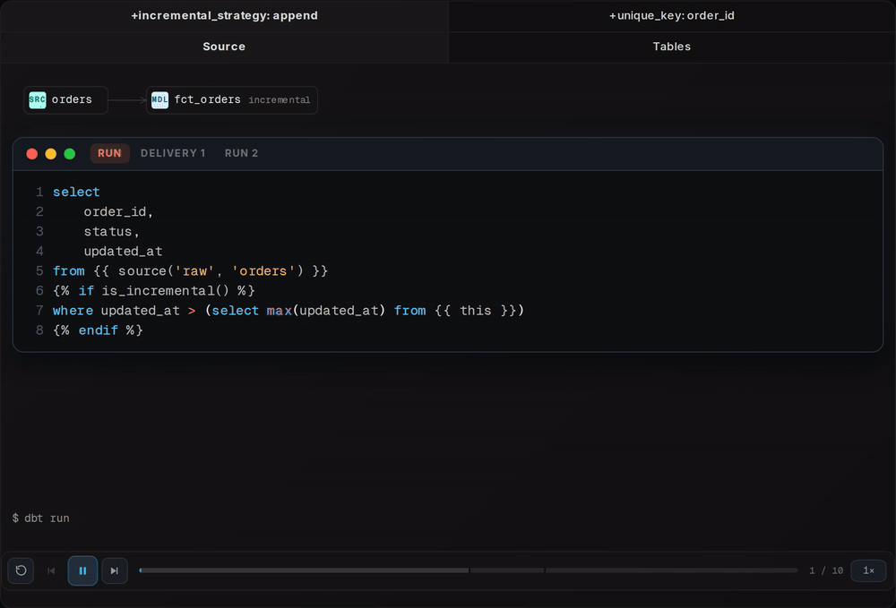
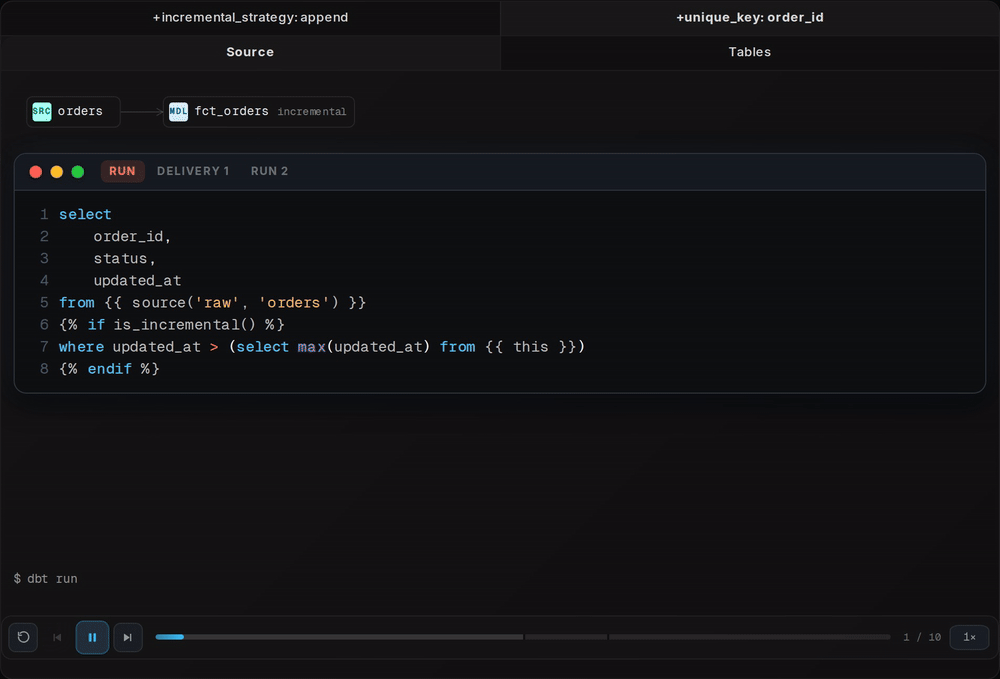

Intermediate·[](https://www.getdbt.com/)·20 min · 8 challenges

# Incremental Models: Intermediate

A DoorDash order moves from placed to picked up to delivered, and each change lands in an orders feed as a new version of the same order_id. Tonight an incremental fct_orders model loads them. Appended, that order counts 3 times in the day's revenue. Merged on its key, it counts once, carrying its latest status.


<br>

---

## unique_key and Merge

### Append sends a changed row twice

The beginner lesson's model filtered the source to rows with `updated_at` later than the latest `updated_at` already in the table, and dbt inserted whatever came back. That holds while each row arrives once and never changes. An order changes. Order 1002 loads on March 1 with status placed, ships on March 2, and the source overwrites its row with status shipped and a March 2 `updated_at`. The filter admits the row a second time, and the insert puts it beside the March 1 version. The table now holds 2 rows for 1 order, and a sum of `amount` counts that order twice.

| order_id | status | amount | updated_at |
| --- | --- | --- | --- |
| 1001 | placed | 40 | 2026-03-01 09:00 |
| 1002 | placed | 25 | 2026-03-01 10:00 |
| 1003 | shipped | 90 | 2026-03-01 11:00 |
| 1004 | placed | 15 | 2026-03-02 08:00 |
| 1002 | shipped | 25 | 2026-03-02 09:00 |

*The target after the second run of an append model: 5 rows for 4 orders, and order 1002 twice.*


<br>

### unique_key tells dbt which row is which

The unique_key config names the column that identifies a row across runs. With it set, dbt stops treating the batch as rows to add and starts treating it as rows to reconcile: a batch row whose key already exists in the table replaces that row, and a batch row with a new key is inserted. The incremental_strategy config says how the reconciling happens. Set it to merge and dbt does it with 1 statement.

```sql
{{ config(
    materialized='incremental',
    unique_key='order_id',
    incremental_strategy='merge'
) }}

select
    order_id,
    status,
    amount,
    updated_at
from {{ source('raw', 'orders') }}

where updated_at > (select max(updated_at) from {{ this }})

```

On the second run dbt does 2 things. It renders the SELECT with the `is_incremental()` block in place, runs it, and writes the result to a temporary table that holds only the batch: here orders 1002 and 1004. Then it sends 1 merge statement that joins the temporary table to the target on `order_id` and acts on each join result.

> The merge, clause by clause
>
> - MERGE INTO the target table USING the temporary batch table
> - ON target.order_id = batch.order_id
> - WHEN MATCHED THEN UPDATE SET every column of the target row from the batch row
> - WHEN NOT MATCHED THEN INSERT the batch row with all its columns

Order 1002 matches, so its status becomes shipped and its `updated_at` moves to March 2, in the row it already had. Order 1004 matches nothing and is inserted. Orders 1001 and 1003 sit outside the batch, and the statement never reads or writes them. The table ends with 4 rows for 4 orders, and the sum of `amount` is right again.

| order_id | status | amount | updated_at |
| --- | --- | --- | --- |
| 1001 | placed | 40 | 2026-03-01 09:00 |
| 1002 | shipped | 25 | 2026-03-02 09:00 |
| 1003 | shipped | 90 | 2026-03-01 11:00 |
| 1004 | placed | 15 | 2026-03-02 08:00 |

**+incremental_strategy: append**



**+unique_key: order_id**



*$ dbt run*


<br>

### Replacing some columns and keeping others

A match replaces every column by default. Some columns should survive a match. A `first_seen_at` column, stamped when the order first appeared, would be reset to the batch's value on every update and stop meaning what its name says. `merge_update_columns` lists the columns a match may change, and `merge_exclude_columns` lists the ones it may not; a model sets one or the other. A column outside the update list keeps the value the target already holds, while the insert branch still writes every column for a new key, so a new order gets its `first_seen_at` and an updated order keeps its old one.

```sql
{{ config(
    materialized='incremental',
    unique_key='order_id',
    incremental_strategy='merge',
    merge_exclude_columns=['first_seen_at']
) }}

select
    order_id,
    status,
    amount,
    updated_at,
    loaded_at as first_seen_at
from {{ source('raw', 'orders') }}

where updated_at > (select max(updated_at) from {{ this }})

```


<br>

### Keys of more than one column

A grain of one order line needs both order_id and line_number to name a row, and unique_key takes a list: unique_key=['order_id', 'line_number']. dbt matches on every listed column, so a batch row updates the target row that agrees with it on all of them. The key has to hold: if 2 target rows share the same key values, 1 batch row matches both and the merge updates both. The built-in unique test checks 1 column, so a compound key is tested with unique_combination_of_columns from dbt_utils, which fails when any combination of the listed columns appears in more than 1 row, and checks the assumption after every build.

```sql
models:
  - name: fct_order_lines
    data_tests:
      - dbt_utils.unique_combination_of_columns:
          arguments:
            combination_of_columns:
              - order_id
              - line_number
```

> **TIP**
>
> unique_key says which target row a batch row stands for. It does not deduplicate the batch and it does not filter the source: the WHERE under is_incremental() still decides which rows reach the merge at all, and a row the filter skips never updates anything.


<br>

---

## Choosing a Strategy

### Four ways to change the target

Every incremental run produces the same batch, the rows the compiled SELECT returns, and the strategy decides what dbt does with that batch. The 4 strategies differ in which target rows they touch, what they need configured, and what happens when a row shows up a second time. Hold one batch in mind through this section: order 1002, changed, and order 1004, new, against a target holding 1001, 1002 and 1003.

| Strategy | Target rows it touches | Needs | A re-sent row |
| --- | --- | --- | --- |
| append | none; the batch is inserted | nothing | lands as a second row |
| merge | rows whose key is in the batch | unique_key | replaces its matching row |
| delete+insert | rows whose key is in the batch | unique_key | is deleted, then inserted |
| insert_overwrite | every row in a partition the batch touches | partition_by | its whole partition is rebuilt from the batch |

#### append

`append` inserts the batch with 1 INSERT and stops, without a key and without matching anything against the target. It fits rows that are final the moment they exist, a page view, a sensor reading, a login. For orders it produces the duplicate from the previous section, so append belongs only where the WHERE guarantees each row qualifies once. It is the cheapest strategy because the write itself reads no target rows: the filter's `max(updated_at)` still queries the target, but nothing joins the batch to it and nothing is deleted.

#### merge

`merge` matches on `unique_key` and updates or inserts in 1 statement. Target rows outside the batch are never read or written. It is the strategy for rows that change, and the only one that can update some columns of a row while leaving the others as they were.

#### delete+insert

`delete+insert` reaches the same end state as a full-row merge with 2 statements. The first deletes every target row whose key appears in the batch; the second inserts the batch. For the example it deletes the March 1 version of 1002 and inserts 1002 and 1004. It exists because not every warehouse runs a merge statement, and on some that do, a delete followed by an insert finishes sooner than a merge over a wide table. Two consequences follow from the 2 statements. There is no update branch, so a column the batch does not carry cannot be kept, and `merge_update_columns` has no effect. And a reader of the table between the delete and the insert sees the keyed rows gone, unless the adapter wraps both statements in 1 transaction.

```sql
delete from "analytics"."fct_orders"
where order_id in (
    select
        order_id
    from "fct_orders__dbt_tmp"
)
```

```sql
insert into "analytics"."fct_orders"
select
    order_id,
    status,
    amount,
    updated_at
from "fct_orders__dbt_tmp"
```

#### insert_overwrite

`insert_overwrite` works on partitions rather than keys. The model declares `partition_by`, say the order date, and dbt finds which partitions the batch holds rows for, drops every row in those partitions, and inserts the batch. The batch must therefore carry the entire partition. If it holds only the changed row 1002 for March 1, the March 1 partition is rebuilt from that single row and orders 1001 and 1003 vanish. So the WHERE under `is_incremental()` selects whole days rather than changed rows, and the strategy pays off where the source reloads a day's rows together and the warehouse stores the table partitioned by that day.

Whole days come from a filter that compares days with >=: where order_date >= (select max(order_date) from {{ this }}). Say a target's newest partition is March 2 and the source now holds 6,000 orders for March 2 and 4,000 for March 3. The batch carries all 10,000, and dbt rebuilds both partitions whole. With >, the batch would hold March 3 alone, and the orders added to March 2 since the last run would never reach the table. The newest day is the one still filling up, so every run reloads it in full.

| Strategy | Rows after the run | Row for 1002 | Why |
| --- | --- | --- | --- |
| append | 5 | 2 versions | no matching |
| merge | 4 | March 2 version | matched on key, updated in place |
| delete+insert | 4 | March 2 version | deleted, then inserted from the batch |
| insert_overwrite | 4 | March 1 version | the batch reloaded March 2 only; 1002 sits in March 1 |

*The last row assumes the overwrite model filters on order date from March 2 onward. The change to 1002 reaches the table only when its partition is reloaded.*

> Which one, in order of questions
>
> - Rows never change once they exist, and the filter admits each once: append
> - Rows change, and some columns must survive an update: merge
> - Rows change, whole rows replace, and the warehouse has no merge: delete+insert
> - The source reloads whole days and the table is partitioned by day: insert_overwrite

*Each adapter supports a subset of the 4 and picks its own default. Set incremental_strategy in every incremental model, so the file says what the run does instead of inheriting it from whatever adapter the project happens to use.*


<br>

---

## Late-Arriving Rows

### The filter that loses rows

The incremental WHERE compares a column of the source to that column's maximum in the target. So far that column has been `updated_at`, the moment the event happened. A row's event time and the moment it reaches the source are 2 different times, and the gap between them decides whether the filter ever sees the row. A delivery completes at 09:10, the courier's phone is out of coverage, and the event reaches the source at 13:40. The model runs at 12:00, and by then the target's max `updated_at` is 11:30. The 14:00 run compares the row's 09:10 against 11:30, the row fails `>`, and no later run looks at it either, because the max only moves forward.

| Row | updated_at | Reaches source | Run at 12:00 | Run at 14:00 |
| --- | --- | --- | --- | --- |
| 2001 delivered | 09:10 | 09:11 | loaded | already loaded |
| 2002 delivered | 11:30 | 11:31 | loaded | already loaded |
| 2003 delivered | 09:10 | 13:40 | not in source yet | 09:10 > 11:30 is false, skipped for good |


<br>

### Filter on when a row arrived

If the source stamps each row with the moment it was loaded, say `loaded_at`, filter on that instead. An event that is late by `updated_at` is on time by `loaded_at`, because `loaded_at` is stamped when the row arrives. Order 2003 carries a `loaded_at` of 13:40, which beats the target's max of 11:31, and the 14:00 run picks it up. Its `updated_at` still reads 09:10 for anyone computing how long the delivery took.

```sql
{{ config(
    materialized='incremental',
    unique_key='order_id',
    incremental_strategy='merge'
) }}

select
    order_id,
    status,
    updated_at,
    loaded_at
from {{ source('raw', 'deliveries') }}

where loaded_at > (select max(loaded_at) from {{ this }})

```

This is the fix to prefer, and it needs 2 things: a load timestamp in the source, and that column kept in the model, so `{{ this }}` has a maximum to compare against. Many sources carry no such column, and a source that is a copy of another system's table usually carries only the event time that system recorded.


<br>

### Reach back with a lookback window

Without a load timestamp, widen the filter. Instead of taking rows later than the max, take rows later than the max minus a window, 3 days here. Every run reprocesses the last 3 days of rows, and a row whose event time is up to 3 days behind the target's max still passes. The reprocessed rows are rows the target already holds, so the model needs `unique_key` and a strategy that replaces by key. With `append`, every run would insert 3 days of rows a second time.

```sql
{{ config(
    materialized='incremental',
    unique_key='order_id',
    incremental_strategy='merge'
) }}

select
    order_id,
    status,
    updated_at
from {{ source('raw', 'deliveries') }}

where updated_at > (
    select
        {{ dbt.dateadd('day', -var('lookback_days', 3), 'max(updated_at)') }}
    from {{ this }}
)

```

```sql
SELECT
  order_id,
  status,
  updated_at
FROM "raw"."deliveries"
WHERE updated_at > (
  SELECT
    DATE_ADD('day', - 3, MAX(updated_at))
  FROM "analytics"."fct_deliveries"
)
```

`dbt.dateadd` is a macro built into dbt that writes date arithmetic in the warehouse's own syntax; its second argument is the number of days, negative to step back. The var lets one command reach further back without editing the file: `dbt run --vars '{lookback_days: 30}'` reprocesses a month. The window has a price and an edge. The price is volume: a table that takes 2,000,000 rows a day merges 6,000,000 rows on every run with a 3-day window, whether or not any of them changed. The edge is the row beyond it: a row 4 days late still misses a 3-day window, and after that only a full refresh catches it. Size the window from how late rows have been measured to arrive, and keep the full refresh for the rows that beat it.

| Row | updated_at | Reached the source | 3-day window |
| --- | --- | --- | --- |
| 3001 | 2026-03-05 08:00 | 2026-03-05 08:01 | reprocessed, unchanged |
| 3002 | 2026-03-04 16:00 | 2026-03-05 13:00 | caught, 1 day late |
| 3003 | 2026-03-01 09:00 | 2026-03-05 13:00 | missed, 4 days late |

*The 14:00 run on March 5. The target's max updated_at is 2026-03-05 11:30, so the filter takes every row after 2026-03-02 11:30.*

Row 3001 was loaded on an earlier run and comes through again unchanged; the merge rewrites it with the values it already had, and that rewrite is the volume the window costs. The late row the window exists for is 3002, and it lands as an insert. Row 3003 is older than the window's start, so it stays out of this run and every run after, the same way 2003 stayed out of the plain filter.

| ✓ Do | ✗ Don't |
| --- | --- |
| • Filter on a load timestamp when the source carries one<br><br>• Pair a lookback window with unique_key and a replacing strategy<br><br>• Size the window from how late rows have been seen to arrive | • Filter on event time alone and assume nothing arrives late<br><br>• Add a lookback window to an append model<br><br>• Widen the window instead of asking why rows arrive late |


<br>

---

## Duplicate Keys in One Batch

### Two versions of one key in the same batch

The merge in the first section relied on the batch holding each key once. The source makes no such promise. Order 1002 is placed at 09:00 and ships at 14:00 on the same day, the source keeps both rows as a change log rather than overwriting, and the nightly batch holds 2 rows for 1002. Now the strategy has to reconcile 2 batch rows against 1 target row, and each strategy does something different with that.

| order_id | status | amount | updated_at |
| --- | --- | --- | --- |
| 1002 | placed | 25 | 2026-03-02 09:00 |
| 1002 | shipped | 25 | 2026-03-02 14:00 |
| 1004 | placed | 15 | 2026-03-02 08:00 |

*Tonight's batch: 3 rows, 2 keys.*

| Strategy | What the run does | Target after |
| --- | --- | --- |
| append | inserts all 3 | 1002 has 3 rows |
| delete+insert | deletes the old 1002, inserts both batch versions | 1002 has 2 rows |
| insert_overwrite | rebuilds the March 2 partition with both versions | 1002 has 2 rows |
| merge, key already in the target | 2 batch rows match 1 target row, which the warehouse rejects | unchanged, run fails |
| merge, key new to the target | neither row matches, so both are inserted | the key has 2 rows, run succeeds |

The last row needs no unusual data. Order 1006 is placed at 10:00 on March 2 and cancelled at 10:20, and both versions reach tonight's batch. The target has never held 1006, so neither row finds a match, the NOT MATCHED branch fires once for each, and the merge inserts 1006 twice. The run reports success. Whether a doubled key fails the merge depends only on whether the target already held that key.

A failed merge reads as the worst row of that table and is the best one: the table is unchanged and the log says why. Every other row finishes green and leaves a duplicate behind, and the duplicate lasts. A later batch row for 1006 matches both target rows, and the merge updates both, so the 2 copies take the same values and stay 2 copies on every run after. No later run fails because of them. A `unique` test on `order_id` is what reveals the duplicate once it exists; the model is where it gets prevented.


<br>

### Keep the latest row per key

Dedupe inside the batch, after the incremental filter, so the ranking runs only over the rows in play. Number each key's rows by `updated_at` descending and keep rank 1.

```sql
{{ config(
    materialized='incremental',
    unique_key='order_id',
    incremental_strategy='merge'
) }}

with new_rows as (
    select
        order_id,
        status,
        amount,
        updated_at
    from {{ source('raw', 'orders') }}
    
    where updated_at > (select max(updated_at) from {{ this }})
    
),

ranked as (
    select
        order_id,
        status,
        amount,
        updated_at,
        row_number() over (
            partition by order_id
            order by updated_at desc
        ) as rn
    from new_rows
)

select
    order_id,
    status,
    amount,
    updated_at
from ranked
where rn = 1
```

On tonight's batch, `ranked` gives the 14:00 row of 1002 rank 1 and the 09:00 row rank 2, and the final SELECT keeps 1 row per key. The merge now matches 1 batch row to 1 target row, updates 1002 to shipped, inserts 1004, and the 09:00 version never reaches the target. Nothing is lost that this table would have kept: a full-row merge ends with the latest version either way, and the 09:00 version was only ever going to be overwritten. If the intermediate versions matter, a snapshot of the source keeps them, and the fact table keeps the latest.

The order of the CTEs is deliberate. If `ranked` ran over the whole source and `new_rows` filtered afterwards, every run would rank every order ever placed to find the few that changed, which is the full scan the incremental model exists to avoid. Ties need a tiebreak too: 2 rows with the same `updated_at` get their ranks in arbitrary order, so add a second column to the `order by`, a load sequence or a load time, when the source offers one.

```sql
SELECT
  order_id,
  status,
  updated_at,
  ROW_NUMBER() OVER (
    PARTITION BY order_id
    ORDER BY updated_at DESC, load_seq DESC
  ) AS rn
FROM new_rows
```

> Where duplicate keys in a batch come from
>
> - A change log source that keeps every version of a row
> - An extract that overlaps with the previous extract by a few minutes
> - A join in the model that fans out on a one-to-many relation
> - A source load that was retried after a timeout and wrote the same rows twice

> **TIP**
>
> A merge error naming a key means the batch holds that key more than once and the target already has a row for it, so look in the batch. A duplicate already in the target raises no error: each later batch row updates both copies, and only a `unique` test on the target finds it.


<br>

---

## New Columns Mid-Life

### The table keeps the columns of its first run

An incremental table is created once, on the first run, with the columns the SELECT had that day. Later runs add rows to that table and never recreate it. When the SELECT changes shape, the run has to decide whether the table changes with it, and the `on_schema_change` config holds that decision. Its default, `ignore`, leaves the table as it is, and what that means depends on the direction of the change.

Add a column. The model gains `delivery_zone`. On the next incremental run dbt builds the temporary batch table from the SELECT, so the batch has 5 columns, then writes to the target using the target's own column list, which has 4. `delivery_zone` is dropped at the door. The run succeeds, the target still has 4 columns, and a query for the new column fails. The first sign is a downstream model that cannot find the column its author was told about.

Remove a column. The model drops `amount`. The batch has 3 columns, and dbt still writes to the target by the target's 4-column list. The statement asks the batch for `amount`, the batch has no such column, and the warehouse raises an error. Under `ignore`, adding a column is silent and removing one is a database error, and neither is the behaviour anyone wanted.


<br>

### The four settings

| on_schema_change | Model gains a column | Model loses a column | A column changes type |
| --- | --- | --- | --- |
| ignore (default) | batch column dropped; target unchanged | run fails: the write asks the batch for a column it lacks | the write sends the batch's values into the old column; the warehouse decides if they convert |
| append_new_columns | column added to the target; old rows hold null | target keeps the column; new rows hold null in it | no change to the target column |
| sync_all_columns | column added; old rows hold null | column dropped from the target with every value it held | target column altered where the warehouse allows it |
| fail | run stops before any write, naming the columns that differ | same | same |

`append_new_columns` is the setting most tables want: the target keeps up with additions, and a column the model stops selecting stays in place holding null for new rows, which breaks nothing downstream. `sync_all_columns` deletes the target's column along with every value in it, so a column dropped by mistake takes its history with it, and a full refresh from a source that still has the data is the only way back. `fail` suits a table other teams build on: the run stops before writing anything, and a person decides what the change means.

```sql
{{ config(
    materialized='incremental',
    unique_key='order_id',
    incremental_strategy='merge',
    on_schema_change='append_new_columns'
) }}

select
    order_id,
    status,
    amount,
    updated_at,
    delivery_zone
from {{ source('raw', 'orders') }}

where updated_at > (select max(updated_at) from {{ this }})

```


<br>

### The old rows do not fill themselves in

Whichever setting adds the column, dbt adds it with an ALTER TABLE before the write, and an added column holds null in every row already there. The batch rows carry `delivery_zone`; the 40,000,000 rows loaded before today carry nothing. A `not_null` test on the new column fails on every run until those rows are filled, and nothing in an incremental run fills them, because the filter never selects them again. A `--full-refresh` rebuilds the table from the SELECT and fills the column for every row the source still holds. So the change costs one full rebuild, scheduled for a quiet hour when the table is large.

| order_id | status | amount | updated_at | delivery_zone |
| --- | --- | --- | --- | --- |
| 1001 | placed | 40 | 2026-03-01 09:00 | null |
| 1002 | shipped | 25 | 2026-03-02 09:00 | null |
| 1003 | shipped | 90 | 2026-03-01 11:00 | null |
| 1004 | placed | 15 | 2026-03-02 08:00 | null |
| 1005 | placed | 30 | 2026-03-03 10:00 | north |

*The target after the first run with the new column under append_new_columns: only the batch row carries a zone.*

> A column change, in order
>
> - Set on_schema_change in the model before the change ships, since the default only reports the removal
> - Expect null in the new column for every row loaded before the change
> - Decide between a full refresh to fill it and a test that tolerates the null
> - A rename is a removal plus an addition: the old column's values do not move to the new one


<br>

---

## Putting It All Together

DoorDash's deliveries fact table is incremental over a change-log source. A delivery produces a row per status change, a courier's phone reports some changes hours late, and this quarter the model gains a delivery zone column for the dispatch team's dashboards.

- The change log sends every version of a delivery, so the model ranks each delivery's rows by event time inside the batch and keeps 1 before the merge sees them.
- The late reports fail a plain event-time filter, so the model reaches back 1 day on every run, and unique_key with merge turns the reprocessed rows into updates instead of duplicates.
- The lookback reprocesses individual rows, so a key-replacing strategy, merge or delete+insert, fits it; append would insert yesterday's deliveries again every night.
- The zone column ships with on_schema_change set to append_new_columns, so the table gains it without a failed run, and a scheduled full refresh fills it for the deliveries that came before.


<br>

---

## Key Takeaways

- unique_key names the target row a batch row stands for; a merge updates the matched row and inserts the rest, and merge_update_columns limits what a match overwrites.
- append only inserts, merge and delete+insert replace by key, and insert_overwrite rebuilds whole partitions from whatever the batch carries.
- A filter on event time loses rows that reach the source late; filter on a load timestamp, or reprocess a lookback window under a key.
- A batch holding one key twice fails a merge when the target already has that key, and inserts it twice when it does not; the other strategies duplicate silently. Rank by time inside the batch and keep rank 1.
- on_schema_change decides whether the target follows the SQL; an added column is null in every old row until a full refresh fills it.

[](https://www.getdbt.com/)

Official dbt resources

"dbt enables data analysts and engineers to transform their data using the same practices that software engineers use to build applications." [github.com/dbt-labs/dbt-core](https://github.com/dbt-labs/dbt-core)

[Documentation](https://docs.getdbt.com/)[Get started](https://docs.getdbt.com/docs/get-started-dbt)[Source](https://github.com/dbt-labs/dbt-core)

dbt and the dbt logo are trademarks of dbt Labs, LLC.
