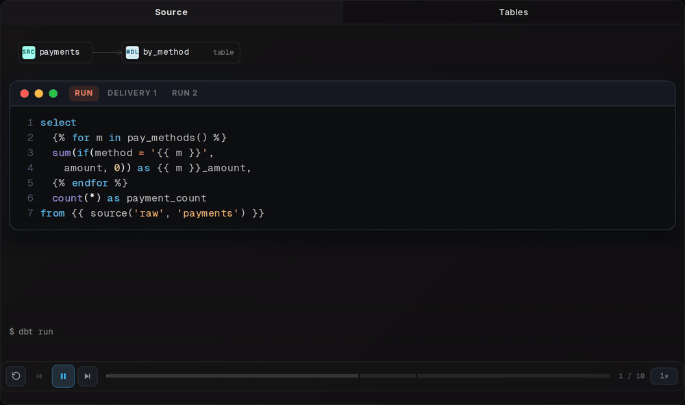
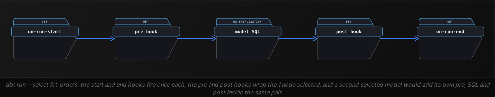

Advanced·[](https://www.getdbt.com/)·20 min · 8 challenges

# Jinja and Macros: Advanced

GitLab runs its analytics on a public dbt project. An engineer there adds a macro that reads the list of subscription plans from the warehouse and emits one revenue column per plan. CI's `dbt parse` passes with 0 plan columns. The nightly build produces 6. The model file is identical in both runs. Where did the second shape come from?


<br>

---

## Parse Time vs Run Time

Every dbt command begins by reading the project. dbt opens each file under `models/`, `macros/`, `seeds/`, `snapshots/` and `tests/` and renders the Jinja in every model; each `ref()` and `source()` the render touches gets written down as an edge. That pass is the parse, and its product is the manifest, which records every node with its config and the nodes it depends on. The warehouse stays unreachable throughout, because dbt cannot schedule a single statement until the graph exists.

Execution starts once the manifest is complete. dbt opens a connection and, for each selected node in graph order, renders the model's Jinja a second time, now with the connection live, and sends the result as SQL. The 2 renders see a different value in one variable, `execute`: `False` during the parse, `True` during execution. Any Jinja that needs an answer from the warehouse (a list of values, a column list, a row count) has to test that variable before it asks.

| Phase | Commands that end here | Connection | execute | run_query() returns |
| --- | --- | --- | --- | --- |
| Parse | `dbt parse`, `dbt ls` | none | `False` | `None` |
| Execution | `dbt compile`, `dbt run`, `dbt test`, `dbt build`, `dbt snapshot`, `dbt run-operation` | open | `True` | a result table |

The split explains 2 things people hit early. `dbt ls` on a project of 2,000 models returns in seconds without opening a connection, because listing needs only the manifest. And `dbt compile` is slower than its name suggests: it connects, because compiling means rendering with `execute` set to `True`, and every warehouse query in the project's Jinja fires. `dbt parse` never connects. It catches syntax errors in Jinja or YAML, and graph errors such as a `ref()` to a model that does not exist. It cannot see what fails only with `execute` on, such as a missing table or a column list a query returns, so in CI it is a necessary check and not a sufficient one.


<br>

### 2 renders of one file

```sql

  

  


select
    order_id,
    total_cents
from {{ ref('stg_orders') }}
```

`dbt run` on this model prints both messages: the parsing line first, while the manifest is being assembled, then the rendering line when the node's turn comes. `dbt parse` prints only the first. Both branches leave the SQL untouched, which is the pattern to copy: a branch on `execute` changes what Jinja computes, never what the SQL means. The second render is the one that reaches `target/compiled/`, so the file there always shows the `True` branch, and a failure that happens only offline never appears in it.

*dbt saves the parse in target/partial_parse.msgpack and reparses only files that changed, so the parsing line shows on a first parse or after an edit to the model. dbt parse --no-partial-parse forces every file through again.*


<br>

### What each phase can see

| Available during the parse | Needs the execution phase |
| --- | --- |
| `ref()`, `source()`, `this`: relation names, whether or not the table exists yet | `run_query()`: a result table, or `None` offline |
| `target.name`, `target.schema` | `adapter.get_columns_in_relation()` |
| `var()`, `env_var()`, `config()` | `load_result()` after a `statement` block |
| `flags.WHICH`: the command's name, such as `run` or `build` | `results` inside an `on-run-end` hook |

`flags.WHICH` carries the command's name in both phases, so a macro can tell `test` from `run` and skip a grant during a test-only invocation. `target.name` works the same way and is the usual switch between dev and prod behaviour. Neither asks the warehouse anything, so neither needs `execute`. The macro below does need it, because it reads rows, and it shows where each line has to sit.

```sql

  
  
  
    
    
  
  {{ return(regions) }}

```

Line 2 runs in both phases and is what draws the edge from the calling model to `dim_region`. Moved inside the branch, it would run only under execution, after dbt had already fixed the build order, and the caller could build before `dim_region` had. Line 5 runs once, with a connection. The caller receives a list in both phases, so a `for` loop over the result renders cleanly offline and the parse completes. `run_query` itself is the subject of the next section.

> 3 rules for Jinja that asks the warehouse
>
> - Put the call behind ``, or test the result for `None` before reading it.
> - Give the parse branch a value of the same type the run branch produces: an empty list, an empty string, a 0.
> - Keep every `ref()` and `source()` outside the branch. A `ref()` the parse never renders draws no edge, and the model can run before its upstream exists.


<br>

---

## Querying from Jinja

`run_query(sql)` sends a query over the open connection and hands back the result as a table object. `result.columns[0].values()` gives the first column as a list and `result.rows` iterates rows; `result.print_table()` is for debugging, since it writes the whole thing to the log. During the parse it returns `None`, which is the reason every call lives behind `execute`. The query fires when the calling model compiles, and under `dbt run` a node compiles right before it runs, after every model it `ref()`s has been built. A model can therefore read a table that an upstream model finished 10 seconds earlier in the same invocation.

`run_query` wraps an older pair: a `` block that holds the SQL, then `load_result('methods')` to fetch what it returned. Older projects and packages use the pair; both forms are the same round trip, and `load_result` returns nothing useful offline either.


<br>

### One column per value the data holds

A payments feed carries a `method` column that holds card and bank today, and later whatever the payments team launches next. The finance mart wants one amount column per method. Typing `card_amount` and `bank_amount` by hand means a code change each time a method appears. Instead, the macro below asks the warehouse which methods exist, and the model writes its column list from the answer. The animation runs that model twice, and a wallet payment lands between the runs.

```sql

  
    select distinct method
    from {{ source('raw', 'payments') }}
    order by 1
  
  
    {{ return(run_query(q).columns[0].values()) }}
  
  {{ return([]) }}

```



*$ dbt run*

Read the second compiled SQL against the first. Nothing in `models/` changed, and the mart has a new column. The `` in `pay_methods()` is what lets `dbt parse` finish: offline, the macro returns an empty list, the `for` loop emits nothing, and the model still parses as a valid SELECT. The `` block sits above the branch, so its `source()` renders in both phases and the edge to `raw.payments` is drawn; only `run_query` waits for the connection. Under `dbt compile` in a schema where `raw.payments` does not exist yet, that call fails with a missing-table error, since compile renders with `execute` on.


<br>

### A shape that moves without a commit

A column list that follows the data also breaks whatever depends on it. A downstream model that selects `wallet_amount` by name works only once a wallet payment exists, and breaks the day the method is retired and its rows deleted. A `not_null` test declared on `card_amount` in YAML fails with an unknown-column error if card payments stop. A model contract (Models: Advanced) freezes the column list and rejects the third column. So a data-driven shape belongs at the edge of the graph, where nothing downstream names its columns, or it should take its list from something you control.

| ✓ List from the raw data | ✗ List from a seed |
| --- | --- |
| • Any new value appears as a column on the next run<br><br>• A retired value drops its column, and whatever named it breaks<br><br>• Column order follows the query's order by and nothing else | • A new value is a row added to the seed: a commit and a review<br><br>• A column exists even in a week with 0 rows of that value, filled with zeros<br><br>• The seed is a ref(), so lineage shows where the list came from |


<br>

### Columns, not values

`adapter.get_columns_in_relation(relation)` asks the warehouse for a relation's columns and returns objects with `.name` and `.data_type`. It is how a model selects every column of its upstream except the load metadata, without listing 40 names. The parse branch here falls back to `*`, which keeps the offline render a valid SELECT. `dbt_utils.star()` does the same with the guards included, and `dbt_utils.get_column_values()` is the packaged form of the pivot above.

```sql



  
    
      
    
  


select
    {{ cols | join(', ') if cols else '*' }}
from {{ ref('stg_events') }}
```

Each of these queries is a round trip issued while the node compiles, one at a time. A project with 40 such models adds 40 queries to every `dbt run` and every `dbt compile`, and each result sits in memory, so `run_query` over a fact table is a mistake even when it works. Keep the questions to metadata-sized answers: distinct values of a low-cardinality column, a column list, a single max date.

> **TIP**
>
> `dbt compile`, then read `target/compiled/.../by_method.sql`, is the quickest way to see what a data-driven model produced today. Keep that file from each production run and a column that vanished has a date attached to it.


<br>

---

## Hooks and Operations

A model is a SELECT with a materialization around it. Some SQL fits neither: a grant on the table once it exists, a row written to an audit table when the run ends, a schema created before anything else, a one-off repair. dbt runs that SQL from 5 places: 4 hooks tied to moments in a build, and an operation that runs apart from one. None of them is a model's SELECT, and each sees a different set of things.

| Hook | Declared in | Runs | Can see |
| --- | --- | --- | --- |
| `pre_hook` | the model's `config()` or its YAML | before the model's statements, once per model | `this`, `target`, the model's `config` |
| `post_hook` | the model's `config()` or its YAML | after the model's statements succeed | the same, and the table now exists |
| `on-run-start` | `dbt_project.yml` | once per invocation, after the parse, before the first node | `target`, `var()`; no node has run |
| `on-run-end` | `dbt_project.yml` | once per invocation, after the last node, even when nodes failed | `results`: one record per node, with `status` and `execution_time` |



Model hooks run on the model's connection and as part of the model's node: a `pre_hook` that errors fails the node, and its children skip exactly as they would behind a failed test (Testing: Beginner). The choice among the 5 is about timing. Use a model hook for work tied to one table and its build, a project hook for work tied to the invocation, and an operation, covered below, for work a person decides to run on demand.


<br>

### post_hook: SQL that needs the table to exist

```sql
{{ config(
    materialized='table',
    post_hook="grant select on {{ this }} to role reporting"
) }}

select
    order_id,
    customer_id,
    total_cents
from {{ ref('stg_orders') }}
```

The hook string is Jinja too, rendered when the hook runs, so `{{ this }}` resolves to the table the model produced. Several hooks go in a list and run in that order. A hook can also be a macro call that returns SQL, which is how one grant reaches every mart from `dbt_project.yml`, where a `+post-hook` under a folder applies to every model beneath it. If the model's own statements fail, its post hook never runs.

```sql
models:
  shop:
    marts:
      +post-hook: "{{ grant_reporting(this) }}"
```


<br>

### on-run-end: a record of the whole run

```sql
on-run-end:
  - "{{ record_run_results(results) }}"
```

```sql

  
    insert into audit.model_runs
    values
    
        (
            '{{ invocation_id }}',
            '{{ r.node.name }}',
            '{{ r.status }}',
            {{ r.execution_time }}
        ){{ ',' if not loop.last }}
    
  
    select 1
  

```

`results` holds one record per node dbt attempted: `r.node.name`, `r.status` (`success`, `error` or `skipped` for a model; `pass`, `fail` or `warn` for a test), `r.execution_time` in seconds, and `r.message`. `invocation_id` is the same value across every row of one run, which is what joins the audit rows back to a single invocation. The macro renders one `insert` with a row per node, and the hook sends that text as its statement. Offline, or when no node ran, it renders `select 1` instead, because an `insert` with no rows is invalid SQL.


<br>

### run-operation: a macro as the whole job

`dbt run-operation create_audit_table` calls the macro with `execute` set to `True`, after parsing the project and opening a connection. The invocation builds no node, so nothing is materialized and nothing enters the lineage graph. The macro has to send its own SQL with `run_query` or inside a `statement` block, because a string it returns goes nowhere. Arguments arrive through `--args '{days: 7}'` as a YAML mapping. It is the home for maintenance: creating a schema, dropping the tables a renamed model left behind (Models: Advanced), a one-time grant, or a repair statement someone would otherwise paste into a console and never record.

```sql

  
    create table if not exists audit.model_runs (
        invocation_id varchar,
        model_name varchar,
        status varchar,
        seconds double
    )
  
  
  {{ log("audit.model_runs is ready", info=True) }}

```

> What hooks do not do
>
> - Appear in `target/compiled/`. Their SQL goes to the log; `dbt --debug run` prints every statement with its timing.
> - Join the graph. A hook that reads a table another model builds has no edge to it, so put the hook on the model that reads, where the order is guaranteed.
> - Wait for `--select`. `on-run-start` and `on-run-end` fire on every invocation, including one that builds a single model, so keep them cheap.
> - Run after a failure. A model whose SQL errors skips its `post_hook`; `on-run-end` still runs and sees `error` in `results`.

> **TIP**
>
> Write a hook once as a macro and call it from `dbt_project.yml`. The same grant pasted into 60 model files is 60 places to edit when the role is renamed, and 60 chances to miss one.


<br>

---

## Custom Materializations

`materialized='table'` names a macro. When a node's turn comes, dbt hands that macro the compiled SELECT as `sql`, the node as `model` and the relation it should produce as `this`, and the macro decides every statement that follows. The `table` materialization creates a temporary table from the SELECT, renames the existing table out of the way, renames the new one into place, drops the old one and reports what now exists. `view` sends one `create or replace view`. A snapshot is a materialization with the same contract and a longer body, and a project can supply its own.

| Step | Call | Why it is there |
| --- | --- | --- |
| 1 | `load_cached_relation(this)` | learn whether an object exists already, and of which type |
| 2 | `run_hooks(pre_hooks)` | the model's `pre_hook` runs here, under the materialization's control |
| 3 | `statement('main')` around `{{ sql }}` | the one statement that writes data; dbt reports its timing and row count as the node's |
| 4 | drop, rename or swap | make the new object the one `this` names |
| 5 | `run_hooks(post_hooks)` | the model's `post_hook` |
| 6 | `return({'relations': [target_relation]})` | tell dbt what exists, so its relation cache, docs and later `ref()` calls agree |

`statement('main')` is the name dbt watches. The rows affected and the timing it prints for the node come from the statement with that name, and `fetch_result=True` on a statement is what `run_query` uses underneath to read rows back. A materialization may send other statements under other names; only `main` is reported as the model.


<br>

### A materialization of 20 lines

A warehouse that stores tables as files on object storage partitions each table by a column named at creation. The built-in `table` macro never writes that property, and a `post_hook` arrives too late, because the table is already laid out. The wrapping around the SELECT has to change, which is the one job a hook cannot do. Here are the 20 lines of `macros/partitioned_table.sql`, grouped by what each does:

| Line | What it does |
| --- | --- |
| `` | opens the definition; a model selects it by this name |
| `` | the relation the model produces, typed as a table |
| `` | whatever already sits at that name, or `none` |
| `` | the partition columns, read from the model's config |
| `{{ run_hooks(pre_hooks) }}` | the model's `pre_hook` |
| ``, inside `` | drops the old table, if there is one |
| `` around `create table {{ target_relation }} with (partitioned_by = array[...]) as {{ sql }}` | the one statement that writes data, with the partition property in its DDL |
| `{{ run_hooks(post_hooks) }}` | the model's `post_hook` |
| `{{ return({'relations': [target_relation]}) }}` | tells dbt what now exists |
| `` | closes the definition |

```sql
{{ config(
    materialized='partitioned_table',
    partition_by=['dt']
) }}

select
    cast(ordered_at as date) as dt,
    order_id,
    amount_cents
from {{ ref('stg_orders') }}
```

```sql
create table analytics.fct_orders_daily
with (partitioned_by = array['dt'])
as
select
    cast(ordered_at as date) as dt,
    order_id,
    amount_cents
from analytics.stg_orders
```

The model's compiled SELECT in `target/compiled/` looks like any other model's; the `create table ... with (...)` wrapper appears only in `target/run/`, where dbt writes the statements it sent. `config.require()` fails the node when the materialization runs, with a compiler error naming the missing key. `dbt parse` and `dbt compile` never execute a materialization's body, so neither catches it. Notice what this version gives up: it drops the old table before creating the new one, so a reader querying between the 2 statements finds nothing. The built-in `table` avoids that with a temporary relation and a rename. Writing a materialization means paying again for every property the built-in already had.

*default after the name makes the macro apply on any adapter. A second definition with adapter='name' wins on that adapter alone, which is how the built-ins specialize without the model knowing.*

The built-in `table` uses 3 relations: `make_intermediate_relation(target)` for the new table, `make_backup_relation(existing)` for the old one, and the target itself for the name readers use. Create, rename, rename, drop: the gap in which `this` names nothing is a single rename. Copy that shape when a reader may be querying while you build, and the 20 lines above become 30.


<br>

### When writing one is justified

| ✓ Write a materialization when | ✗ Reach for something else when |
| --- | --- |
| • The DDL around the SELECT has to differ: a table property, a storage layout, an object that is neither a table nor a view<br><br>• Which statements run depends on what exists: a found relation takes one path, nothing found takes another<br><br>• The same wrapping belongs to many models and should live in 1 macro rather than in a hook on each | • The work happens after the table exists: a grant, an audit row. That is a post_hook<br><br>• A config already does it. persist_docs, set once in dbt_project.yml, writes model and column descriptions to the warehouse as comments; other needs have configs of their own, among them schema, alias and contract<br><br>• One model needs it. A model-specific pre_hook and post_hook cost 2 lines and no new contract |

Materializations are also the layer with the least help when they break. A wrong `return` value leaves dbt's relation cache out of step with the warehouse, and the next run's drop or rename fails against an object of the wrong type. A missing `run_hooks(post_hooks)` silently drops every `post_hook` in the project for models of that type. Treat a custom materialization as adapter code: a short file, a test model in the project that uses it, and a review by someone who has read the built-in it replaces.

> **TIP**
>
> Before writing one, read the built-in you would replace. It is a macro in the adapter package under `macros/materializations/`. Most custom materializations turn out to be that file with 3 lines changed.


<br>

---

## When Not to Write a Macro

A macro is a jump. The reader of a model sees `{{ net_revenue('orders') }}`, and before knowing which columns it touches they have to find the file under `macros/` and render its branches in their head. SQL has no jumps: the expression sits where it is used. Every macro starts in debt, and it pays the debt off only when the SQL it replaces would have cost more to keep correct across the project.


<br>

### One model, 4 macros

| Line in the model | What it compiles to | What the reader had to open |
| --- | --- | --- |
| `{{ money('subtotal_cents') }}` | `round(subtotal_cents / 100.0, 2)` | `macros/money.sql`, 1 line |
| `{{ safe_pct('refunds_cents', 'subtotal_cents') }}` | `100.0 \* refunds_cents / nullif(subtotal_cents, 0)` | `macros/safe_pct.sql`, 1 line |
| `{{ day_bucket('ordered_at') }}` | `date_trunc('day', ordered_at)` in prod, `date_trunc('hour', ordered_at)` in dev | `macros/day_bucket.sql`, 5 lines, a branch on `target.name` |
| `{{ customer_dims() }}` | 9 columns | `macros/dims.sql`, 40 lines, 3 nested macro calls |

```sql
SELECT
  customer_id,
  ROUND(subtotal_cents / 100.0, 2) AS subtotal,
  ROUND(tax_cents / 100.0, 2) AS tax,
  100.0 * refunds_cents / NULLIF(subtotal_cents, 0) AS refund_pct,
  DATE_TRUNC('day', ordered_at) AS order_day
FROM stg_orders
```

3 of the 4 macros wrap one expression. `money()` saves 3 characters per call and costs a file lookup per reader; `round(x / 100.0, 2)` tells the reader the unit conversion and the precision without leaving the line. `safe_pct()` hides the `nullif`, which is the one thing a reader checking a division wants to see. `day_bucket()` is worse than either, because it compiles differently per target, so the SQL a reviewer reads in dev differs from the SQL production runs. `customer_dims()` is the only one worth keeping: 9 columns repeated across 12 marts that must stay identical.


<br>

### One question for every macro

The question is whether a change to this expression would have to land in several places at once, and whether those places are models in the same project. Repetition on its own does not answer it. `round(x / 100.0, 2)` appears in 30 models and will never change, because cents are cents, so copying it costs nothing. A refund-rate definition that finance amended twice last year, used in 6 marts, is the opposite case, and a macro with the rule in a comment is cheaper than 6 inconsistent fixes. Shapes driven by data (the pivot in Querying from Jinja) and generic tests are macros by nature, because no fixed SQL can express them.

| ✓ Do | ✗ Don't |
| --- | --- |
| • Write a macro when 3 or more models carry the same block and must change together.<br><br>• Write a macro when the SQL's shape depends on data or config, as the pivot did.<br><br>• Write a generic test as a macro; that is what a generic test is.<br><br>• Review a macro change by diffing target/compiled/, where its effect is visible. | • Wrap one function call: nullif(b, 0) reads faster than safe_denominator(b).<br><br>• Pass 5 or more positional arguments; the call site stops saying which is which.<br><br>• Call a macro from a macro from a macro; each hop is another file to open.<br><br>• Rewrite a case expression as  branches; SQL already has control flow. |


<br>

### Costs the project pays past readability

A warehouse error points at a line in `target/compiled/`, and the reader maps it back to a macro call by hand. Searching the repository for `refund_pct` finds no model, because the column name was assembled inside a macro. The static parser from the first section gives up on any model with a macro call, so parse time grows with macro use. A change to a shared macro changes the compiled SQL of every model that calls it, so a one-line edit is a review of 40 models. Each cost is small, and a project of 400 models and 90 macros pays all 4 on every change.

When a macro does stay, its call site should read the way SQL reads. Name it for what it produces, `refund_rate` rather than `calc`, and use keyword arguments so `{{ refund_rate(numerator='refunds_cents', denominator='subtotal_cents') }}` says which is which. Put the business rule in a comment inside the macro, above the SQL, with the date it last changed. Keep it to one level: a macro that calls into `dbt_utils` is fine, and a macro that calls a macro that calls a macro is 3 files for one expression.

> A review of 3 macros
>
> - `pivot_by_method()`: keep. Its columns come from data, and no fixed SQL can write them.
> - `cents_to_dollars()`: inline. One function, one constant, used 30 times, changed 0 times in 3 years.
> - `active_customer_filter()`: keep. A 4-condition `where` that legal redefined twice, used in 8 marts, with the ticket number in its comment.

> **TIP**
>
> Run `dbt compile` and read the model in `target/compiled/` beside the file in `models/`. When the compiled SQL is quicker to understand than the source, the macros subtracted clarity, and the compiled text is the better draft of the model.


<br>

---

## Putting It All Together

A subscription software company closes its monthly books from a dbt project. The revenue mart carries one column per plan, generated from a query over the plans seed, and finance adds a plan by adding a seed row. An on-run-end hook writes each model's status and duration to an audit table that the on-call engineer reads first when the close is late. Mart tables are built by a 30-line custom materialization that sets the storage partition the warehouse needs, with grants left to a post_hook declared once in dbt_project.yml. Last quarter's review deleted 28 one-line macros and left 4.

- The plan columns exist because run_query runs at build time, and the seed behind them is why dbt parse in CI still draws the edge and finishes offline.
- The audit table is populated from results after the last node, so a model that errored still has a row, which is what makes the late close diagnosable.
- The partition property had to be a materialization because it is part of the create table statement; the grant stayed a hook because it needs the table to exist first.
- Of the 4 surviving macros, 2 are business rules that changed in the last year; the others are the pivot and 1 generic test. Everything that wrapped a single function went back to SQL that reads on the line.


<br>

---

## Key Takeaways

- dbt renders every model twice: once offline to build the graph with execute set to False , once per node with a connection and execute set to True .
- run_query and adapter . get_columns_in_relation return nothing useful offline, so they sit behind execute while every ref ( ) and source ( ) stays outside the branch.
- A model whose columns come from data changes shape without a commit; keep it at the edge of the graph or feed it a list from a seed.
- pre_hook and post_hook wrap one model, while on - run - start and on - run - end wrap the invocation. dbt run - operation runs a macro with no node at all.
- A materialization owns every statement around the SELECT and is justified only when the DDL itself has to differ; a hook or a config covers the rest.
- A macro is a jump the reader has to follow, so it is worth a file only when the SQL it replaces must change in several models at once.

[](https://www.getdbt.com/)

Official dbt resources

"dbt enables data analysts and engineers to transform their data using the same practices that software engineers use to build applications." [github.com/dbt-labs/dbt-core](https://github.com/dbt-labs/dbt-core)

[Documentation](https://docs.getdbt.com/)[Get started](https://docs.getdbt.com/docs/get-started-dbt)[Source](https://github.com/dbt-labs/dbt-core)

dbt and the dbt logo are trademarks of dbt Labs, LLC.
