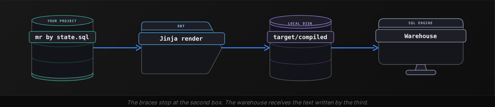

Beginner·[](https://www.getdbt.com/)·20 min · 9 challenges

# Jinja and Macros: Beginner

GitLab's data team runs its warehouse on dbt and publishes the project in its handbook. A mart counts merge requests per state, and the SELECT holds 3 near-identical CASE columns. A 4th state, locked, arrives. One engineer copies the merged column and changes only its alias. The quoted literal is untouched, so locked_mrs quietly counts merged requests. Jinja decides whether that bug can exist at all.


<br>

---

## Jinja Renders First

### 2 readers, 1 file

A model file is written for 2 readers. dbt reads it first. To dbt the file is a template, and every piece of Jinja inside it runs to produce text. The warehouse reads second, and the only thing it receives is that text: plain SQL with no braces left in it. The order never varies. Rendering finishes before a single byte crosses the connection, so the warehouse needs no Jinja interpreter and has none.

You have been writing Jinja since your first model. {{ ref('stg_merge_requests') }} is a Jinja expression that calls a function, and {{ source('raw', 'merge_requests') }} is another. dbt builds both functions in and makes them available inside every model, and each returns text: the fully qualified name of a relation, quoted so the warehouse resolves it without guessing. The call disappears and the name stands where it stood. A function you write yourself in Jinja is called a macro, and a later lesson in this track covers writing one.

```sql
select
    id as merge_request_id,
    project_id,
    state,
    created_at
from {{ source('raw', 'merge_requests') }}
```

```sql
SELECT
  id AS merge_request_id,
  project_id,
  state,
  created_at
FROM analytics."raw"."merge_requests"
```

Only the `from` line changed. The 4 column lines passed through byte for byte, because Jinja treats everything outside its delimiters as text it doesn't understand and does not touch. That indifference is what makes it useful: the renderer cannot tell a SQL keyword from a string literal, so it can write any SQL at all. It also means you can predict the output with a pen: copy the file, replace each expression with its value, and you hold the SQL.

An expression need not call a function at all. {{ 60 \* 24 }} renders to 1440, so a filter written where minutes_open > {{ 60 \* 24 }} reaches the warehouse as where minutes_open > 1440. Jinja did the multiplication, and the query log shows only the product. Whatever runs inside the braces runs in dbt before the warehouse is involved, whether dbt is on your laptop or on the machine that schedules the build.


<br>

### 3 delimiters

| Delimiter | Name | What stays in the SQL |
| --- | --- | --- |
| {{ ... }} | expression | the value it evaluates to, as text |
|  | statement | nothing: it controls what gets rendered |
| {# ... #} | Jinja comment | nothing: the warehouse never sees a trace of it |

An expression prints. A statement acts without printing.  is one, and section 2 covers it along with  and . Each leaves an empty spot where it stood, and that spot keeps its line break, so compiled SQL often opens with blank lines. A Jinja comment vanishes before the SQL is sent. A SQL line comment, the kind that opens with 2 hyphens, is text to Jinja, so it survives rendering, and the warehouse reads it and ignores it. Pick the delimiter by who should be able to see the note.


<br>

### config() prints nothing

```sql
{{ config(materialized='table') }}

select
    project_id,
    count(*) as open_mrs
from {{ ref('stg_merge_requests') }}
where state = 'opened'
group by project_id
```

```sql
SELECT
  project_id,
  COUNT(*) AS open_mrs
FROM analytics."dbt_dev"."stg_merge_requests"
WHERE state = 'opened'
GROUP BY project_id
```

config() sits inside expression braces, so by the table above it should print. It returns an empty string on purpose. Its work happens inside dbt: it records that this model is a table, and dbt later wraps the rendered SELECT in a create table statement because of that record. The warehouse receives the wrapper and the SELECT. It never learns that a configuration existed, and the blank lines at the top are the only trace the call leaves behind.




> **TIP**
>
> Read each model twice: once as the template you typed, once as the SQL the warehouse will receive. When you can't write the second down from the first, you have found the part of the model you do not yet understand.


<br>

---

## Reading Compiled SQL

### 2 folders under target/

Every command that renders a model writes the result to disk before anything reaches the warehouse. dbt compile renders and stops there. dbt run and dbt build render, write, then execute. In every case the text lands in the target/ folder at the project root, in 2 subfolders that hold 2 different things, and reading the wrong one is a common way to be puzzled by a correct answer.

| Path | Holds | Written by |
| --- | --- | --- |
| target/compiled/analytics/models/marts/mr_by_state.sql | your SELECT with every Jinja expression replaced | compile, run, build |
| target/run/analytics/models/marts/mr_by_state.sql | the statement the warehouse executed: that SELECT inside its create table or create view wrapper | run, build |

The folder under each, analytics here, is the name: from dbt_project.yml, and the path under it mirrors your models/ tree. Compiled SQL is your model after Jinja and before materialization. Run SQL is what appears in the warehouse's query history. The difference between the 2 is the wrapper the materialization adds, and nothing else.


<br>

### Compiled and run, side by side

```sql
SELECT
  project_id,
  SUM(
    CASE
      WHEN state = 'merged' THEN 1
      ELSE 0
    END
  ) AS merged_mrs,
  SUM(
    CASE
      WHEN state = 'opened' THEN 1
      ELSE 0
    END
  ) AS opened_mrs
FROM analytics."dbt_dev"."stg_merge_requests"
GROUP BY project_id
```

```sql
create table "analytics"."dbt_dev"."mr_by_state" as
select
    project_id,
    sum(case when state = 'merged'
        then 1 else 0 end) as merged_mrs,
    sum(case when state = 'opened'
        then 1 else 0 end) as opened_mrs
from "analytics"."dbt_dev"."stg_merge_requests"
group by project_id
```

A model configured as a view gets the same SELECT under a different first line. Here is the staging model from section 0 as the warehouse received it. The first words of the run file tell you how dbt built the model: it opens with either create table or create view.

```sql
create view "analytics"."dbt_dev"."stg_merge_requests" as
select
    id as merge_request_id,
    project_id,
    state,
    created_at
from "analytics"."raw"."merge_requests"
```

*The adapter for your warehouse may build into a temporary name first and swap it into place, so the run file can hold more than one statement. The SELECT inside is the compiled file, unchanged.*


<br>

### Reasons to open target/ first

A warehouse that rejects a query reports a line number, and that number counts lines of the statement it received. That statement is the file in target/run, and the count includes the wrapper and any leading blank lines. A loop has already made that statement longer than your template, and the wrapper pushes every SELECT line further down. Line 14 in the message may be line 13 of the compiled file and come from line 6 of your template. A reviewer reading a template with 3 Jinja statements in it has to render the loop in their head to know whether the last column ends in a comma; the compiled file shows the answer. The resolved relation names tell you which schema a run built into. And a colleague who has never installed dbt can paste the compiled file into any SQL client and run it, because it contains nothing dbt-specific.

#### Counting a cited line

| Run file line | Compiled file line | Text |
| --- | --- | --- |
| 1 | none | create table "analytics"."dbt_dev"."mr_by_state" as |
| 2 | 1 | select |
| 7 | 6 | then 1 else 0 end) as opened_mrs |
| 8 | 7 | from "analytics"."dbt_dev"."stg_merge_requests" |

Here the wrapper takes 1 line, so every line the warehouse cites sits 1 below its place in the compiled file: a message about line 8 points at the from clause, which is line 7 of the compiled file. An adapter that spreads its wrapper over several lines moves the offset, which is why the run file is where you count. Find the cited line there, then read the same text in the compiled file, where the wrapper is out of the way and the SELECT is the one you wrote, rendered.

> Open target/ when
>
> - A database error cites a line number: count it in target/run, then read that text in target/compiled
> - A loop or an if produced output you did not expect, or a comma you can't see
> - A ref() resolved to a schema or database you did not intend to build in
> - Someone outside the dbt project needs to run or review the exact query


<br>

### Compile alone

dbt compile --select mr_by_state renders that 1 model, writes it under target/compiled and prints it in the terminal. It creates no table and no view, so you can check what a loop produces as often as you like without rebuilding anything. Because ref() must resolve, compile still reads the whole project and still needs the connection profile the project uses; what it leaves out is executing a model. Change the template, compile, read, repeat: the loop costs seconds and touches no data.

*target/ holds the output of the last command that touched each node. If you edit a model and open its compiled file without recompiling, you're reading the previous version. dbt clean deletes the folder when you want to start from nothing.*


<br>

---

## Set, If, and For

### set names a value

 creates a variable that lives for the rest of the file. It prints nothing, because it's a statement. Writing {{ states[0] }} later prints opened without quotes, because Jinja inserts the raw text of the value. When the SQL needs a string literal, you type the quotes: '{{ states[0] }}' renders to 'opened'. A number set with  renders through {{ min_year }} as 2024, which the warehouse reads as a number because nothing quotes it.


<br>

### for repeats a block

Everything between  and  is rendered once per item, with s holding the current item. The body is text with expressions in it, so it can hold a single column or a whole UNION branch. The 3 CASE columns from the intro become 1 block with 1 copy to edit, and the 4th state is 1 more entry in the list.

```sql


select
    project_id,
    
    sum(case when state = '{{ s }}'
        then 1 else 0 end) as {{ s }}_mrs
    ,
    
from {{ ref('stg_merge_requests') }}
group by project_id
```

*The if on the comma line places a comma only when another state follows. The loop variable it tests and the - inside {%- are explained further down this section.*

```sql
SELECT
  project_id,
  SUM(
    CASE
      WHEN state = 'opened' THEN 1
      ELSE 0
    END
  ) AS opened_mrs,
  SUM(
    CASE
      WHEN state = 'merged' THEN 1
      ELSE 0
    END
  ) AS merged_mrs,
  SUM(
    CASE
      WHEN state = 'closed' THEN 1
      ELSE 0
    END
  ) AS closed_mrs
FROM analytics."dbt_dev"."stg_merge_requests"
GROUP BY project_id
```

Each pass printed the same 2 lines with s substituted twice: once inside quotes as a literal the warehouse compares against, once bare as part of a column name. The for statement left a blank line where it stood, and if and endfor did the same, so blank lines separate the columns. The warehouse skips them.


<br>

### if decides whether text appears

The comma after each column is the detail that breaks copied SQL most often, and , places it only when another column follows. loop is a variable Jinja provides inside every for block, and it carries the position of the current pass.

| Attribute | Value during the states loop |
| --- | --- |
| loop.index | 1 on the first pass, 2 on the second, 3 on the third |
| loop.index0 | 0 on the first pass |
| loop.first | true on the first pass only |
| loop.last | true on the third pass only |
| loop.length | 3, the number of items |

An if also works outside any loop. A flag set at the top of the file can switch a column or a filter on and off, and the compiled SQL contains the branch that was taken and no sign of the other. The template below adds a 3rd column only when the flag is true.

```sql


select
    project_id,
    count(*) as mrs
    
    , sum(case when state = 'locked'
        then 1 else 0 end) as locked_mrs
    
from {{ ref('stg_merge_requests') }}
group by project_id
```

With the flag false, the compiled file has 2 columns and a blank gap where the branch stood. Set it to true and compile again: 3 columns, and the warehouse never learns that a choice was made. Putting the comma at the start of the optional column, rather than at the end of the one before it, keeps the SQL valid in both branches.

**['opened', 'merged', 'closed']**

![['opened', 'merged', 'closed']](images/dbt_jinja_and_macros_beginner_animation_1_opened-merged-closed.gif)

**['opened', 'merged', 'closed', 'locked']**

![['opened', 'merged', 'closed', 'locked']](images/dbt_jinja_and_macros_beginner_animation_1_opened-merged-closed-locked.gif)

*$ dbt run*

Switch between the 2 versions and watch the lineage stay the same while the table gains a column. The raw data holds a locked merge request in both versions; in the 3-state version it is counted in no column at all, which is the quiet failure a loop over a hand-typed list can hide.

> **TIP**
>
> A - inside a delimiter, , strips the whitespace on that side. That's how the comma above lands right after the alias instead of on its own line. Use it when compiled SQL is hard to read, and stop there: the warehouse does not care about the blanks.

#### Looping over UNION branches

A loop body can be a whole SELECT. Suppose each region's merge requests land in a raw table of its own, declared as 3 sources. The loop below writes 1 branch per region, and the same loop.last test that placed commas now places union all between branches. ~ is Jinja's string join, so 'merge_requests_' ~ r evaluates to merge_requests_us on the first pass.

```sql



select
    '{{ r }}' as region,
    id as merge_request_id,
    state
from {{ source('raw', 'merge_requests_' ~ r) }}
union all

```

```sql
SELECT
  'us' AS region,
  id AS merge_request_id,
  state
FROM analytics."raw"."merge_requests_us"

UNION ALL

SELECT
  'eu' AS region,
  id AS merge_request_id,
  state
FROM analytics."raw"."merge_requests_eu"

UNION ALL

SELECT
  'apac' AS region,
  id AS merge_request_id,
  state
FROM analytics."raw"."merge_requests_apac"
```

The 3 blank lines at the top are the set line, the empty line under it and the for line. Each branch carries its region as a quoted literal, so the unioned rows still say where they came from. The keyword appears twice for 3 branches because the if fails only on the last pass. Add a 4th region to the list and the compiled file gains a 4th branch and a 3rd union all, with no other edit.


<br>

---

## Where a Config Comes From

### 3 places to set one config

materialized can be set in 3 files that all claim the same model. dbt_project.yml sets it for every model under a folder. A properties file sets it for 1 named model. The model file sets it for itself with config(). When they agree there is nothing to decide. When they disagree, dbt follows 1 rule: the setting closest to the model wins.

```sql
name: analytics

models:
  analytics:
    +materialized: view
    marts:
      +materialized: table
```

The + marks a config key as opposed to a folder name, and the nesting follows the folder tree: marts here means models/marts/. A deeper key overrides a shallower one, so every model under models/marts/ is a table and every other model in the project is a view, before any other file has spoken.

```sql
models:
  - name: mr_by_state
    config:
      materialized: view
  - name: mr_by_project
    config:
      materialized: view
```

```sql
{{ config(materialized='table') }}

select
    project_id,
    count(*) as mrs
from {{ ref('stg_merge_requests') }}
group by project_id
```


<br>

### Resolving 3 models

| Model | Folder | dbt_project.yml | Properties file | In the file | Result |
| --- | --- | --- | --- | --- | --- |
| stg_merge_requests | models/staging/ | view | not named | no config() | view |
| mr_by_project | models/marts/ | table | view | no config() | view |
| mr_by_state | models/marts/ | table | view | table | table |

Read each row from right to left and stop at the first value. The staging model is set in 1 place, so it's a view. mr_by_project is a table by folder, but its properties name it a view, and the properties sit closer to the model than the folder rule does, so it is a view. mr_by_state has all 3, and the config() call inside the file beats both: a table. A folder default is a statement about what most models there should be; the 2 closer levels are for the exceptions.


<br>

### Deeper folders, moved files

```sql
name: analytics

models:
  analytics:
    +materialized: view
    marts:
      +materialized: table
      finance:
        +materialized: view
```

Folder rules nest as deep as the folders do, and among them the deepest key whose folder contains the model wins. A model in models/marts/finance/ is a view, one directly in models/marts/ is a table, and one in models/staging/ falls back to the project-wide view. Because a folder rule follows the file's location, moving a file can change how it's built without changing a line inside it. Move a model with no config() and no properties entry from models/staging/ into models/marts/, and the next run builds a table where a view stood.


<br>

### Seeing the answer dbt reached

target/run shows which setting won. A statement that opens with create table or create view is the materialization dbt resolved, whatever the 3 files seem to say, so the habit from section 1 covers configs as well as SQL. One config behaves differently: tags from every level are combined rather than replaced, so a model tagged nightly by its folder and finance by its properties carries both.

| Where it is set | materialized | tags |
| --- | --- | --- |
| dbt_project.yml, for models/marts/ | table | nightly |
| marts.yml, under mr_by_state | view | finance |
| config() in mr_by_state.sql | table | not set |
| What dbt resolves | table: the closest level | nightly and finance: every level |

Materialized and tags follow different rules on the same model. A materialization has exactly 1 answer, so the closest level replaces the others. Tags are labels, and a model can hold any number of them, so each level adds its own.

| ✓ Do | ✗ Don't |
| --- | --- |
| • Set the common case once, in dbt_project.yml, by folder<br><br>• Use a properties file or config() only for the models that differ<br><br>• Check target/run when you are unsure which level won<br><br>• Keep the 3 levels in agreement where you can, so nobody has to resolve them | • Repeat the folder default inside every model file<br><br>• Set the same config in 2 places with 2 values and leave it for the next reader<br><br>• Assume a folder rule applies to a model whose file says otherwise<br><br>• Guess at the result when dbt has already written it to disk |


<br>

---

## Compile vs Database Errors

### 2 moments a model can fail

Section 0 fixed the order: dbt renders, then the warehouse executes. Each step can fail, and the 2 failures print different headings, point to different files and call for different fixes. A Compilation Error happens inside dbt while it turns Jinja into SQL, and the warehouse received nothing. A Database Error happens inside the warehouse after it received SQL it could not run; rendering succeeded, and the compiled file exists for you to read.

| ✓ Compilation Error | ✗ Database Error |
| --- | --- |
| • Raised by dbt while rendering Jinja or resolving refs<br><br>• The warehouse received nothing<br><br>• Causes include a ref() to a model that doesn't exist and a missing endfor or endif. A name that was never set does it too<br><br>• Fix the template, and dbt compile confirms the fix without building | • Raised by the warehouse while running the SQL<br><br>• dbt forwards the warehouse's own message, line number included<br><br>• Causes: a misspelled column, a type mismatch, a comma the loop left behind<br><br>• Find the cited line in target/run, read it in target/compiled, then fix the template that produced it |


<br>

### Each error in the terminal

Type {{ ref('stg_merge_request') }} with the final s missing, and dbt reports a Compilation Error in model mr_by_state. The message names the file and says the model depends on a node that was not found. Because dbt resolves every ref() when it parses the project, this error arrives before any node runs, and the whole command stops. A  with no  fails the same way: Jinja cannot finish the template, so there's no SQL to send.

Type stat for state inside the CASE and the template renders without complaint, because Jinja has no idea what a column is. The warehouse rejects the query, and dbt reports a Database Error in model mr_by_state followed by the warehouse's message: a column that does not exist, and the line it appears on. That line counts the statement in target/run, wrapper included, so find it there and then read the same text in the compiled file. Other models keep building; this one fails and its children are skipped, as you saw with failing tests.

The case that confuses people sits between the 2. Remove the if not loop.last guard from section 2's loop and every pass emits a comma, so the compiled file reads as closed_mrs, on 1 line and from on the next. Jinja was content: a comma is text. The warehouse reports a syntax error near from. The heading says Database Error but the cause is in the template, so read the compiled file to see the stray comma, then fix the loop that printed it.

| The heading reads | What failed | Where to look |
| --- | --- | --- |
| Compilation Error in model ... | Jinja rendering or dependency resolution, inside dbt | the template; the compiled file for that model is missing or stale |
| Database Error in model ... | the warehouse rejected the SQL it received | target/run at the cited line, then the same text in target/compiled |
| Database Error after editing a loop or an if | rendering succeeded and produced SQL the warehouse cannot run | the compiled file to see the shape, then the template to fix it |


<br>

### A debugging order

- Read the heading before the message: it tells you which program failed
- Compilation Error: fix the template, then run dbt compile until it finishes clean
- Database Error: find the cited line in target/run, then read that SQL in target/compiled
- Run that compiled SQL on its own in a SQL client to confirm the diagnosis
- Fix the template, compile, and compare the new compiled file with the old one

The 2 kinds also differ in blast radius. A compilation error raised during parsing stops the entire command before any model builds, because dbt can't trust a DAG it couldn't resolve. A database error fails 1 node: dbt marks its descendants as skipped and continues with every node that does not depend on it. If a run summary shows 1 error and 6 skips next to 40 successes, the error came from the warehouse, so a compiled file exists for you to open.


<br>

---

## Putting It All Together

GitLab's data team moves mr_by_state from models/staging to models/marts, where dbt_project.yml defaults to table, and adds a 4th state, locked, to its loop in the same change. While editing the loop, the engineer replaces the if not loop.last guard with a plain comma after the alias. The nightly build fails 1 model and skips its 3 children.

- The error heading reads Database Error, so Jinja rendered: target/compiled holds the file, and it shows a comma after locked_mrs with from on the next line, because a comma written without the loop.last guard prints on every pass, the last one included.
- The line the warehouse cites counts the statement in target/run, create table wrapper included, so the engineer finds it there and reads the same text in target/compiled rather than in the template, where the loop holds a single copy of the column.
- The statement in target/run now opens with create table, confirming the folder rule took effect after the move and no closer config overrode it.
- The fix is restoring the if not loop.last guard in the template, and dbt compile confirms the trailing comma is gone without building anything.
- The 3 skipped children never ran because dbt stops a node's descendants when it fails, the same rule that held back children behind a failing test.


<br>

---

## Key Takeaways

- dbt renders every piece of Jinja to text first; the warehouse receives plain SQL and never sees a brace.
- target/compiled holds your rendered SELECT and target/run holds it inside its materialization wrapper; a line number the warehouse cites counts target/run.
- set names a value, for repeats a block once per item, and if includes text only when its condition holds, with loop.last placing the commas.
- When more than one place sets materialized, the setting closest to the model wins: config() beats a properties file, which beats dbt_project.yml. Tags combine instead.
- A Compilation Error means dbt couldn't render or resolve the template and sent nothing; a Database Error means the warehouse rejected SQL you can open and read.

[](https://www.getdbt.com/)

Official dbt resources

"dbt enables data analysts and engineers to transform their data using the same practices that software engineers use to build applications." [github.com/dbt-labs/dbt-core](https://github.com/dbt-labs/dbt-core)

[Documentation](https://docs.getdbt.com/)[Get started](https://docs.getdbt.com/docs/get-started-dbt)[Source](https://github.com/dbt-labs/dbt-core)

dbt and the dbt logo are trademarks of dbt Labs, LLC.
