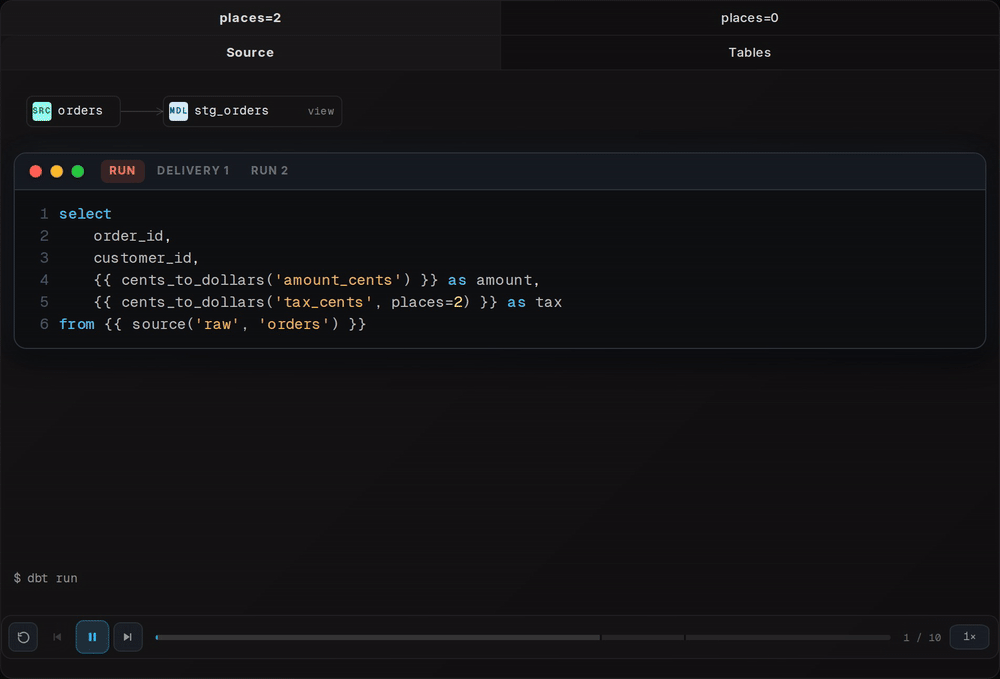
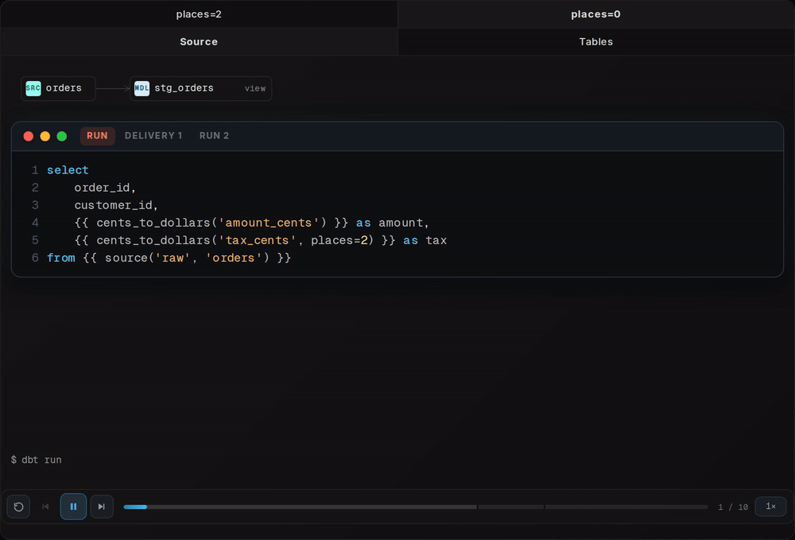

Intermediate·[](https://www.getdbt.com/)·20 min · 11 challenges

# Jinja and Macros: Intermediate

GitLab publishes its whole dbt project in the open, macros folder included. Picture a week there in which 2 revenue reports disagree by cents on the same orders, because 6 models each convert cents to dollars with their own rounding. One macro gives all 6 the same arithmetic, a test written once guards every amount column, and a variable picks the quarter to rebuild.


<br>

---

## Writing a Macro

Six models in the project turn a cents column into dollars, and each one spells out the arithmetic for itself. Two of the 6 round to 4 places where the rest round to 2, so a report that joins them shows the same order with 2 different amounts. The fix is to write the expression once, in a place every model can reach, and call it by name.

```sql
select
    order_id,
    customer_id,
    round(amount_cents / 100.0, 2) as amount,
    round(tax_cents / 100.0, 2) as tax,
    round(shipping_cents / 100.0, 2) as shipping
from {{ source('raw', 'orders') }}
```

A macro is a named block of Jinja that dbt expands wherever the name is called. It lives in a .sql file under macros/, and dbt reads every file in that folder at parse time, before any model renders, so a model deep in models/staging/ calls a macro defined anywhere in the project without importing it.

```sql

    round({{ column_name }} / 100.0, {{ places }})

```

The  tag names the macro and lists its arguments, with a default after = where one applies. The body between the tags renders with the arguments filled in, and the rendered text is pasted into the model at the point of the call. column_name arrives as the string 'amount_cents', so the body prints round(amount_cents / 100.0, 2), and nothing about the macro survives into the SQL the warehouse receives.

```sql
select
    order_id,
    customer_id,
    {{ cents_to_dollars('amount_cents') }} as amount,
    {{ cents_to_dollars('tax_cents') }} as tax,
    {{ cents_to_dollars('shipping_cents') }} as shipping
from {{ source('raw', 'orders') }}
```

```sql
SELECT
  order_id,
  customer_id,
  ROUND(amount_cents / 100.0, 2) AS amount,
  ROUND(tax_cents / 100.0, 2) AS tax,
  ROUND(shipping_cents / 100.0, 2) AS shipping
FROM raw.orders
```

Arguments are passed by position or by name, and every call that leaves `places` out gets the default of 2, so the 3 columns now round alike, as does every other model that calls the macro. The dashes on the opening and closing tags strip the newline and indentation around the body, which is why each compiled expression sits flush with the other columns. Without the dashes the compiled SQL carries a line break and 4 spaces before each `round`, which the warehouse accepts and the next reader of the compiled file has to look past.

An override belongs where a column's precision really differs. A supplier feed prices small parts in fractions of a cent: a washer costs 0.4 cents. At the default, `round(0.4 / 100.0, 2)` is 0.00, and a cost model that multiplies by 50,000 washers reports 0 dollars where the true cost is 200. Four places keep 0.0040, which survives the multiplication.

```sql
select
    part_id,
    {{ cents_to_dollars('unit_cost_cents', places=4) }} as unit_cost
from {{ source('raw', 'supplier_costs') }}
```

The override is written at the call, in the one model whose column needs it, so a reader of `stg_supplier_costs` sees why its costs carry 4 places. A later change to the macro's default reaches every call that left `places` out, while this call keeps its 4, which is what the animation below plays out on a small orders table.

**places=2**



**places=0**



*$ dbt run*


<br>

### A Macro Argument Is Text

The macro receives the characters `amount_cents` and nothing about the column behind them, so it renders the same text whether that column is an integer, a string or missing, and a misspelled column name passes through it untouched into the compiled SQL.

Macros call each other the same way models call them. A net amount that subtracts refunds from gross can lean on the macro already written, and the inner call renders first, so the outer body receives finished text.

```sql

    {{ cents_to_dollars(gross_column) }} - {{ cents_to_dollars(refund_column) }}

```

```sql
SELECT
  order_id,
  ROUND(amount_cents / 100.0, 2) - ROUND(refund_cents / 100.0, 2) AS net
FROM raw.orders
```

> What dbt does with a macro
>
> - Reads every .sql file under macros/ at parse time, so a macro is callable from any model, test or other macro in the project.
> - Renders the body with the call's arguments and pastes the text into the caller, exactly where the double braces stood.
> - Leaves nothing of itself in the SQL the warehouse receives, so the compiled file is where a call's output is read and checked.
> - Refuses to parse a project that defines 2 macros with the same name, because a call could not tell them apart.

> **TIP**
>
> A macro changes every call site at once. Moving the default from 2 places to 0 reaches every call that leaves `places` out on the next run, which is the point and also the risk: after each edit, run the models that call it and read their compiled SQL before trusting the tables.


<br>

---

## Packages and dbt_utils

A package is a dbt project someone else published, pulled into yours so its macros and tests can be called by name. dbt_utils, maintained by the team that maintains dbt, holds the macros and generic tests most projects would otherwise write for themselves: a hashed key over several columns, a test that a pair of columns is unique together, a test that a value sits inside a range. Installing it takes one file and one command.

```sql
packages:
  - package: dbt-labs/dbt_utils
    version: [">=1.3.0", "<3.0.0"]
```

The package name is the GitHub owner and repository the package hub keys it by, and the version is a range dbt is free to resolve within. dbt deps reads the file, picks the newest version inside the range, downloads that project into dbt_packages/ and records the exact version it chose in package-lock.yml. No SQL runs and nothing in the warehouse changes; the only effect is files on disk. A package also declares which dbt versions it supports, and dbt deps stops with an error when the running dbt falls outside that range.

- dbt_packages/dbt_utils/ now holds the package's own macros/ and tests/ folders, a dbt project inside yours
- package-lock.yml records the version resolved, so the next dbt deps installs the same one
- dbt_packages/ stays out of version control, so every fresh checkout runs dbt deps before anything builds
- Every macro and test in the package is called with dbt_utils. in front of its name, the package's project name

| Name | Kind | What it does |
| --- | --- | --- |
| generate_surrogate_key | macro | Prints a hash of several columns joined into one key, with nulls replaced by a fixed string |
| safe_divide | macro | Prints a division that returns null instead of failing when the denominator is 0 |
| date_spine | macro | Prints SQL producing one row per day, week or month between 2 dates |
| unique_combination_of_columns | test | Fails when 2 or more rows share the same values across a set of columns |
| accepted_range | test | Fails when a value falls below a minimum or above a maximum |
| not_empty_string | test | Fails when a string column holds an empty string |
| expression_is_true | test | Fails on any row where a SQL expression you give is false |


<br>

### Declaring a Package Test

A package's test is declared like a built-in one, with the package prefix in front of the name. The arguments the test takes sit under arguments, and settings dbt itself reads, such as severity, sit under config. A test over several columns at once belongs at the model level, since no single column owns it.

```sql
models:
  - name: stg_order_items
    data_tests:
      - dbt_utils.unique_combination_of_columns:
          arguments:
            combination_of_columns:
              - order_id
              - line_number
    columns:
      - name: quantity
        data_tests:
          - dbt_utils.accepted_range:
              arguments:
                min_value: 1
              config:
                severity: warn
```

The test is still a query that returns failing rows. unique_combination_of_columns groups by the columns it was given and keeps the groups with more than 1 row, which is the query you wrote by hand for a compound key, now written once in the package and filled in from the YAML.

```sql
WITH validation_errors AS (
  SELECT
    order_id,
    line_number
  FROM analytics.stg_order_items
  GROUP BY order_id, line_number
  HAVING COUNT(*) > 1
)

SELECT
  *
FROM validation_errors
```


<br>

### Calling a Package Macro

The macros are called the same way, prefix first. generate_surrogate_key takes a list of column names and prints a hash of them, so a model with no single key column gets one from the pair it is unique on, and the test above and the key below agree on what that pair is.

```sql
select
    {{ dbt_utils.generate_surrogate_key(['order_id', 'line_number']) }} as order_item_key,
    order_id,
    line_number,
    quantity
from {{ source('raw', 'order_items') }}
```

```sql
SELECT
  LOWER(
    TO_HEX(
      MD5(
        TO_UTF8(
          COALESCE(
            CAST(order_id AS VARCHAR),
            '_dbt_utils_surrogate_key_null_'
          ) || '-' || COALESCE(
            CAST(line_number AS VARCHAR),
            '_dbt_utils_surrogate_key_null_'
          )
        )
      )
    )
  ) AS order_item_key,
  order_id,
  line_number,
  quantity
FROM raw.order_items
```

Each column is cast to text, a null becomes the literal _dbt_utils_surrogate_key_null_ so that a null in one column cannot make 2 different rows hash alike, the pieces are joined with -, and the whole string is hashed. The hash function and the cast syntax come from the warehouse adapter rather than from the package, which is how one macro serves every warehouse dbt runs on: the Jinja is shared, the SQL it prints is local.

> What the prefix buys
>
> Your project can define its own generate_surrogate_key without a collision, because a bare name resolves in your project and the prefixed name resolves in the package. The package's macros call each other through their own prefix, so they keep working whatever names your project gives its macros.


<br>

---

## Writing a Generic Test

A singular test is one query about one table. Wanting the same check on 12 columns across 5 models would mean 12 copies of that query, each edited by hand. A generic test is a query with 2 holes, the model and the column, and dbt fills the holes from YAML every time a column declares it. The 4 built-in tests are written this way, and a test you write joins them as an equal.

```sql

select
    {{ column_name }}
from {{ model }}
where {{ column_name }} < 0

```

The  block works like a macro with a reserved purpose. dbt reads it from tests/generic/ or from macros/ at parse time, and the name after test becomes the key a column writes in YAML. model arrives as the relation the model builds, column_name as the name the YAML sits under, and the query must return the rows that break the rule: zero rows is a pass, any row is a failure.

```sql
models:
  - name: stg_orders
    columns:
      - name: amount
        data_tests:
          - not_negative
      - name: tax
        data_tests:
          - not_negative:
              config:
                severity: warn
```

Each declaration becomes its own test node, so stg_orders now carries 2 tests, `not_negative_stg_orders_amount` and `not_negative_stg_orders_tax`, each named after the rule, the model and the column. For tax, dbt renders the block with model set to the table and column_name set to tax, then wraps the result in the counting query it wraps around every test, and a warn severity changes what the count does to the run, never the query.

```sql
SELECT
  COUNT(*) AS failures,
  COUNT(*) != 0 AS should_warn,
  COUNT(*) != 0 AS should_error
FROM (
  SELECT
    tax
  FROM analytics.stg_orders
  WHERE tax < 0
) AS dbt_internal_test
```


<br>

### Tests That Take an Argument

A hole for the column is often not enough. A currency code must be 3 characters long, a country code 2, and one test should serve both. Any argument after model and column_name is filled from YAML, and a default after the equals sign makes it optional.

```sql

select
    {{ column_name }}
from {{ model }}
where length({{ column_name }}) != {{ length }}

```

```sql
models:
  - name: stg_orders
    columns:
      - name: currency
        data_tests:
          - has_length
      - name: country
        data_tests:
          - has_length:
              arguments:
                length: 2
```

The first declaration uses the default and compiles to where length(currency) != 3; the second compiles to where length(country) != 2. Watch what a null does here: length of null is null, the comparison is null, and the row stays out of the failures. A generic test checks the rule it states and nothing more, so a column that also must never be null declares not_null beside it, as 2 nodes with 2 results.

| currency | country | has_length on currency | has_length on country | not_null on country |
| --- | --- | --- | --- | --- |
| USD | US | pass | pass | pass |
| EUR | DEU | pass | fails, length 3 | pass |
| US | FR | fails, length 2 | pass | pass |
| GBP | null | pass | pass, the null drops out | fails |

Each fail is one row returned by that node's query, so the 3 nodes each report 1 failure. Take away the not_null declaration and the GBP row passes every test its country column has, which is the gap the second declaration on the same column closes.

#### An Argument That Names a Column

```sql

select
    {{ earlier_column }},
    {{ column_name }}
from {{ model }}
where {{ column_name }} < {{ earlier_column }}

```

```sql
models:
  - name: stg_shipments
    columns:
      - name: shipped_at
        data_tests:
          - not_before:
              arguments:
                earlier_column: ordered_at
```

`earlier_column` arrives as the text `ordered_at`, the same way a macro argument does, so the test prints it into the query as a column name and compiles to `where shipped_at < ordered_at`. Selecting both columns means a stored failure shows the pair that broke the rule: an order placed at 10:15 and shipped at 09:40 the same morning is visible at a glance.

| ✓ Singular test | ✗ Generic test |
| --- | --- |
| • One .sql file under tests/, one query, one table<br><br>• Names the table it checks with ref() inside the file<br><br>• Fits a rule that holds for exactly one model<br><br>• Runs once per project | • One test block, reused by any column that declares it<br><br>• Takes the table and column as holes filled from YAML<br><br>• Fits a rule that several columns share<br><br>• Runs once per declaration, each its own node |

| ✓ Do | ✗ Don't |
| --- | --- |
| • Select the failing rows, so stored failures show which values broke the rule<br><br>• Give an argument a default when one value fits most columns<br><br>• Name the block for the rule that passes, as not_negative does | • Order or limit the query, dbt only counts its rows<br><br>• Make one test check 2 rules, declare 2 tests instead<br><br>• Reference a specific table inside the block, that is a singular test |


<br>

---

## Macros That Return Values

Every macro so far prints SQL: its body renders to text and the text lands in the model. A macro can instead hand back a value, a list, a dictionary or a number, for other Jinja in the model to work with. return() does that, and the SQL that reaches the warehouse is then built by the loop or lookup that uses the value.

```sql

    {{ return(['card', 'bank_transfer', 'gift_card']) }}

```

```sql


select
    order_id,
    
    sum(case when payment_method = '{{ method }}' then amount else 0 end)
        as {{ method }}_amount,
    
from {{ ref('stg_payments') }}
group by order_id
```

```sql
SELECT
  order_id,
  SUM(
    CASE
      WHEN payment_method = 'card' THEN amount
      ELSE 0
    END
  ) AS card_amount,
  SUM(
    CASE
      WHEN payment_method = 'bank_transfer' THEN amount
      ELSE 0
    END
  ) AS bank_transfer_amount,
  SUM(
    CASE
      WHEN payment_method = 'gift_card' THEN amount
      ELSE 0
    END
  ) AS gift_card_amount
FROM analytics.stg_payments
GROUP BY order_id
```

return() stops the macro at that point and hands the value to the caller. methods therefore holds a list of 3 strings, methods | length is 3, and for walks the 3 items. Adding a fourth method is one edit to the macro, and the next run gives this model, and every other model that loops over the list, a fourth column.

A macro without return() hands back the text its body printed. Setting a variable from cents_to_dollars works too, but the variable is a string holding the rendered expression, with whatever whitespace the body left in it, and a string cannot be walked as a list of columns. Printing a returned list with double braces writes the list's own text into the SQL, square brackets and quotes included, which the warehouse rejects, so a returned value is handled by Jinja and only its pieces are printed.

| Call | What the model gets |
| --- | --- |
| {{ cents_to_dollars('amount_cents') }} | The rendered text, pasted into the SQL |
|  | A string holding that text |
|  | A list of 3 strings; m[0] is card |
| {{ payment_methods() }} | The text ['card', 'bank_transfer', 'gift_card'] in the SQL, a database error |


<br>

### Returning a Dictionary

A list carries one value per item. A dictionary carries a value for each key, which fits a mapping the SQL needs on both sides, such as a status code and the label it is reported under.

```sql

    {{ return({'p': 'placed', 's': 'shipped', 'r': 'returned'}) }}

```

```sql


select
    order_id,
    case
        when status is null then 'unknown'
    
        when status = '{{ code }}' then '{{ label }}'
    
    end as status_label
from {{ ref('stg_orders') }}
```

```sql
SELECT
  order_id,
  CASE
    WHEN status IS NULL THEN 'unknown'
    WHEN status = 'p' THEN 'placed'
    WHEN status = 's' THEN 'shipped'
    WHEN status = 'r' THEN 'returned'
  END AS status_label
FROM analytics.stg_orders
```

The first branch is typed by hand ahead of the loop, so a missing status reads `unknown` instead of null, and the CASE keeps at least one branch even if the dictionary were emptied, since a CASE with no WHEN at all is a database error. A second model that counts orders per label loops over the same dictionary, so the labels in the CASE and the labels in the count come from one file and cannot drift apart. The values here are typed into the macro by hand; nothing in this section reads them from the warehouse, and the whole expansion happens while Jinja renders, before any SQL is sent.

> **TIP**
>
>  runs an expression for its effect and prints nothing. Use it to build a list up inside a macro before returning it, or to call a macro whose return you do not want in the SQL.


<br>

### Building a List Before Returning It

```sql

    
    
        
    
    {{ return(columns) }}

```

```sql


select
    
    {{ cents_to_dollars(column) }} as {{ column | replace('_cents', '') }},
    
    order_id
from {{ source('raw', 'orders') }}
```

```sql
SELECT
  ROUND(amount_cents / 100.0, 2) AS amount,
  ROUND(tax_cents / 100.0, 2) AS tax,
  ROUND(shipping_cents / 100.0, 2) AS shipping,
  order_id
FROM raw.orders
```

`columns` starts empty, `do` appends one name per prefix in the macro's list without printing anything, and `return()` hands back `['amount_cents', 'tax_cents', 'shipping_cents']`. The model calls `cents_to_dollars` once per name, the `replace` filter strips the suffix for the alias, and placing `order_id` after the loop lets every generated line end in a comma with no `loop.last` check. A fourth prefix in the macro's list adds a fourth column to every model that loops over it, and no model file changes.


<br>

---

## vars and env_var

Every value so far was typed inside the project's own files. Some values belong outside them: the first day a model should include, chosen by whoever starts the run, or the schema a raw table sits in, which differs between a laptop and the shared warehouse. dbt reads such values through 2 functions. var() reads a project variable, set in dbt_project.yml or on the command line, and env_var() reads the shell environment dbt was started in.

```sql
select
    order_id,
    order_date,
    amount
from {{ ref('stg_orders') }}
where order_date >= date '{{ var("start_date", "2024-01-01") }}'
```

var() takes the variable's name and an optional default. With nothing set anywhere, the default renders and the model keeps rows from 2024-01-01 on. The project file can set it for every run, and the command can set it for one run.

```sql
name: shop
version: '1.0.0'
profile: shop
vars:
  start_date: '2024-06-01'
```

Running dbt run --vars '{"start_date": "2025-10-01"}' overrides the project file for that run alone; the file keeps its value for the next one. The argument is a small YAML or JSON mapping, so a var can be a number, a list or a date string, and var() hands it back with that type, which is why a list passed this way can be looped over like one a macro returned.

| Where start_date is set | Value the model renders |
| --- | --- |
| Nowhere | 2024-01-01, the default in the call |
| Nowhere, and the call has no default | Compile error: Required var 'start_date' not found in config |
| vars: in dbt_project.yml | 2024-06-01 |
| --vars on the command, with the file also set | 2025-10-01, the command wins |

*A var under vars: applies to every file in the project; nesting it under the project's own name, or under an installed package's name, scopes it to that one project's files.*


<br>

### env_var

env_var() reads a value the shell set before dbt started, such as export DBT_RAW_SCHEMA=raw_dev. It takes the name and an optional default, and it works in every file dbt renders, including dbt_project.yml, profiles.yml and packages.yml, so a password or a token never has to be written into a file that is committed.

```sql
sources:
  - name: raw
    schema: "{{ env_var('DBT_RAW_SCHEMA', 'raw') }}"
    tables:
      - name: orders
      - name: order_items
```

With the variable unset, source('raw', 'orders') resolves to raw.orders; with it set to raw_dev, every model that reads the source compiles to raw_dev.orders and no model file changes. A name that is missing and has no default stops the run at compile time with Env var required but not provided, before any SQL is sent. Every value comes back as a string, since the shell holds only strings, so a number from the environment is text until the SQL casts it. A variable whose name starts with DBT_ENV_SECRET is treated as a secret: dbt allows it only in profiles.yml and packages.yml and masks its value in logs.

```sql


select
    order_id,
    order_date
from {{ ref('stg_orders') }}
where order_date >= current_date - interval '{{ lookback_days }}' day
```

With nothing set, the default `'2'` becomes the number 2 through the `int` filter, and the model compiles to `interval '14' day`. Drop the filter and Jinja multiplies a string instead: `'2' * 7` is `'2222222'`, so the model keeps 2,222,222 days of orders, which is every row, and no stage of the run raises an error. The same value passed as `--vars '{"lookback_weeks": 2}'` arrives as the number 2 and needs no filter.

| ✓ var() fits | ✗ env_var() fits |
| --- | --- |
| • A parameter of one run, chosen by the person or schedule starting it<br><br>• A value with a sensible committed default in dbt_project.yml<br><br>• A typed value: a date string, a number, a list of codes<br><br>• A value it is fine to see in the command and the logs | • A property of the place dbt runs: a schema name, a hostname<br><br>• A credential or token that must never sit in a committed file<br><br>• A value set once by the shell and read by every command run in it<br><br>• A value profiles.yml or packages.yml needs before the project is read |

| ✓ Do | ✗ Don't |
| --- | --- |
| • Give every var() and env_var() a default when a missing value has a safe meaning<br><br>• Name environment variables with a DBT_ prefix so their purpose is clear in the shell<br><br>• Keep the committed default the one the shared warehouse should use | • Pass a password through --vars, it lands in the shell history and the logs<br><br>• Read the same value through both functions in different models<br><br>• Use env_var() for a value that changes run to run on the same machine |


<br>

---

## Putting It All Together

A new engineer clones a team's project built the way this lesson builds one, and the first morning runs in a fixed order: dbt deps so the package tests resolve, an exported environment variable naming the raw schema, then a build. A finance model converts cents through one shared macro, a package test keeps the compound key of order line items unique, a custom generic test checks that every currency code is 3 characters, a macro returns the list of payment methods that 2 models pivot on, and a start_date var lets a rebuild of one quarter run without editing a file.

- The shared macro and the returned list both change every caller on the next run, so a single edit is reviewed as a change to every model that calls it.
- The package test and the custom generic test are the same kind of node: a query with holes, filled from YAML, counted by the wrapper dbt puts around every test.
- dbt deps and the environment variable both have to be in place before parse, because package macros and source schemas are resolved while Jinja renders, before any SQL exists.
- A var carries the one value that differs per run, and the committed default in dbt_project.yml is what the shared warehouse uses when nobody passes one.


<br>

---

## Key Takeaways

- A macro is a named Jinja block under macros/ that renders with its arguments and pastes text into the caller; the warehouse sees only the text.
- dbt deps installs a package into dbt_packages/ and records the version in package-lock.yml; its macros and tests are called with the package's name as a prefix.
- A generic test is a query with model and column_name as holes, filled from YAML on every declaration, and any extra argument arrives under arguments: in the YAML.
- return() hands a typed value back to the calling Jinja; a macro without it hands back the text its body printed.
- var() reads a run's parameter from dbt_project.yml or --vars, with the command winning; env_var() reads the shell, always as a string, and is the place for credentials and per-environment names.
- A missing var, env var or macro name fails at compile time, before any SQL is sent; a wrong column inside a macro fails in the warehouse.

[](https://www.getdbt.com/)

Official dbt resources

"dbt enables data analysts and engineers to transform their data using the same practices that software engineers use to build applications." [github.com/dbt-labs/dbt-core](https://github.com/dbt-labs/dbt-core)

[Documentation](https://docs.getdbt.com/)[Get started](https://docs.getdbt.com/docs/get-started-dbt)[Source](https://github.com/dbt-labs/dbt-core)

dbt and the dbt logo are trademarks of dbt Labs, LLC.
