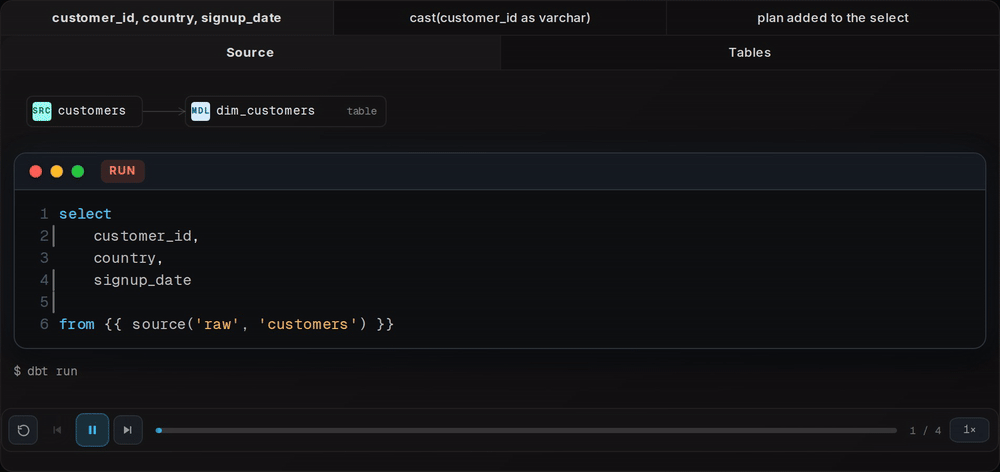
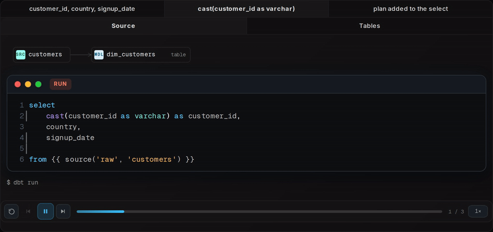
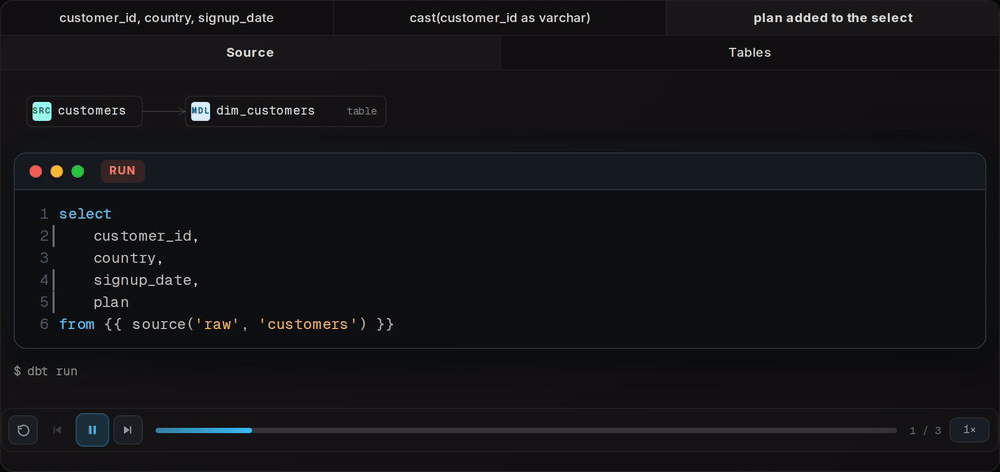
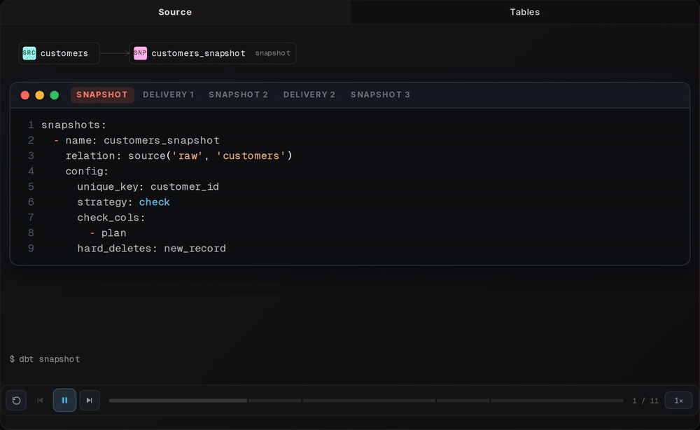
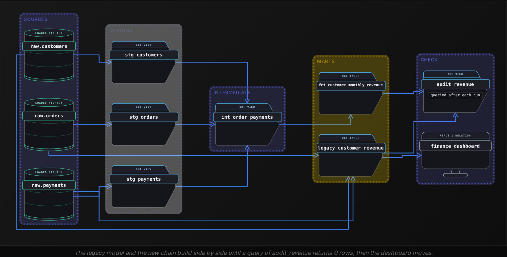

Advanced·[](https://www.getdbt.com/)·20 min · 6 challenges

# Models: Advanced

It is June 30 at Stripe, and a finance analyst notices the merchant revenue dashboard shows the total it showed on March 3. That morning an analytics engineer renamed the model behind it. dbt has built the new table nightly since and never touched the old one the dashboard still reads. No error fired anywhere. This lesson is about which changes fail loudly, and which fail like this.


<br>

---

## Model Contracts

A model's table has whatever columns its SELECT returns. If you rename `country` to `country_code` in `dim_customers.sql` and run the model, the table changes shape and dbt raises no complaint. The complaints arrive later, from the 6 models and 2 dashboards that read `country`, each failing at its own build time or rendering a blank panel. A model contract moves that failure to `dim_customers` itself, before it writes a single row.


<br>

### Declaring the shape

```sql
models:
  - name: dim_customers
    config:
      materialized: table
      contract:
        enforced: true
    columns:
      - name: customer_id
        data_type: integer
      - name: country
        data_type: varchar
      - name: signup_date
        data_type: date
```

This is a properties file, the same kind of YAML that declares sources, with a `models:` list in place of `sources:`. On its own, the `columns` list documents the model. `contract: enforced: true` under `config` turns it into a promise dbt checks on every run. Each `data_type` is written in the warehouse's own type names, the words it prints when asked to describe a column. A properties file can hold several models; 1 file beside each model, named like it, keeps the promise next to the SQL it governs.


<br>

### What dbt does with it

Before the model runs, dbt compiles the SELECT and asks the warehouse which columns it would return, by running the query inside a wrapper that matches no rows. The answer is a column list with a type for each. dbt checks that list against the YAML: the SELECT must return exactly the declared columns, each with its declared type. A mismatch fails the model with a table of the differences, and nothing is written. A match lets dbt create the table with the declared types first and load the SELECT's rows into it afterwards, so the warehouse holds `integer` for `customer_id` even on a day the query would have inferred something wider.

**customer_id, country, signup_date**



**cast(customer_id as varchar)**



**plan added to the select**



*$ dbt run*

That early failure is the reason to add a contract. Suppose the application team migrates customer ids to strings on a Tuesday night. Without a contract, `dim_customers` rebuilds with a `varchar` key, the 6 models joining it on `customer_id` fail 1 by 1 over the next hour, and the dashboard that casts nothing shows 0 customers. With the contract, `dim_customers` fails first with 1 line naming the column and the 2 types, the 6 models never run, and yesterday's table stays in place for every reader until the fix lands.


<br>

### Which edits break the promise

| Edit to the SELECT | Build result | Why |
| --- | --- | --- |
| Rename `country` to `country_code` | fails | `country` missing, `country_code` never declared |
| `cast(customer_id as varchar)` | fails | varchar where the contract says integer |
| Add a `plan` column | fails | 4 columns where the contract declares 3 |
| Reorder the 3 columns | passes | columns are matched by name, order is free |
| `upper(country)` in place of `country` | passes | the contract checks shape, never values |
| Drop `signup_date` | fails | 2 columns where the contract declares 3 |

*Type names are compared as the warehouse prints them, so a contract that says varchar where the warehouse reports text fails on a system that treats the 2 as different words, and passes on one that treats them as aliases.*


<br>

### Reading the failure

| column_name | definition_type | contract_type | mismatch_reason |
| --- | --- | --- | --- |
| customer_id | VARCHAR | INTEGER | data type mismatch |
| plan | VARCHAR |  | missing in contract |
| signup_date |  | DATE | missing in definition |

`definition_type` is what the SELECT returns, `contract_type` is what the YAML promised. A row with an empty `contract_type` is a column the SELECT produces that the YAML never mentioned, and a row with an empty `definition_type` is a promised column the SELECT lost. The fix goes either into the SQL or into the YAML, and the choice has a consequence: an edit to the YAML changes the promise, so every reader of the model is told before it lands.

| ✓ Without a contract | ✗ With a contract |
| --- | --- |
| • The table takes the SELECT's shape on every run<br><br>• A changed column is found by whichever reader hits it first<br><br>• Readers fail or show wrong panels, 1 at a time, after the write | • The YAML's shape is checked before the write<br><br>• A changed column is found in the model that changed<br><br>• Readers keep yesterday's table until the model builds again |

> What a contract covers
>
> - Exactly the declared columns, each with its declared data type, checked on every run before the table is written
> - A `constraints` list per column, such as `not_null`, which the warehouse enforces as rows load where it supports constraints
> - Never the data in the rows, not even how many there are or how fresh it is
> - Tables and views both, with views checked on names and types only

> **TIP**
>
> Put contracts on the models read outside the project: marts, and anything a dashboard or another team's project queries. A staging model with 1 reader inside the project gains little from the promise and pays the extra column-check query on every run.


<br>

---

## Model Versions

A contract stops `country` from turning into `country_code` by accident. Sometimes the change is the plan: the regions team wants `country_code` and a new `region` column, while 4 downstream models and a dashboard still read `country`. A versioned model lets both shapes build on the same run, each under its own contract, so the readers move when their owners choose.


<br>

### 2 files, 1 name

```sql
models:
  - name: dim_customers
    latest_version: 1
    config:
      contract:
        enforced: true
    columns:
      - name: customer_id
        data_type: integer
      - name: country
        data_type: varchar
      - name: signup_date
        data_type: date
    versions:
      - v: 1
        config:
          alias: dim_customers
      - v: 2
        columns:
          - include: all
            exclude:
              - country
          - name: country_code
            data_type: varchar
          - name: region
            data_type: varchar
```

The model is still `dim_customers`. Its SQL now lives in `dim_customers_v1.sql` and `dim_customers_v2.sql`, 1 file per entry under `versions`. dbt builds 1 relation per file. The default relation names are `dim_customers_v1` and `dim_customers_v2`; the `alias` under version 1 overrides the first to `dim_customers`, for a reason the dashboard explains below. The top-level `columns` list is the shape every version starts from. Version 1 adds nothing, so it inherits all 3 columns. Version 2 says `include: all` then excludes `country`, and declares 2 new columns, so its contract has 4 columns: `customer_id`, `signup_date`, `country_code`, `region`.

```sql
select
    customer_id,
    signup_date,
    country as country_code,
    case
        when country in ('DE', 'FR', 'ES', 'IT') then 'EU'
        else 'ROW'
    end as region
from {{ source('raw', 'customers') }}
```


<br>

### What ref() resolves to

| Call | latest_version: 1 | latest_version: 2 |
| --- | --- | --- |
| `ref('dim_customers')` | `dim_customers` (version 1, via its alias) | `dim_customers_v2` |
| `ref('dim_customers', v=1)` | `dim_customers` | `dim_customers` |
| `ref('dim_customers', v=2)` | `dim_customers_v2` | `dim_customers_v2` |

`latest_version` decides where an unpinned `ref('dim_customers')` points. Leaving it at 1 while version 2 first appears means nothing downstream changes shape: version 2 builds, sits beside version 1, and a reader opts in with `ref('dim_customers', v=2)` when its owner is ready. When most readers have moved, flip `latest_version` to 2 and pin the stragglers with `v=1`, which compiles to the same relation they always read. A reader's shape changes only when its owner edits it to add a pin or remove one.


<br>

### Readers outside dbt

A dashboard reads a relation by name and knows nothing about `ref()` or `latest_version`. Before versioning, that name was `dim_customers`. After it, with no alias, dbt builds `dim_customers_v1` and `dim_customers_v2`. The `dim_customers` relation the dashboard reads stops updating, and neither side reports an error. The `alias: dim_customers` on version 1 keeps that name attached to the old shape. Moving the alias to version 2 later is the dashboard's cutover, a YAML edit made on the day its owner has changed the panels that read `country`.


<br>

### Retiring version 1

```sql
versions:
  - v: 1
    deprecation_date: 2027-03-31
    config:
      alias: dim_customers
  - v: 2
```

`deprecation_date` on the `v: 1` entry puts an end date on the old shape. Every parse then prints a warning for each model that still refs version 1, as an upcoming deprecation before the date and a passed one after it, so every run lists the stragglers. When the list is empty, delete `dim_customers_v1.sql` along with the `v: 1` entry. The same change moves the alias to version 2. The next run builds version 2 into `dim_customers`, replacing the old shape under the name the dashboard reads, so that relation stays. The one left behind is `dim_customers_v2`, which version 2 built under its default name until now: drop it after that first run. Retiring version 1 without moving the alias leaves the reverse, a `dim_customers` frozen in the old shape, to drop once nothing reads it. Versions are for changes of shape. A wrong `region` mapping gets fixed in version 2 in place, because the shape its readers depend on does not change.

> Breaking or not
>
> - Dropping a column, or changing its name or type: breaking, so a new version
> - Adding a column: additive, so add it to the contract and every reader keeps working
> - Changing how a value is computed: a fix in place, since the shape holds
> - Changing the grain: a new model, since every reader's joins and sums change meaning

| ✓ Do | ✗ Don't |
| --- | --- |
| • Keep latest_version on the old shape until most readers have opted into the new one<br><br>• Give the version a dashboard reads an alias so its relation name holds through the cutover<br><br>• Set a deprecation_date so dbt lists the stragglers on every parse<br><br>• Put a contract on every version so each shape is a checked promise | • Rename or retype a column in place when anything outside the model reads it<br><br>• Flip latest_version and migrate the readers in the same change<br><br>• Retire a version without dropping the relation name that no version builds any more |


<br>

---

## Snapshot Strategies

A snapshot reads a table that overwrites itself and keeps 1 row per version it has seen. On each row, `dbt_valid_from` and `dbt_valid_to` bound the time that version held. The intermediate lesson showed that result. Behind it, every run asks 2 questions of every row: has this row changed since the last run, and is this row still there. The strategy answers the first question, the `hard_deletes` setting answers the second.


<br>

### timestamp: trust a column

```sql
snapshots:
  - name: customers_snapshot
    relation: source('raw', 'customers')
    config:
      unique_key: customer_id
      strategy: timestamp
      updated_at: updated_at
```

With `strategy: timestamp`, a source row counts as changed when its `updated_at` is later than the `updated_at` the snapshot recorded for that `unique_key`. The comparison reads 1 column, so it costs little, and `dbt_valid_from` takes the source's own `updated_at`, so the history records when the application changed the row rather than when dbt noticed. Both benefits depend on the application keeping `updated_at` honest. A support tool that edits `plan` without touching `updated_at` makes a change the snapshot never records. A nightly job that rewrites `updated_at` on every row records a new version of every row, each identical to the last apart from its dates.


<br>

### check: compare the columns

With `strategy: check`, dbt compares each column in `check_cols` between the source row and the snapshot's latest row for the same key, counting 2 nulls as equal. A difference in any listed column records a new version. A difference in a column outside the list records nothing. `check_cols: all` compares every column, at the price of comparing every column on every row. The timeline is dbt's own: `dbt_valid_from` is the run's timestamp, so a row that changed twice between 2 nightly runs yields 1 version holding the final values, and the history is as fine as the schedule.



*$ dbt snapshot*

| ✓ timestamp | ✗ check |
| --- | --- |
| • Changed when 1 column is later than before<br><br>• dbt_valid_from is the application's time<br><br>• Misses edits that leave updated_at alone<br><br>• Records a version for every bump of updated_at | • Changed when any listed column differs<br><br>• dbt_valid_from is the snapshot run's time<br><br>• Misses edits to columns outside the list<br><br>• Records 1 version per run however many edits happened |

Choose by what the source gives you. A table with an `updated_at` the application maintains on every write should use `timestamp`, which gives the cheaper comparison and the truer dates. A table with no such column, or one where edits arrive from tools that skip it, needs `check`, with `check_cols` listing the columns whose history anyone will ask about and nothing more, since every listed column is compared on every row on every run.


<br>

### When a row disappears

A key present last run and absent this run is a hard delete, and the default, `hard_deletes: ignore`, does nothing with it: the last version keeps a null `dbt_valid_to`, and every query for current rows reports a customer who no longer exists. The 2 other settings record the disappearance in different shapes.

| hard_deletes | What the run does to the vanished key | A current-row query sees |
| --- | --- | --- |
| ignore | Nothing | The last version, as if still present |
| invalidate | Sets dbt_valid_to on the last version to the run's time | No row for the key |
| new_record | Closes the last version and inserts a copy of it with dbt_is_deleted set to True | The deletion row, marked as such |

In the animation, run 2 edits 2 rows: customer 1 moves from free to pro, customer 3 moves from US to CA. The snapshot gains 1 row, for customer 1, because `country` is outside `check_cols` and the edit to customer 3 is invisible to this snapshot. Run 3 finds customer 2 gone. `new_record` sets `dbt_valid_to` on customer 2's open row and inserts a 5th row carrying the same values with `dbt_is_deleted` set to True, so the table says when customer 2 left and what the row held at that moment.

> The columns dbt adds
>
> - `dbt_scd_id`: a hash unique to each version of each key
> - `dbt_updated_at`: the source's updated_at under timestamp, the run's time under check
> - `dbt_valid_from` and `dbt_valid_to`: the span a version held, null dbt_valid_to meaning still current
> - `dbt_is_deleted`: present only under hard_deletes: new_record, True on the rows that record a deletion

> **TIP**
>
> With new_record, a current-state query that filters only on dbt_valid_to IS NULL returns the deletion rows too, so a customer deleted in March still appears today with their last plan. Filter out the rows dbt_is_deleted flags as well, or choose invalidate where a deleted key should vanish from current state.


<br>

---

## Tables dbt Left Behind

dbt's picture of the warehouse is the project. Each run walks the models it parsed and creates or replaces 1 relation per model, named after the model. At the start of a run dbt may list the relations in the schemas it builds into, so it knows whether each name it is about to build already exists, but it acts only on the names its parsed nodes claim. A relation no node claims is never updated and never dropped. So every rename and every deletion in a dbt project leaves a relation behind, built on the day of the edit and untouched from then on.


<br>

### 5 edits and what they leave

| Edit | dbt builds on the next run | Left in the warehouse |
| --- | --- | --- |
| Rename `fct_orders.sql` to `fct_orders_daily.sql` | `fct_orders_daily` | `fct_orders`, frozen at its last build |
| Delete `int_order_payments.sql` | Nothing for it | `int_order_payments` |
| Point `fct_revenue` at a different schema | `fct_revenue` in the new schema | `fct_revenue` in the old one |
| Add `versions` to `dim_customers` with no alias | `dim_customers_v1`, `dim_customers_v2` | `dim_customers` |
| Change `materialized` from view to table | `fct_orders` as a table | Nothing: dbt drops the view of the same name first |

The last row marks the boundary. dbt owns the name it is about to build, so a view called `fct_orders` gives way to a table called `fct_orders`. The 4 rows above it change the name or the schema, and the old name belongs to nobody. The frozen `fct_orders` is the dangerous case. The finance dashboard reading it renders every panel. Its monthly total on June 30 equals the total shown on March 3, the morning of the rename, because the table has held the same rows since, and no error appears anywhere.


<br>

### Why dbt leaves them

The schema dbt builds into is often shared. An analyst's hand-made table, a load tool's staging copy and a table another project writes can all live beside dbt's relations, and a run that dropped everything it did not recognise would destroy them. dbt's unit of work is the node, and a deleted node has no file to run and no name to act on. The cleanup is left to the engineer, who knows which of the unclaimed names were dbt's.


<br>

### Finding them

```sql
SELECT
  table_schema,
  table_name,
  table_type
FROM information_schema.tables
WHERE table_schema = 'analytics'
ORDER BY table_name
```

The warehouse answers with what exists. `dbt ls --resource-type model --resource-type seed --resource-type snapshot` answers with the nodes the project builds, seeds included because each seed loads a table of its own. dbt ls prints node names, and a relation's name can differ: an alias replaces it, so `fct_orders_daily` builds `fct_orders`, and a version without an alias adds `_v` and its number, so version 2 of `dim_customers` builds `dim_customers_v2`. Translate each node into its relation name before comparing. A relation no translated name matches is either one dbt left behind or a table a person created by hand inside dbt's schema. Both deserve a look, and the warehouse's last-modified metadata, where it keeps any, dates the day each orphan stopped changing.

```sql
DROP TABLE IF EXISTS analytics.fct_orders
```

Dropping is a statement run against the warehouse, outside dbt. Run it after the readers have moved, because a dropped table takes the dashboard from stale to broken, and a stale dashboard is at least a dashboard someone can compare against. `dbt clean` deletes local folders such as `target` and touches nothing in the warehouse.


<br>

### Renaming without an orphan

```sql
{{ config(alias='fct_orders') }}

select
    order_date,
    count(*) as orders,
    sum(amount) as revenue
from {{ ref('stg_orders') }}
group by
    order_date
```

The `alias` config separates the model's name in the project from the relation's name in the warehouse. `fct_orders_daily.sql` with `alias='fct_orders'` builds the relation `fct_orders` the dashboard already reads, so the rename is visible to every `ref()` and invisible to the warehouse. 2 models that would build the same relation name in the same schema stop the run at parse time with an error naming both, so an alias can never silently overwrite a neighbour. Without the alias, a rename is 3 changes in a fixed order: rename the file and build, move the dashboard to the new name, drop the old relation. Dropping first leaves the dashboard with nothing, and never dropping leaves it showing frozen numbers.

- Rename the file and run, so the new relation exists beside the old one
- Move every reader outside dbt to the new name and confirm it renders
- List the schema and compare it with dbt ls to confirm the old name is unclaimed
- Drop the old relation by hand and record the drop in the same change

| ✓ Do | ✗ Don't |
| --- | --- |
| • Treat every file rename or deletion as a warehouse change with a drop step at the end<br><br>• Use alias when the relation name must hold while the model name changes<br><br>• List orphans with a catalog query after each round of refactoring<br><br>• Drop a relation only after confirming nothing reads it | • Expect dbt run to drop anything whose model is gone<br><br>• Trust a dashboard with no errors to be reading fresh data<br><br>• Drop the old relation before its readers have moved |


<br>

---

## Refactoring a Legacy Query

The finance dashboard runs a 220-line query pasted into the dashboard tool 3 years ago, and no one has changed it since. It joins orders to payments through a subquery, filters test accounts with a hard-coded list of ids and a pattern on email, and computes monthly revenue per customer. Refactoring it into models is this section's work, under 1 rule: the new models return the same rows as the old query on every day until the old query is deleted.

```sql
SELECT
  c.id AS customer_id,
  DATE_TRUNC('month', o.created) AS revenue_month,
  SUM(p.amount_cents) / 100.0 AS revenue
FROM raw.customers AS c
JOIN raw.orders AS o
  ON o.cust = c.id
JOIN (
  SELECT
    order_id,
    SUM(amount) AS amount_cents
  FROM raw.payments
  WHERE status = 'captured'
  GROUP BY order_id
) AS p
  ON p.order_id = o.id
WHERE c.email NOT LIKE '%@example.com'
  AND c.id NOT IN (104, 2231, 9087)
GROUP BY c.id, DATE_TRUNC('month', o.created)
```


<br>

### Step 1: park the query as a model

Copy the query into `models/legacy/legacy_customer_revenue.sql` unchanged, apart from swapping each raw table name for a `source()` call, and materialize it as a table. dbt now builds the result the dashboard trusts on the same schedule as everything else, and that table becomes the reference every later step is measured against. The dashboard can read it at once, which retires the pasted copy on day 1.


<br>

### Step 2: carve out the layers

Start from the tables the query reads, then follow its joins and its grain. 3 raw tables become 3 staging models, each renaming and casting 1 table, and the test-account filter moves into `stg_customers`, the only place it belongs. The subquery that sums captured payments per order is 1 grain, 1 row per order, so it becomes `int_order_payments`, joining orders to their captured total. The outer query sums per customer per month, so it becomes `fct_customer_monthly_revenue`, 1 row per customer per month, the grain the dashboard reads. Each model does the work the legacy query did at that level and nothing from the levels around it.

#### Where to cut

A subquery with a `GROUP BY` is a grain of its own and becomes a model. An expression repeated in 2 places, such as `date_trunc('month', o.created)` in the select and the group by, becomes 1 column, `revenue_month`, computed once in `int_order_payments`. A hard-coded list of ids becomes a seed, so the finance team edits a CSV when a new test account appears, and the staging model joins against it.



```sql
select
    customer_id,
    revenue_month,
    sum(captured_cents) / 100.0 as revenue
from {{ ref('int_order_payments') }}
group by
    customer_id,
    revenue_month
```


<br>

### Step 3: audit until the difference is 0 rows

```sql
SELECT
  'legacy_only' AS side,
  customer_id,
  revenue_month,
  revenue
FROM (
  SELECT
    customer_id,
    revenue_month,
    revenue
  FROM analytics.legacy_customer_revenue

  EXCEPT

  SELECT
    customer_id,
    revenue_month,
    revenue
  FROM analytics.fct_customer_monthly_revenue
) AS legacy_only

UNION ALL

SELECT
  'new_only' AS side,
  customer_id,
  revenue_month,
  revenue
FROM (
  SELECT
    customer_id,
    revenue_month,
    revenue
  FROM analytics.fct_customer_monthly_revenue

  EXCEPT

  SELECT
    customer_id,
    revenue_month,
    revenue
  FROM analytics.legacy_customer_revenue
) AS new_only
```

The query returns every row in 1 result and missing from the other, tagged by side. 0 rows means the 2 results match for every customer in every month, down to the amount. The first run rarely returns 0. The differences repeat across refactors: a left join written as an inner join drops customers whose orders have no captured payment, a join to payments at the wrong grain doubles an order with 2 payments, `round` applied per order instead of per month moves cents, and 1 test id in the hard-coded list is missing from the seed. Each difference names a model to fix. After each fix, rebuild the chain and rerun the audit until it is empty. Saving the audit as a view called `audit_revenue` keeps the query in the project, but building a view only stores the query: nothing runs it, and a non-empty result fails nothing. The proof is a `select count(*)` from `audit_revenue`, run after each scheduled build and read by the engineer doing the refactor.


<br>

### Step 4: swap, then delete

Point the dashboard at `fct_customer_monthly_revenue`, under a contract that fixes the 3 column names and types the panels read. After the next scheduled run, `audit_revenue` should still return 0 rows; query it again to confirm. Then delete `legacy_customer_revenue.sql` and `audit_revenue.sql`, and drop both relations by hand, as the previous section showed. The 220 lines are now 5 models plus 1 seed. Each model sits at 1 grain and is short enough to read in a minute, and you can build and check any of them on its own.

> The refactor in 4 steps
>
> - Park the legacy query as a model so dbt builds the reference result
> - Carve the query into layers, with 1 staging model per source and 1 grain per model above them
> - Audit the new mart against the legacy model until 0 rows differ
> - Swap the readers, then delete the legacy model and drop its relation

> **TIP**
>
> Refactor 1 layer at a time and audit after each. Carve out staging alone first and leave the legacy logic sitting on top of the staging views. The audit then checks the renames and casts before any join moves, so the first non-zero audit points at 1 small change instead of 5.


<br>

---

## Putting It All Together

At Shopify, a merchant-analytics team inherits a 300-line churn query that the growth team's dashboard has run for 2 years. The merchants source table has no reliable last-modified column, merchants who close their stores vanish from it overnight, and the growth team wants the plan column replaced by a tier and a billing-cycle column without their dashboard going dark for a single morning.

- The churn query is parked as a model first, then carved into layered models at 1 grain each, from staging up to the mart, with an audit model comparing the 2 results until it returns 0 rows.
- The merchants source gets a snapshot with the check strategy on the columns churn depends on, and hard_deletes set to new_record, so a closed store is recorded as a dated deletion rather than a merchant frozen on its last plan.
- The new mart carries an enforced contract matching the columns the dashboard reads, so a type change in the source fails the mart before the dashboard sees a bad row.
- The plan-to-tier change ships as version 2 of the mart under its own contract, with version 1 holding the plain relation name through an alias until the dashboard's panels are rewritten, then the alias moves.
- The legacy model and the audit model each leave a relation dbt will never touch again, as does version 1 once it retires, and a catalog query against dbt ls finds each one to drop.


<br>

---

## Key Takeaways

- An enforced contract checks that a model returns exactly the declared columns with the declared types before the table is written, and a mismatch fails the model, so readers keep the last good table.
- A versioned model builds 1 relation per version; latest_version decides where an unpinned ref() points, and a pin with v= holds a reader on the shape it chose.
- An alias fixes a relation's name in the warehouse apart from the model's name in the project, which is how a dashboard survives a version flip or a file rename.
- The timestamp strategy trusts 1 column and dates history by the application; the check strategy compares listed columns and dates history by the snapshot run.
- hard_deletes decides what a vanished key leaves: nothing under ignore, a closed row under invalidate, a closed row plus a deletion row under new_record.
- dbt creates and replaces relations for the models it parses and drops nothing else, so a frozen relation to drop by hand is left behind by every rename and deletion, and by every schema move or new version.
- A legacy query is refactored by parking it as a model and carving layers by grain. An audit runs until 0 rows differ, and only then do the readers swap over and the leftovers get dropped.

[](https://www.getdbt.com/)

Official dbt resources

"dbt enables data analysts and engineers to transform their data using the same practices that software engineers use to build applications." [github.com/dbt-labs/dbt-core](https://github.com/dbt-labs/dbt-core)

[Documentation](https://docs.getdbt.com/)[Get started](https://docs.getdbt.com/docs/get-started-dbt)[Source](https://github.com/dbt-labs/dbt-core)

dbt and the dbt logo are trademarks of dbt Labs, LLC.
