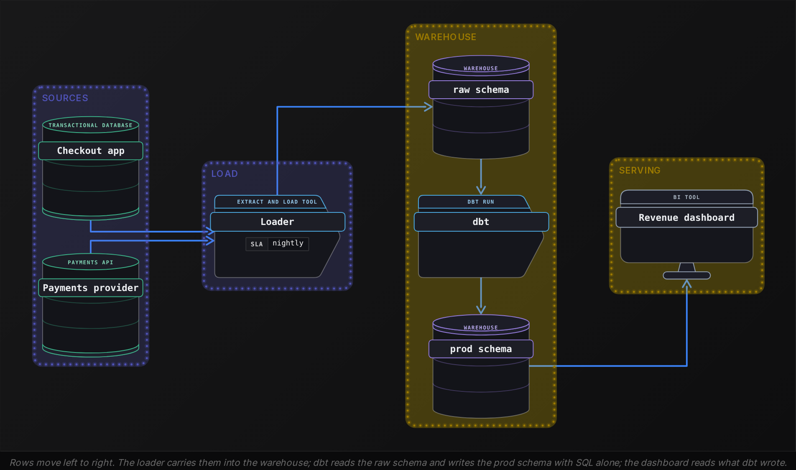
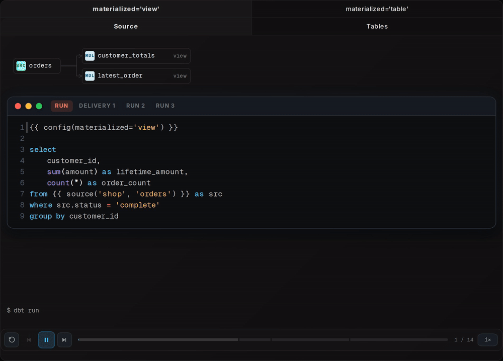
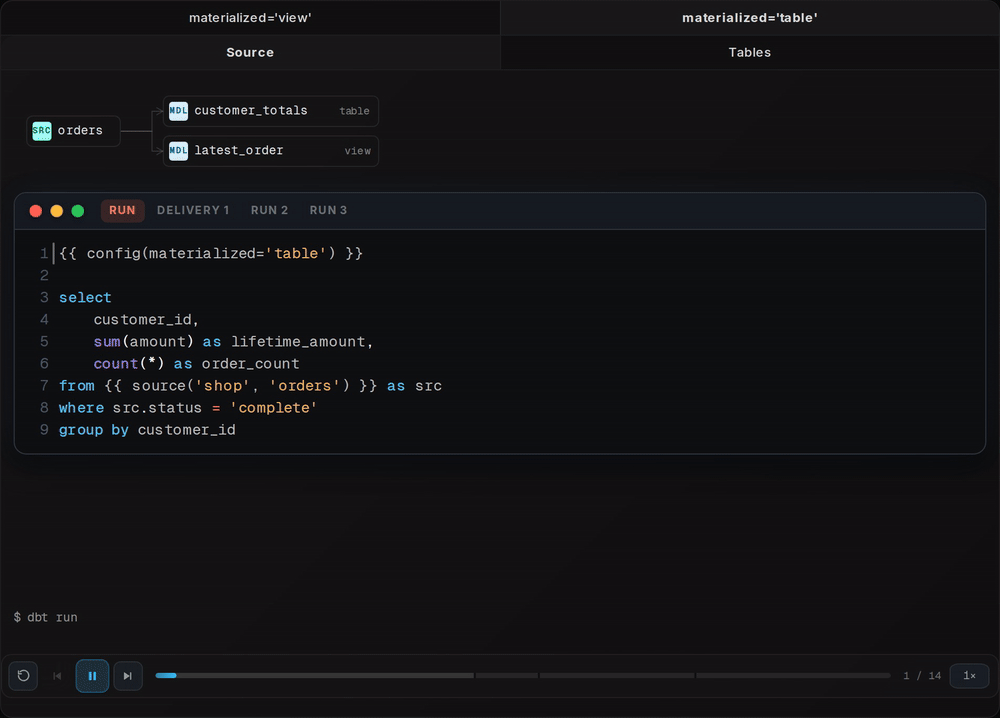
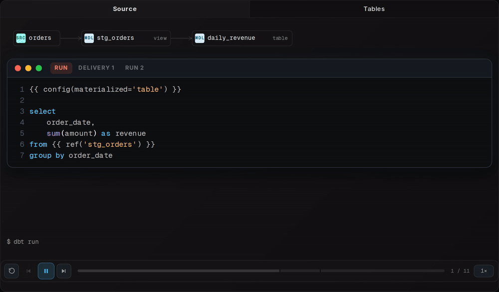

Beginner·[](https://www.getdbt.com/)·20 min · 5 challenges

# Models: Beginner

GitLab publishes its whole analytics codebase, and most of it is dbt models that turn raw CRM and billing tables into the recurring revenue figures finance reports each month, with product usage tables feeding the same models. When an analyst there changes how a trial counts toward that revenue the week the quarter closes, the change is one SQL file, and dbt rebuilds every table that reads it.


<br>

---

## What dbt Is For

### The query that lived in a dashboard

A typical analytics team has a warehouse that a loading tool fills every night with raw tables copied from the company's applications. Every number the business looks at begins as a SELECT someone wrote over those tables: daily revenue, active customers, refund rate. The first version of each query lives where it was written, inside a dashboard tool or a saved worksheet, and for a while that works.

The trouble arrives with the second analyst. She needs daily revenue too, so she copies the query and changes one filter. 6 months later the finance team counts a refunded order as revenue and the product team does not, and nobody can say which of the 11 copies is the right one. The queries that create tables are in worse shape: someone runs `CREATE TABLE` statements by hand each morning, in an order kept in their head, and a missed step leaves a dashboard reading yesterday's numbers under today's date.


<br>

### Transformation as code

dbt exists to turn that pile of saved queries into a project. Each transformation becomes a file holding one SELECT statement, kept in a folder under version control with every other transformation the company has. When you run dbt, it reads every file, works out which files depend on which, wraps each SELECT in the statement that creates a table or a view, and sends those statements to the warehouse in an order where every dependency is built before the file that reads it.

```sql
SELECT
  CAST(ordered_at AS DATE) AS order_date,
  SUM(amount) AS revenue
FROM raw.orders
WHERE status = 'complete'
GROUP BY 1
```

Set that beside the version in the dashboard. The SELECT is the same text. What changed is where it lives and who runs it: the file sits next to every other transformation, its history is a git log, and a scheduler runs `dbt run` each morning in place of a person. A new analyst who needs daily revenue reads this file or builds on top of it, and the 11 copies never come into being.

Writing only the SELECT is the design decision the rest of dbt depends on. Because the `CREATE TABLE` and `DROP` statements are missing from a model, and so is any `INSERT`, dbt is free to choose those statements itself: the same file can be built as a view today and a table next month, and the same file can build into a private schema on your laptop and into the production schema on the scheduler. The author decides what the rows should be; dbt decides how they come to exist.

That division tells you what kind of tool dbt is. The joins and aggregations run inside the warehouse that already stores the tables. dbt's own work is generating the SQL and sending each statement in the right order, then reporting what came back. A dbt project is a description of the tables a company wants to exist, and `dbt run` is the act of making the warehouse match that description.

| ✓ Saved queries, run by hand | ✗ A dbt project |
| --- | --- |
| • Each copy drifts from the others<br><br>• Build order lives in someone's head<br><br>• A change is tested by running it in production<br><br>• Nobody can list which tables depend on which | • One file per transformation, under version control<br><br>• dbt derives the build order from the files<br><br>• The same files build a private copy for testing<br><br>• The dependency graph is drawn from the files |


<br>

### What a run prints

Running `dbt run` in a project of 3 files prints one pair of lines per file: a START line when dbt sends the statement and an OK line when the warehouse returns, each naming the model and whether it was created as a view or a table. The last line totals the results: how many models passed, and how many failed or were skipped. The ref() section walks through that log line by line; for now the point is that a person typed one command and 3 tables came to exist in the right order.


> **TIP**
>
> Keep each model to one SELECT. dbt wraps the whole file in a single CREATE statement, so a second statement in the file reaches the warehouse inside that wrapper and fails there.

The word model is dbt's name for one of these files, and this lesson takes models at their plainest: a SELECT over raw tables, built as a view or a table, reading other models by name. Everything else dbt does hangs off that file.


<br>

---

## Where dbt Fits

### From checkout page to dashboard

Follow one order from the shop's checkout page to the revenue dashboard. The order is written to the application's transactional database. A loading tool copies that row, with the rest of the table, into the warehouse's `analytics` database each night, into a schema the team calls `raw`, with the columns exactly as the application stored them. dbt reads `raw.orders`, joins and aggregates the filtered rows into tables the business can use, and writes those tables to a schema called `prod` in the same database. The dashboard tool queries `analytics.prod.daily_revenue` and draws a chart.




<br>

### Extract, load, transform

That path has 3 jobs. Extraction pulls rows out of the systems that produce them. Loading lands those rows in the warehouse unchanged. Transformation turns the landed rows into the shapes the business asks for. dbt does the third job, and only the third: it holds no connection to the checkout database or the payments API, and it copies no row across the network. Every action it takes is a SQL statement sent to the warehouse, which reads one of its own tables and writes another.

| Job | Who does it | Where the rows are afterwards | dbt's part |
| --- | --- | --- | --- |
| Extract | loading tool | in flight from the source system | none |
| Load | loading tool | raw schema, unchanged | none; dbt reads what landed |
| Transform | dbt | prod schema, reshaped | the whole job |
| Serve | BI tool | on screens | none; dbt built what it reads |


<br>

### Why transformation comes after loading

Doing the transformation after loading, inside the warehouse, is what lets a dbt model be a plain SELECT. Older pipelines transformed rows in flight, in a separate processing engine, before they reached the warehouse: a change to a metric meant a change to a program, and the raw rows were gone by the time anyone wanted to recompute. With the raw tables kept, every model can be rebuilt from scratch at any time, and a wrong definition of revenue costs one corrected file and one run.

The split also sets the edges of what you can fix in dbt. A missing column in `raw.orders` is a loading problem, because the loader decides what lands. A dashboard that times out is a serving problem, or a sign that the model it reads should be a table and not a view; the View or Table section takes that up. A revenue figure that disagrees with finance is a transformation problem, and that one is yours.


<br>

### A second source

The second source on the diagram shows why the raw schema is worth keeping. The payments provider delivers a `charges` table with amounts in cents and a `created` column holding a Unix timestamp; the checkout app stores `amount` in dollars and `ordered_at` as a timestamp. Neither system knows about the other. The model that matches a charge to its order lives in dbt, where both tables already sit in one warehouse and one SELECT can read both. Had the match been attempted in the loader, every new source system would need a new home for that logic.

Inside the warehouse band, the 2 schemas have different owners. Only the loader writes to `raw`, so a model can trust that what it read this morning is what landed. Only dbt writes to `prod`, so a table there can be dropped and rebuilt without asking whose work it was. Keeping those 2 rules is most of what it takes for the diagram to stay true a year from now.

Timing follows the same split. The loader starts at 6:00 and finishes by 6:20; the scheduler starts `dbt run` at 6:30; the dashboards refresh at 7:00. A table built at 6:30 holds the rows landed by 6:20. An order placed at 6:45 reaches `raw` only with the next night's load, so no model shows it before then, whether it is built as a table or a view, because a model reads only what the loader has landed. A view gets ahead of a table only when rows land after the last dbt run, as with a loader that runs every 15 minutes, a difference the View or Table section explains.

| ✓ What belongs to dbt | ✗ What belongs to other tools |
| --- | --- |
| • Every SELECT that turns raw tables into tables the business reads<br><br>• The order those SELECTs run in<br><br>• Whether each result is stored as a view or a table<br><br>• The names of the raw tables it reads, declared in one place | • Copying rows out of source systems<br><br>• The clock that starts a load and then a run<br><br>• Drawing charts over the finished tables<br><br>• Storing and scanning the rows |

| ✓ Do | ✗ Don't |
| --- | --- |
| • Point dbt only at tables a loader has already landed<br><br>• Keep raw tables unchanged so every model can be rebuilt<br><br>• Let the scheduler finish the load before dbt run starts | • Expect dbt to copy rows from an API<br><br>• Edit raw tables by hand to fix a model<br><br>• Transform rows before they reach the warehouse |

*The loader and dbt usually share one scheduler: load first, then dbt run, so the models see this morning's rows. Running dbt on a schedule has a lesson of its own later in the track.*


<br>

---

## Models Over Sources

### A model is one SELECT

A model is a file in the `models/` folder with a `.sql` extension. The file holds one SELECT statement. The file's name is the model's name, so `models/stg_orders.sql` is the model `stg_orders`. dbt names the table or view it builds from that file `stg_orders` too. That is the whole definition. Adding a file adds a model: the file needs no header, and no list of models has to be registered or updated.


<br>

### Sources are declared once

The model needs to read `raw.orders`. Writing `raw.orders` in the FROM clause works, and the model in the first section did. The cost shows up around the 40th model: when the loader is reconfigured to land tables in a schema called `raw_shop`, 40 files have to change. The team finds out which ones were missed when the morning run fails. dbt's answer is to declare each raw table once, in a YAML file in the models folder, and have every model name it through a function.

```sql
version: 2

sources:
  - name: shop
    database: analytics
    schema: raw
    tables:
      - name: orders
      - name: customers
```

The source `shop` names the loader's landing area. Inside it are the tables `orders` and `customers`. A model reads a source table with `{{ source('shop', 'orders') }}` in its FROM clause. The double braces mark a region dbt fills in before any SQL leaves your machine. dbt looks up `shop` to find `analytics.raw`, then appends `orders` and writes `analytics.raw.orders` into the statement. When the landing schema moves, one line in the YAML changes and every model follows.


```sql
select
    order_id,
    customer_id,
    cast(ordered_at as date) as order_date,
    amount
from {{ source('shop', 'orders') }}
where status = 'complete'
```

`stg_orders` does what most models over a raw table do. It keeps the 4 columns later models need and drops `status` once the filter has used it, it renames `ordered_at` to `order_date`, and it casts that timestamp to a date. Every model that reads it inherits those clean columns without repeating the work.

The braces are the syntax of a templating language called Jinja, and dbt renders every braced region before sending anything. This lesson uses 2 of its functions: `source()` here, and `ref()` in the last section. The Jinja lessons later in the track open the rest.


<br>

### The SQL dbt writes around the SELECT

Running `dbt run` on this project produces 2 pieces of SQL for the model, and dbt saves both to disk so you can read them. The first is the compiled SQL: the file with every braced region replaced by the text it rendered to. It lands at `target/compiled/shop_analytics/models/stg_orders.sql`, under the project's name, and reads as plain SQL.

```sql
SELECT
  order_id,
  customer_id,
  CAST(ordered_at AS DATE) AS order_date,
  amount
FROM analytics.raw.orders
WHERE status = 'complete'
```

The second is the SQL dbt sends. dbt takes the compiled SELECT and wraps it in the statement that makes a view or a table, with the model's own name as the target, and saves that at `target/run/shop_analytics/models/stg_orders.sql`. This is the statement the warehouse receives, and it is the one to read when a run fails with an error you do not recognise.

```sql
create or replace view analytics.dbt_maria.stg_orders as
select
    order_id,
    customer_id,
    cast(ordered_at as date) as order_date,
    amount
from analytics.raw.orders
where status = 'complete'
```

Read the 2 files together and the division of labour is visible. Everything from `select` to the final line is yours, copied through unchanged. The first line is dbt's, and it is the only part that changes when the model becomes a table instead of a view. The schema `dbt_maria` is also dbt's: it comes from the connection profile the run used, so the same file builds into a different schema for each person who runs it.

| File | Written by | Holds |
| --- | --- | --- |
| models/stg_orders.sql | you | the SELECT, with source() regions |
| target/compiled/.../stg_orders.sql | dbt | the SELECT with every region rendered |
| target/run/.../stg_orders.sql | dbt | the rendered SELECT inside a CREATE statement |


<br>

### Source names and model names

Keep the 2 kinds of name apart. A source name is a name for something the loader created, and dbt never builds it: `source('shop', 'orders')` renders to a table that must already exist when the run starts. A model name is a name for something dbt will build, and the build creates it. If `raw.orders` is missing, the error comes from the warehouse, saying the table doesn't exist, because dbt sent a SELECT over a name it took on trust.

> **TIP**
>
> When a run fails, open target/run, copy the statement for the failing model, and run it in the warehouse's own query editor. The error message there is often clearer than the one dbt relays, and you can edit the statement in place until it passes.


<br>

---

## View or Table

### Storing the SELECT or the rows

The first line of the run SQL carries a decision: is `stg_orders` a view or a table? A view stores the SELECT. Querying it runs that SELECT against `raw.orders` at that moment, so the view reflects whatever the loader has landed so far, and each read costs the full query. A table stores the rows. Building it runs the SELECT once and keeps the result, so a read is a scan of stored rows, and the rows are as old as the last `dbt run`.

| Property | View | Table |
| --- | --- | --- |
| What the warehouse stores | the SELECT text | the rows |
| Work during dbt run | a catalog entry, nothing more | the full query runs |
| Work during a read | the full query runs | a scan of stored rows |
| Freshness | as of the moment it is read | as of the last run |
| Storage used | none | the size of the result |


<br>

### Telling dbt which one

dbt calls this choice the model's materialization, and the default is view. To make a model a table, set `materialized` in a config block at the top of the file. The block is another braced region, rendered before the SQL is sent, and it produces no text of its own: it tells dbt how to wrap the SELECT that follows.

```sql
{{ config(materialized='table') }}

select
    customer_id,
    sum(amount) as lifetime_amount,
    count(*) as order_count
from {{ source('shop', 'orders') }} as src
where src.status = 'complete'
group by customer_id
```

The run SQL now begins `create table analytics.dbt_maria.customer_totals as`, and the warehouse does the aggregation during the run rather than during each read. On most warehouses dbt builds the new table under a temporary name and swaps it into place at the end, so a dashboard reading `customer_totals` sees either yesterday's complete rows or today's, never a half-built table.

The run log names the materialization on each model's line, a view for `stg_orders` and a table for `customer_totals`, and the table's line carries the longer time, because the warehouse did the aggregation during the run.

The setting can also be made for a whole folder in `dbt_project.yml`, under the `models:` key. A file's own config block wins over the folder's setting, so a project can default to views and mark a folder of heavy models as tables, or the reverse.

```sql
models:
  shop_analytics:
    +materialized: view
    reports:
      +materialized: table
```


<br>

### Choosing

The choice follows from who reads the model and how often. A view costs nothing to build and nothing to store, and it suits a model that reshapes rows without heavy work, that few queries read, or that has to show the latest landed rows between runs. A table suits a SELECT that is expensive, a result that many dashboards read, or figures that every reader must see identically until the next run. An aggregation over millions of orders read by 50 dashboards every morning is the strongest case for a table: as a view, the warehouse would run that aggregation 50 times before lunch.

The choice also changes what a stale number means. If `customer_totals` is a table and a customer's count is wrong, the first question is when the last run finished, because the table cannot know about rows landed since. If it is a view and the count is wrong, the run time is irrelevant: the view computed its answer from `raw.orders` as it stood a second ago, so the fault is in the SELECT or in what the loader landed.

Storage is the quieter difference. A view occupies a row in the warehouse's catalog and nothing else. A table occupies the size of its result for as long as it exists, and a project of 300 tables where 250 could have been views pays for 250 copies of rows that already sit in `raw`. The habit that keeps that in check is asking of each table model what a reader gains from the rows being stored.

> Signs a view should become a table
>
> - The same dashboards query it many times a day
> - Its SELECT joins or aggregates millions of rows
> - Readers must all see identical figures until the next run
> - Query times from the dashboard are measured in minutes

**materialized='view'**



**materialized='table'**



*$ dbt run*

> **TIP**
>
> When unsure, start with a view. Switching to a table later is one config line and one run, and the view will have told you how slow the SELECT is by then.


<br>

---

## ref() Orders the Build

### One model reads another

The first section's `daily_revenue` cast `ordered_at` to a date and kept only completed orders itself, and `stg_orders` now does both. Reading `stg_orders` in place of the raw table removes that duplicated work. dbt provides a function for it: `{{ ref('stg_orders') }}`. It takes a model's name and does 2 things: it renders to the table or view this run built for that model, and it links `daily_revenue` to a model dbt must build first. `source()` adds a node to the graph too, but a source is a node dbt never builds; it only has to exist when the run starts.

```sql
{{ config(materialized='table') }}

select
    order_date,
    sum(amount) as revenue
from {{ ref('stg_orders') }}
group by order_date
```


<br>

### ref() names the right table

When the run uses a profile whose schema is `dbt_maria`, `stg_orders` is built as `analytics.dbt_maria.stg_orders`, and `ref('stg_orders')` in the next model renders to that same name. On the scheduler, with a profile whose schema is `prod`, the first model is built as `analytics.prod.stg_orders` and the ref renders to that. The file never changes. Had the author written `analytics.prod.stg_orders` by hand, every developer's private build would read production's copy of the model in place of their own, and a broken change would look fine until it shipped.

| Where the run happens | Profile schema | ref('stg_orders') renders to |
| --- | --- | --- |
| Maria's laptop | dbt_maria | analytics.dbt_maria.stg_orders |
| Jun's laptop | dbt_jun | analytics.dbt_jun.stg_orders |
| the scheduler | prod | analytics.prod.stg_orders |


<br>

### Each ref() sets the build order

The second thing `ref()` does happens before any SQL is sent. While reading the project, dbt collects every `ref()` and every `source()` in every file and draws a graph: each model and each source table is a node, and each `ref()` is an edge from the model named to the model that named it. dbt takes the build order from that graph. A model is built only after every model it refs has finished, so `stg_orders` goes first and `daily_revenue` after it, with no list of steps written anywhere in the project.

The log of a run reads as that order. Each node gets a START line when it begins and a finish line when it ends, and the lines are numbered `1 of 2` and `2 of 2`. The final summary counts the passes, with errors and skips counted on their own.

| Line | What dbt did |
| --- | --- |
| 1 of 2 START sql view model dbt_maria.stg_orders | opened the first node, which refs nothing dbt builds |
| 1 of 2 OK created sql view model dbt_maria.stg_orders | the CREATE VIEW statement returned |
| 2 of 2 START sql table model dbt_maria.daily_revenue | opened the node that refs stg_orders, now that it exists |
| 2 of 2 OK created sql table model dbt_maria.daily_revenue | the CREATE TABLE AS statement returned |
| Done. PASS=2 WARN=0 ERROR=0 SKIP=0 NO-OP=0 TOTAL=2 | the summary of the run |

When a node fails, a model with a typo in its SELECT for instance, every model downstream of it, meaning every model that refs it directly or through others, is skipped rather than run against a table that was never rebuilt. Models on other branches of the graph carry on. The summary counts the error and the skips, and the command exits with a non-zero code so a scheduler notices.

With more than 1 thread, dbt builds nodes that have no path between them at the same time: 2 models that both ref `stg_orders` and nothing else start together once it finishes. The order the graph imposes still holds; only the independent nodes overlap.

The graph also answers the question the folder of saved queries could not: what reads this? Every edge out of a model is a model that will break if its columns change, and dbt can list them from the files alone, before anything is run.



*$ dbt run*


<br>

### run and build

`dbt run` builds models and nothing else. `dbt build` walks the same graph and builds every kind of node the project has, models among them, in the same dependency order. In a project that holds only models, the 2 commands do the same work; later lessons add the node kinds that make `build` the command most teams schedule.

| ✓ Do | ✗ Don't |
| --- | --- |
| • Name another model with ref(), never by its schema and table<br><br>• Let the graph decide the order; write no run list<br><br>• Read the run log top to bottom as the build order | • Write analytics.prod.stg_orders inside a model file<br><br>• Ref a model from itself, which makes a cycle dbt refuses<br><br>• Read a raw table in a model that could ref a cleaned one |


<br>

---

## Putting It All Together

GitLab's finance team closes the quarter from recurring revenue tables that its public dbt project builds over subscription billing and CRM account data a loader lands in the warehouse. An analyst corrects how a trial that converted on the quarter's last day counts, in one model file, and the night's run rebuilds every table that reads it.

- The correction is one SELECT in one file under version control (What dbt Is For), and every dashboard that read the old definition reads the new one after the run.
- The loader landed the billing rows unchanged into a raw schema, and dbt's part begins there with SQL alone (Where dbt Fits).
- The model reads the subscription table through source(), so a move of the landing schema changes the YAML and leaves the model untouched, and her test build went to her own schema because the schema comes from the profile her run used (Models Over Sources).
- The revenue table is a table, built once a night, so finance sees one figure all day however many times the dashboards read it (View or Table).
- Downstream models ref() the corrected one, so dbt rebuilt them after it, in her dev schema while she tested and in the production schema that night (ref() Orders the Build).


<br>

---

## Key Takeaways

- A model is a file in models/ holding one SELECT; the file name is the name of the table or view dbt builds.
- dbt sends SQL to the warehouse and moves no rows itself: loaders fill the raw schema, and dbt reads from it to write the tables the business reads.
- source() names a raw table declared once in YAML; ref() names another model and renders to wherever that model was built in this run.
- A view stores the SELECT and runs it at read time; a table stores the rows at run time. The materialized config makes the choice, and it can be set in the file itself or in dbt_project.yml.
- Every ref() is an edge in the graph dbt draws from the files, and the graph is the build order: a node runs only after everything it refs has finished.
- target/compiled holds each model's rendered SELECT and target/run holds the CREATE statement that wrapped it; read the second when a run fails.

[](https://www.getdbt.com/)

Official dbt resources

"dbt enables data analysts and engineers to transform their data using the same practices that software engineers use to build applications." [github.com/dbt-labs/dbt-core](https://github.com/dbt-labs/dbt-core)

[Documentation](https://docs.getdbt.com/)[Get started](https://docs.getdbt.com/docs/get-started-dbt)[Source](https://github.com/dbt-labs/dbt-core)

dbt and the dbt logo are trademarks of dbt Labs, LLC.
