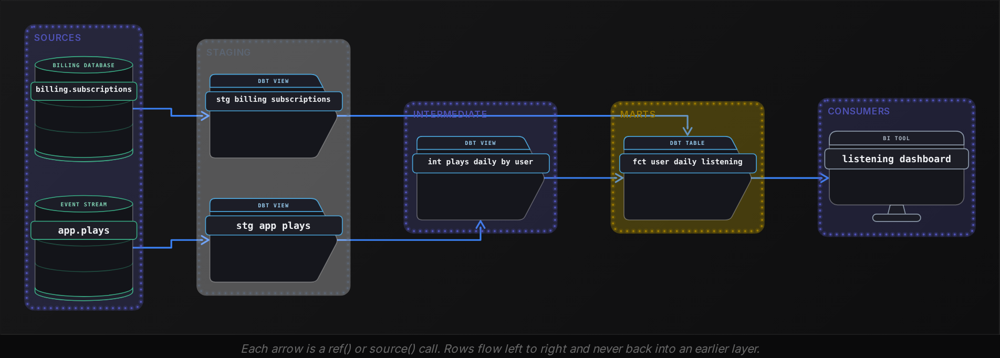
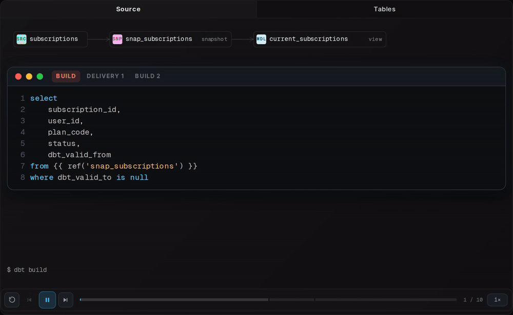

Intermediate·[](https://www.getdbt.com/)·20 min · 6 challenges

# Models: Intermediate

At Spotify, a listener on Premium Individual upgrades to Premium Duo on March 2. The billing system updates her row in place, and by March 3 nothing in the warehouse says she was ever on Individual. The finance team asks why Duo revenue jumped and Individual revenue dipped. Whether anyone can answer depends on how the dbt project was built.


<br>

---

## Staging, Intermediate, Marts

### Each layer has 1 job

A project with 1 source table and 2 marts can read the source from each mart and stay readable. A project with 40 source tables and 60 marts cannot: every mart repeats the same renames and casts, and when the billing system renames a column, every mart that touches it breaks on the same morning. Layering splits the work into 3 kinds of model. Each kind is allowed one job, so any change lands in 1 file.

Take 3 marts that read billing.subscriptions directly. The first casts started_at to a timestamp, the second does the same under a different alias, and the third forgets the cast and compares a string to a date. That is 3 copies of the same 4 lines, and a rename in billing touches all 3. With a staging model between them, the cast is written once and the rename is absorbed once.

| Layer | Prefix | Reads from | Does | Built as |
| --- | --- | --- | --- | --- |
| Staging | stg_ | source() only | rename, cast, light cleaning, 1 model per source table | view |
| Intermediate | int_ | staging and other intermediate models | joins and aggregations that change the grain | view or ephemeral |
| Marts | fct_, dim_ | intermediate and staging | the tables analysts query, named for the business | table |




<br>

### Staging: one model per source table

A staging model reads 1 source table through `source()`, renames its columns to the names the project uses, casts types and stops; joins, aggregations and business rules all happen in later layers. The file name is `stg_` followed by the source name and the table name, with a doubled separator between the two, so `stg_billing__subscriptions` can only mean one thing. Everything downstream selects `subscription_id` and never `id`, which is why the billing team can rename its column and the project changes in 1 file.

```sql
select
    id as subscription_id,
    user_id,
    lower(plan_code) as plan_code,
    status,
    cast(started_at as timestamp) as started_at,
    cast(updated_at as timestamp) as updated_at
from {{ source('billing', 'subscriptions') }}
```

Staging models are built as views. A view stores nothing, so 40 of them cost nothing to keep, and selecting from one always returns the source as it stands at that moment. The renaming itself is cheap work; its value is that it happens in one place.


<br>

### Intermediate: where the grain changes

```sql
select
    user_id,
    cast(played_at as date) as play_date,
    count(*) as plays,
    sum(ms_played) / 60000.0 as minutes_played
from {{ ref('stg_app__plays') }}
group by
    user_id,
    cast(played_at as date)
```

An intermediate model holds a join or an aggregation that would make a mart hard to read if it sat inline. It reads staging models, or other intermediate models, through ref(), and never calls source(). This one turns a table of individual plays into 1 row per user per day. The name carries the layer, the staging model it reads, and what a row stands for. Intermediate models are steps toward a mart; analysts query the marts.


<br>

### Marts: what the business asks for

```sql
select
    d.user_id,
    d.play_date,
    s.plan_code,
    d.plays,
    d.minutes_played
from {{ ref('int_plays__daily_by_user') }} as d
left join {{ ref('stg_billing__subscriptions') }} as s
    on d.user_id = s.user_id
```

A mart is the table an analyst opens. It reads intermediate and staging models and never a source, so every column it shows has passed through a staging rename. The fct_ prefix marks a fact table of events or measures and dim_ a dimension that describes things. Marts are built as tables, because a dashboard that ran the join above on every page load would recompute the aggregation each time, and a table computes it once per build.

```sql
models:
  streaming:
    staging:
      +materialized: view
    intermediate:
      +materialized: view
    marts:
      +materialized: table
```

The project file sets the materialization for each folder, so a model saved under models/marts becomes a table without a config line of its own, and a model under models/staging becomes a view. A model can still override its folder with a config() call at the top of the file.

> What each layer may do
>
> - Staging: select from exactly 1 source() call. Rename, cast, nothing else.
> - Intermediate: ref() staging or intermediate models. Joins and aggregations happen here.
> - Marts: ref() intermediate or staging models. Never source().
> - Nothing reads upward: a staging model never refs an intermediate model or a mart.


> **TIP**
>
> When a mart grows a 50-line subquery, that subquery is an intermediate model waiting for a name. Move it to `models/intermediate`, name it `int_` plus what it reads, a doubled separator, and what a row is, and the mart shrinks back to a join.


<br>

---

## One Grain per Model

### What one row is

The grain of a model is what 1 row stands for. fct_orders holds 1 row per order, fct_order_items 1 row per line on an order, int_plays__daily_by_user 1 row per user per day. Write the grain down before the select, because every join and every sum in the model is correct or wrong only relative to it. A model with 2 grains mixed together has no grain, and no query on it can be trusted.


<br>

### A join that multiplies

Take a shop with 3 orders and 5 order lines. Each order carries its own total, and each line belongs to exactly 1 order.

stg_shop__orders

| order_id | customer_id | order_total |
| --- | --- | --- |
| 1 | 101 | 30.00 |
| 2 | 102 | 12.00 |
| 3 | 101 | 45.00 |

stg_shop__order_items

| item_id | order_id | sku | quantity |
| --- | --- | --- | --- |
| 1 | 1 | A | 1 |
| 2 | 1 | B | 2 |
| 3 | 2 | C | 1 |
| 4 | 3 | A | 1 |
| 5 | 3 | D | 3 |

Revenue across the 3 orders is 30.00 plus 12.00 plus 45.00, which is 87.00. Someone wants revenue per customer with an item count beside it, and joins the 2 staging models in one step.

```sql
select
    o.customer_id,
    sum(o.order_total) as revenue,
    count(i.item_id) as item_count
from {{ ref('stg_shop__orders') }} as o
join {{ ref('stg_shop__order_items') }} as i
    on o.order_id = i.order_id
group by
    o.customer_id
```

Trace the join before the group by. Every order row is matched to each of its lines, so the join result has 5 rows and order 1 appears twice.

| order_id | item_id | customer_id | order_total |
| --- | --- | --- | --- |
| 1 | 1 | 101 | 30.00 |
| 1 | 2 | 101 | 30.00 |
| 2 | 3 | 102 | 12.00 |
| 3 | 4 | 101 | 45.00 |
| 3 | 5 | 101 | 45.00 |

| customer_id | revenue the join reports | true revenue |
| --- | --- | --- |
| 101 | 150.00 | 75.00 |
| 102 | 12.00 | 12.00 |

Customer 101 shows 150.00 against a true 75.00. Order 1 has 2 lines, so its 30.00 is counted twice; order 3 has 2 lines, so its 45.00 is counted twice. The query raised no error and returned numbers, and the numbers are wrong by exactly the number of lines on each order. Any measure that lives on the one side of a join is multiplied by the number of matches on the many side, and a sum over it inherits every copy.


<br>

### Change the grain in its own model

The item count lives at the order-line grain and the total lives at the order grain. The fix brings the lines up to the order grain first, in an intermediate model whose only job is that aggregation, and then joins 2 models that both hold 1 row per order.

```sql
select
    order_id,
    count(*) as item_count,
    sum(quantity) as units
from {{ ref('stg_shop__order_items') }}
group by
    order_id
```

```sql
select
    o.order_id,
    o.customer_id,
    o.order_total,
    coalesce(i.item_count, 0) as item_count,
    coalesce(i.units, 0) as units
from {{ ref('stg_shop__orders') }} as o
left join {{ ref('int_order_items__per_order') }} as i
    on o.order_id = i.order_id
```

Both sides of the join have 1 row per order_id, so the join is 1 to 1 and the output keeps the order grain: 3 rows in, 3 rows out, and sum(order_total) returns 87.00. The left join and the coalesce keep an order that has no lines yet, which an inner join would drop. Revenue per customer is now a group by over fct_orders, with nothing left to multiply.


<br>

### Proving the grain

```sql
SELECT
  COUNT(*) AS row_count,
  COUNT(DISTINCT order_id) AS order_count
FROM analytics.fct_orders
```

If the 2 numbers match, the model holds 1 row per order. If row_count is larger, some join multiplied rows, and the difference is the number of extra copies. Run this on every model whose grain you have declared, and run it again after adding any join. The check takes a second and catches the error before a dashboard does.

> Join types and the grain
>
> - 1 to 1 (orders to per-order item counts): the grain is unchanged.
> - Many to 1 (orders to customers): the grain is the many side, unchanged. Customer columns repeat, which is fine, and customer measures must not be summed here.
> - 1 to many (orders to order lines): the grain becomes the many side. Aggregate the many side first to keep the one side's grain.

| ✓ Do | ✗ Don't |
| --- | --- |
| • Name the grain in the model name and in its first comment line<br><br>• Aggregate the many side to the one side's grain before joining<br><br>• Compare count(\*) with count(distinct key) after every new join<br><br>• Use coalesce after a left join so a missing match reads 0 | • Sum a measure from the one side of a 1 to many join<br><br>• Mix 2 grains in 1 model<br><br>• Trust a query because its numbers look plausible<br><br>• Patch fanout with select distinct, which hides the cause |

Section 0 joined int_plays__daily_by_user to stg_billing__subscriptions on user_id. That join is many to 1 only while every user has exactly 1 subscription row. The first user with a cancelled row and an active row gets every minute of listening counted twice, with no error anywhere. The join belongs behind an intermediate model that reduces subscriptions to 1 row per user, which the ephemeral section builds.


<br>

---

## Seeds for Small Lookups

### Data that lives in the repository

Some tables have no system behind them: a mapping of 4 plan codes to a tier and a monthly price, 12 country codes grouped into 3 sales regions, the 9 internal test accounts every mart must exclude. Nobody loads them, somebody types them, they change a few times a year, and each change should go through the same review a model goes through. dbt calls such a file a seed: a CSV saved under seeds/ that dbt loads into the warehouse as a table, and that models ref() like any other node.

| plan_code | plan_tier | monthly_price_usd |
| --- | --- | --- |
| free | free | 0.00 |
| basic | paid | 9.00 |
| plus | paid | 14.00 |
| family | paid | 19.00 |

*seeds/plan_codes.csv: 1 header line and 4 data lines, saved as plain text beside the models.*

dbt seed reads every CSV under seeds/, creates 1 table per file in the target schema, named for the file, and inserts the rows. Running it again replaces the table's rows with whatever the file holds now, so editing the CSV and committing it is how the table changes. The first line of the file becomes the column names. dbt build loads seeds too, in DAG order, so a seed is in place before any model that refs it runs.

| Command | What happens to plan_codes |
| --- | --- |
| dbt seed | the table is created or replaced with the file's 4 rows |
| dbt build | the seed is loaded first, then every model that refs it |
| dbt run | the seed is untouched; models read whatever rows the table already holds |


<br>

### Pinning the types

```sql
seeds:
  - name: plan_codes
    config:
      column_types:
        plan_code: varchar(16)
        plan_tier: varchar(16)
        monthly_price_usd: decimal(6,2)
```

Without this file dbt infers each column's type from the values it sees. A column of postal codes like 02134 becomes an integer and loses its zero; a price column can land as a floating point type, where a value like 19.99 has no exact binary form and a sum over thousands of rows drifts by fractions of a cent. Declaring `column_types` under the seed's config makes every load produce the same columns whatever the values, and a reviewer can see the types in the same pull request as the data.


<br>

### Reading a seed

```sql
select
    s.subscription_id,
    s.user_id,
    s.plan_code,
    p.plan_tier,
    p.monthly_price_usd
from {{ ref('stg_billing__subscriptions') }} as s
left join {{ ref('plan_codes') }} as p
    on s.plan_code = p.plan_code
```

ref('plan_codes') points at the seed's table and draws the edge in the DAG, so this model runs after the file has been loaded. The join is many to 1: plan_codes has 1 row per plan_code, so the subscription grain holds. That depends on the CSV. A second line for basic, added by hand with a new price, turns the join into 1 to many and every basic subscription appears twice. The key column of a seed must stay unique, and a reviewer reading the diff is what keeps it so.

A seed sits beside staging in the layers. Like a source, it enters the project from outside the SQL; like a staging model, it is read by intermediate models and marts through ref(). Some teams write a staging model over each seed so marts only ever see stg_ and int_ names; others ref the seed from an intermediate model directly. Either way a seed refs nothing, and a seed never stands in for a source table.

When the price of plus rises to 15.00, the CSV changes in a pull request, the reviewer sees 1 line changed, the next dbt seed replaces the table, and every model that refs it carries the new price on its next build. Compare that with a price hard-coded in 6 marts, where the same change is 6 edits and a search to find them.


<br>

### Seed or source

| ✓ A seed | ✗ A source |
| --- | --- |
| • Typed by a person and changed through pull requests<br><br>• Hundreds of rows, a few thousand at most<br><br>• No system owns it; the project is its home<br><br>• Versioned with the code that reads it | • Owned and written by another system<br><br>• Loaded into the warehouse by something other than dbt<br><br>• Any size, from 10 rows to 10 billion<br><br>• Changes without a commit, so dbt only reads it |

A seed is read by a human before it is read by a machine, so size is the first test. A file of 300 rows is reviewable in a pull request; a file of 300,000 rows is a data load pretending to be code, and every dbt build inserts all 300,000 rows again. Data a system owns belongs as a source even when it is small, because the system will change it without a commit and the seed will drift. Personal data and secrets never belong in a seed, because the repository is readable by everyone with access to the code.

> **TIP**
>
> Keep each seed to the columns someone will edit by hand. A seed of plan codes needs plan_code, plan_tier and monthly_price_usd; it does not need the 14 columns the billing system attaches to a plan.


<br>

---

## Ephemeral Models

### A model dbt never builds

Materialized as a view or a table, a model becomes an object in the warehouse. Materialized as ephemeral, it becomes nothing there. dbt keeps its SQL, and when another model refs it, dbt pastes that SQL into the referencing model as a CTE and sends the combined statement. The ephemeral model exists in the project files and in the lineage, and never in the schema. Here the intermediate model that section 1 asked for settles subscriptions to 1 row per user.

```sql
{{ config(materialized='ephemeral') }}

select
    user_id,
    max_by(plan_code, started_at) as plan_code
from {{ ref('stg_billing__subscriptions') }}
where status = 'active'
group by
    user_id
```

The group by settles the grain to 1 row per user whatever the subscriptions table holds, and max_by returns the plan_code of the active row that started most recently. The mart from section 0 now refs this model instead of the staging view.

```sql
select
    d.user_id,
    d.play_date,
    c.plan_code,
    d.plays,
    d.minutes_played
from {{ ref('int_plays__daily_by_user') }} as d
left join {{ ref('int_subscriptions__current') }} as c
    on d.user_id = c.user_id
```


<br>

### The SQL dbt sends

```sql
create table analytics.fct_user_daily_listening as
with __dbt__cte__int_subscriptions__current as (
    select
        user_id,
        max_by(plan_code, started_at) as plan_code
    from analytics.stg_billing__subscriptions
    where status = 'active'
    group by
        user_id
)
select
    d.user_id,
    d.play_date,
    c.plan_code,
    d.plays,
    d.minutes_played
from analytics.int_plays__daily_by_user as d
left join __dbt__cte__int_subscriptions__current as c
    on d.user_id = c.user_id
```

The ref() to int_subscriptions__current became the CTE name __dbt__cte__int_subscriptions__current, and the whole body of the ephemeral model was pasted in above the mart's select. The ref() to int_plays__daily_by_user, a view, became a relation name as before. dbt sends 1 statement for the mart, and the warehouse runs the group by over subscriptions as part of building the table. When the run finishes, nothing named int_subscriptions__current exists in the schema.

| Materialization | What dbt sends for the node | What the warehouse holds after | What a ref() to it becomes |
| --- | --- | --- | --- |
| view | create view | a saved query | the view's name |
| table | create table as | the rows | the table's name |
| ephemeral | nothing of its own | nothing | a CTE pasted into the caller |


<br>

### What that changes

- No object to query: a select from analytics.int_subscriptions__current fails, the relation was never created.
- Its SQL runs once per model that refs it: 3 marts that ref it run the group by 3 times.
- It stays in the lineage and dbt orders the build around it, but the node itself takes no run time.
- An ephemeral model that refs another ephemeral model nests as a second CTE; a chain of 5 makes a 5-CTE statement.
- To see its rows, build a model that refs it, or switch its config to view for an afternoon.


<br>

### Ephemeral or a warehouse object

| ✓ Ephemeral fits | ✗ Make it a view or a table |
| --- | --- |
| • Logic read by 1 or 2 models<br><br>• A filter or a small aggregation too light to deserve a warehouse object<br><br>• A schema you want to show only the tables analysts should open | • Logic refd by many models, which would each recompute it<br><br>• Rows you need to inspect while debugging<br><br>• Heavy work, where a table stores the result once per build |

The schema listing is the first reason. A project with 30 intermediate models as views lists 30 objects beside the 8 marts analysts want, and every analyst learns to skip past them. Ephemeral keeps the project's structure in the files and the warehouse's listing to the results. The cost is repetition: a heavy intermediate model refd by 6 marts recomputes 6 times per build, where a view or a table pays once.

Switching a model between view and ephemeral changes no SQL inside it and no SQL in any model that refs it. The 1 line of config decides whether dbt sends a create view during the run and a relation name in the mart, or nothing during the run and a CTE in the mart. Because every neighbor reaches the node through ref(), none of them depends on how the node is materialized.

> **TIP**
>
> Start an intermediate model as a view while you are writing it, so you can select from it and check its grain. Switch it to ephemeral once the rows are right and only 1 or 2 marts read it.


<br>

---

## Snapshots Keep History

### A table that forgets

billing.subscriptions holds 1 row per subscription, and the billing system updates that row in place. On March 1, subscription 2 reads plan_code basic. At 09:00 on March 2 the user upgrades, the row reads plus, and updated_at moves forward. stg_billing__subscriptions is a view over that table, so it shows plus too, and nothing in the project says basic was ever there. A revenue-by-plan mart built on March 3 reports March 1 as if subscription 2 had been on plus all along. A model can only reflect the source as it stood when the model ran, and a source that overwrites keeps 1 state.

| ✓ A plain model over the source | ✗ A snapshot of the source |
| --- | --- |
| • Holds the present state, 1 row per key<br><br>• Rebuilt from scratch each run<br><br>• Cannot answer what a row said last week | • Holds every version of each row dbt has seen<br><br>• Grows each run by the rows that changed<br><br>• Answers what a row said at any moment since the first run |


<br>

### How dbt snapshot compares and writes rows

```sql
snapshots:
  - name: snap_subscriptions
    relation: source('billing', 'subscriptions')
    config:
      unique_key: subscription_id
      strategy: timestamp
      updated_at: updated_at
```

dbt snapshot reads the relation, compares it with the snapshot table by unique_key, and writes the difference. On the first run there is no snapshot table, so dbt creates it with every source row plus 4 columns of its own. On every later run, a key whose updated_at is newer than its open snapshot row's gets that row closed and a fresh row inserted; a key with no change is left alone; a key the snapshot has never seen is inserted as an open row. The strategy line names how dbt detects a change, and here it watches the updated_at column.

| Column | What it holds |
| --- | --- |
| dbt_valid_from | the updated_at the version was taken from, when the version began |
| dbt_valid_to | the updated_at of the version that replaced it, null while current |
| dbt_updated_at | the source row's updated_at at the time of the run |
| dbt_scd_id | a hash of the key and updated_at, 1 per version |



*$ dbt build*

Run 1 writes 3 rows, every one open. Before run 2, subscription 2 moves from basic to plus with updated_at 2026-03-02 09:00:00; run 2 closes the basic row by setting its dbt_valid_to to that timestamp and inserts a plus row, so the table holds 4 rows. Subscriptions 1 and 3 never changed, and each keeps its single open row after both runs.

| subscription_id | plan_code | status | dbt_valid_from | dbt_valid_to |
| --- | --- | --- | --- | --- |
| 1 | basic | active | 2026-02-10 08:00:00 | null |
| 2 | basic | active | 2026-02-14 12:30:00 | 2026-03-02 09:00:00 |
| 2 | plus | active | 2026-03-02 09:00:00 | null |
| 3 | plus | active | 2026-02-20 17:45:00 | null |

*snap_subscriptions after run 2: 4 rows for 3 subscriptions, and the only closed row is the one that changed.*


<br>

### Reading history back

```sql
SELECT
  subscription_id,
  plan_code
FROM analytics.snap_subscriptions
WHERE dbt_valid_to IS NULL
```

```sql
SELECT
  subscription_id,
  plan_code
FROM analytics.snap_subscriptions
WHERE dbt_valid_from <= TIMESTAMP '2026-03-01 23:59:59'
  AND (
    dbt_valid_to > TIMESTAMP '2026-03-01 23:59:59'
    OR dbt_valid_to IS NULL
  )
```

The second query returns subscription 2 as basic, because its basic row was valid from February 14 until 09:00 on March 2, and the chosen moment falls inside that span. The first query returns it as plus. Both read the same table; the filter on the 2 validity columns picks which version. A snapshot has more than 1 row per key by design, so any join to it must pick a version first, or section 1's multiplication returns.

In the layers, a snapshot reads the source, so it sits beside staging, and an intermediate model reads it with `ref('snap_subscriptions')`, the way it would read a staging model. Marts that need history read that intermediate model; marts that need only the present can keep reading `stg_billing__subscriptions`. `dbt snapshot` runs only snapshots, and `dbt build` runs them in DAG order alongside seeds and models, so the snapshot refreshes before anything that refs it.

> Rules a snapshot lives by
>
> - Snapshot the source relation, not a staging view: history should hold what the system said, before any rename or cast the project might later change.
> - updated_at must move whenever a column you care about changes. A row that changes without touching updated_at is a change the snapshot never sees.
> - A value held only between 2 runs is never seen: a row changed and changed back gets a new version holding the old value. The run schedule sets the history's resolution.
> - dbt never drops a snapshot table on its own, and nothing can rebuild lost history from a source that keeps only the present.

> **TIP**
>
> Start the snapshot the day you learn a source overwrites its rows, before anyone asks for history. Every version that passed before the first run is gone, and the first run can only record the present.


<br>

---

## Putting It All Together

Netflix launched an ad-supported plan in November 2022, and members moved between plans for months afterwards. A finance analyst wants monthly revenue by plan for the year around the launch, built from a billing table that overwrites each member's row whenever the plan changes.

- The billing table overwrites rows, so a snapshot of the source is the only place last year's plan assignments can live; a staging view over it would show today's plans for every month.
- Plan codes map to a tier and a monthly price in a 4-row table nobody's system owns, so it is a seed, and its key column is checked for uniqueness before any join.
- Revenue by plan per month is 1 row per plan per month. The snapshot has several rows per member, so an intermediate model picks the version valid at each month end before any sum, and each member is counted once per month.
- That version-picking model is read by 1 mart, so it is ephemeral and the schema shows the mart alone; the snapshot and the seed sit beside staging, and the mart reads only through ref().


<br>

---

## Key Takeaways

- Staging reads 1 source and renames; intermediate joins and aggregates; marts are what analysts open. No layer reads from a layer to its right.
- Every model has 1 grain. A 1 to many join moves the grain to the many side, so aggregate the many side first and check count(\*) against count(distinct key).
- A seed is a small hand-kept CSV loaded by dbt seed and read through ref(); its key column must stay unique and its types belong in YAML.
- An ephemeral model is pasted into each model that refs it as a CTE, builds nothing in the warehouse, and recomputes once per caller.
- A snapshot keeps every version of each row with dbt_valid_from and dbt_valid_to, and the filter on those 2 columns chooses the present or any past moment.

[](https://www.getdbt.com/)

Official dbt resources

"dbt enables data analysts and engineers to transform their data using the same practices that software engineers use to build applications." [github.com/dbt-labs/dbt-core](https://github.com/dbt-labs/dbt-core)

[Documentation](https://docs.getdbt.com/)[Get started](https://docs.getdbt.com/docs/get-started-dbt)[Source](https://github.com/dbt-labs/dbt-core)

dbt and the dbt logo are trademarks of dbt Labs, LLC.
