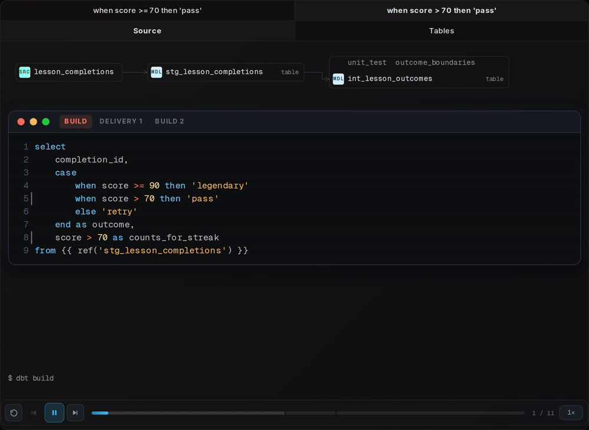
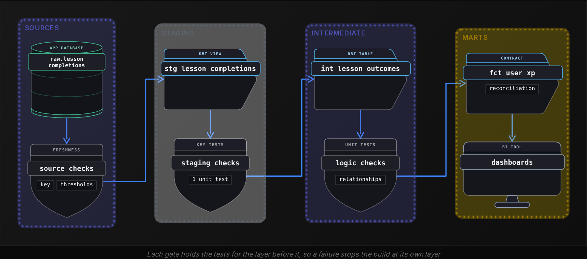

Advanced·[](https://www.getdbt.com/)·20 min · 7 challenges

# Testing: Advanced

Picture Duolingo's data team rewriting the SQL that decides whether a day counts toward a learner's streak, so a day covered by a streak freeze stops registering as a miss. Nobody wants to find a bug by resetting a learner's 1,000-day streak to 0, so the rewrite ships only after a test on 6 rows written by hand shows the new logic keeps every streak the old rules kept.


<br>

---

## Unit Tests on Fixed Inputs

A data test queries the table a model built and reports the rows that break a rule, so it finds only the faults that the warehouse's rows exercise today. When no completion in production scored exactly 70 this week, a bug on that boundary passes every data test and waits for the first learner to hit it. A unit test takes the warehouse's data out of the question: you write the input rows by hand, write the rows the model must produce from them, and dbt runs the model's SQL over your rows and compares the 2 results.


<br>

### The model under test

```sql
select
    completion_id,
    user_id,
    score,
    case
        when score >= 90 then 'legendary'
        when score >= 70 then 'pass'
        else 'retry'
    end as outcome,
    score >= 70 as counts_for_streak
from {{ ref('stg_lesson_completions') }}
```

Two rules live here: the outcome label with its thresholds at 90 and 70, and counts_for_streak, which must agree with the label. The rows worth writing sit on each side of those boundaries, and the test holds exactly those: a 90 that is legendary by 0 points and an 89 that misses it by 1, a 70 that passes by 0 points and a 69 that misses by 1, and a 95 well inside the top band.


<br>

### The test in YAML

```sql
unit_tests:
  - name: outcome_boundaries
    model: int_lesson_outcomes
    given:
      - input: ref('stg_lesson_completions')
        rows:
          - {completion_id: 1, user_id: 7, score: 95}
          - {completion_id: 2, user_id: 7, score: 70}
          - {completion_id: 3, user_id: 8, score: 69}
          - {completion_id: 4, user_id: 8, score: 90}
          - {completion_id: 5, user_id: 9, score: 89}
    expect:
      rows:
        - {completion_id: 1, outcome: legendary, counts_for_streak: true}
        - {completion_id: 2, outcome: pass, counts_for_streak: true}
        - {completion_id: 3, outcome: retry, counts_for_streak: false}
        - {completion_id: 4, outcome: legendary, counts_for_streak: true}
        - {completion_id: 5, outcome: pass, counts_for_streak: true}
```

unit_tests is a top-level key in any properties file, beside models. model names the model whose SQL runs. Each given entry names an input by the same ref() or source() call the model makes and lists its rows. expect lists the rows the model must return. A column left out of a given row is null, and expect compares only the columns it lists, so completed_date stays out of the inputs and user_id and score stay out of the expectations. What remains reads as the 2 rules the test checks and nothing else.


<br>

### What dbt sends

dbt never reads stg_lesson_completions for this test. It renders the model with the ref() replaced by a CTE holding the given rows, each value cast to the column's type in the real staging table, wraps the model's SQL as a subquery that keeps only the expected columns, and unions it with the expected rows under a label column. The whole test is 1 query, and it creates no table.

```sql
WITH __dbt__cte__stg_lesson_completions AS (
  SELECT
    CAST(1 AS INTEGER) AS completion_id,
    CAST(7 AS INTEGER) AS user_id,
    CAST(95 AS INTEGER) AS score,
    CAST(NULL AS DATE) AS completed_date

  UNION ALL

  SELECT
    CAST(2 AS INTEGER),
    CAST(7 AS INTEGER),
    CAST(70 AS INTEGER),
    CAST(NULL AS DATE)

  UNION ALL

  SELECT
    CAST(3 AS INTEGER),
    CAST(8 AS INTEGER),
    CAST(69 AS INTEGER),
    CAST(NULL AS DATE)

  UNION ALL

  SELECT
    CAST(4 AS INTEGER),
    CAST(8 AS INTEGER),
    CAST(90 AS INTEGER),
    CAST(NULL AS DATE)

  UNION ALL

  SELECT
    CAST(5 AS INTEGER),
    CAST(9 AS INTEGER),
    CAST(89 AS INTEGER),
    CAST(NULL AS DATE)
),
actual AS (
  SELECT
    completion_id,
    outcome,
    counts_for_streak,
    'actual' AS actual_or_expected
  FROM (
    SELECT
      completion_id,
      user_id,
      score,
      CASE
        WHEN score >= 90 THEN 'legendary'
        WHEN score >= 70 THEN 'pass'
        ELSE 'retry'
      END AS outcome,
      score >= 70 AS counts_for_streak
    FROM __dbt__cte__stg_lesson_completions
  ) AS model_sql
),
expected AS (
  SELECT
    completion_id,
    outcome,
    counts_for_streak,
    'expected' AS actual_or_expected
  FROM (
    SELECT
      1 AS completion_id,
      'legendary' AS outcome,
      TRUE AS counts_for_streak

    UNION ALL

    SELECT
      2,
      'pass',
      TRUE

    UNION ALL

    SELECT
      3,
      'retry',
      FALSE

    UNION ALL

    SELECT
      4,
      'legendary',
      TRUE

    UNION ALL

    SELECT
      5,
      'pass',
      TRUE
  ) AS fixture
)

SELECT
  *
FROM actual

UNION ALL

SELECT
  *
FROM expected
```

Every actual row must match an expected row and nothing may be left over. When they differ, dbt prints the unmatched rows from both sides with their labels, which is the whole diagnosis. If the model had score > 70 on the second threshold, the output would be the 2 rows below: the row with completion_id 2 came back as retry and false, so the comparison excludes the boundary the rule includes.

| completion_id | outcome | counts_for_streak | actual_or_expected |
| --- | --- | --- | --- |
| 2 | retry | false | actual |
| 2 | pass | true | expected |


<br>

### Where it runs in a build

dbt test --select "test_type:unit" runs every unit test and nothing else. In dbt build, a model's unit tests run after its parents are built and before the model itself, so a failing unit test skips the model and everything downstream, the same way a failing data test does. The difference is timing: a data test fails after a bad table exists, and a unit test fails before the model has written anything. One consequence of the casts in the query above: the staging relation must exist in the warehouse so dbt can read its column types, which section 3 returns to.

**when score >= 70 then 'pass'**



**when score > 70 then 'pass'**


*$ dbt build*

> **TIP**
>
> Write 1 given row per branch of every case expression and 1 per side of every comparison. A unit test with 40 rows hides which rule it checks; 5 rows chosen for their boundaries tell the next reader what the model promises.


<br>

---

## Fixtures and Overrides

The dict rows in section 0 are 1 of 3 formats a given or expect block accepts, and the choice is about reading, since each format becomes the same CTE. Dict rows suit a handful of rows with a handful of columns. CSV suits a wide input, where 1 header line names the columns once and each row is a line of values. SQL suits rows that are easier to compute than to type, such as the same row repeated with 30 consecutive dates.

```sql
unit_tests:
  - name: outcome_boundaries_csv
    model: int_lesson_outcomes
    given:
      - input: ref('stg_lesson_completions')
        format: csv
        rows: |
          completion_id,user_id,score
          1,7,95
          2,7,70
          3,8,69
          4,8,90
          5,9,89
    expect:
      format: csv
      fixture: outcome_boundaries_expected
```

fixture names a file, tests/fixtures/outcome_boundaries_expected.csv, laid out as a header line and rows, so 1 file can serve several tests of the same model. With format: sql, rows holds a SELECT whose result is the input, and that SELECT may stack rows with union all or compute them from a sequence.

```sql
given:
  - input: ref('stg_lesson_completions')
    format: sql
    rows: |
      select 1 as completion_id, 7 as user_id, 95 as score
      union all
      select 2, 7, 70
```

| Format | Pick it when | Where the rows live |
| --- | --- | --- |
| dict | A few rows, a few columns | Inline, 1 mapping per row |
| csv | Many columns, or rows shared across tests | Inline block or a file under tests/fixtures |
| sql | Rows that follow a pattern | Inline SELECT |


<br>

### A model with 2 inputs

A join reads 2 relations, and the unit test gives each one. Rows that should find a partner share a key, rows that should drop out do not, and the expected rows state which survived. An input the model reads from a source is given by its source() call in the same way. An input given as rows: [] tests what the model does with nothing, which is where a missing coalesce or an inner join written where a left join belongs shows itself.

```sql
select
    u.user_id,
    u.country,
    coalesce(sum(c.xp), 0) as total_xp
from {{ ref('stg_users') }} as u
left join {{ ref('stg_lesson_completions') }} as c
    on c.user_id = u.user_id
group by u.user_id, u.country
```

```sql
unit_tests:
  - name: users_without_completions_keep_zero
    model: int_user_xp
    given:
      - input: ref('stg_users')
        rows:
          - {user_id: 7, country: BR}
          - {user_id: 8, country: BR}
      - input: ref('stg_lesson_completions')
        rows:
          - {completion_id: 1, user_id: 7, xp: 10}
          - {completion_id: 2, user_id: 7, xp: 15}
    expect:
      rows:
        - {user_id: 7, total_xp: 25}
        - {user_id: 8, total_xp: 0}
```

Change the left join to an inner join and user 8 disappears from the actual rows while the expected row for user 8 stays, and the test prints both. Remove the coalesce and user 8 comes back with a null total against an expected 0. Each of the 2 defects a join can carry has 1 row in this test that names it.


<br>

### Pinning the clock

A model that reads the current time gives a different answer each day, and a unit test with a fixed expectation would pass this week and fail next week. {{ dbt.current_timestamp() }} is a function dbt ships that renders to the warehouse's current time, and a unit test can replace what it renders with a literal under overrides.

```sql
select
    user_id,
    max(completed_date) as last_completed_date,
    max(completed_date) >= date_add('day', -7, cast({{ dbt.current_timestamp() }} as date)) as is_active
from {{ ref('stg_lesson_completions') }}
group by user_id
```

```sql
unit_tests:
  - name: active_means_7_days
    model: int_user_activity
    given:
      - input: ref('stg_lesson_completions')
        rows:
          - {completion_id: 1, user_id: 7, completed_date: 2026-03-03}
          - {completion_id: 2, user_id: 8, completed_date: 2026-03-02}
    overrides:
      macros:
        dbt.current_timestamp: "timestamp '2026-03-10 00:00:00'"
    expect:
      rows:
        - {user_id: 7, is_active: true}
        - {user_id: 8, is_active: false}
```

The override's value is text pasted where the call stood, so it must be a SQL expression the warehouse accepts, here a timestamp literal. With the clock held at 10 March, 7 days back is 3 March: user 7, who finished a lesson that day, is active, and user 8, 1 day earlier, is not. The test now states the rule, inclusive at exactly 7 days, in a form that passes on any date it runs, and the row for user 7 is the one that fails if someone later writes the comparison as strictly greater.

| ✓ A given replaces | ✗ An override replaces |
| --- | --- |
| • A ref() or source() the model reads<br><br>• With rows you wrote, cast to the input's real column types<br><br>• Required for every input the model reads | • A function call inside the model, such as the current time<br><br>• With a literal pasted in its place<br><br>• Optional, only where the output would depend on the run |

*What a unit test cannot replace is the model's own SQL, which is the point: everything around the logic is held still so the logic alone decides the result.*


<br>

---

## Failure Thresholds

The stg_users table holds 12 rows with a null email, all accounts created in 2016 before the signup form required one, and they will stay null for as long as the accounts exist. A plain not_null test on that column fails on every run, and a test that always fails teaches the team to stop reading it, so on the day 500 new rows arrive with null emails, the failure looks like every other day's. The severity setting from the intermediate lessons chooses warn or error for the whole test. A threshold goes further and makes the outcome depend on how many rows fail.

```sql
models:
  - name: stg_users
    columns:
      - name: email
        data_tests:
          - not_null:
              config:
                warn_if: ">0"
                error_if: ">12"
```

warn_if and error_if each hold a comparison against the number of failing rows, written as the operator and the number dbt will paste into SQL. The default for both is != 0, which is the behavior the reader already knows: any failing row is a failure. With the values above, 1 to 12 failing rows warn and 13 or more error. The 12 known rows keep the test yellow, and the 13th row, the first new one, turns it red and stops the models behind stg_users.


<br>

### The query dbt sends

The test's own SELECT is unchanged. dbt wraps it in an outer query that counts its rows and evaluates both comparisons against the count, so 1 round trip returns the count and the 2 verdicts.

```sql
SELECT
  COUNT(*) AS failures,
  COUNT(*) > 0 AS should_warn,
  COUNT(*) > 12 AS should_error
FROM (
  SELECT
    email
  FROM analytics.stg_users
  WHERE email IS NULL
) AS dbt_internal_test
```

dbt reads should_error first, then should_warn, and the first true one is the status. With severity: warn on the test, dbt skips error_if and reads only warn_if, so a warn-severity test never errors however many rows fail; the thresholds only decide which runs stay silent.

| Failing rows | should_warn | should_error | Status |
| --- | --- | --- | --- |
| 0 | false | false | pass |
| 12 | true | false | warn |
| 13 | true | true | error |
| 500 | true | true | error |


<br>

### Picking the number

The number comes from a query, never from a guess: run the test's SELECT with a count over it, and set error_if to that count so the next bad row is the first error. The known rows should also be the stored failures from the intermediate lessons, so the 12 rows and their account dates sit in a table anyone can query when the warning is questioned. When a backfill repairs 8 of the 12, the threshold drops to 4 the same day, because a tolerance of 12 over 4 real defects leaves 8 new defects unseen.


<br>

### Counting something other than rows

A reconciliation test compares a mart's total XP per user with the sum of completions in staging. A mismatch of 1 point on 1 user is noise from an event that arrived late, and a mismatch of 600 points on 1 user is a broken join, but the count of mismatched users is 1 in both cases. fail_calc replaces the count(\*) in the wrapper with any aggregate over the test's rows, and the thresholds then compare against that figure instead.

```sql
{{ config(fail_calc = 'coalesce(sum(abs(xp_diff)), 0)', warn_if = '> 0', error_if = '> 500') }}

with mart as (
    select
        user_id,
        total_xp
    from {{ ref('fct_user_xp') }}
),
staging as (
    select
        user_id,
        sum(xp) as total_xp
    from {{ ref('stg_lesson_completions') }}
    group by user_id
)
select
    mart.user_id,
    mart.total_xp - staging.total_xp as xp_diff
from mart
join staging
    on mart.user_id = staging.user_id
where mart.total_xp <> staging.total_xp
```

sum over 0 rows is null, and null compared with 500 is neither true nor false, so the coalesce turns a clean run into 0 failures rather than an undefined one. The wrapper's first line becomes coalesce(sum(abs(xp_diff)), 0) as failures, and dbt reports that figure as the failure count, so a warning that reads 37 failures means 37 XP points of drift across all users. The test's name carries that meaning, since the log line will not. The 500 is measured too: the stored failures of the last 30 runs show late events never pushed the daily sum past 480 points, so 500 sits just above the worst day the known noise produced.

> A threshold is a decision, written down
>
> - The number is the defect count measured on the day it was set, so the date and the cause belong in a comment beside it
> - Tighten it when the cause is repaired, since a tolerance that outlives its reason hides that many new defects
> - Pair it with store_failures so the warning's rows are a table someone can query
> - Never raise it to turn a red run green without first reading the rows that pushed it over


<br>

---

## Empty Builds as a Check

Every check so far ran on rows, written by hand or read from the warehouse. A project can also be built on no rows at all. dbt run --empty and dbt build --empty render every ref() and source() as a subquery that returns 0 rows, then create every model, view or table, with the warehouse running each statement over an empty input.

```sql
create table analytics.int_lesson_outcomes as
select
    completion_id,
    user_id,
    score,
    case
        when score >= 90 then 'legendary'
        when score >= 70 then 'pass'
        else 'retry'
    end as outcome,
    score >= 70 as counts_for_streak
from (
    select *
    from analytics.stg_lesson_completions
    where false
    limit 0
) _dbt_limit_subq_stg_lesson_completions
```

The statement runs to completion, so everything the warehouse checks before it reads a row gets checked: every referenced column exists, every function exists for the types it receives, every join compares comparable types, every union has matching column counts, and the role can read each relation and write each schema. A contract from the models lessons is checked too, because dbt compares the empty table's columns and types against the contract after creating it. What stays unproven is anything about rows. A data test over an empty table finds 0 failing rows and passes, an aggregate returns nothing, and a filter that drops every row looks the same as one that keeps them.

| ✓ An empty build proves | ✗ It cannot prove |
| --- | --- |
| • Each model's SQL runs in the warehouse<br><br>• Columns and functions resolve for the types in play<br><br>• Contracts match the shape each model produces<br><br>• The DAG builds end to end in order | • Any data test, since 0 rows means 0 failures<br><br>• A join's keys line up<br><br>• A filter keeps the right rows<br><br>• Values fall in range |


<br>

### A rename, caught in a minute

A teammate renames score to points in stg_lesson_completions and opens a change with the staging model updated and nothing else. A full build reaches the failure only after building, on its real rows, every model scheduled ahead of int_lesson_outcomes, then fails there on the missing column. The empty build fails at the same model with the same message from the warehouse, that column score cannot be resolved, after reading 0 rows, and reports every model downstream as skipped. The cost is the warehouse's planning time per statement, a few seconds each, which is why the check fits before every merge where a full build does not.

|  | dbt build | dbt build --empty |
| --- | --- | --- |
| Rows read | Every row of every input | 0 |
| Time | Scales with the data | Scales with the model count |
| Catches | Bad rows, bad shape, bad logic | Bad shape |
| Data tests | Meaningful | Pass on every table |
| Unit tests | Run on fixtures | Run on fixtures |


<br>

### Empty first, then unit tests

Section 0 noted that a unit test casts its given rows to the input's real column types, which means the input relation must exist. On a fresh schema nothing does, and the unit test cannot run. dbt run --empty creates every relation with the right columns and 0 rows, and dbt test --select "test_type:unit" then runs every unit test on its fixtures, so a change can be checked for shape and for logic without reading a production row. dbt build --empty does both in 1 command and also runs the data tests, which pass on empty tables and so prove nothing there; those run against real data in the scheduled build.

- A model that names a table directly, without ref() or source(), reads it in full even under --empty
- A model whose SELECT has no from clause returns its literal rows, and so can every model below it
- A model built with --empty holds 0 rows: never build that way where consumers read, and rebuild it in full after


<br>

---

## A Test Plan per Layer

A failing test skips every model downstream of it, so the test that fires first on a fault is the one whose message gets read. If a null user_id enters from the source and the first test to see it sits on the mart, the alert names fct_user_xp, and the investigation starts 3 models away from the fault. The plan below places each test at the layer where its fault can first appear, and at no layer after that.

| Layer | What enters here | Tests that belong | Severity |
| --- | --- | --- | --- |
| Sources | Rows from systems the team does not control | Freshness; unique and not_null on the natural key; accepted_values on raw codes | Warn up to the measured count, error above it |
| Staging | Casts, renames, trimmed and mapped values | unique and not_null on the key; accepted_values on mapped values; 1 unit test on the mapping | Error |
| Intermediate | Joins, aggregations, business rules | A unit test per rule with a row per boundary; relationships between joined keys; singular tests for invariants | Error |
| Marts | The shape consumers read | Contracts; relationships from facts to dimensions; reconciliation to staging with fail_calc | Error, thresholds only on drift |
| Every layer | A change to the SQL | An empty build before merge | Error |


<br>

### Sources and staging: 1 column, 2 questions

A source test on raw.lesson_completions finds 12 rows with a null user_id today, the app's known gap for deleted accounts, so its threshold warns at 12 and errors at 13. The staging model drops those rows with a filter, and its own not_null test errors on any null, because after staging a null user_id means the filter broke. The 2 tests read the same column and answer different questions: the source test measures the upstream system, the staging test guards the project's first promise. A mart test on the same column would fire only after both had passed, and would add a third alert to a fault already named.


<br>

### Intermediate: where the logic lives

Staging has 1 kind of logic, a cast or a mapping per column, and 1 unit test per staging model with a row per mapped value covers it. Intermediate models hold the rules people argue about, the outcome thresholds, the 7-day activity window, the join that keeps users with no completions, and each rule gets a unit test named for the rule with 1 row per boundary. A relationships test from int_lesson_outcomes.user_id to stg_users belongs here too, since an orphan between keys joined in intermediate first changes a result there; a mart's own joins to dimensions carry their own relationships tests.


<br>

### Marts: shape and reconciliation

A mart's readers are dashboards and other teams, so the tests here guard what they read. A contract fixes the columns and types, relationships from each fact key to its dimension proves every row can be joined, and 1 singular test per measure reconciles it back to staging with fail_calc measuring drift rather than counting rows. Row-level rules stay out: a mart that re-tests not_null on a key proves only that staging's test already ran, and costs a scan of the largest table in the project to prove it.



What the first failure says, by layer

- **Source** *The upstream system changed*\
  A warn past its threshold or a stale freshness check: nothing in the project is wrong yet, and the fix is a conversation with the system's owners
- **Staging** *A cast or a filter broke*\
  A key test errors on rows that staging promised to clean, so the fix is in 1 staging model
- **Intermediate** *A rule changed meaning*\
  A unit test prints the boundary row that moved, before the model is built, so the fix is the comparison the row names
- **Mart** *The measure drifted*\
  A reconciliation test reports the size of the drift, with every row-level guarantee already proven upstream

| ✓ Do | ✗ Don't |
| --- | --- |
| • Place each test at the first layer its fault can appear<br><br>• Name a unit test for the rule it states<br><br>• Set a source threshold from today's measured count<br><br>• Run the empty build on every change, before anything else | • Repeat a staging key test on every mart that reads the key<br><br>• Raise a mart threshold to turn a red run green without reading the rows<br><br>• Write 20 rows into a staging unit test that has 2 boundaries<br><br>• Let a warn-only test stand in for a decision nobody made |


<br>

---

## Putting It All Together

Duolingo's team ships the streak rewrite from the intro. The empty build runs first on a fresh schema and fails: the rewrite references a streak-freeze column the staging model renamed last week, and the warehouse reports it in seconds, before a single completion is read. With the column fixed, the unit test holds the clock at a chosen midnight and gives 6 rows, a learner whose freeze lands on the missed day, one who missed 2 days with 1 freeze, one who kept a plain streak, and asserts each learner's streak length. On the source of freeze purchases, a not_null test warns at the 20 malformed rows the payments team has already acknowledged and errors at 21. The mart's streak count reconciles against staging with fail_calc summing the difference, so the morning the rewrite goes live, the only question left is a number of streak-days of drift, and it reads 0.

- The empty build caught the rename because the shape check needs no rows, and it ran before the unit test because the unit test needs the staging relation's column types to cast its fixtures.
- The clock override turned a rule that depends on today into a test that passes on any day, and the 6 given rows chose the boundaries the streak-freeze logic argues about.
- The threshold on the freeze source kept a known upstream defect from blocking the build, while staging's strict test on the same column still guards the project's own promise.
- The reconciliation sits on the mart because drift is the one fault that can first appear there, and every row-level fault was caught by a test placed at the layer that produced it.


<br>

---

## Key Takeaways

- A unit test runs a model's SQL over rows you wrote and compares to rows you expect, so a boundary bug is caught whether or not the warehouse holds a row on that boundary today.
- Each given replaces a ref() or source() with a CTE cast to the input's real types; an override replaces a function call such as the current time with a literal, so the logic alone decides the result.
- warn_if and error_if compare the failure count against numbers you set, and fail_calc swaps the count for any aggregate, so a test tolerates measured dirt and still turns red on the first new defect.
- An empty build renders every input as 0 rows and runs every statement, proving shape, types and contracts in minutes, and proving nothing about data.
- Each test belongs at the first layer its fault can appear, so the first failure in a build names its cause instead of a model 3 steps downstream.

[](https://www.getdbt.com/)

Official dbt resources

"dbt enables data analysts and engineers to transform their data using the same practices that software engineers use to build applications." [github.com/dbt-labs/dbt-core](https://github.com/dbt-labs/dbt-core)

[Documentation](https://docs.getdbt.com/)[Get started](https://docs.getdbt.com/docs/get-started-dbt)[Source](https://github.com/dbt-labs/dbt-core)

dbt and the dbt logo are trademarks of dbt Labs, LLC.
