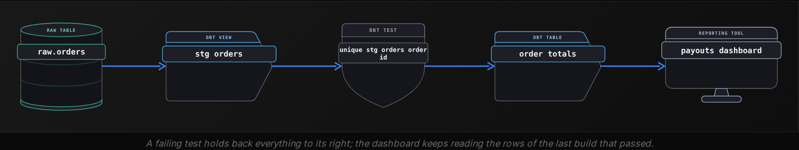
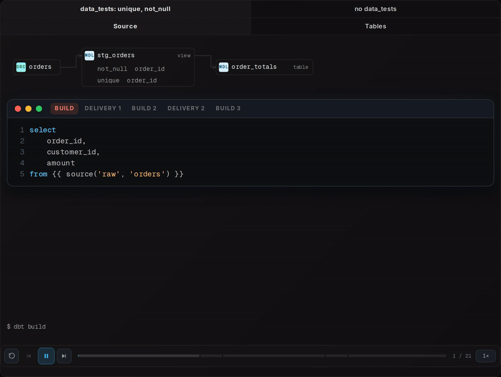
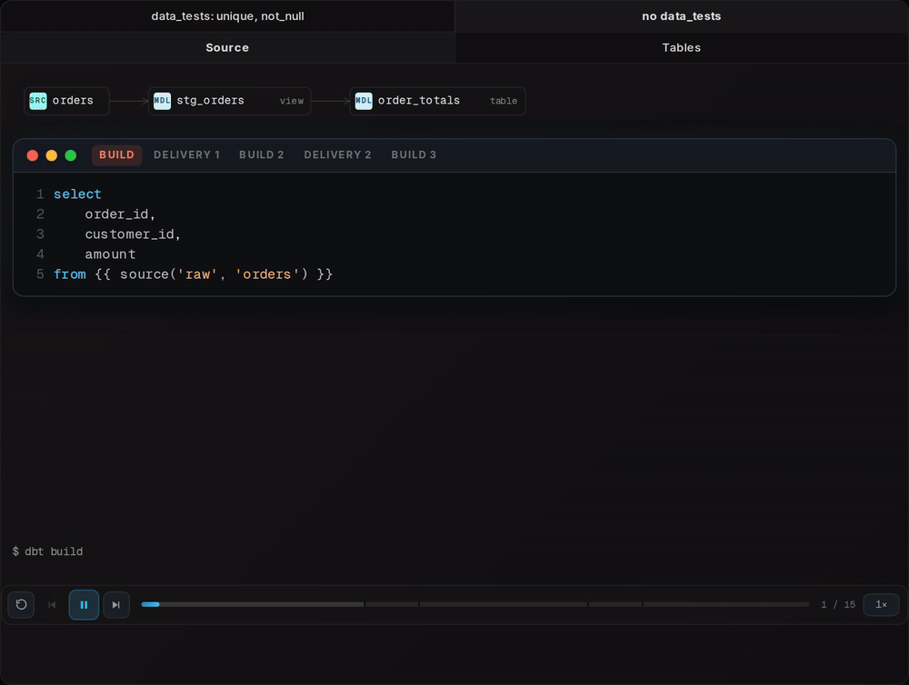

Beginner·[](https://www.getdbt.com/)·20 min · 8 challenges

# Testing: Beginner

Take a payouts model at Shopify, where Shopify Payments deposits each merchant's sales into their bank account. Suppose the order loader replays an hour of events overnight and a few thousand orders land twice. Without a test, the model doubles those merchants' payouts, and that is real money sent out. With a `unique` test on `order_id`, the build stops at the orders model and the payouts table keeps the previous day's correct rows.


<br>

---

## A Test Is a Query

A dbt test is a SELECT that returns the rows breaking a rule. dbt sends the query, counts the rows that come back, and prints PASS when the count is 0 and FAIL followed by the count when it is not. The 4 built-in tests, and every test anyone writes later, work this one way, so reading a test comes down to reading its query and asking which rows it would return from the table as it stands today.


<br>

### One query, one count

Take a model `stg_orders` holding 5 rows, 1 of which arrived without an `order_id` because the checkout service logged the row before it assigned the id. The rule is that every order carries an id. A test for that rule selects the rows that have none, and nothing else.

| order_id | customer_id | status | amount |
| --- | --- | --- | --- |
| 101 | 1 | shipped | 40 |
| 102 | 2 | placed | 25 |
| null | 1 | placed | 60 |
| 104 | 3 | delivered | 15 |
| 105 | 2 | shipped | 30 |

```sql
SELECT
  order_id
FROM analytics.stg_orders
WHERE order_id IS NULL
```

Against that table the query returns 1 row, the one with the missing id, so dbt prints FAIL 1. Once the row is dropped from the model or repaired in the source, the next run of the same query returns 0 rows, which dbt prints as PASS. The number after FAIL is the count of rows the test query returned. For this query each returned row is 1 bad row of the model, so FAIL 4000 would mean 4,000 orders without an id; section 1 shows tests whose query returns 1 row per bad value, where a single returned row can stand for many bad rows.


<br>

### What dbt wraps around it

dbt never pulls the failing rows back to the machine running it. It wraps the test query in an outer SELECT that counts them, so the warehouse answers with 1 row holding a number whether the test finds 0 bad rows or 10 million.

```sql
SELECT
  COUNT(*) AS failures,
  COUNT(*) != 0 AS should_warn,
  COUNT(*) != 0 AS should_error
FROM (
  SELECT
    order_id
  FROM analytics.stg_orders
  WHERE order_id IS NULL
) AS dbt_internal_test
```

For the 5-row table above, the inner query finds the 1 order without an id, and the warehouse sends back this single row:

| failures | should_warn | should_error |
| --- | --- | --- |
| 1 | true | true |

The inner query is the test. The outer query is dbt's way of asking the warehouse for a number instead of a result set, and `should_error` is the flag it reads: true prints FAIL, false prints PASS. A test writes nothing to the warehouse, which is why `dbt test` can run against a production schema without changing a table in it.


<br>

### The query describes the bad rows

The query names the rows that should not exist, which is the reverse of how most people write a first query. Written the other way round, `where order_id is not null` returns 4 rows from the table above and would return every row from a healthy table, so the test would fail hardest when the data is at its best. A test that keeps failing with a count equal to the model's row count is almost always selecting the good rows.

The same shape fits any rule. An order amount must be 0 or more, so the test selects orders whose amount is below 0; a shipped order must carry a shipping date, so the test selects shipped orders where that date is null. Each query reads as a sentence that begins with find me the rows where, and the rest of the sentence is the mistake.

| Rows the query returns | What dbt prints | What it means |
| --- | --- | --- |
| 0 | PASS | the rule holds for every row |
| 1 | FAIL 1 | 1 row breaks the rule |
| 250 | FAIL 250 | 250 rows break the rule |

> **TIP**
>
> Before trusting a test, run its query by hand and look at the rows it returns. Each row is a concrete example of the problem the test guards against, and a test that returns rows you would happily keep has its rule written backwards.


<br>

### Running every test

`dbt test` runs every test in the project, 1 query each, printing a line per test with the outcome and the count, and closes with a summary line that totals the outcomes. It exits with a non-zero code when any test failed, so a script that called it can tell the run went wrong without reading the log. The same lines appear inside `dbt build`, where each test runs as soon as its model is built, which section 3 returns to.


<br>

---

## The Four Generic Tests

dbt ships 4 generic tests. `not_null` and `unique` need only a column, while `accepted_values` and `relationships` take inputs as well. Each is a query template with a model and a column filled in, and each reports 1 kind of mistake that raw data makes often. Read the query behind a test and you know which rows it reports and how dbt counts them; the same query shows which bad rows it lets past.

#### not_null reports a missing value

Its query selects the column where the value is null, as the last section showed. It catches a loader that wrote a row before the value existed, and a left join in the model that matched nothing and left null where an id belongs. The count is the number of rows holding the null.

#### unique reports a value that appears twice

`unique` groups the column and keeps every group holding more than 1 row. It catches a loader that replayed a batch, and a join that matched several rows on the far side and multiplied each order.

```sql
SELECT
  order_id AS unique_field,
  COUNT(*) AS n_records
FROM analytics.stg_orders
WHERE order_id IS NOT NULL
GROUP BY order_id
HAVING COUNT(*) > 1
```

The clause `where order_id is not null` means nulls never form a duplicate group, so a column with 3 null ids passes `unique`. Reporting those is `not_null`'s job, which is why the 2 tests are declared together on an id column. The count is the number of duplicated values rather than rows, so 1 id that appears 3 times prints FAIL 1.

| unique_field | n_records |
| --- | --- |
| 103 | 2 |

That single row is what the query returns after a loader delivers order 103 a second time: 1 value, seen 2 times, printed as FAIL 1.

#### accepted_values reports a value outside the list

`accepted_values` groups the column by its values and keeps the values absent from the list you give it. It catches a new status the application started sending, a casing change such as `Shipped`, and a typo that reached the source.

```sql
WITH all_values AS (
  SELECT
    status AS value_field,
    COUNT(*) AS n_records
  FROM analytics.stg_orders
  GROUP BY status
)

SELECT
  *
FROM all_values
WHERE value_field NOT IN ('placed', 'shipped', 'delivered')
```

| value_field | n_records | kept by the where clause |
| --- | --- | --- |
| placed | 1 | no |
| shipped | 1 | no |
| delivered | 1 | no |
| Shipped | 1 | yes |
| null | 1 | no |

Here 2 of the 5 orders in `stg_orders` arrived with a status the list does not hold, 1 recased as `Shipped` and 1 missing entirely. The grouped result above becomes 1 returned row, `Shipped` with its capital letter, printed as FAIL 1. The null status passes this test: `null not in (...)` evaluates to neither true nor false, and the where clause drops the row. The count is the number of distinct unexpected values, so 500 rows of `cancelled` also print FAIL 1, which says 1 new value exists and nothing about how many rows carry it.

#### relationships reports a key that points at nothing

`relationships` takes each value in a column and looks for it in a column of another model, keeping the values that find no match. It catches an order whose customer was deleted, a customer created after the orders loaded, and a customers model that filtered out rows the orders still reference.

```sql
WITH child AS (
  SELECT
    customer_id AS from_field
  FROM analytics.stg_orders
  WHERE customer_id IS NOT NULL
),
parent AS (
  SELECT
    customer_id AS to_field
  FROM analytics.stg_customers
)

SELECT
  from_field
FROM child
LEFT JOIN parent
  ON child.from_field = parent.to_field
WHERE parent.to_field IS NULL
```

stg_orders

| order_id | customer_id |
| --- | --- |
| 101 | 1 |
| 102 | 2 |
| 103 | 4 |
| 104 | 3 |
| 105 | 4 |

stg_customers

| customer_id | name |
| --- | --- |
| 1 | Ada |
| 2 | Bo |
| 3 | Cy |

The left join keeps every order and attaches a customer when one exists; the final where keeps the orders where nothing attached, which above is orders 103 and 105 from customer 4. Nulls are removed in `child`, so an order with no customer id at all passes `relationships` and is `not_null`'s to report. The count is child rows, so those 2 orders print FAIL 2, even though they share 1 missing customer.

| Test | Rows it returns | The mistake it catches | What FAIL counts |
| --- | --- | --- | --- |
| not_null | rows where the column is null | a value the loader or a join never filled in | rows |
| unique | values seen in more than 1 row | a replayed batch or a join that fans out | duplicated values |
| accepted_values | values outside the list | a new, misspelled or recased category | distinct bad values |
| relationships | child values with no parent | a key whose parent row is gone or filtered | child rows |

> 3 gaps the 4 tests leave open
>
> - A null passes every test except not_null, so a column that matters carries not_null beside whichever other test it has.
> - unique and accepted_values count values, so their FAIL number can be far smaller than the number of rows affected.
> - None of the 4 looks at a number's range, so a negative amount or an order dated in the year 2099 passes all of them.


<br>

---

## Properties in YAML

Tests on a column are declared in a YAML properties file in the models folder, under the model's name and then the column's name. dbt reads every `.yml` file under the project's model paths when it parses the project, so the file's name is yours to pick and 1 file can describe several models. What ties a block to a model is the `name` under `models:`, which must match the model's file name without `.sql`.

```sql
models:
  - name: stg_orders
    description: One row per order placed in the shop.
    columns:
      - name: order_id
        description: Assigned by the checkout service when the order is placed.
        data_tests:
          - unique
          - not_null
      - name: status
        data_tests:
          - accepted_values:
              arguments:
                values: ['placed', 'shipped', 'delivered']
      - name: customer_id
        data_tests:
          - not_null
          - relationships:
              arguments:
                to: ref('stg_customers')
                field: customer_id
```

Tests under `data_tests:` come in 2 shapes. A test with nothing to configure, such as `unique`, is written as its bare name, and `not_null` is written the same way. A test that needs input is a mapping whose single key is the test name, with the inputs beneath `arguments:`. `accepted_values` needs its list, and `relationships` needs the model to search and the column there. The `to:` value uses `ref()` just as a model would, so dbt draws an edge from `stg_customers` to the test and builds that model before the test runs.

The keys dbt reads in a properties file

- **models** *a list*\
  one entry per model the file describes
- **name** *under models and under columns*\
  the model's file name, or the column as the SELECT names it
- **description** *text*\
  stored with the node, shown to people, never run
- **data_tests** *a list under a column*\
  bare test names, or a test name over its arguments
- **arguments** *under a test name*\
  the inputs the test's template needs


<br>

### The file becomes 5 test nodes

Each entry under `data_tests:` becomes a node with a name dbt assembles from the test, the model, the column and, where present, the arguments. The file above yields 5 test nodes, named as follows.

| Declared on | Test | Node name dbt prints |
| --- | --- | --- |
| order_id | unique | unique_stg_orders_order_id |
| order_id | not_null | not_null_stg_orders_order_id |
| status | accepted_values | accepted_values_stg_orders_status__placed__shipped__delivered |
| customer_id | not_null | not_null_stg_orders_customer_id |
| customer_id | relationships | relationships_stg_orders_customer_id__customer_id__ref_stg_customers_ |

Those names are what the build prints, so a line reading `FAIL 2 not_null_stg_orders_customer_id` is enough to tell which rule failed and on which model column, without opening the file. The argument values are part of the name, which is why adding `cancelled` to the accepted list produces a test node with a new name and the old one disappears from the project.

After the file is saved, `dbt test` parses it, compiles each of the 5 nodes into the query the previous section showed, sends them in turn and prints 5 lines. The accepted list travels into the `not in` clause. For relationships, `to:` and `field:` become the `parent` query, and in every template the column name is pasted wherever `order_id` or `status` stood.


<br>

### Descriptions and columns dbt never verifies

`description` is text dbt stores with the model or column it describes. People read it and dbt can generate documentation from it, but it changes no SQL. The `columns:` list is also a declaration rather than a check. dbt does not compare it with the warehouse when it parses, so a column that exists only in the YAML surfaces when a test on it runs and the warehouse answers that the column does not exist. That outcome prints as ERROR, meaning the query itself broke, which is different from FAIL, meaning the query ran and returned rows.

Put a `not_null` test on 3 versions of the same column and the 3 outcomes separate cleanly. The typo never reaches the rows at all: the warehouse refuses the query, so there is no count to report, and dbt prints ERROR with the warehouse's message in the log.

| not_null declared on | What the warehouse does | Printed |
| --- | --- | --- |
| order_id, with 1 null in the model | runs the query, returns 1 row | FAIL 1 |
| order_idd, a typo | rejects the query: no such column | ERROR |
| order_id, every row filled | runs the query, returns 0 rows | PASS |

| ✓ Do | ✗ Don't |
| --- | --- |
| • Match each name to the model file and the column as the SELECT spells it<br><br>• Put unique and not_null together on every id column<br><br>• Nest a test's inputs under arguments, with to written as a ref()<br><br>• Keep the properties file beside the models it describes | • Declare a test on a column the model does not select; it will ERROR, never PASS<br><br>• Rely on accepted_values alone to catch a null category<br><br>• Misspell a model name in YAML; dbt only warns, and that block's tests never run<br><br>• Expect description to validate anything |

*A project with many models usually keeps 1 properties file per folder of models, each named for what the folder holds, because a single file for every model in the project grows past what anyone will read.*


<br>

---

## Failing Tests Stop Children

`dbt build` runs each model and then the tests declared on it before it moves to anything that reads from that model. A test that fails stops the build from running the models downstream of the tested model, and dbt marks each of them SKIP. Models elsewhere in the DAG, with no path leading back to the failed test, keep building, so 1 bad column holds back only the part of the project that depends on it.



**data_tests: unique, not_null**



**no data_tests**



*$ dbt build*

In the first run, 4 raw rows build the `stg_orders` view, both tests on `order_id` pass, and `order_totals` builds 3 rows, with customer 1 at 2 orders and 100. The loader then delivers order 103 a second time. The second build creates `stg_orders` again and runs `unique_stg_orders_order_id`, which gets 1 row back and prints FAIL 1, so dbt skips `order_totals` and the table still holds the 3 rows from the first run. Once the duplicate is removed, the third build passes and rebuilds `order_totals` to the same 3 rows. Switch to the project without tests and the second build writes customer 1 as 3 orders and 160, which is the wrong figure a payouts report would have read.

| Line | Node | Printed |
| --- | --- | --- |
| 1 of 4 | stg_orders (view) | OK |
| 2 of 4 | not_null_stg_orders_order_id | PASS |
| 3 of 4 | unique_stg_orders_order_id | FAIL 1 |
| 4 of 4 | order_totals (table) | SKIP |
| Summary | Done. | PASS=2 WARN=0 ERROR=1 SKIP=1 NO-OP=0 TOTAL=4 |

The summary counts a failed test under ERROR, which is also where a model whose SQL broke would land, so ERROR=1 on its own does not say which happened; the per-node lines do. SKIP is a status of its own: dbt sent no SQL for that node and wrote nothing, which leaves whatever the node held before. The build then exits with a non-zero code, and a later `dbt build` starts from the beginning, because dbt keeps no memory of which nodes were skipped.


<br>

### Why the skip protects a table more than a view

`order_totals` is a table, so SKIP leaves the rows of the last good build in place and a dashboard that reads it keeps showing 100 for customer 1. Had `order_totals` been a view, SKIP would have left its definition in place too, but a view recomputes on every read from the current `stg_orders`, which now includes the duplicate, so anyone querying it would have seen 160 regardless. The skip protects stored rows; it cannot protect a view from its own upstream. That is a reason to materialize the models people read directly as tables when their inputs are tested.

Siblings carry on. Had the project also held a `stg_customers` model and a `customer_count` table built from it alone, both would build on the same run, because no edge connects them to the failed test. The build prints OK for them and SKIP for `order_totals` in the same log.


<br>

### run then test, or build

| ✓ dbt run, then dbt test | ✗ dbt build |
| --- | --- |
| • run builds stg_orders and order_totals in one pass<br><br>• order_totals is written with customer 1 at 160 before any test runs<br><br>• test then prints FAIL 1, after the wrong rows are already stored<br><br>• the dashboard shows 160 until someone rebuilds | • stg_orders builds, then its tests run at once<br><br>• unique returns 1 row and prints FAIL 1<br><br>• order_totals is SKIP and keeps 100 for customer 1<br><br>• the dashboard shows the last correct figure |

The 2 routes send the same test query and print the same FAIL line. The difference is timing: `dbt run` finishes every model first, so a downstream table is already overwritten by the time `dbt test` reports the duplicate, and the test becomes a record of damage done. `dbt build` interleaves tests with models, so a failure arrives before the next model reads the bad rows.

> **TIP**
>
> When a build prints SKIP, read upward in the log for the FAIL line that caused it. The skipped nodes are never the problem; the first FAIL or ERROR above them is, and fixing that one node usually clears every SKIP beneath it.


<br>

---

## Source Freshness

Tests check the rows a model holds. They say nothing about whether new rows are still arriving: a raw table that stopped loading 3 days ago passes `unique` and `not_null` as well as it ever did, and every model built from it serves data 3 days old without a single FAIL. Source freshness is the check for that, and it runs against the raw table dbt reads, never against a model.

```sql
sources:
  - name: raw
    schema: raw
    config:
      loaded_at_field: _loaded_at
      freshness:
        warn_after:
          count: 12
          period: hour
        error_after:
          count: 24
          period: hour
    tables:
      - name: orders
      - name: customers
        config:
          freshness:
            warn_after:
              count: 2
              period: day
            error_after:
              count: 4
              period: day
```

`loaded_at_field` names the column the loader stamps with the time it wrote the row. The freshness block sets 2 windows: past `warn_after` dbt prints WARN, past `error_after` it prints ERROR. Set in the source's `config:` block, both apply to every table under it; a table can carry its own `config:` to override them, which is why `customers`, loaded once a night, gets windows measured in days while `orders` keeps the hourly ones.

```sql
SELECT
  MAX(_loaded_at) AS max_loaded_at,
  CURRENT_TIMESTAMP AS snapshotted_at
FROM raw.orders
```

`dbt source freshness` sends that query for each source table with a freshness config, subtracts the newest load time from the time of the query, and compares the age with the 2 windows. It touches no model and writes no table. `dbt build` never runs it either, so a project that wants both checks runs 2 commands, and freshness usually goes first because a stale source makes building from it pointless.

| Newest _loaded_at | Checked at | Age | Printed for orders |
| --- | --- | --- | --- |
| 2026-11-03 07:40 | 2026-11-03 08:00 | 20 minutes | PASS |
| 2026-11-02 19:00 | 2026-11-03 08:00 | 13 hours | WARN |
| 2026-11-01 22:00 | 2026-11-03 08:00 | 34 hours | ERROR |


<br>

### Reading the output

The command prints 1 line per table showing the status and how long the query took, laid out like a test line. A WARN leaves the exit code at 0, so a calling script carries on; an ERROR sets it non-zero, the same signal a failed test gives. The same age that prints WARN for `orders` would print PASS for `customers`, because the table's own windows replace the source's.

| Line | Printed |
| --- | --- |
| 1 of 2 START freshness of raw.orders | RUN |
| 1 of 2 WARN freshness of raw.orders | WARN in 0.41s |
| 2 of 2 START freshness of raw.customers | RUN |
| 2 of 2 PASS freshness of raw.customers | PASS in 0.38s |


<br>

### A morning the loader stops

Suppose the orders loader dies at 22:00 on 2026-11-01 and the morning script runs at 08:00 on 2026-11-03, freshness first. `raw.orders` is 34 hours old, past its 24-hour `error_after`, so it prints ERROR and the command exits non-zero, which stops the script before the build. `raw.customers` prints PASS because it loaded at 01:00, 7 hours earlier. Had the build run anyway, it would have found nothing to object to: the raw rows are unchanged, every test returns the same 0 rows as the day before, and `order_totals` is rebuilt to the same totals it held 34 hours ago. The freshness ERROR is the only line in either log that reports the orders stopped arriving.

| Command | Printed | What follows |
| --- | --- | --- |
| dbt source freshness | ERROR for raw.orders, PASS for raw.customers | exit code non-zero, so the script stops |
| dbt build, if run anyway | OK for every model, PASS for every test | order_totals rebuilt from rows 34 hours old |


<br>

### Choosing the column

The column must say when the row was loaded, not what the row is about. `order_date` records when a customer bought, so a loader that died on Sunday night leaves Saturday's orders as the newest rows and the check reports stale, which is right, while a quiet Sunday with no sales reports stale too, which is wrong. A column the loader stamps at write time, named something like `_loaded_at`, separates those 2 cases: it advances with every batch whether the batch held 1 order or 1 million.

A table with years of history makes the `max` scan everything. A `filter:` under `freshness` adds a where clause to the query so the scan stays within recent rows, and the comparison with the windows works as before.

```sql
sources:
  - name: raw
    schema: raw
    config:
      loaded_at_field: _loaded_at
      freshness:
        warn_after:
          count: 12
          period: hour
        filter: _loaded_at > current_timestamp - interval '2' day
    tables:
      - name: orders
```

> Limits of the freshness check
>
> - It reports the age of the newest row, so a loader that writes a few rows an hour while dropping the rest still looks fresh.
> - A table without a freshness config is left out of the check, so a new source table is unwatched until someone adds the block.
> - It reads the raw table directly, so it works even when the models built from that table are broken.

> **TIP**
>
> Set warn_after a little past the loader's normal gap and error_after past the longest gap you would tolerate. A warning on orders at 12 hours when the loader runs hourly says something slowed; an error at 24 hours says a day of reporting is already wrong.


<br>

---

## Putting It All Together

Suppose a payouts pipeline at Shopify, where Shopify Payments sends each merchant's sales to their bank account, reads raw orders into an orders model, sums them per merchant into a payouts table, and feeds a dashboard merchants check every morning. Suppose the loader replays an hour of events overnight and a few thousand orders arrive twice, which would overpay those merchants if the payouts table took them in.

- The unique test on order_id sends 1 grouped query and gets back the replayed ids, so the build prints FAIL with their count rather than a vague error.
- Because the test is declared in the orders model's properties file, dbt runs it right after the orders view and before the payouts table, and the payouts table is SKIP.
- The payouts table is materialized as a table, so the skip leaves yesterday's correct balances for the dashboard; as a view it would have shown the doubled sums anyway.
- On a different morning the loader stops entirely and every test passes on the unchanged rows. Only dbt source freshness reports that nothing new has arrived, because it checks _loaded_at against its warn and error windows.


<br>

---

## Key Takeaways

- A dbt test is a SELECT for the rows that break a rule; 0 rows prints PASS, and FAIL carries the count the warehouse returned.
- Each of the 4 generic tests catches 1 kind of mistake, and a null slips past every one of them except not_null.
- Tests are declared in a properties YAML under the model's name and the column's name, with inputs under arguments, and each becomes a node dbt names and prints.
- dbt build runs a model's tests before anything reads from it, and a failure marks the downstream models SKIP, which keeps a table's last good rows in place.
- dbt source freshness measures the age of the newest row in a raw table against warn and error windows, a check no test on a model can make.

[](https://www.getdbt.com/)

Official dbt resources

"dbt enables data analysts and engineers to transform their data using the same practices that software engineers use to build applications." [github.com/dbt-labs/dbt-core](https://github.com/dbt-labs/dbt-core)

[Documentation](https://docs.getdbt.com/)[Get started](https://docs.getdbt.com/docs/get-started-dbt)[Source](https://github.com/dbt-labs/dbt-core)

dbt and the dbt logo are trademarks of dbt Labs, LLC.
