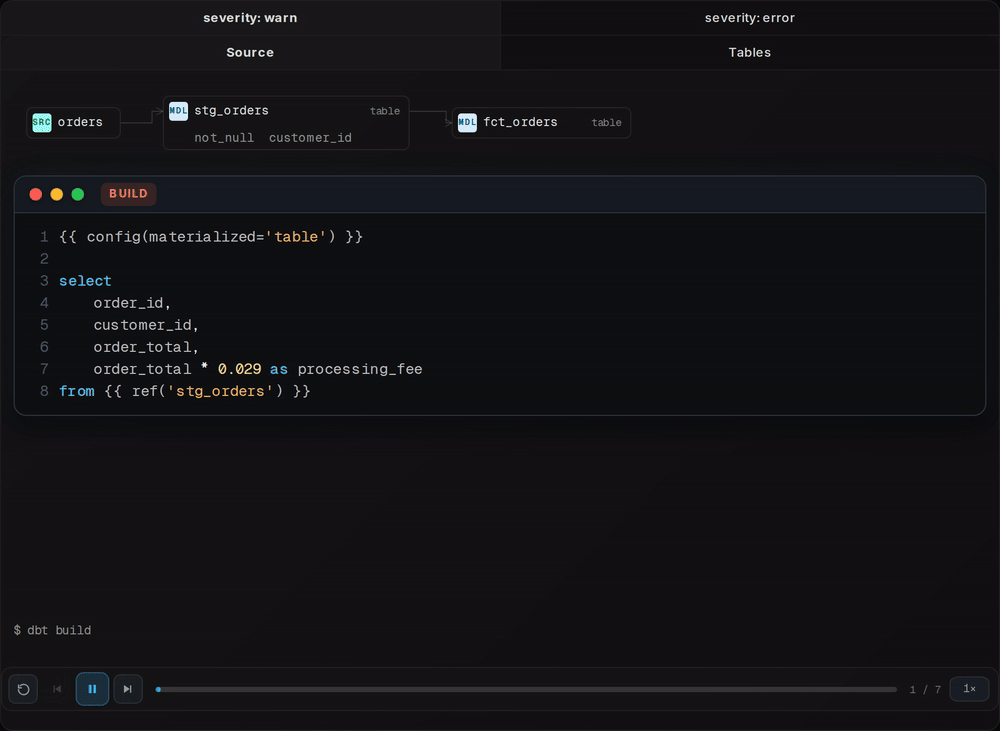
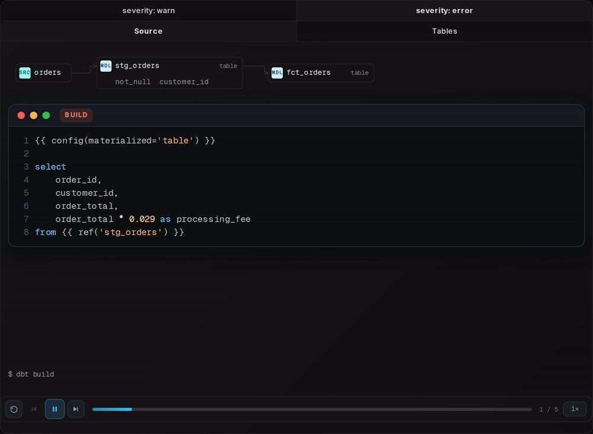

Intermediate·[](https://www.getdbt.com/)·20 min · 8 challenges

# Testing: Intermediate

Shopify pays its merchants through Shopify Payments, which sends each one a regular payout. Take the dbt project behind a payouts model like `fct_payouts`. In one nightly build, a test finds 14 order lines whose refund exceeds the line's total. Stop the build and every merchant's payout runs late; let it finish and 14 merchants are paid the wrong amount. The test's severity decides which.


<br>

---

## Warn or Error

A test's severity decides what dbt does once the test's query has returned rows. The default severity is `error`: dbt prints `FAIL` with the row count, marks the test failed, skips every node downstream of the model the test guards, and ends `dbt build` with a nonzero exit code, so the scheduler records a failed run. The other severity is `warn`: dbt prints `WARN` with the same row count, builds every downstream node as if the test had passed, counts the test under warnings in the summary line, and exits with code 0. The query is identical under both; only what happens to its result changes.

Severity is a config on the test, so in a properties file it sits under `config:` beside the test it changes. Here the key tests on `fct_order_lines` keep the default, and the `accepted_values` test on `shipping_region` becomes a warning:

```sql
models:
  - name: fct_order_lines
    columns:
      - name: order_line_key
        data_tests:
          - unique
          - not_null
      - name: shipping_region
        data_tests:
          - accepted_values:
              arguments:
                values: ['NA', 'EU', 'APAC', 'LATAM']
              config:
                severity: warn
```

| Severity | Line dbt prints | Models downstream | Exit code | Who notices |
| --- | --- | --- | --- | --- |
| error | FAIL 3 not_null_fct_order_lines_merchant_id | skipped | 1 | the scheduler, as a failed run |
| warn | WARN 3 accepted_values_fct_order_lines_shipping_region | built | 0 | whoever reads the log |

The log tells the 2 cases apart on the test's own line and again in the summary. An error reads `FAIL 3 not_null_fct_order_lines_merchant_id` and is followed by `SKIP` lines for every model behind it; a warning reads `WARN 3 accepted_values_fct_order_lines_shipping_region` and the models behind it show `OK` as usual. Under `dbt test` there are no models to skip, so the difference is the exit code alone, and a scheduler that triggers downstream jobs on exit code 0 will trigger them after a warning.


<br>

### Which severity a rule deserves

The question that picks a severity is what a downstream reader would see if the build continued. A null `merchant_id` on `fct_order_lines` means `fct_payouts` sums that line into no merchant's payout, so money leaves a real total; that test is an error, because a build that continues produces a payout table someone acts on. A `shipping_region` outside the 4 listed values means 1 row lands in an `other` bucket on a dashboard; every other row on that dashboard is still right and nobody is paid from it, so that test is a warning that tells the team a new region appeared.

Most tests fall into 1 of 3 cases. If a failure would make a downstream number wrong, or feed a wrong row into a system outside the warehouse, the test is an error. A condition in the source data that the team has decided to tolerate while it is fixed upstream gets a warning. When nobody would act on the failure either way, delete the test, which section 4 returns to.


<br>

### A default for a whole folder

Severity can also be set once in `dbt_project.yml`, scoped by folder, and a test's own `config:` overrides the folder's value. A project whose staging tests describe the quality of raw feeds, while its marts carry guarantees, writes:

```sql
data_tests:
  shop:
    staging:
      +severity: warn
    marts:
      +severity: error
```

The folder default replaces `severity: warn` written on 60 staging tests with 1 line, and it makes the policy readable in one place. It also makes an override stand out: a staging test that carries `severity: error` in its own `config:` is announcing that this one rule is a guarantee, and a comment saying why belongs next to it.

The animation below builds `stg_orders` and `fct_orders` from the same 5 raw rows, 1 of them with a null `customer_id`, under both severities. Switch between the versions and watch what happens to `fct_orders` once `not_null` has found that row.

**severity: warn**



**severity: error**



*$ dbt build*


<br>

### Lowering a severity is a decision

Changing a test from error to warn is the quickest way to turn a red build green, and the change outlives the morning it was made. A test lowered to warn during an incident keeps warning after the incident, and 3 months later nobody remembers that it once stopped the build. Record the reason in the properties file beside the `severity` line, with a date, so the next engineer can decide whether the reason still holds.

| ✓ severity: error | ✗ severity: warn |
| --- | --- |
| • Prints FAIL with the row count<br><br>• Skips every model downstream of the tested model<br><br>• Exit code 1, the run is reported failed<br><br>• For rules a downstream number depends on | • Prints WARN with the row count<br><br>• Builds downstream models as if the test passed<br><br>• Exit code 0, the run is reported successful<br><br>• For known conditions someone is tracking |

> **TIP**
>
> Warn is a message to a person, so pair every warn test with the person who reads the log. A warning nobody owns is a failure the project has agreed to ignore.


<br>

---

## Singular Tests

The 4 generic tests each state one shape of rule about one column: its values are present, its values are distinct, its values come from a list, its values exist in another model. A rule that compares 2 columns, joins 2 models, or applies arithmetic fits none of them. A singular test is that rule written out as SQL: a `.sql` file in the `tests/` folder whose `SELECT` returns the rows that break the rule. dbt runs the file like any other test, and 0 returned rows means the test passes.

On `fct_order_lines`, a refund can never exceed what the customer paid for the line. No generic test compares `refund_amount` with `line_total`, so the rule becomes a file named `tests/assert_refund_within_line_total.sql`:

```sql
select
    order_line_key,
    line_total,
    refund_amount
from {{ ref('fct_order_lines') }}
where refund_amount > line_total
```

dbt names the test after the file, so the log reads `PASS assert_refund_within_line_total` or `FAIL 14 assert_refund_within_line_total`. The `ref()` places the test in the DAG behind `fct_order_lines`, so it runs after that model is built and, at error severity, holds back every model that reads `fct_order_lines`. As with a generic test, the query dbt sends wraps the file's `SELECT` in a count, and the count decides the result:

```sql
SELECT
  COUNT(*) AS failures,
  COUNT(*) != 0 AS should_warn,
  COUNT(*) != 0 AS should_error
FROM (
  SELECT
    order_line_key,
    line_total,
    refund_amount
  FROM analytics.fct_order_lines
  WHERE refund_amount > line_total
) AS dbt_internal_test
```


<br>

### A rule across 2 models

The rule that most often needs a singular test is a reconciliation: a total in one model must equal the sum of its parts in another. `stg_orders` carries `order_total` from the checkout system, and `fct_order_lines` carries 1 `line_total` per line. The 2 agree for every order when the lines model is right, and they disagree when a join dropped a line or duplicated one. The test sums the lines per order, joins the sum back to the order, and keeps the orders where the figures differ:

```sql
with line_sums as (
    select
        order_id,
        sum(line_total) as lines_total
    from {{ ref('fct_order_lines') }}
    group by order_id
)
select
    o.order_id,
    o.order_total,
    l.lines_total
from {{ ref('stg_orders') }} o
left join line_sums l
    on o.order_id = l.order_id
where abs(o.order_total - coalesce(l.lines_total, 0)) > 0.01
```

On the morning this test fails, 3 details in the query determine how much the engineer can learn from it. The `left join` keeps an order whose lines were all dropped: it has no row in `line_sums`, so `lines_total` comes back null, `coalesce` counts it as 0, and the order is returned. An inner join would drop that order from the result, and the worst case of a lost line would pass. The `SELECT` list names the key and both figures, so each returned row identifies 1 order and shows the size of its disagreement; `select *` over a 40-column model would bury that. The tolerance of 0.01 absorbs rounding between a system that stores cents and one that stores decimals, and it is written in the test where the next engineer can read what was chosen and ask why.


<br>

### Configs on a singular test

A singular test takes its configs from a `config()` block at the top of the file, the same way a model does. The reconciliation above keeps the default severity, because a payout computed from a missing line is wrong money. A test that reports orders with a negative total, which a legacy returns process produces on purpose and which finance has agreed to tolerate while it is replaced, warns instead:

```sql
{{ config(severity='warn') }}

select
    order_id,
    order_total
from {{ ref('stg_orders') }}
where order_total < 0
```

A singular test fits 1 rule in 1 place. When the same rule, refund within total, applies to 3 models, 3 copies of the file drift apart as columns are renamed, and that case is a generic test with arguments, which a later lesson writes. Until then, 1 file per rule, named for what it asserts, with `assert_` as the prefix so the `tests/` folder reads as a list of guarantees the project makes.


<br>

### Proving the test can fail

A singular test that passes on its first run has shown 1 of 2 things: the data obeys the rule, or the query cannot return rows. A join on the wrong column, a `where` that compares a varchar with a number, or a filter that excludes every row each produce a test that passes forever. Before trusting a new singular test, run its `SELECT` in dev with the condition flipped, `where refund_amount <= line_total`, and confirm that rows come back; then flip it back.

| ✓ Do | ✗ Don't |
| --- | --- |
| • Name the file for the rule: assert_refund_within_line_total.sql<br><br>• Select the key and the compared values, so a failing row explains itself<br><br>• Write tolerances and date ranges in the query, where the next reader sees them<br><br>• Flip the condition once in dev to prove the query can return rows | • Copy one singular test across 3 models; that rule wants a generic test<br><br>• Select \* from a wide model; the failing rows become unreadable<br><br>• Hide the rule in a model's where clause, where it drops rows instead of failing |


<br>

---

## Storing Failing Rows

A failing test prints a count. `FAIL 17 assert_refund_within_line_total` says 17 lines broke the rule and says nothing about which 17. The compiled query sits in `target/compiled/`, so the first instinct is to copy it into a query editor, strip the count wrapper and run it. By then the next build may have rebuilt the model and the rows have changed. dbt can instead write the failing rows to a table in the warehouse as part of running the test, so the evidence waits for whoever investigates.

The config is `store_failures: true`. On 1 test it sits under `config:` in YAML, or in the `config()` block of a singular test; across a project it goes in `dbt_project.yml`; and for 1 run, the flag `dbt test --store-failures` turns it on for every test the command runs.

```sql
models:
  - name: fct_order_lines
    columns:
      - name: merchant_id
        data_tests:
          - not_null:
              config:
                store_failures: true
```


<br>

### Where the rows land

dbt writes each test's failing rows to a schema named after the target schema with `_dbt_test__audit` appended, so a build into `analytics` writes `analytics_dbt_test__audit`. The table takes the test's name: the `not_null` above becomes `analytics_dbt_test__audit.not_null_fct_order_lines_merchant_id`, and a singular test keeps its file name. Each run drops and recreates the table, so it holds the failures of the most recent run and nothing older. A test that passes still writes its table, with 0 rows, which is how a stored-failures test that ran can be told from one that never did.

What the table holds is whatever the test's inner `SELECT` returns, and that differs by test. `not_null` selects every column of each row with the null, so its audit table is a slice of the model. `unique` selects the duplicated value as `unique_field` with an `n_records` count, 1 row per duplicated value. A singular test writes the columns chosen in its `SELECT`, which is why section 1 asked for the key and the compared figures.

not_null_fct_order_lines_merchant_id

| order_line_key | order_id | merchant_id | line_total |
| --- | --- | --- | --- |
| 1042-1 | 1042 | null | 24.00 |
| 1042-2 | 1042 | null | 15.00 |
| 1077-1 | 1077 | null | 9.50 |

unique_fct_order_lines_order_line_key

| unique_field | n_records |
| --- | --- |
| 1042-2 | 2 |
| 1077-1 | 3 |

Reading the table is a query like any other, and joining it back to the model that fed the failing rows turns a count into a cause:

```sql
SELECT
  f.order_line_key,
  f.order_id,
  s.source_system
FROM analytics_dbt_test__audit.not_null_fct_order_lines_merchant_id AS f
JOIN analytics.stg_orders AS s
  ON f.order_id = s.order_id
```

If all 17 rows share 1 `source_system`, the fix is in 1 feed. If they share 1 `created_at` date, a batch arrived broken. If they share nothing, the defect is in the model's own SQL.

The audit table is for people to read. Nothing can `ref()` it, no test reads it, and the next run replaces it, so a model built from it would stand on a table that changes under it. Storing failures also makes warnings reviewable: a `severity: warn` test with `store_failures: true` leaves its rows in the audit schema even though the build went green, and the owner of that warning can read them without rerunning anything.


<br>

### Tables, views, or nothing

Writing a table for every test on every build has a cost: a `unique` test over 200 million rows, with a bug that duplicates half of them, writes 100 million rows to the audit schema before it fails. `store_failures_as` picks the form. `table` is the default. `view` stores the test's query instead of its rows, so the failures are computed when someone looks and reflect the model as it stands then. `ephemeral` stores nothing, and overrides a project-wide `store_failures: true` for 1 test.

```sql
data_tests:
  shop:
    +store_failures: true
    +store_failures_as: view
    marts:
      +store_failures_as: table
```

A view costs nothing to write but keeps no evidence. Once the model is rebuilt after a fix, the view shows today's rows, so the 17 that failed yesterday are gone. For marts where a failure has to be examined after the fact, a table keeps the evidence; for staging tests where the goal is a quick look, a view is enough. The `schema` config on a test moves its audit table, so `schema: quality` writes to `analytics_quality` instead of `analytics_dbt_test__audit`.

> What a stored-failures run leaves behind
>
> - A table per test, named after the test, in the target schema with `_dbt_test__audit` appended
> - The failing rows as the test's inner SELECT shapes them: full rows for not_null, value and count for unique
> - The most recent run only; each run drops and recreates the table
> - An empty table for a passing test, proof that the test ran


<br>

---

## Testing a Compound Key

`fct_order_lines` holds 1 row per line of an order. No single column identifies a row: `order_id` repeats across the lines of one order, and `line_number` repeats across every order. The grain is the pair, and a `unique` test on either column alone fails on correct data. Proving 1 row per pair needs a test that sees both columns at once.

| order_id | line_number | sku | line_total |
| --- | --- | --- | --- |
| 1041 | 1 | SKU-88 | 24.00 |
| 1041 | 2 | SKU-19 | 9.50 |
| 1042 | 1 | SKU-88 | 24.00 |
| 1042 | 2 | SKU-07 | 15.00 |
| 1042 | 2 | SKU-07 | 15.00 |
| 1043 | 1 | SKU-19 | 9.50 |

In the sample, order 1042 carries line 2 twice, and that fifth row is the defect. `unique` on `order_id` reports 1041 and 1042 as duplicates, which is the correct shape of the data. `unique` on `line_number` reports 1 and 2. Neither points at the row that is wrong.


<br>

### A singular test over the pair

The direct route is a singular test that groups by both columns and keeps the groups holding more than 1 row:

```sql
select
    order_id,
    line_number,
    count(*) as n_records
from {{ ref('fct_order_lines') }}
group by order_id, line_number
having count(*) > 1
```

This is the query the `unique` test sends, with a 2-column group in place of 1. On the sample it returns 1 row, `1042, 2, 2`, and with failures stored that row names the order to look at. The test adds no column to the model and works for a key of any width; a 4-column key is a 4-column `group by`.


<br>

### A key column the generic tests can see

The other route changes the model. Concatenating the parts into one column gives downstream models a single join key and gives the generic tests a single column to guard. `fct_order_lines` builds it in its `SELECT`:

```sql
select
    cast(order_id as varchar) || '-' || cast(line_number as varchar) as order_line_key,
    order_id,
    line_number,
    sku,
    line_total
from {{ ref('stg_order_lines') }}
```

With the column in place, the properties file guards it with the 2 tests every key gets, and guards each part as well:

```sql
models:
  - name: fct_order_lines
    columns:
      - name: order_line_key
        data_tests:
          - unique
          - not_null
      - name: order_id
        data_tests:
          - not_null
      - name: line_number
        data_tests:
          - not_null
```


<br>

### 2 ways the key column lies

A concatenated key has 2 failure modes, and they are handled in different places. First, a null in either part makes the whole key null, because `||` with a null yields null. `unique` ignores nulls, so 500 lines with a missing `line_number` all produce a null key and `unique` passes over all of them. The `not_null` on `order_line_key` catches the result directly, and the `not_null` on each part names the cause. Second, parts that run together without a separator collide: order 1 line 12 and order 11 line 2 both become `112`. The `-` in the model's SQL is what prevents that, keeping them apart as `1-12` and `11-2`, so the separator must be a character that cannot appear in either part. Without it, the YAML would expose the collision only indirectly, as a `unique` failure on the key `112` even though the 2 rows behind it are different lines.

| order_id | line_number | key without separator | key with separator |
| --- | --- | --- | --- |
| 1 | 12 | 112 | 1-12 |
| 11 | 2 | 112 | 11-2 |
| 1042 | null | null | null |


<br>

### Which route to take

Build the key column when other models join to the grain: `fct_refunds` needs to point at one order line, and a single `order_line_key` column makes that a one-column join and a `relationships` test. Use the singular test when the pair is a grain nobody joins to, such as a daily snapshot keyed by `merchant_id` and `snapshot_date`, where a column no model reads buys nothing. In both cases, `not_null` on each part stays, because the grain is proven only when every part is present.

> **TIP**
>
> Cast every part to varchar before concatenating, so the key has one type wherever it is built, and the same part written as 1042 and as '1042' produces the same key in every model.


<br>

---

## Deciding What to Test

Each test is a query that scans a table on every build. A project with 40 models and 10 tests each runs 400 queries after its models, and on tables of hundreds of millions of rows those queries take longer than the models did. The second cost is attention: each failure is a message someone must read, decide on and clear. Both costs are worth paying when a test's failure would change what someone does that day. A test whose failure changes nothing is a scheduled query that produces noise.


<br>

### Tests worth their cost

Grain tests come first: `unique` and `not_null` on the key of every model, including the compound keys from section 3. They catch the most common defect in a transformation, a join that fans out and doubles rows, and they catch it at the model where it happened rather than 3 models downstream in a total that is twice what it should be. They cost 2 queries per model, and a failure always means a real defect.

`relationships` tests at the mart layer, from a fact to each dimension it joins, catch orphan rows: an order line whose `sku` has no row in `dim_products`. A left join downstream would carry a null product name onto a report; an inner join would drop the line and shrink revenue. Either outcome is wrong, so the test belongs at error severity. At staging, the same test is rarely worth its cost, because staging mirrors the source and an orphan there is a fact about the source that the mart test will report anyway.

`accepted_values` pays off on a column that SQL branches on. If `fct_order_lines` computes `case when status = 'refunded'` and a new status `partially_refunded` appears, every such line falls through to the `else` without a sound. The test on `status` reports the new value before a report is wrong. On a column nobody branches on, such as a free-text `shipping_method`, the test is a list that goes stale.

Singular tests belong where money, or a count that leaves the warehouse, depends on an invariant: payouts equal line totals minus refunds, every invoice falls inside its subscription window, no refund exceeds its line. These are the rules a business user would state as facts, and the tests make dbt restate them on each run.


<br>

### Tests that cost more than they return

`not_null` on every column is the usual overreach. A `shipped_at` is null on every unshipped order by design, a `coupon_code` is null on most orders, and each of those tests either fails on correct data or gets set to warn and ignored. `not_null` belongs on the key and on columns a downstream calculation reads without a `coalesce`.

The key of every model is tested in that model, even when its parent already proved the same column unique. `dim_customers` may select `customer_id` unchanged from `stg_customers`, but if it also joins `stg_addresses` and a customer has 2 addresses, the join returns that customer twice, and only the `unique` test on `dim_customers` sees it. Repetition becomes waste on a non-key column that a model copies straight through from 1 parent with no join: a `not_null` on `email` in `stg_customers` and again in a model that selects `email` from that one parent can only fail together, because the second query reads the same values the first one checked. Test such a property where a model creates or changes it: a relationship where a join happens, a value list where a `case` reads it.

Warnings nobody owns are the last category. A warn test that has fired on every build for 2 months has become part of the log's shape, and the morning it fires for a new reason, nobody reads it. Each warning either gets an owner and a date to fix the upstream cause, or gets deleted.

| Test | Where | Catches | Verdict |
| --- | --- | --- | --- |
| unique and not_null on the key | every model | fan-out joins, dropped keys | keep, error |
| relationships fact to dimension | marts | orphan rows | keep, error |
| accepted_values on status | the model whose case reads it | new states falling through | keep, error or owned warn |
| singular reconciliation | marts feeding payouts | dropped or doubled lines | keep, error |
| not_null on shipped_at | fact | nulls that are there by design | delete |
| not_null on a pass-through email | staging and a model with no join | nothing the staging test missed | keep once, at staging |
| accepted_values on country | dimension | new countries | delete, or warn with an owner |


<br>

### A test plan in 3 questions

For each test, ask what rows it would return if the model broke, who would read the failure, and what they would do. A test with a clear answer to all 3 keeps its place and gets the severity the answers imply. A test where the third answer is nothing is removed, the build gets faster, and the failures that remain get read. A later lesson lays out a plan per layer; these 3 questions are what that plan is made of.

| ✓ Do | ✗ Don't |
| --- | --- |
| • Put unique and not_null on the key of every model, compound keys included<br><br>• Test relationships in marts, where the join that needs them happens<br><br>• Test accepted_values on columns a case expression branches on<br><br>• Give every warn test an owner and a date, or delete it | • Put not_null on columns that are null by design<br><br>• Repeat a non-key test on a column copied from 1 parent with no join<br><br>• Keep a test whose failure nobody would act on |


<br>

---

## Putting It All Together

At Stripe, a daily settlement table tells each business what will reach its bank account. It is built from a ledger in which every charge has several lines, the charge itself, its fee and any refund, so the grain is charge plus line, and the total per business is a figure someone will be paid from.

- The grain of charge plus line is a compound key, proven by a separated key column with unique and not_null on it and on each part, so a fee line that arrives twice is caught at the ledger model.
- Settlement equals charges minus fees minus refunds is a singular test, because no generic test states arithmetic across rows of 2 models.
- That reconciliation runs at error severity, because a build that continued would pay a business the wrong amount; a test on a free-text descriptor column is a warning with an owner, or is removed.
- Its failures are stored as a table, so the morning the build stops, the engineer joins the audit rows back to the ledger feed and names the batch that broke.
- Every other test on the settlement model answers the 3 questions, and the ones whose failure would change nothing are deleted so the failures that remain get read.


<br>

---

## Key Takeaways

- severity: error stops downstream models and fails the run; severity: warn reports the count and continues. Choose by what a downstream reader would see if the build went on.
- A singular test is a SELECT in tests/ that returns violating rows; select the key and the compared values so each returned row explains itself, and flip the condition once to prove it can fail.
- store_failures writes each test's rows to the target schema with _dbt_test__audit appended, in a table named after the test and replaced on every run; store_failures_as chooses table, view or nothing.
- A compound key is proven by unique and not_null on a cast, separated, concatenated key column plus not_null on each part, or by a group by over the parts with having count(\*) > 1.
- A test is worth its cost when its failure changes what someone does: grain tests, relationships in marts, accepted_values on branched columns and money invariants qualify; blanket not_null and unowned warnings do not.

[](https://www.getdbt.com/)

Official dbt resources

"dbt enables data analysts and engineers to transform their data using the same practices that software engineers use to build applications." [github.com/dbt-labs/dbt-core](https://github.com/dbt-labs/dbt-core)

[Documentation](https://docs.getdbt.com/)[Get started](https://docs.getdbt.com/docs/get-started-dbt)[Source](https://github.com/dbt-labs/dbt-core)

dbt and the dbt logo are trademarks of dbt Labs, LLC.
