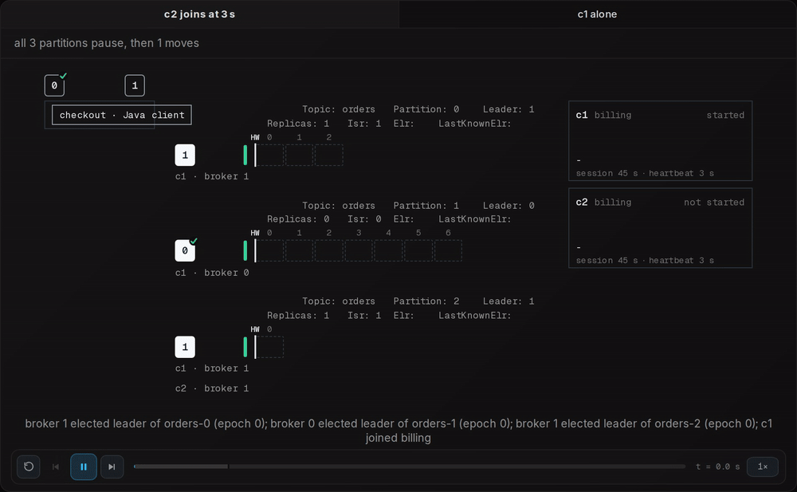
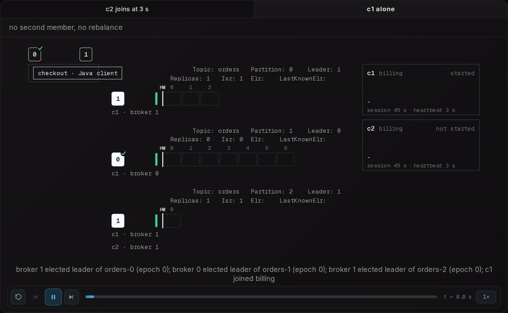
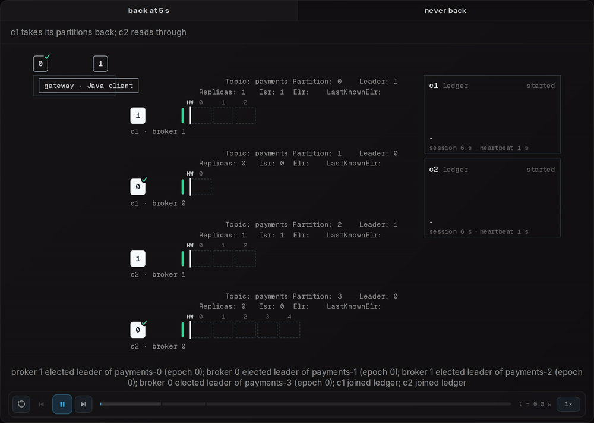
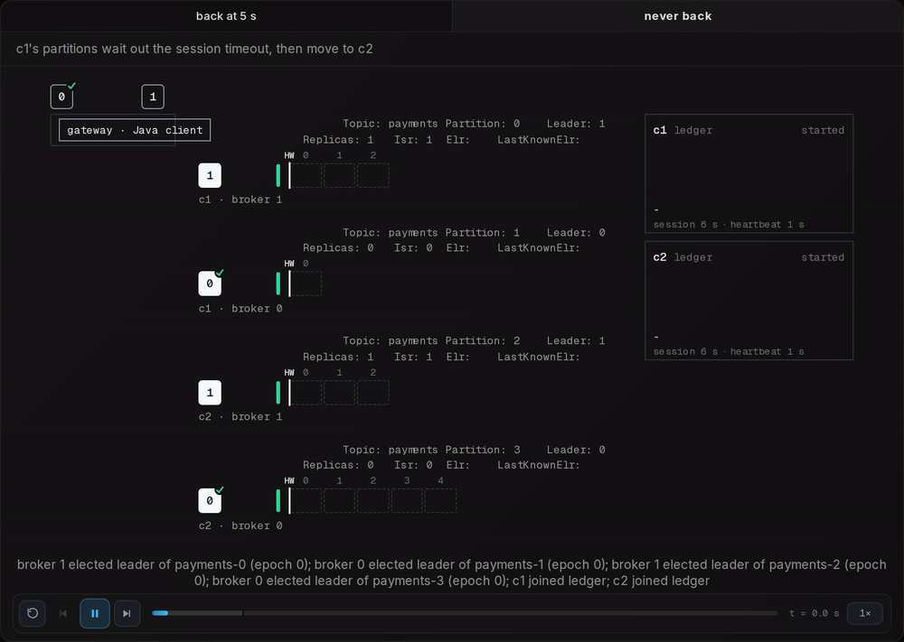

Advanced·[](https://kafka.apache.org/)·20 min · 7 challenges

# Consumer Groups: Advanced

Take one consumer group behind Shopify's checkout on Black Friday: 48 pods reading the orders topic, and a deploy restarts them 4 at a time. If every restart stops all 48 for a rebalance, orders back up at least 12 times before the rollout finishes. Whether each stop lasts seconds or never happens comes down to the rebalance protocol, how a restarted pod rejoins, and the timeouts around both.


<br>

---

## Cooperative Rebalancing

[partition.assignment.strategy](https://kafka.apache.org/44/configuration/consumer-configs/#consumerconfigs_partition.assignment.strategy)[KIP-429 Incremental Rebalance](https://cwiki.apache.org/confluence/display/KAFKA/KIP-429%3A+Kafka+Consumer+Incremental+Rebalance+Protocol)


<br>

### Eager rebalancing stops the whole group

A rebalance under the classic protocol starts when the coordinator answers a member's heartbeat with an instruction to rejoin. The eager protocol is what RangeAssignor and RoundRobinAssignor use. Under it, every member revokes every partition it holds before it sends JoinGroup, so each member commits its offsets and every fetch stops. One member, the group leader, receives everyone's subscriptions and runs the assignor; the result goes back to each member through SyncGroup. Each member then opens fetches for its new partitions. Between the first revoke and the last SyncGroup response the group reads nothing, and that holds for a partition that lands back with the member it left.

| Partition | Owner before | During the rebalance | Owner after (range) | Changed owner? |
| --- | --- | --- | --- | --- |
| p0 | A | paused | A | no |
| p1 | A | paused | A | no |
| p2 | A | paused | B | yes |
| p3 | B | paused | B | no |
| p4 | B | paused | C | yes |
| p5 | B | paused | C | yes |

3 of the 6 partitions change hands, and all 6 pause. With 24 members and 96 partitions the arithmetic is the same: a member joining to help moves a few partitions and stops every one of them, for as long as the slowest member takes to commit its current batch and rejoin.


<br>

### Cooperative rebalancing moves only what must move

The CooperativeStickyAssignor changes the contract in 2 ways. Members keep fetching their partitions while they rejoin, and each JoinGroup carries the list of partitions the member currently owns. The leader computes a sticky target, one that keeps every partition where it's unless balance requires a move, and then strips from the result every partition whose owner changes. The SyncGroup response in this first round therefore tells each member what to keep, and a member that lost a partition commits that partition's offset and revokes it before rejoining. That second JoinGroup starts a second round, in which the stripped partitions have no owner and the leader assigns them to the member the target named.

| Round | A holds | B holds | C holds | Paused |
| --- | --- | --- | --- | --- |
| Before | p0 p1 p2 | p3 p4 p5 |  | none |
| Round 1 result | p0 p1 | p3 p4 |  | p2 p5 |
| Round 2 result | p0 p1 | p3 p4 | p2 p5 | none |

2 partitions pause instead of 6, and only from the end of round 1 to the end of round 2. Their old owners revoked them and committed their offsets before rejoining, so the leader's second run of the assignor finds them unowned and hands each to the member that should take it, while every other partition is still being read. A handler halfway through a batch from p0 keeps going; a handler on p2 gets onPartitionsRevoked for p2 alone, which is where it commits p2's offset before giving it up.

```sql
PARTITION.assignment.strategy = org.apache.kafka.clients.consumer.CooperativeStickyAssignor
```

> **TIP**
>
> A sticky assignor and a cooperative protocol are 2 different things. Sticky decides where partitions go and tries to keep them put; cooperative decides whether members keep fetching while the decision is made. The CooperativeStickyAssignor does both; the plain StickyAssignor is sticky and eager.


<br>

### Switching a running group

A group runs the first assignor in the list that every member supports, so a mixed fleet runs whatever the old members put first. The client's default list is RangeAssignor followed by CooperativeStickyAssignor, which means a group of default consumers runs range and eager while every member already understands cooperative-sticky. Setting the strategy to cooperative-sticky alone and restarting members one at a time moves the group over in a single rolling restart. A fleet whose list never contained cooperative-sticky needs 2 rolling restarts: the first adds it to the list behind the old assignor, the second removes the old one. Restarting everything at once with the new list works too, at the cost of one eager rebalance at the start.

| ✓ Do | ✗ Don't |
| --- | --- |
| • Commit the revoked partitions' offsets inside onPartitionsRevoked<br><br>• List cooperative-sticky alone once every member supports it<br><br>• Expect 2 rounds per membership change, and 2 short pauses | • Clear all local state in onPartitionsRevoked; only the listed partitions left<br><br>• Mix members that list only range with members that list only cooperative-sticky<br><br>• Read a second rebalance in the logs as a failure |

The animation plays the eager protocol under the range assignor: c1 reads 3 partitions alone until c2 joins at 3 s, and at that moment every partition pauses while the group reassigns, including the 2 that end up back with c1. The second variant leaves c1 alone, and the same records flow through without a single pause.

**c2 joins at 3 s**



**c1 alone**




<br>

---

## The Broker-Side Protocol

[Server](https://kafka.apache.org/44/operations/consumer-rebalance-protocol/#server)[group.protocol](https://kafka.apache.org/44/configuration/consumer-configs/#consumerconfigs_group.protocol)


<br>

### The coordinator computes the assignment

Under the classic protocol everything happens on the clients: a leader member runs the assignor, and JoinGroup plus SyncGroup form a barrier that every member crosses at the same time, once in the eager protocol and twice in the cooperative one. Kafka 4.0 made a second group protocol generally available, in which the group coordinator on the broker computes the assignment and no member is special. A consumer joins it by setting group.protocol to consumer; the value classic keeps it on the old one.

```sql
group.protocol=consumer
group.remote.assignor=uniform
```

Each member sends a ConsumerGroupHeartbeat request on a schedule the broker sets. The request carries the member's subscription and the partitions it currently owns. The coordinator holds a group epoch, bumps it whenever the membership or a subscription changes, and computes a target assignment at that epoch with the assignor the members named. The response to each heartbeat tells that member which partitions to own now. The protocol drops the leader member and the JoinGroup and SyncGroup barrier, so no member ever waits for every other.

> The coordinator tracks 3 epochs
>
> - Group epoch: bumped whenever the membership or any member's subscription changes; it names the current membership
> - Target assignment epoch: the group epoch at which the stored target was computed
> - Member epoch: the epoch a member last acknowledged; a member on an older epoch is still reconciling


<br>

### Reconciliation happens one partition at a time

A partition moves to its new owner only after the old owner has reported, in a heartbeat, that it no longer owns it. The coordinator never hands the same partition to 2 members, and it never asks a member to stop everything. Take the 6-partition group again, with A on p0 to p2 and B on p3 to p5 at group epoch 5, and C joining.

| Clock | Heartbeat from | Owns, as reported | Coordinator's reply |
| --- | --- | --- | --- |
| 0 ms | C | nothing | epoch 6; own nothing yet |
| 5 ms | A | p0 p1 p2 | epoch 6; own p0 p1 (release p2) |
| 10 ms | B | p3 p4 p5 | epoch 6; own p3 p4 (release p5) |
| 2.1 s | A | p0 p1 | epoch 6; own p0 p1 |
| 5.0 s | C | nothing | epoch 6; own p2 |
| 5.1 s | C | p2 | epoch 6; own p2 |
| 7.0 s | B | p3 p4 | epoch 6; own p3 p4 |
| 10.1 s | C | p2 | epoch 6; own p2 p5 |

A finished release is reported at once, without waiting out the 5 s heartbeat interval: A takes about 2 s to drain its batch from p2 and commit p2's offset, and its heartbeat at 2.1 s frees p2. C hears about p2 only on its next scheduled heartbeat, at 5.0 s, and acknowledges it straight away. B is slower and frees p5 at 7.0 s, so p5 reaches C on the scheduled heartbeat after that, at 10.1 s, while C has been reading p2 for 5 s. Each move is independent: a slow member delays only the partitions it is releasing, and the other 4 partitions never stop. The 2 rounds of the cooperative protocol become a stream of independent heartbeats.

*A member told to release a partition gets onPartitionsRevoked for that partition alone, the same listener call the cooperative protocol makes.*


<br>

### The timeouts move with the protocol

| ✓ Classic protocol (client decides) | ✗ Consumer protocol (broker decides) |
| --- | --- |
| • session.timeout.ms on the consumer, 45000 ms by default<br><br>• heartbeat.interval.ms on the consumer, 3000 ms by default<br><br>• partition.assignment.strategy names a client-side assignor<br><br>• max.poll.interval.ms on the consumer | • group.consumer.session.timeout.ms on the broker, 45000 ms by default<br><br>• group.consumer.heartbeat.interval.ms on the broker, 5000 ms by default<br><br>• group.remote.assignor names a server-side assignor: uniform or range<br><br>• max.poll.interval.ms stays on the consumer |

The classic settings do not carry over. With group.protocol=consumer, setting session.timeout.ms or heartbeat.interval.ms in a consumer's config makes it throw a ConfigException and never start, and partition.assignment.strategy does the same, so a config copied from a classic fleet has to drop all 3. One group that needs a longer timeout gets it as a group config: kafka-configs.sh --bootstrap-server broker:9092 --alter --entity-type groups --entity-name billing --add-config consumer.session.timeout.ms=60000. The broker's group.consumer.min.session.timeout.ms sets the floor for that value, 45000 ms by default, and group.consumer.max.session.timeout.ms sets the ceiling at 60000 ms, so a group that wants more than 60 s needs the broker's maximum raised first. max.poll.interval.ms stays with the client because the broker cannot see a poll loop; a member that stops polling leaves the group by itself, as before.


<br>

### Migrating a live group

The broker setting group.coordinator.rebalance.protocols lists the protocols the coordinator offers, and it includes both by default. When a member with group.protocol=consumer joins a group whose members run the classic protocol, the coordinator converts the group to the new protocol and keeps serving the classic members through their JoinGroup and SyncGroup requests, so one fleet can be restarted a member at a time. When the last new-protocol member leaves a mixed group, it converts back. kafka-consumer-groups.sh --list --type consumer shows which groups have moved.

> **TIP**
>
> The assignor runs on the broker, so a hand-written client-side assignor has no place under the new protocol. A custom one is installed on the brokers through group.consumer.assignors and named by consumers in group.remote.assignor; until it is, a group that depends on it stays on the classic protocol.


<br>

---

## Static Membership

[Static Membership](https://kafka.apache.org/44/design/design/#static-membership)[group.instance.id](https://kafka.apache.org/44/configuration/consumer-configs/#consumerconfigs_group.instance.id)


<br>

### A member id that survives a restart

Under both protocols a member gets a fresh member id each time it joins, and a member that closes or crashes takes that id with it. The process that replaces it is a stranger to the group: its join bumps the epoch, and partitions move. group.instance.id gives a process a name the coordinator remembers across its lifetimes.

```sql
group.id=billing
group.instance.id=billing-pod-3
session.timeout.ms=120000
```

On close() a static member sends no LeaveGroup, so the coordinator keeps its slot and its assignment. While the slot is held, the member's heartbeats stop and the session clock runs; if a process joins with the same group.instance.id before session.timeout.ms elapses, the coordinator hands it the slot's assignment and bumps nothing, so no other member notices. If the clock runs out first, the coordinator drops the slot and rebalances as it would for any dead member.

| Clock | Dynamic member (no instance id) | Static member, 120 s session timeout |
| --- | --- | --- |
| 0 s | pod-3 holds p6, p7 | pod-3 holds p6, p7 |
| 10 s | pod-3 closes and sends LeaveGroup; rebalance; p6, p7 go to pod-1 | pod-3 closes and sends nothing; p6, p7 wait |
| 10 s to 55 s | pod-1 reads p6, p7 | lag on p6, p7 grows |
| 55 s | new pod-3 joins; rebalance; p6, p7 come back | new pod-3 joins; gets p6, p7; no rebalance |
| Rebalances | 2, every partition paused twice under eager | 0 |

The dynamic column paid for 2 rebalances to end up where it started. The static column paid 45 s of lag on 2 partitions and touched nobody else. Which is cheaper depends on the deploy: a rolling restart of 48 members is 96 rebalances in one column and 0 in the other, and the lag in the static column is bounded by the restart time, which the deploy controls.


<br>

### The price is partitions that nobody reads

A static member that dies for good looks, to the coordinator, like one that is restarting. Its partitions sit unread until the session timeout expires, and the session timeout is the only clock. Pick it from the restart, with margin. A pod that takes 90 s to come back under the 45 s default is dropped at 45 s, which costs a rebalance, and rejoins at 90 s as a fresh static member, which costs another; static membership with a timeout shorter than the restart buys nothing and adds 45 s of unread partitions in front of the first rebalance.

| Restart takes | session.timeout.ms | What happens |
| --- | --- | --- |
| 40 s | 120 s | rejoins at 40 s, no rebalance, 40 s of lag on its partitions |
| 90 s | 45 s | dropped at 45 s (rebalance), rejoins at 90 s (rebalance), 45 s of lag then nothing |
| 90 s | 120 s | rejoins at 90 s, no rebalance, 90 s of lag |
| never | 120 s | partitions unread for 120 s, then 1 rebalance |

Under the broker-side protocol the static member's clock is group.consumer.session.timeout.ms or the group's consumer.session.timeout.ms, because a consumer on that protocol refuses to start with session.timeout.ms in its config; the instance id works the same way. The 120 s timeout above is a classic-protocol choice: on the broker-side protocol it is past the 60 s default ceiling, so group.consumer.max.session.timeout.ms has to be raised on the brokers before a group can ask for 120 s. A scale-down that retires a static member for good should not wait out the clock: Admin.removeMembersFromConsumerGroup evicts the instance id at once and triggers the one rebalance the group needs.


<br>

### Two processes, one name

An instance id names a slot, and a slot holds one process. If a second process joins with an id that a live process already holds, the coordinator gives the slot to the newcomer and fences the old one: its next heartbeat or commit fails with FencedInstanceIdException, and the only correct response is to shut down. That makes the id safe to tie to something stable and unique, a stable pod ordinal or a hostname, and unsafe to tie to anything 2 processes could share, such as a deployment name.

> **TIP**
>
> Instance ids and transactional ids solve the same problem on 2 sides of the log: a stable name that lets a restarted process be recognized and a stale one be fenced. Pair them: a static member billing-pod-3 whose producer is billing-pod-3-tx restarts as itself on both ends.

Both variants run c1 and c2 as static members with a 6 s session timeout, and both close c1 at 3 s. In the first, c1 returns at 5 s, picks up its partitions where it left them, and c2 reads straight through with no rebalance. In the second, c1 never returns: its partitions sit unread until the session timeout expires, about 6 s after its last heartbeat, and only then does the group rebalance and hand them to c2.

**back at 5 s**



**never back**




<br>

---

## Share Groups

[The Share Consumer](https://kafka.apache.org/44/design/design/#the-share-consumer)[Managing share groups](https://kafka.apache.org/44/operations/basic-kafka-operations/#managing-share-groups)


<br>

### Many members on one partition

A consumer group gives each partition to exactly 1 member, so a topic of 8 partitions gives work to at most 8 members, and a slow record on 1 partition holds every record behind it. A share group, generally available since Kafka 4.2, drops that rule: the broker hands records from a partition to whichever member asks, tracks every record it handed out, and waits for an acknowledgement. 30 members can read 8 partitions, and a record that takes 3 minutes stalls nothing behind it.

```sql
group.id=invoice-renderers
share.acknowledgement.mode=explicit
```

The client is KafkaShareConsumer. It has the same poll() loop and drops seek and position; there's no ConsumerRebalanceListener either. The broker keeps the state: the leader of each partition runs a share-partition for every share group reading it, and a record in a share-partition moves through 4 states.

| State | Meaning | Leaves it when |
| --- | --- | --- |
| Available | deliverable to the next member that polls | a member fetches it |
| Acquired | held by 1 member under a lock of group.share.record.lock.duration.ms, 30 s by default | acknowledged, released, or the lock expires |
| Acknowledged | the member reported ACCEPT | never; the start offset moves past it |
| Archived | REJECT, or delivered group.share.delivery.count.limit times, 5 by default | never; the start offset moves past it |


<br>

### A crash, a lock, and a redelivery

Take 1 partition with records at offsets 100 to 105 and 3 members, of which X and Y matter here. Each polls once and is given 2 records; the broker marks all 6 Acquired, each with a delivery count of 1 and a 30 s lock. Y crashes after writing invoice 102 and before acknowledging. At 30 s the locks on 102 and 103 expire: both return to Available with delivery count 2. X had already finished 100 and 101 and acknowledged both, so its next poll returns 102 and 103.

| Clock | Offsets 100, 101 | Offsets 102, 103 | Offsets 104, 105 | Start offset |
| --- | --- | --- | --- | --- |
| 0 s | Acquired by X (count 1) | Acquired by Y (count 1) | Acquired by Z (count 1) | 100 |
| 4 s | Acknowledged | Acquired by Y | Acknowledged | 102 |
| 30 s | Acknowledged | Available (count 2) | Acknowledged | 102 |
| 31 s | Acknowledged | Acquired by X (count 2) | Acknowledged | 102 |
| 34 s | Acknowledged | Acknowledged | Acknowledged | 106 |

Invoice 102 gets rendered twice, because Y wrote it before dying and X renders it again. Every share group handler lives with that: the contract is at-least-once, and a record that keeps failing is delivered 5 times and then archived, where it waits for someone to look. The start offset at 4 s stayed at 102 while 104 and 105 were already done, because it points at the oldest record that is neither acknowledged nor archived.


<br>

### Acknowledging, 2 ways

| ✓ Implicit (default) | ✗ Explicit |
| --- | --- |
| • Each poll() acknowledges every record from the previous poll as ACCEPT<br><br>• No per-record choice; a crash before the next poll releases the whole batch at lock expiry<br><br>• Fits handlers that succeed or fail as a batch | • acknowledge(record, ACCEPT), RELEASE or REJECT per record, then commitSync() or commitAsync()<br><br>• RELEASE returns a record to Available at once with its count raised; REJECT archives it<br><br>• Fits handlers where 1 bad record must not hold the batch |


<br>

### What a share group gives up

- Order: X processes 102 after Z finished 104, within 1 partition, and nothing stops it
- Offsets as a position: no commit, no seek, no per-member lag; kafka-share-groups.sh --describe shows start offsets
- Keys as a routing rule: records of 1 key reach whichever member polls first
- A bounded window: group.share.partition.max.record.locks caps in-flight records at 200 by default; slow ones block it
- A chosen starting point: a new group starts at latest unless the group config share.auto.offset.reset says earliest

Pick a share group for work queues: images to render, emails to send, webhooks to deliver. In those, each record stands alone and a duplicate can be tolerated or caught, and the slow ones must not block the fast ones. Keep a consumer group for anything that folds records into state by key, where order within a partition is the whole point.

> **TIP**
>
> A share group changes how many members read a partition; the partition count still decides how many leaders serve the reads, and 1 partition read by 30 members is 1 leader serving 30 fetchers. Partition for the brokers' sake, and let the share group decide how many hands are on each one.


<br>

---

## Reading Only Committed Writes

[isolation.level](https://kafka.apache.org/44/configuration/consumer-configs/#consumerconfigs_isolation.level)[Using Transactions](https://kafka.apache.org/44/design/design/#using-transactions)


<br>

### Markers on the tape

A transactional producer appends its records to the partitions it writes, and when it commits or aborts, the transaction coordinator appends a commit or abort marker, which is a control record, to every one of those partitions. The marker takes an offset like any record but carries no key or value an application sees. It is the only thing on the tape that says how the records before it ended. Records from an aborted transaction stay on the log; reading does not delete, and neither does aborting.

| Offset | Record | Transaction | Outcome |
| --- | --- | --- | --- |
| 40 | order 8812 | T1 | committed |
| 41 | order 8813 | T1 | committed |
| 42 | commit marker | T1 |  |
| 43 | order 8814 | T2 | aborted |
| 44 | order 8815 | T2 | aborted |
| 45 | abort marker | T2 |  |
| 46 | order 8816 | none | plain record |
| 47 | order 8817 | T3 | open |
| 48 | order 8818 | T3 | open |
| 49 | high watermark |  |  |


<br>

### 2 isolation levels, 2 sets of records

```sql
isolation.level = read_committed
```

isolation.level is read_uncommitted by default: the consumer returns every record below the high watermark with the markers skipped, so 43 and 44 reach the handler, and so do 47 and 48. Under read_committed the broker lists, in each fetch response, the transactions in that range that aborted, as a producer id and a first offset, and the consumer drops that producer's records from the first offset up to the abort marker. It also refuses to return anything at or beyond the last stable offset, the LSO, which is the offset of the first record of the oldest open transaction.

read_uncommitted returns

| offset | record |
| --- | --- |
| 40 | order 8812 |
| 41 | order 8813 |
| 43 | order 8814 |
| 44 | order 8815 |
| 46 | order 8816 |
| 47 | order 8817 |
| 48 | order 8818 |

read_committed returns

| offset | record |
| --- | --- |
| 40 | order 8812 |
| 41 | order 8813 |
| 46 | order 8816 |

The read_committed consumer's position after that poll is 47, and that's the offset it commits. Its lag reads as 2 in kafka-consumer-groups.sh, since lag is measured to the end of the log, while the 2 records in that lag are ones it is correct to refuse. Offset 46 was returned because it sits below the LSO; a plain record written at offset 49, after T3 opened, would wait behind T3 as 47 and 48 do.


<br>

### Where a read_committed consumer stops

The LSO moves only when the oldest open transaction ends. A producer that opened T3 and then stalled holds every read_committed consumer of that partition at 47, and a producer that died holds it until the transaction coordinator times the transaction out and writes the abort marker itself. The clock is the producer's transaction.timeout.ms, capped by the broker's transaction.max.timeout.ms. Until then the consumer's poll returns nothing while its lag climbs. What it eventually gets depends on the outcome: 47 and 48 if T3 commits, and whatever follows T3's marker if it aborts.

- **60 s** — transaction.timeout.ms default
- **15 min** — transaction.max.timeout.ms default

> Reading the LSO
>
> - endOffsets() under read_committed returns the LSO; under read_uncommitted it returns the high watermark
> - A consumer parked at the LSO is working correctly; the lag it shows is the size of the open transaction
> - Shorter transactions and a shorter transaction.timeout.ms shrink the longest a reader can be held


<br>

### Committing offsets past a marker

The consumer's position counts markers. After the handler processes 40 and 41, the committed offset is 42 or 43 depending on whether the marker was already in the fetch buffer, and both resume correctly: a consumer that restarts at 42 skips the marker it finds there and continues at 43. read_committed does not make the handler's work atomic. A handler that commits after each record and crashes between 40 and 41 restarts at 41 and processes it alone; the transaction was one unit on the write side, and the consumer group's offset decides the unit on the read side.

| ✓ Do | ✗ Don't |
| --- | --- |
| • Set read_committed on every reader of a topic that any transactional producer writes<br><br>• Alert on an LSO that stops moving, with the transaction timeout as the ceiling<br><br>• Commit the handler's offset after its own write, as before | • Read a lag equal to an open transaction's size as a broken consumer<br><br>• Expect read_committed to hand a whole transaction to one poll<br><br>• Mix read_committed and read_uncommitted members in 1 group |


<br>

---

## Putting It All Together

Shopify's order pipeline during a flash sale: a 48-pod ledger group folds order events into per-shop balances and writes them in transactions to a ledger topic; a 30-pod share group renders receipts from that topic; and a deploy rolls through both fleets while the sale runs.

- The ledger group runs the broker-side protocol with instance ids, so each pod's restart releases nothing and its 2 partitions wait at most the restart's length inside the group's consumer.session.timeout.ms.
- The receipt renderers are a share group, so a pod restart in that fleet moves no partitions at all; its acquired records return to Available at lock expiry and another pod picks them up.
- The renderers read the ledger topic under read_committed, so a ledger pod that stalls mid-transaction parks every renderer on that partition at the LSO until transaction.timeout.ms fires, and the lag they show is the open transaction, which is the alert to watch during the rollout.


<br>

---

## Key Takeaways

- Eager rebalancing revokes every partition from every member; cooperative-sticky revokes only the partitions that change owner, in 2 rounds.
- Under group.protocol=consumer the broker computes the assignment and reconciles it over heartbeats. Session and heartbeat timeouts are set on the broker or per group from then on.
- A static member with group.instance.id keeps its partitions through a restart that finishes inside the session timeout, and its partitions sit unread for that long if it never returns.
- A share group lets many members read 1 partition under broker-held locks and acknowledgements, at the price of order within a partition, offsets as a position, and per-key routing; its handlers must tolerate the duplicates a lock expiry redelivers.
- read_committed drops aborted records and stops at the LSO, so an open transaction holds every committed reader until it ends or times out.

[](https://kafka.apache.org/)

Official Apache Kafka resourcesversion 4.4

"Apache Kafka is an open-source distributed event streaming platform used by thousands of companies for high-performance data pipelines, streaming analytics, data integration, and mission-critical applications." [kafka.apache.org](https://kafka.apache.org/)

[Documentation](https://kafka.apache.org/44/)[Quickstart](https://kafka.apache.org/quickstart/)[Download](https://kafka.apache.org/community/downloads/)[Community](https://kafka.apache.org/community/)

In the documentation

Cooperative Rebalancing
:   [partition.assignment.strategy](https://kafka.apache.org/44/configuration/consumer-configs/#consumerconfigs_partition.assignment.strategy)[KIP-429 Incremental Rebalance](https://cwiki.apache.org/confluence/display/KAFKA/KIP-429%3A+Kafka+Consumer+Incremental+Rebalance+Protocol)

The Broker-Side Protocol
:   [Server](https://kafka.apache.org/44/operations/consumer-rebalance-protocol/#server)[group.protocol](https://kafka.apache.org/44/configuration/consumer-configs/#consumerconfigs_group.protocol)

Static Membership
:   [Static Membership](https://kafka.apache.org/44/design/design/#static-membership)[group.instance.id](https://kafka.apache.org/44/configuration/consumer-configs/#consumerconfigs_group.instance.id)

Share Groups
:   [The Share Consumer](https://kafka.apache.org/44/design/design/#the-share-consumer)[Managing share groups](https://kafka.apache.org/44/operations/basic-kafka-operations/#managing-share-groups)

Reading Only Committed Writes
:   [isolation.level](https://kafka.apache.org/44/configuration/consumer-configs/#consumerconfigs_isolation.level)[Using Transactions](https://kafka.apache.org/44/design/design/#using-transactions)

Further
:   [KIP-848 Consumer Rebalance Protocol](https://cwiki.apache.org/confluence/display/KAFKA/KIP-848%3A+The+Next+Generation+of+the+Consumer+Rebalance+Protocol)[KIP-932 Queues for Kafka](https://cwiki.apache.org/confluence/display/KAFKA/KIP-932%3A+Queues+for+Kafka)[KIP-345 Static Membership](https://cwiki.apache.org/confluence/display/KAFKA/KIP-345%3A+Introduce+static+membership+protocol+to+reduce+consumer+rebalances)

Apache Kafka, Kafka, and the Kafka logo are either registered trademarks or trademarks of The Apache Software Foundation in the United States and other countries.
