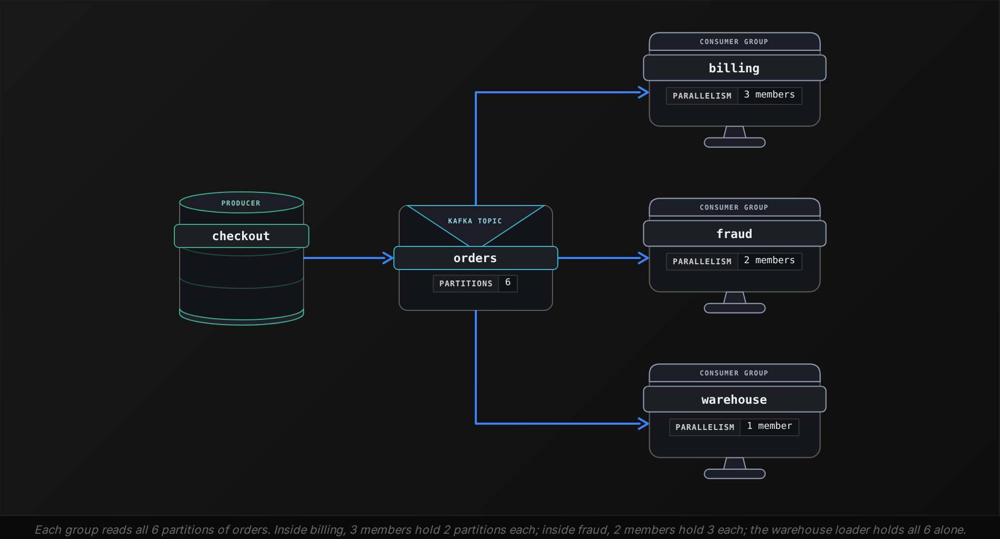
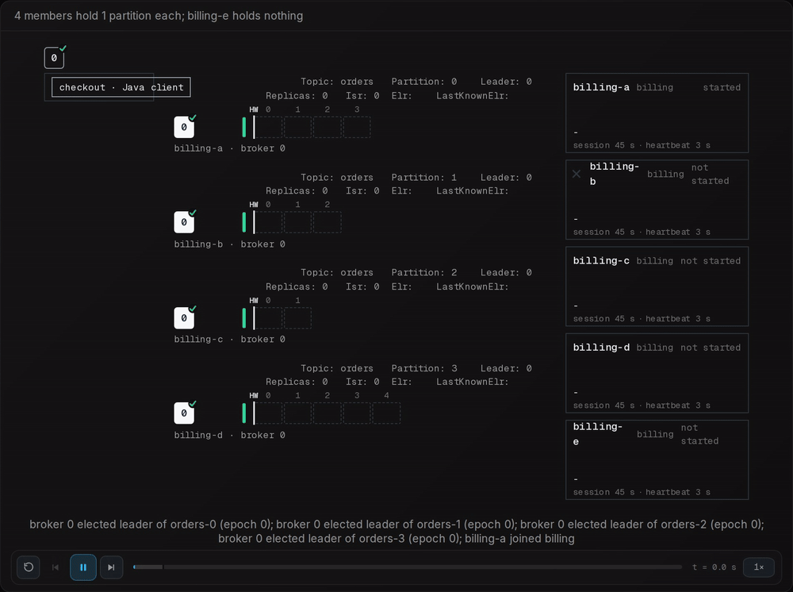

Beginner·[](https://kafka.apache.org/)·20 min · 10 challenges

# Consumer Groups: Beginner

A new team at LinkedIn ships a dashboard that reads the page-view topic. They start it on Friday and see 0 records, so they file a bug against the producer team. Monday brings the opposite: the dashboard is 40 million records behind and climbing. Both mysteries come down to 1 setting and 1 number this lesson teaches: where a group starts, and how lag is measured.


<br>

---

## The Poll Loop

[The Consumer](https://kafka.apache.org/44/design/design/#the-consumer)[max.poll.records](https://kafka.apache.org/44/configuration/consumer-configs/#consumerconfigs_max.poll.records)


<br>

### The consumer pulls

A Kafka consumer pulls. It sends a fetch request to the leader of each partition it reads, naming the offset it wants next, and the leader answers with the records from that offset forward. The call that does this is `poll`. One call can return hundreds of records from several partitions, or none at all when nothing new has arrived, and the consumer decides when to call again. The leader tracks nothing about what the consumer does with those records; it answers fetches. A broker acting as the group coordinator keeps track of which consumers read together and where each one has got to, and sections 1 and 2 cover it.

The log lesson showed that a record sits at an offset in a partition and that reading leaves it there. A consumer turns that into a loop: subscribe to a topic, call `poll`, handle every record in the batch, call `poll` again. The loop below is the whole job of a billing service that reads the `orders` topic and charges a card for each one.

```sql
consumer.subscribe(["orders"])

while True:
    batch = consumer.poll(timeout_ms=1000)
    for partition, records in batch.items():
        for record in records:
            charge_card(record.key, record.value)
    consumer.commit()
```

Suppose the loop's 2nd `poll` returns 3 records. The consumer did not ask for offsets 4 and 5 of partition 0 by name; it asked for everything from its current position on each partition it holds, and the 2 leaders sent what they had. Within 1 partition the batch keeps offset order, 4 before 5. Across partitions there is no order, and partition 1's record may arrive before or after partition 0's.

| topic | partition | offset | key | value |
| --- | --- | --- | --- | --- |
| orders | 0 | 4 | cust-17 | {amount: 42.00} |
| orders | 0 | 5 | cust-3 | {amount: 9.99} |
| orders | 1 | 12 | cust-8 | {amount: 120.00} |

After that batch the consumer remembers, in its own memory, that partition 0 is at 6 and partition 1 is at 13, and the next `poll` fetches from those positions. The position is in the consumer's memory alone; nothing has been saved to the broker. Saving it is the commit, which section 2 covers.


<br>

### What one poll may return

`max.poll.records` caps how many records a single `poll` hands to your code, 500 by default; the consumer fetches more than that in the background and parcels them out call by call. `fetch.min.bytes` and `fetch.max.wait.ms` tell the leader how long it may hold a fetch open while data piles up before it answers. With the defaults of 1 byte and 500 ms, the leader answers as soon as it has anything. `max.partition.fetch.bytes` limits how much of 1 partition comes back in 1 fetch, so a batch of 1 KB records from 1 partition tops out near 1,000 records in the buffer.

| setting | default | what it bounds |
| --- | --- | --- |
| max.poll.records | 500 | records one poll hands to your code |
| fetch.min.bytes | 1 | bytes the leader gathers before answering |
| fetch.max.wait.ms | 500 | how long the leader may wait for fetch.min.bytes |
| max.partition.fetch.bytes | 1048576 | bytes fetched from one partition at a time |
| max.poll.interval.ms | 300000 | time allowed between two poll calls |

> **TIP**
>
> The timeout passed to `poll` is the longest it waits when no records are available. When records are already buffered, `poll` returns at once whatever the timeout, so a 1-second timeout costs nothing on a busy partition.


<br>

### The deadline between polls

Between one `poll` and the next, the consumer does its work on the batch: it charges the cards, writes the rows, calls the downstream service. The broker does not watch this work; it sees only the next fetch. The consumer must call `poll` again within `max.poll.interval.ms`, 5 minutes by default. A batch of 500 records that take 1 second each finishes in about 8 minutes. That is past the deadline, so the group treats the consumer as gone. What the group does about it comes in a later lesson; for now, size the batch so the loop returns in time: 500 records at 1 second each needs `max.poll.records` under 300, or a handler 2 times faster.


Watch the consumer's position in the animation. After each batch it moves forward by the batch size, and the next fetch asks for exactly that offset. The setting changes how many records the consumer holds at once between polls, and nothing about which records it reads or in what order.


> The loop, in 4 moves
>
> - Subscribe once to the topics the consumer reads.
> - Poll: fetch from the current position on each partition held, waiting up to the timeout.
> - Process every record the batch returned.
> - Commit, then poll again before `max.poll.interval.ms` runs out.


<br>

---

## Groups Split Partitions

[group.id](https://kafka.apache.org/44/configuration/consumer-configs/#consumerconfigs_group.id)[Consumer Rebalance Protocol](https://kafka.apache.org/44/operations/consumer-rebalance-protocol/#overview)


<br>

### One partition, one reader at a time

A consumer joins a group by setting `group.id`. Every member of the group subscribes to the same topics, and the group as a whole reads every record once: each partition is handed to exactly 1 member, and that member reads it alone until the membership changes. A topic with 6 partitions read by a group of 3 gives each member 2 partitions. The same topic read by a group of 6 gives each member 1. A 7th member joins and finds nothing left to hand out. It keeps polling and getting empty batches until a partition frees up.

| members in the group | partitions each holds | idle members |
| --- | --- | --- |
| 1 | 6 | 0 |
| 2 | 3 and 3 | 0 |
| 3 | 2 each | 0 |
| 4 | 2, 2, 1, 1 | 0 |
| 6 | 1 each | 0 |
| 7 | 1 each, 1 holds nothing | 1 |

The partition count is the ceiling on parallel readers. The 7th member adds no throughput; it adds a standby that takes over a partition when another member leaves. A group that needs more parallel readers needs a topic with more partitions, a number chosen when the topic is created. The split is also what keeps a key's records in order for a reader: all of customer 17's orders sit on 1 partition, that partition has 1 reader, so that reader sees them in the order they were written.


<br>

### Who deals the partitions

One broker acts as the group's coordinator. When a member starts, it tells the coordinator its `group.id` and the topics it subscribes to. The coordinator keeps the member list, and it calls a fresh deal whenever a member joins or leaves, cleanly or by crashing. Under the default protocol the deal itself is computed by 1 member, the group's leader, and handed to every member through the coordinator, so that every partition has 1 reader and no partition has 2. The default dealing spreads them as evenly as the counts allow: 6 partitions over 4 members come out 2, 2, 1, 1. How a member hands over a partition it was in the middle of reading is a later lesson; here the invariant is what matters: at any moment a partition has at most 1 reader in the group.

> Rules of the split
>
> - A partition has at most 1 reader per group.
> - A member may hold any number of partitions, including none.
> - Members beyond the partition count hold nothing and wait.
> - Each group keeps its own position on every partition.


<br>

### 2 groups, 2 full copies of the stream

Groups do not share work with each other. A `billing` group and a `fraud` group both subscribed to `orders` each receive every record, and each keeps its own position. The split happens inside a group, never across groups. This is what lets 1 topic feed 10 independent systems with none of them seeing a subset, and it's why reading does not delete: 9 other groups may still need the record.

| ✓ 2 consumers, same group.id | ✗ 2 consumers, different group.id |
| --- | --- |
| • Partitions split between them<br><br>• Each record read by 1 of the 2<br><br>• Adding the 2nd halves the 1st one's work<br><br>• Both share 1 committed position per partition | • Each reads every partition<br><br>• Each record read by both<br><br>• Adding the 2nd changes nothing for the 1st<br><br>• Separate committed positions |





In the animation, every record with key `cust-2` lands on 1 partition, and that partition belongs to 1 member, so 1 member sees all of that customer's orders in order. With 2 members each holds 2 partitions; with 5, 4 members hold 1 each and `billing-e` holds nothing. Use the crash control to stop `billing-b`: once the coordinator notices it is gone, its partitions are dealt to the others, and when it restarts it rejoins and the group deals again.


<br>

---

## Committing an Offset

[Consumer Position](https://kafka.apache.org/44/design/design/#consumer-position)[enable.auto.commit](https://kafka.apache.org/44/configuration/consumer-configs/#consumerconfigs_enable.auto.commit)


<br>

### The committed offset is the next offset to read

A consumer's position lives in its memory until it commits. A commit sends the group's coordinator 1 number per partition: the offset of the next record to read, which is the last processed offset plus 1. After processing offsets 7 through 9 of partition 0, the consumer commits 10. The coordinator appends that number to an internal topic named `__consumer_offsets`, keyed by the group and the topic-partition, so the committed position belongs to the group rather than to the member that sent it. Any member that holds partition 0 later asks the coordinator for the group's committed offset and starts at 10.

The internal topic obeys everything the earlier lessons established about topics: it has partitions and replicas, and each commit is appended to it. Each new commit for a group and partition is a new record with a newer offset number inside it, and the coordinator keeps the latest in memory to answer quickly. Because the replicas carry the topic, a committed offset survives the consumer that wrote it, the member that replaces it, and the broker that stored it.

| step | position in memory | committed offset | what happens |
| --- | --- | --- | --- |
| poll returns 7, 8, 9 | 10 | 7 | handler processes 3 records |
| commit | 10 | 10 | coordinator stores 10 for billing, orders, 0 |
| poll returns 10, 11, 12 | 13 | 10 | handler processes 3 records |
| crash before commit | gone | 10 | partition 0 is dealt to another member, or waits |
| restart, ask for committed offset | 10 | 10 | reads 10, 11, 12 a 2nd time |

The last row shows what a restart does. The consumer reads from the committed offset, so every record between the last commit and the crash is read a 2nd time. Offsets 10 through 12 were charged once before the crash and are charged again after it. Kafka lost nothing; the gap between the position in memory and the position committed turned into duplicates downstream. The smaller that gap, the fewer the repeats, which is why the loop in section 0 committed after every batch.


<br>

### Commit by hand or on a timer

```sql
bootstrap.servers=broker-1:9092
group.id=billing
enable.auto.commit=true
auto.commit.interval.ms=5000
```

With `enable.auto.commit=true`, the default, the consumer commits on its own: during a `poll`, if `auto.commit.interval.ms` has elapsed since the last commit, 5 seconds by default, it commits the position its memory holds, and your loop never calls `commit`. The timer runs on the consumer's clock and takes no notice of whether your handler finished with the batch; what that means for a crash in the middle of one is the next lesson's first subject. With `enable.auto.commit=false`, nothing is committed until the loop calls `commit`, and the loop picks the moment: once a batch, once every 100 records, or right after a downstream write succeeds.

`commit` comes in 2 forms. The synchronous form blocks until the coordinator confirms, so the loop pauses for a round trip but knows the position was saved before the next poll. The asynchronous form sends the commit and returns at once, so the loop keeps polling and the confirmation, or the failure, arrives later. The Java client names them `commitSync` and `commitAsync`. A loop that commits once a batch usually affords the synchronous round trip; a loop that commits after every record usually cannot.


In the base run the consumer commits after each batch, crashes after processing its 2nd batch, and on restart reads that batch again: 1 batch of duplicate rows lands in the ledger. In the variant the loop never commits, so the restart finds no saved position for the group and the whole partition is read from the start, doubling every row it had written. The difference between the 2 runs is 1 line in the loop.

- **50** — __consumer_offsets partitions, default
- **1** — offset kept per group, per partition

> **TIP**
>
> A committed offset says where to resume and nothing about whether the records before it reached your database. Commit after the write you care about, and the gap between commit and crash stays 1 batch wide.


<br>

---

## Where a New Group Starts

[auto.offset.reset](https://kafka.apache.org/44/configuration/consumer-configs/#consumerconfigs_auto.offset.reset)


<br>

### No committed offset, so the setting decides

The committed offset answers where a consumer resumes. A group that has never committed has no answer: the coordinator looks in `__consumer_offsets` for the group's commit on that partition and finds nothing. The consumer then falls back to `auto.offset.reset`, a setting with 3 main values. `latest`, the default, starts at the end of the partition, so the consumer sees only records written after it first asked. `earliest` starts at the oldest offset the partition holds, 0 for a fresh topic, and reads everything. `none` raises an error and leaves the decision to you. Kafka 4.x also accepts a duration form, `by_duration:` followed by a span such as `PT1H`, which starts at the first record written within that span before now.

| value | where the first poll starts | what the consumer sees |
| --- | --- | --- |
| latest (default) | the end of the partition | only records produced after it starts |
| earliest | the oldest offset on the partition | every record the partition holds, then new ones |
| none | nowhere; poll raises an error | nothing until you assign a position by hand |


<br>

### Why the default surprises people

Take a topic `orders` with 5,000 records on 1 partition. A developer writes a new consumer with `group.id=report-v1` and starts it, but no records arrive. The log shows the consumer joined its group and holds the partition, and `poll` keeps returning empty batches. The consumer is working as configured: with `latest` it began at offset 5,000, and no record has been written since. The 5,000 records are still there, as the log lesson promised, but this consumer stepped over all of them. The developer who expected a backfill wanted `earliest`; the developer running a live alerting service that must never replay a week of old events wanted `latest`. The default assumes the second case.

The setting applies only when the group has no valid committed offset on a partition. For a group that commits regularly, that is its first start, plus 2 rare cases: the committed offset points at records the broker has since deleted, or the group's commits expired while it had no members, which the tip below describes. On every other restart the committed offset wins. Changing the setting from `latest` to `earliest` on a group with a valid commit does nothing; the group resumes from its commit. To read from the start with such a group, either use a new `group.id`, which has no commits, or reset the group's offsets, a tool covered in a later lesson.

A `group.id` nobody has used is a new group, even when the code is the same. Rename `report-v1` to `report-v2` and redeploy, and the service starts under the reset setting again: with `latest` it skips everything written before the deploy, with `earliest` it reprocesses the topic from the start. Teams use that on purpose, giving a rebuilt service a fresh id and `earliest` to recompute a table from history, and by accident, when a config template changes the id and a live service silently skips an hour of events.

```sql
bootstrap.servers=broker-1:9092
group.id=report-v1
auto.offset.reset=earliest
```


The producer writes 5 records before the consumer starts. Under `latest`, the consumer's first fetch asks for offset 5, and the 3 records the producer writes afterwards are the only ones it reads. Under `earliest`, the first fetch asks for 0, and it reads 8. Both runs commit after reading, so if either consumer restarts it continues from its commit and the setting no longer matters.

> **TIP**
>
> A group with no live members keeps its commits for 7 days, the broker's `offsets.retention.minutes` default of 10080. A consumer switched off for longer comes back with nothing saved, and under `latest` it skips every record written while it was away.

> Which value to choose
>
> - earliest: backfills, rebuilding a table, any reader that must see the history already on the topic.
> - latest: live alerting, dashboards of the present, any reader that must never replay old events.
> - none: a group whose starting point a person sets by hand, and which must fail loudly when it is missing.


<br>

---

## Reading Consumer Lag

[Checking consumer position](https://kafka.apache.org/44/operations/basic-kafka-operations/#checking-consumer-position)[Managing consumer groups](https://kafka.apache.org/44/operations/basic-kafka-operations/#managing-consumer-groups)


<br>

### Lag is a subtraction per partition

Every partition carries 2 numbers a group cares about: the log end offset, 1 past the newest record the leader holds, and the group's committed offset. Lag is the difference. A partition whose log end is 8,420 and whose committed offset is 8,400 has a lag of 20: the group has 20 records it has not yet committed. Lag belongs to a partition and a group, so a topic read by 3 groups has 3 lags per partition, and a group reading 6 partitions has 6 lags, usually summed into 1 number on a dashboard.

The subtraction uses the committed offset, never the position in the consumer's memory. A consumer that has polled and processed 300 records since its last commit shows those 300 as lag until it commits. With auto-commit every 5 seconds, a healthy group's lag on a busy partition bounces between 0 and a few seconds of traffic; with a loop that commits once a batch, it bounces by the batch size.


<br>

### Describing a group

The command that prints the numbers ships with Kafka: bin/kafka-consumer-groups.sh --bootstrap-server broker-1:9092 --describe --group billing. It prints 1 row per partition the group reads, with the member holding each one.

| TOPIC | PARTITION | CURRENT-OFFSET | LOG-END-OFFSET | LAG | CONSUMER-ID |
| --- | --- | --- | --- | --- | --- |
| orders | 0 | 8400 | 8420 | 20 | billing-a-7f3c |
| orders | 1 | 8391 | 8391 | 0 | billing-a-7f3c |
| orders | 2 | 2110 | 9876 | 7766 | billing-b-21e9 |
| orders | 3 | 8405 | 8412 | 7 | billing-b-21e9 |

`CURRENT-OFFSET` is the committed offset; the tool names it from the group's point of view. Partitions 0 and 1 sit within a few records of their ends, as does partition 3. Partition 2 is 7,766 behind while its reader, `billing-b`, keeps partition 3 nearly current, so that member is alive and committing. One reading can't say why partition 2 trails. Compare how fast each partition's log end grows between readings: if partition 2's grows far faster than the others, a hot key is sending it most of the traffic, the skew the producers lesson named; if it grows at their pace, suspect the handler, which is slow on partition 2's records or stuck on one of them. Either way, adding members won't help, because partition 2 can only ever have 1 reader.

3 readings of partition 2, 10 minutes apart, tell the direction. The log end moved 6,000 in each gap, so the producers write about 10 records a second. The committed offset moved 2,400, then 2,400 again: the reader processes 4 a second and falls 3,600 records further behind every 10 minutes. At that rate the partition never catches up; it needs a faster handler, or its traffic needs spreading over more partitions by the producers, because a 2nd member can't read it.

| reading | CURRENT-OFFSET | LOG-END-OFFSET | LAG |
| --- | --- | --- | --- |
| 10:00 | 2110 | 9876 | 7766 |
| 10:10 | 4510 | 15876 | 11366 |
| 10:20 | 6910 | 21876 | 14966 |


<br>

### Lag's direction matters more than its size

| ✓ Lag steady or shrinking | ✗ Lag growing |
| --- | --- |
| • The group keeps pace with the producers<br><br>• The number is about a batch size or a commit interval<br><br>• A spike after a deploy that drains in minutes<br><br>• Nothing to do but keep watching | • The group reads slower than the producers write<br><br>• Every partition growing: too few members, or a slow handler<br><br>• 1 partition growing: a hot key, or 1 member stuck<br><br>• Every CONSUMER-ID blank: no member holds anything |

A lag of 50,000 that was 500,000 an hour ago is a group catching up after an outage. A lag of 500 that was 50 yesterday and 5 the day before is a service losing ground slowly. When every `CONSUMER-ID` is blank, the group has no live members: its committed offsets stand still and lag grows at exactly the producers' rate until a member returns and resumes from them. Record the total and the per-partition lag on a schedule and graph it, because the describe command shows only the moment you run it.

> **TIP**
>
> The describe command reads committed offsets, so a group that commits every 5 seconds shows up to 5 seconds of traffic as lag even while its handlers sit idle. Read the trend before reading the number.

| ✓ Do | ✗ Don't |
| --- | --- |
| • Alert on lag that grows for 10 minutes, rather than on lag above a fixed number<br><br>• Read lag per partition before adding members<br><br>• Check CONSUMER-ID when lag grows on every partition at once<br><br>• Commit often enough that lag reflects processing, within a batch | • Add members past the partition count expecting lag to drop<br><br>• Treat a lag of 0 as proof the sink received the records<br><br>• Compare lags across groups as if 1 number meant 1 thing<br><br>• Judge a group from 1 reading of the command |


<br>

---

## Putting It All Together

A marketplace's orders topic has 12 partitions. The billing group runs 6 members that commit after every batch, the fraud group runs 12, and a new reporting team launches report-v1 on Friday with default settings. By Monday the reporting group is 40 million records behind, and 1 billing member crashed and restarted twice overnight.

- Billing's 6 members hold 2 partitions each and fraud's 12 hold 1 each; the 2 groups read the same records with separate committed offsets, so neither slows the other.
- Each billing crash reread 1 batch on each of the 2 partitions the member held, because the loop committed after every batch, so at most 2 batches of orders were charged twice per crash.
- Reporting saw nothing on Friday evening because latest started it at the end of each partition; the records it stepped over were still on the log, readable under earliest with a new group id.
- Monday's 40 million is the log end offset minus the committed offset summed over 12 partitions; the per-partition rows show whether 1 reader is stuck on a hot partition or all 12 read slower than the producers write.


<br>

---

## Key Takeaways

- poll fetches from the consumer's in-memory position on each partition it holds and returns a batch capped by max . poll . records ; the loop must call it again within max . poll . interval . ms .
- Inside a group each partition has at most 1 reader; members beyond the partition count idle, and a 2nd group gets its own full copy of the stream.
- A committed offset is the next offset to read, stored in __consumer_offsets per group and partition; after a restart the consumer reads from it, so uncommitted records are read again.
- A group with no committed offset starts where auto . offset . reset says: latest by default, which steps over everything already in the topic.
- Lag is the log end offset minus the committed offset, measured for each partition a group reads; its direction over time says more than its size.

[](https://kafka.apache.org/)

Official Apache Kafka resourcesversion 4.4

"Apache Kafka is an open-source distributed event streaming platform used by thousands of companies for high-performance data pipelines, streaming analytics, data integration, and mission-critical applications." [kafka.apache.org](https://kafka.apache.org/)

[Documentation](https://kafka.apache.org/44/)[Quickstart](https://kafka.apache.org/quickstart/)[Download](https://kafka.apache.org/community/downloads/)[Community](https://kafka.apache.org/community/)

In the documentation

The Poll Loop
:   [The Consumer](https://kafka.apache.org/44/design/design/#the-consumer)[max.poll.records](https://kafka.apache.org/44/configuration/consumer-configs/#consumerconfigs_max.poll.records)

Groups Split Partitions
:   [group.id](https://kafka.apache.org/44/configuration/consumer-configs/#consumerconfigs_group.id)[Consumer Rebalance Protocol](https://kafka.apache.org/44/operations/consumer-rebalance-protocol/#overview)

Committing an Offset
:   [Consumer Position](https://kafka.apache.org/44/design/design/#consumer-position)[enable.auto.commit](https://kafka.apache.org/44/configuration/consumer-configs/#consumerconfigs_enable.auto.commit)

Where a New Group Starts
:   [auto.offset.reset](https://kafka.apache.org/44/configuration/consumer-configs/#consumerconfigs_auto.offset.reset)

Reading Consumer Lag
:   [Checking consumer position](https://kafka.apache.org/44/operations/basic-kafka-operations/#checking-consumer-position)[Managing consumer groups](https://kafka.apache.org/44/operations/basic-kafka-operations/#managing-consumer-groups)

Further
:   [KIP-848 Consumer Rebalance Protocol](https://cwiki.apache.org/confluence/display/KAFKA/KIP-848%3A+The+Next+Generation+of+the+Consumer+Rebalance+Protocol)

Apache Kafka, Kafka, and the Kafka logo are either registered trademarks or trademarks of The Apache Software Foundation in the United States and other countries.
