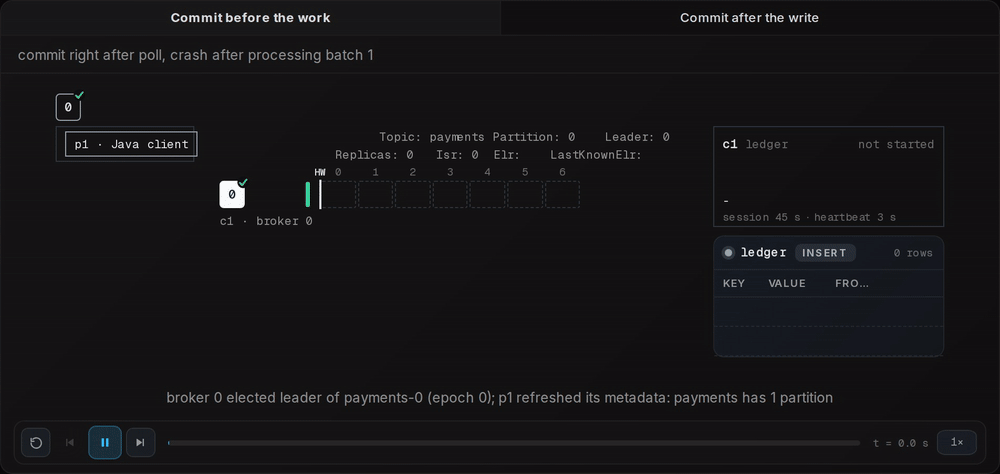
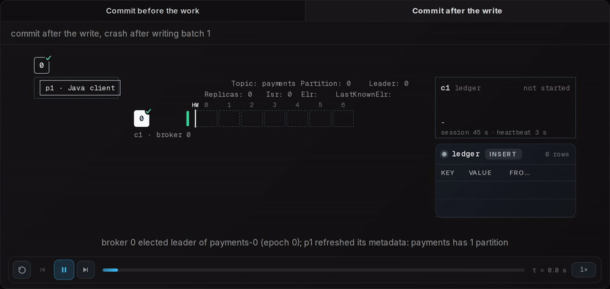
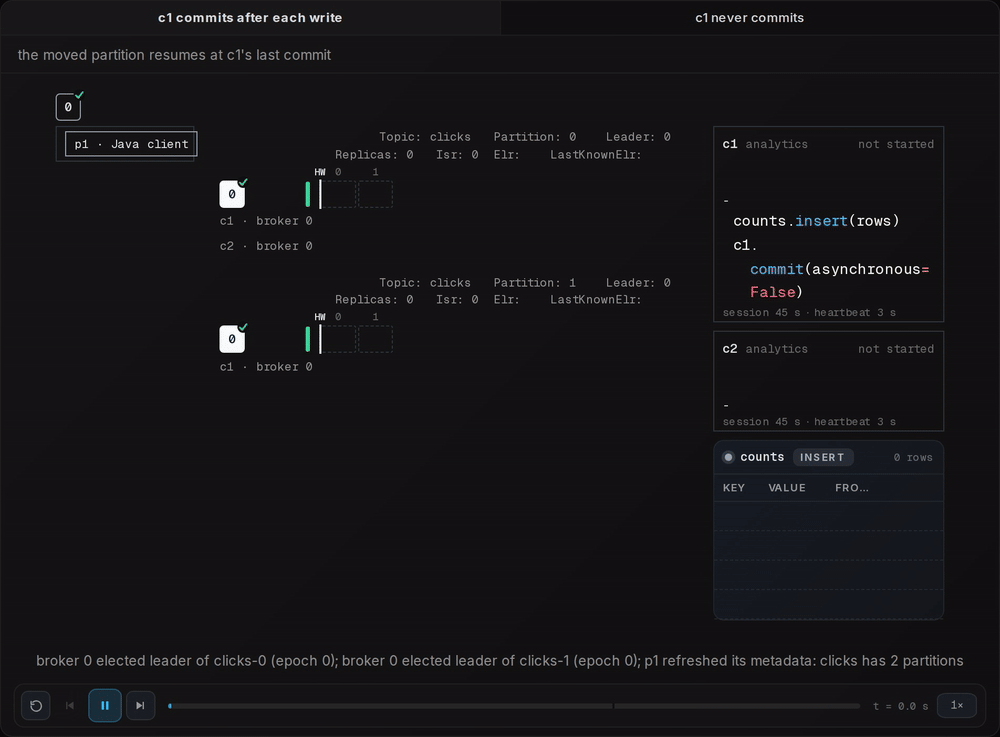
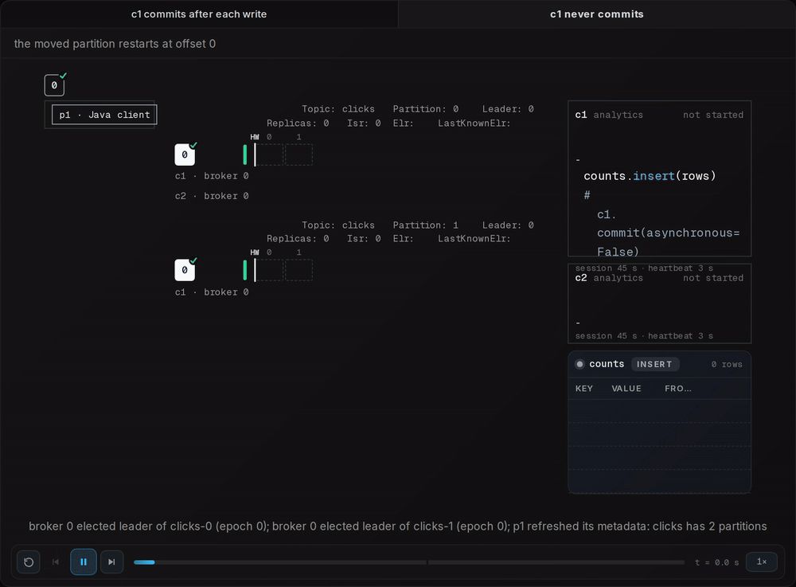
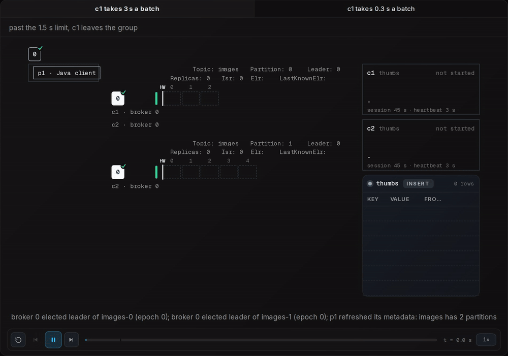
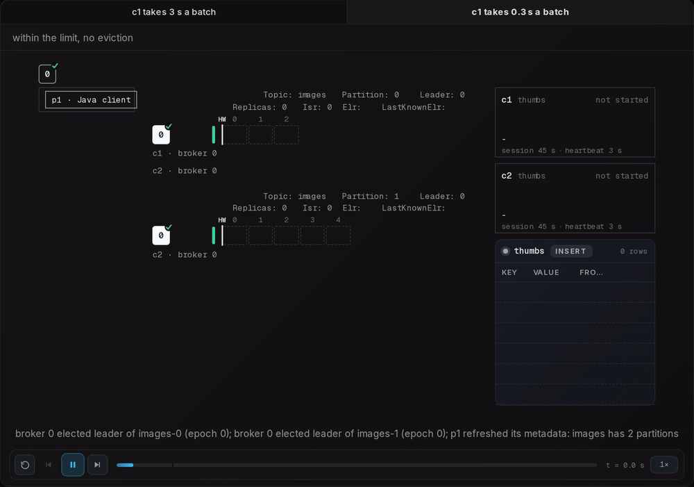
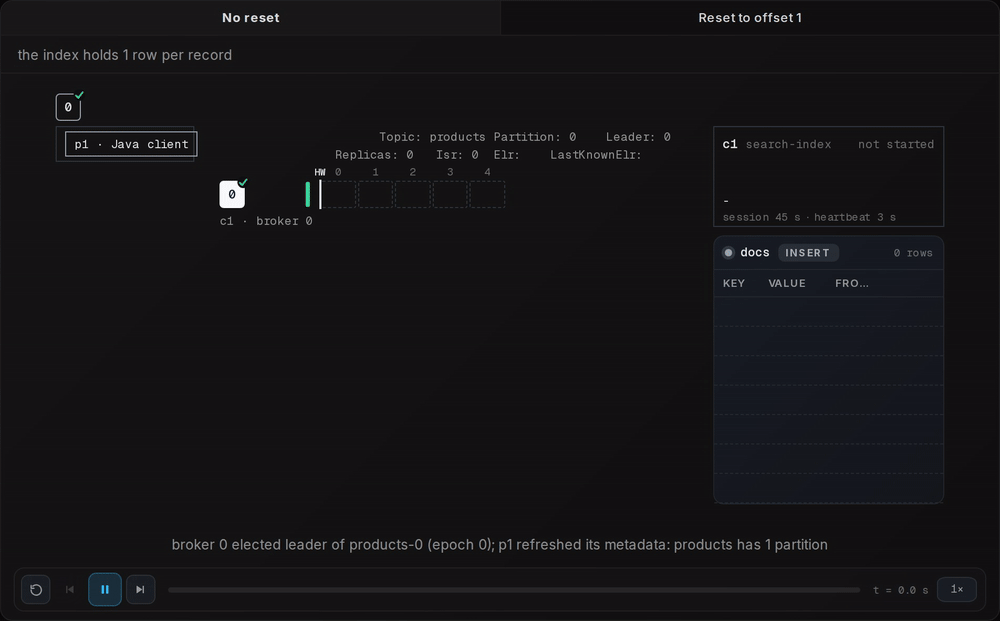
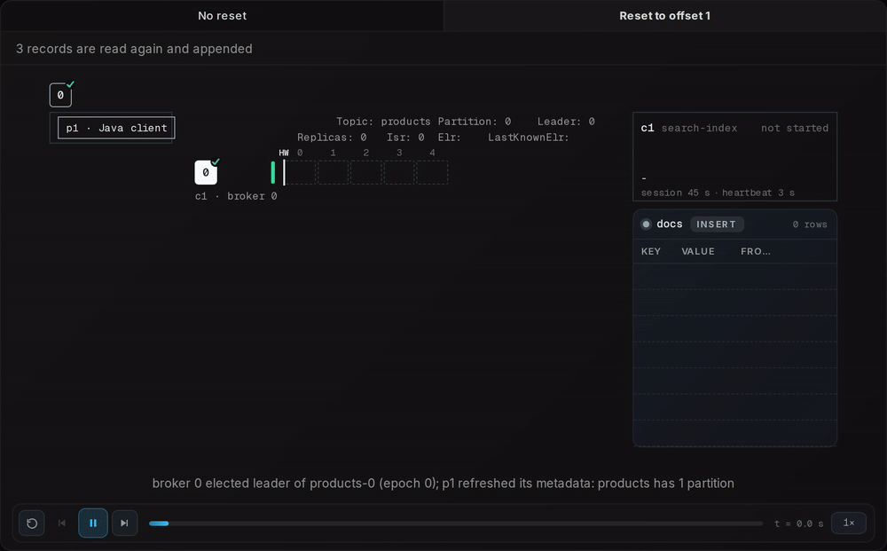

Intermediate·[](https://kafka.apache.org/)·20 min · 6 challenges

# Consumer Groups: Intermediate

At Uber, a consumer group reads completed trips from a topic and writes each driver's earnings to a ledger. One night a deploy restarts every member of the group at once. By morning, 1,400 drivers are missing a trip and 300 others were paid twice. Which trips vanished, which repeated, and which setting decided each outcome is what this lesson works out.


<br>

---

## Auto-Commit's Blind Spot

[enable.auto.commit](https://kafka.apache.org/44/configuration/consumer-configs/#consumerconfigs_enable.auto.commit)[auto.commit.interval.ms](https://kafka.apache.org/44/configuration/consumer-configs/#consumerconfigs_auto.commit.interval.ms)


<br>

### What auto-commit records

Leave `enable.auto.commit` at its default of `true` and the consumer commits on its own schedule. What it commits is its position: for each partition it holds, the offset one past the last record that `poll()` handed back. It writes that position at 3 moments. Inside `poll()`, before any new records are fetched, when `auto.commit.interval.ms` (5,000 ms by default) has passed since the last commit. Inside `close()`. And just before partitions are revoked in a rebalance, a moment the Rebalances and Revocation section returns to. Processing appears nowhere in that rule. The consumer cannot see what your code did with the records, so it treats handing them over as the moment they were dealt with.

That's the blind spot. A committed offset is a promise to the next reader of this partition that everything before it is finished. Auto-commit makes that promise from the only fact it has, which is what was fetched, and fetched and finished are the same line only while your loop keeps them so.

| ✓ What the consumer knows | ✗ What only your code knows |
| --- | --- |
| • The offset after the last record poll() returned, per partition<br><br>• How long it has been since the last commit<br><br>• That poll() and close() were called | • Which of those records the handler has finished<br><br>• Whether a write reached the sink or sits in a buffer<br><br>• Whether a worker thread still holds a record |


<br>

### Where fetched and finished drift apart

Consider a group named `ledger` reading partition 3 of `payments`. Records arrive at 4 a second, so each `poll()` returns 4 records once a second. The loop hands each record to a pool of worker threads and goes straight back to `poll()` without waiting for them. The workers finish 1 record a second between them. Each poll moves the position 4 ahead; the workers move the finished line 1 ahead. The 2 lines separate from the first second.

| clock | poll returns | position after the poll | records the workers have finished | committed offset |
| --- | --- | --- | --- | --- |
| 0 s | 0 to 3 | 4 | none | none |
| 1 s | 4 to 7 | 8 | 0 | none |
| 2 s | 8 to 11 | 12 | 0 to 1 | none |
| 3 s | 12 to 15 | 16 | 0 to 2 | none |
| 4 s | 16 to 19 | 20 | 0 to 3 | none |
| 5 s | 20 to 23 | 24 | 0 to 4 | 20 |

At 5 s the interval has elapsed, so the `poll()` call commits before it fetches. The position it commits is 20, the end of the batch returned at 4 s. The workers have finished offsets 0 to 4. The process crashes at 5.5 s. Its replacement asks the coordinator where `ledger` stands on partition 3, hears 20, and reads from there. Offsets 5 to 19 were fetched, committed, and never processed: 15 payments gone, with no error logged anywhere, because every component did what its contract says.

```sql
while True:
    batch = consumer.poll(timeout_ms=1000)
    for tp, records in batch.items():
        for record in records:
            pool.submit(handle, record)
```


<br>

### When auto-commit only duplicates

Change 1 line and the outcome changes. Call `handle(record)` inline instead of `pool.submit(handle, record)`, and the loop can't reach the next `poll()` until every record of the batch is done. Now the position committed at 5 s is the end of a batch the loop finished before 5 s. A crash at 5.5 s loses nothing: the restart begins at 20, and the batch 20 to 23 that was half done gets handled again from the start. Synchronous processing turns auto-commit into at-least-once delivery, where a crash costs repeats.

Synchronous handling still loses records in 2 cases. The first is `close()`. A shutdown signal arrives while the loop is 2 records into a batch of 4, the signal handler stops the loop and calls `close()`, and `close()` commits the position, which lies past the 2 untouched records. The second is a write that completes later than it returns, such as a buffered client that returns before the bytes reach the sink. Both are the same blind spot: a position that got ahead of the work.

> The 3 moments auto-commit writes
>
> - Inside poll(), once auto.commit.interval.ms has passed since the last commit, before the new records of that poll are fetched
> - Inside close(), whatever the loop was in the middle of
> - Before a partition is given up in a rebalance, which the Rebalances and Revocation section covers

*The 5,000 ms interval is a minimum, checked at each poll. A loop that polls every 30 seconds commits every 30 seconds.*

> **TIP**
>
> To find out whether a loop can lose records, ask 1 question: at the instant of a commit, can the committed offset be greater than the offset after the last record whose work is complete? If the answer is ever yes, the loop loses records on a crash, and the fix is to move the commit, which the next section does.


<br>

---

## Commit After Processing

[Message Delivery Semantics](https://kafka.apache.org/44/design/design/#message-delivery-semantics)[Consumer Position](https://kafka.apache.org/44/design/design/#consumer-position)


<br>

### Move the commit to the end of the loop

Set `enable.auto.commit=false` and the consumer commits nothing on its own. The loop takes over the job and does it at the one moment it is true: after the records have been processed and the results written. Each pass through the loop then runs in a fixed order: poll a batch, process it, write the results to the sink, and commit the position. The committed offset is always the offset after the last record whose write has returned, so it never gets ahead of the work.

```sql
while True:
    batch = consumer.poll(timeout_ms=1000)
    for tp, records in batch.items():
        for record in records:
            ledger.write(record.key, record.value)
    consumer.commit()
```

The sketch uses the kafka-python client, whose blocking `commit()` matches the Java client's `commitSync()`, the name the rest of this lesson uses. With no argument it commits the position of every partition the consumer holds, the offsets after the last records of the most recent poll. That's the same number auto-commit would have stored; the difference is only the moment. A committed offset of 44 says the next read starts at 44, so the number stored is one past the last record processed, as the beginner lesson on committing showed.

The blocking matters. A synchronous commit waits for the coordinator's reply and retries on a retriable error, so when the call returns the position is stored. The asynchronous form, `commitAsync()`, sends the request and moves on, which costs less per batch and is fine while the loop keeps running, because a later commit supersedes a failed earlier one. The usual pairing is asynchronous commits inside the loop and 1 synchronous commit in the shutdown path, so the last position is stored before the process exits.


<br>

### A crash at every step

Walk the loop with a batch of records 40 to 43 from partition 1 of `payments`, with 40 as the committed offset before the pass starts. The sink is a table with 1 row per record. Crash the process at each step and look at what the restarted consumer does.

| crash point | committed offset | rows in the sink from this batch | after the restart |
| --- | --- | --- | --- |
| after the poll, before processing | 40 | none | reads 40 to 43 again, writes them once |
| after processing, before the write | 40 | none | reads 40 to 43 again, writes them once |
| after the write, before the commit | 40 | 40 to 43 | reads 40 to 43 again, writes them a second time |
| after the commit | 44 | 40 to 43 | continues at 44, nothing repeats |

Every row of that table is a repeat or a no-op, and none is a loss. Committing after the work changes what a crash costs from silent loss to duplication, and duplication is a failure you can see in the sink and design for. The window for it is narrow, the time between the write returning and the commit landing, but at any real volume a crash will eventually land inside it.

**Commit before the work**



**Commit after the write**




<br>

### Make the repeat harmless

At-least-once delivery only works with a sink that tolerates a second copy of the same record, and 3 designs do. An upsert keyed by something that identifies the record, the record's key when keys are unique per event, or the triple of topic, partition and offset when they are not, overwrites the first copy with an identical second one. An insert with a uniqueness constraint on that same identifier rejects the second copy, and the loop treats the rejection as success. A sink that stores the offset next to the data lets the loop skip any record whose offset is already present. In each case the second pass changes nothing, which is the definition of an idempotent write.

| ✓ Do | ✗ Don't |
| --- | --- |
| • Commit only after the write has returned<br><br>• Key the sink by record key or by topic, partition and offset<br><br>• Commit synchronously once in the shutdown path<br><br>• Treat a duplicate-key rejection as a successful write | • Call commit before the loop body runs<br><br>• Hand records to a thread pool and commit the poll's position<br><br>• Retry a failed asynchronous commit by hand<br><br>• Insert into a sink that has no unique identifier |

Committing partway through a batch is possible too. `commitSync(offsets)` takes a map from partition to offset, so a loop processing a large batch can store progress every 100 records and bound the repeat after a crash to 100 records instead of 500.


<br>

### Committing behind a worker pool

A worker pool keeps at-least-once delivery only if the loop commits what the workers report, not the poll's position. Track the finished offsets per partition. Workers finish out of order, so the safe commit is the lowest offset still unfinished. Partition 1 hands 40 to 47 to the pool, and the workers report in the order below. Committing 45 while 42 runs would mark 42 done, and a crash would skip it. On revocation, the loop waits for that partition's workers or discards their results, then commits the unbroken line, inside the callback the next section introduces.

| workers report | finished on partition 1 | safe commit |
| --- | --- | --- |
| 40, 41 | 40, 41 | 42 |
| 43, 44 | 40, 41, 43, 44 | 42 |
| 42 | 40 to 44 | 45 |

*A commit stores a number, not a record. The records stay in the log, which is why the restarted consumer can read them again at all.*


<br>

---

## Rebalances and Revocation

[Consumer Rebalance Protocol](https://kafka.apache.org/44/operations/consumer-rebalance-protocol/#overview)[partition.assignment.strategy](https://kafka.apache.org/44/configuration/consumer-configs/#consumerconfigs_partition.assignment.strategy)


<br>

### What starts a rebalance

A group's partitions are split among its members, and the split is recomputed whenever the membership changes: a member joins, leaves by calling `close()` or by crashing so that its heartbeats stop, or is thrown out for polling too slowly, which the next section covers. The topic can also gain partitions, which members notice when they refresh their metadata, every `metadata.max.age.ms`, 5 minutes by default. Each of these starts a rebalance, run by the group's coordinator, the broker that also stores the group's committed offsets.

With the range assignor, the Java consumer's default under the classic group protocol, a rebalance is a full reshuffle. Every member gives back every partition it holds, the coordinator collects the new membership, and each member receives a fresh list. Between giving back and receiving, nobody reads anything: the group pauses for the rebalance's duration, a few hundred milliseconds when every member responds at once, longer if one member is slow to rejoin. Kafka also offers protocols that move only the partitions whose owner changes, which a later lesson covers; the rule for in-flight work below holds under all of them.

Before: 2 members, 6 partitions

| member | partitions |
| --- | --- |
| A | 0, 1, 2 |
| B | 3, 4, 5 |

After C joins: range assignment

| member | partitions |
| --- | --- |
| A | 0, 1 |
| B | 2, 3 |
| C | 4, 5 |

Partition 2 moves from A to B, and 4 and 5 move from B to C, so 3 partitions change hands. The 3 that stayed put were revoked and handed back as well. A moved partition takes its committed offset with it and nothing else. C begins partition 4 at the last offset anyone committed for it, and has no idea what B had in flight.


<br>

### What in-flight work becomes

Take partition 4 at the moment the rebalance begins. B's last commit stored 200. B's current batch runs 200 to 211; it has written 200 to 207 to the sink and is working on 208. The coordinator tells B to give the partition up. C receives it, reads the committed offset, 200, and starts there. Offsets 200 to 207 land in the sink twice, once from B and once from C. Offsets 208 to 211 are still in B's memory. If B keeps writing them after the revocation, they land twice as well, because C will reach them.

The consumer gives your code a place to act before the handover. Pass a `ConsumerRebalanceListener` to `subscribe()`, and its `onPartitionsRevoked()` callback runs inside `poll()` before the partitions leave, on the same thread as the loop. The right move in it is to finish or abandon the current batch and commit what's done: `commitSync()` with a map holding 208 for partition 4. C then starts at 208 and the repeat shrinks to zero. `onPartitionsAssigned()` runs after the new list arrives, the place to reset any per-partition state your handler keeps in memory.

**c1 commits after each write**



**c1 never commits**



With auto-commit on, the consumer commits the position itself before rejoining. That is the third commit moment from the first section, and it carries the same blind spot: the position, not the finished line. A rebalance that arrives with an unprocessed batch sitting in a worker pool commits that batch as done, and the new owner skips it.

> A rebalance changes 3 things for a member
>
> - Which partitions it reads: a revoked partition may come back to it or go to another member
> - Where it reads from: every partition restarts at its committed offset, including the ones that returned to the same member
> - What its old commits mean: a commit sent for a partition the member no longer holds is rejected

How a rebalance shows up

- In the consumer log: lines naming the group joining, a new generation, and partitions revoked and assigned
- In lag: every partition of the group climbs together during the pause, then drops as members resume
- In the sink: a burst of repeated rows for partitions that moved with uncommitted work in flight

> **TIP**
>
> Count the rebalances. A group that rebalances every few minutes is losing time to pauses and repeating work at every move; the usual cause is a member being evicted, and the next section shows how to tell.


<br>

---

## Slow Handlers Get Evicted

[max.poll.interval.ms](https://kafka.apache.org/44/configuration/consumer-configs/#consumerconfigs_max.poll.interval.ms)[session.timeout.ms](https://kafka.apache.org/44/configuration/consumer-configs/#consumerconfigs_session.timeout.ms)


<br>

### 2 timers for 2 questions

The coordinator cannot see inside your process, so it watches 2 signals. The first is the heartbeat, sent by a background thread of the consumer every `heartbeat.interval.ms`, which answers the question is this process alive. If heartbeats stop for longer than the session timeout, the coordinator removes the member and rebalances. A crashed process, a lost network path and a machine that was powered off all look the same through this timer.

The second signal is the gap between 2 calls to `poll()`, measured on the consumer's own clock against `max.poll.interval.ms`. It answers a different question: is this process making progress. A handler stuck on a lock, a batch of 500 records that each take 2 seconds, a call to a service that never times out: all of these keep heartbeating, because the background thread is unaffected, and all of them stop polling.

- **3 s** — heartbeat.interval.ms default
- **45 s** — session timeout default
- **5 min** — max.poll.interval.ms default

| ✓ Dead process | ✗ Stuck process |
| --- | --- |
| • Heartbeats stop<br><br>• Caught by the session timeout<br><br>• Part of its batch may be written but not committed<br><br>• Partitions move, work repeats from the committed offset | • Heartbeats continue<br><br>• Caught by the poll interval<br><br>• Its batch finishes late<br><br>• Partitions move, the batch runs twice |


<br>

### What happens past the limit

When the gap exceeds the limit, the consumer acts against itself. Its background thread sends the coordinator a leave request, and the coordinator rebalances the group without it. The partitions the slow member held go to the others, which start them from the committed offsets. The slow handler knows none of this. It finishes its batch, perhaps 20 minutes later, writes the results, and calls `commitSync()`. The commit comes back with a `CommitFailedException` whose message says the group has already rebalanced and assigned the partitions to another member. The next `poll()` rejoins the group, which triggers another rebalance, and the member receives an assignment again.

Count the cost. The batch the slow member finished was already handed to another member, which processed it from the committed offset, so every record in it ran twice. The group paused twice, once at the eviction and once at the rejoin. And if the handler is slow on every batch, the member is evicted on every batch, and the group spends its life rebalancing: a rebalance storm, visible as lag that climbs on every partition at once while the sink fills with repeats.

| batch size | seconds per record | time to finish the batch | within a 300 s poll interval? |
| --- | --- | --- | --- |
| 500 | 0.2 | 100 s | yes |
| 500 | 0.8 | 400 s | no, evicted on every batch |
| 100 | 0.8 | 80 s | yes |
| 500 | 0.8, with pause() and polling | 400 s, but polls continue | yes |


<br>

### Keeping a slow handler in the group

There are 3 fixes, listed in the order to try them. Lower `max.poll.records`, so a batch finishes within the limit, as the third row of the table shows. Raise `max.poll.interval.ms` for work that is slow by nature, accepting that a stuck process now takes that long to be noticed. Or take the slow work off the polling thread, using 2 calls together: hand the record to a worker thread, call `pause()` on its partition, and keep calling `poll()`. A poll returns no records for a paused partition and still counts as a poll, the other partitions keep flowing, and `resume()` reopens the paused one when the worker finishes. Threads lose records only when the loop commits the poll's position, so commit the workers' finished line instead.

**c1 takes 3 s a batch**



**c1 takes 0.3 s a batch**



- Log line to watch: a CommitFailedException whose message names a rebalance
- Metric to watch: the group's rebalance rate, and lag rising on every partition together
- Setting to check first: max.poll.records against the handler's measured time per record


<br>

---

## Replaying by Resetting Offsets

[Managing consumer groups](https://kafka.apache.org/44/operations/basic-kafka-operations/#managing-consumer-groups)[Offline Data Load](https://kafka.apache.org/44/design/design/#offline-data-load)


<br>

### Moving a group back in time

Committed offsets are entries the coordinator stores, and they can be rewritten. That is what a replay is: move the group's committed offset for each partition to an earlier point, start the members, and they read forward from there as if those records had never been consumed. The log itself is untouched. Reading does not delete, and neither does re-reading.

The command is kafka-consumer-groups.sh --bootstrap-server broker1:9092 --group search-index --topic products --reset-offsets --to-datetime 2026-11-03T02:00:00.000 --execute. Without --execute the tool prints the offsets it would set for each partition and changes nothing, which is the form to run first. Swap --to-datetime for one of the options below to pick a different target.

| option | where each partition lands |
| --- | --- |
| --to-earliest | the partition's current first offset, wherever retention has left it |
| --to-latest | the end of the partition, skipping everything unread |
| --to-offset 1200 | offset 1200 on every selected partition, which is a different record on each |
| --shift-by -500 | 500 before the current committed offset, per partition |
| --to-datetime 2026-11-03T02:00:00.000 | the first record with a timestamp at or after that time, per partition |
| --by-duration PT2H | the first record with a timestamp at or after 2 hours ago, per partition |

The tool refuses while the group has members, because a reset of an active group would be overwritten by the next commit from a running member. Stop every consumer, run the reset, confirm with `--describe` that the committed offsets moved, then start them. The datetime and duration forms are the ones you reach for most, because a bad deploy has a start time, and they land each partition on its own first record past that time rather than on a single offset that means something different on every partition. The time matches record timestamps, not when the group processed them, so a group running 10 minutes behind at a 02:00 deploy resets to 01:50 to catch the older records the bad code handled. The indexer below ran near zero lag.

--describe before the reset

| PARTITION | CURRENT-OFFSET | LOG-END-OFFSET | LAG |
| --- | --- | --- | --- |
| 0 | 48210 | 48230 | 20 |
| 1 | 51904 | 51920 | 16 |

--describe after --to-datetime 02:00

| PARTITION | CURRENT-OFFSET | LOG-END-OFFSET | LAG |
| --- | --- | --- | --- |
| 0 | 41800 | 48230 | 6430 |
| 1 | 45310 | 51920 | 6610 |


<br>

### What a replay does to the sink

A group named `search-index` reads `products` and upserts each product's document into a search store, keyed by product id. A deploy at 02:00 drops the price field from every document it writes. The fix goes out at 04:10. Every product changed between 02:00 and 04:10 now has a document with no price. The replay is 3 steps: stop the group, reset to 02:00, start it. The indexer re-reads 2 hours of changes with the fixed code and upserts the correct document over the broken one. Products changed again after 04:10 are rewritten with the same value they already hold.

That sink made the replay safe because an upsert by product id is idempotent, the same property the Commit After Processing section needed for a crash. An append-only sink turns the same replay into 2 hours of duplicate rows. For such a sink, delete the rows from the window first, or write the replay into a fresh table and swap it in once it has caught up. Either way the rule is the same: before resetting the offset, know what the sink does with a record it has seen before.

**No reset**



**Reset to offset 1**



How far back you can go has 3 limits. Retention: an offset older than the partition's first offset no longer exists, so the tool warns and uses the first offset instead. Compaction: on a compacted topic, older values that compaction has already removed are gone, so the cleaned part of the log replays as the latest value per key, while the recent part not yet cleaned still holds every version; a replay there rebuilds current state and can't be relied on for history. Lag: the instant the group starts, its lag equals the size of the window, 13,040 records in the tables above, and an alert set on lag fires until the group catches up.

For a reset that needs a hand-picked offset per partition, export first: `kafka-consumer-groups.sh --bootstrap-server broker1:9092 --group search-index --topic products --reset-offsets --to-current --export > offsets.csv` changes nothing and writes the current offsets as CSV. Edit the numbers, then `kafka-consumer-groups.sh --bootstrap-server broker1:9092 --group search-index --reset-offsets --from-file offsets.csv --execute` applies them. The same file is a backup: export before any reset, and the old positions come back with that 1 command if the replay turns out to be the wrong call.

Before you run a reset

- Every member of the group is stopped, and --describe shows no consumers
- The sink is idempotent for the window, or its rows for the window have been removed
- The dry run shows the offsets you expect on every partition, and the old offsets are exported
- Whoever watches the lag alert knows it is about to fire

> **TIP**
>
> Reset 1 partition when the damage is on 1 partition: `--topic products:3` restricts the reset to that partition, and the others keep their committed offsets.


<br>

---

## Putting It All Together

At LinkedIn, where Kafka was created, a consumer group reads member profile updates and upserts each member's search document. A release that writes a wrong headline runs for 90 minutes before rollback, and during it 1 member was repeatedly evicted for a slow enrichment call. The fix is a replay to the release time, and every part of this lesson decides whether that replay heals or harms.

- The evictions during the release moved partitions between members, and each move restarted a partition at its committed offset, so some updates were indexed twice with the wrong headline; committing after the write is what kept any from being skipped.
- The replay only works because the search document is an upsert keyed by member, so the 90 minutes of repeated updates overwrite the wrong headline with the right one and leave members changed later untouched.
- The group must be fully stopped before the reset, and once it restarts its lag equals 90 minutes of updates, so the alert on lag fires until the fixed code catches up.
- If the group had been running auto-commit with the enrichment call in a thread pool, the evictions would have committed batches the workers never finished, and the replay would have been the only way to recover records that were never indexed at all.


<br>

---

## Key Takeaways

- Auto-commit stores the position, the offset after the last record poll() returned, inside poll(), close() and before a rebalance; it never knows what was processed.
- Committing after the write makes a crash cost a repeat instead of a loss, so the sink must take a second copy of a record without changing.
- A moved partition carries only its committed offset; whatever the old owner processed past it is processed again by the new one unless the revocation callback commits first.
- Heartbeats say a process is alive and the poll interval says it is making progress; a handler that breaks the poll interval leaves its group on its own and its late commit is rejected.
- Resetting a group's offsets rewrites stored positions on a stopped group and replays the log from there, so what the sink does with a repeated record decides whether the replay fixes the data or duplicates it.

[](https://kafka.apache.org/)

Official Apache Kafka resourcesversion 4.4

"Apache Kafka is an open-source distributed event streaming platform used by thousands of companies for high-performance data pipelines, streaming analytics, data integration, and mission-critical applications." [kafka.apache.org](https://kafka.apache.org/)

[Documentation](https://kafka.apache.org/44/)[Quickstart](https://kafka.apache.org/quickstart/)[Download](https://kafka.apache.org/community/downloads/)[Community](https://kafka.apache.org/community/)

In the documentation

Auto-Commit's Blind Spot
:   [enable.auto.commit](https://kafka.apache.org/44/configuration/consumer-configs/#consumerconfigs_enable.auto.commit)[auto.commit.interval.ms](https://kafka.apache.org/44/configuration/consumer-configs/#consumerconfigs_auto.commit.interval.ms)

Commit After Processing
:   [Message Delivery Semantics](https://kafka.apache.org/44/design/design/#message-delivery-semantics)[Consumer Position](https://kafka.apache.org/44/design/design/#consumer-position)

Rebalances and Revocation
:   [Consumer Rebalance Protocol](https://kafka.apache.org/44/operations/consumer-rebalance-protocol/#overview)[partition.assignment.strategy](https://kafka.apache.org/44/configuration/consumer-configs/#consumerconfigs_partition.assignment.strategy)

Slow Handlers Get Evicted
:   [max.poll.interval.ms](https://kafka.apache.org/44/configuration/consumer-configs/#consumerconfigs_max.poll.interval.ms)[session.timeout.ms](https://kafka.apache.org/44/configuration/consumer-configs/#consumerconfigs_session.timeout.ms)

Replaying by Resetting Offsets
:   [Managing consumer groups](https://kafka.apache.org/44/operations/basic-kafka-operations/#managing-consumer-groups)[Offline Data Load](https://kafka.apache.org/44/design/design/#offline-data-load)

Further
:   [KIP-429 Incremental Rebalance](https://cwiki.apache.org/confluence/display/KAFKA/KIP-429%3A+Kafka+Consumer+Incremental+Rebalance+Protocol)

Apache Kafka, Kafka, and the Kafka logo are either registered trademarks or trademarks of The Apache Software Foundation in the United States and other countries.
