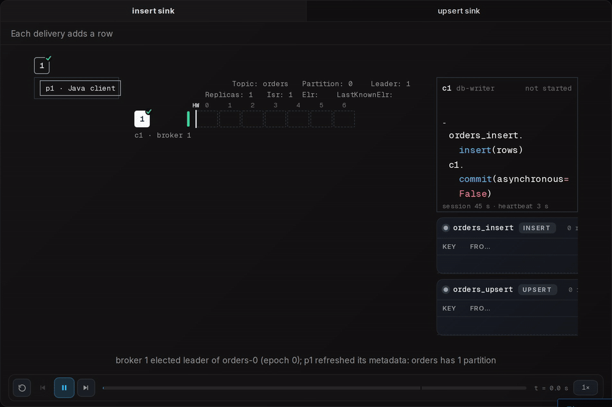
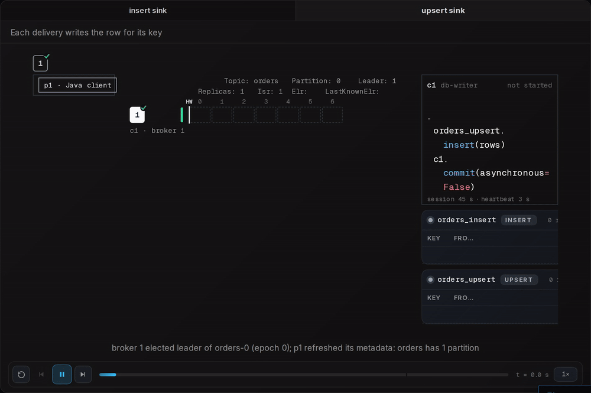
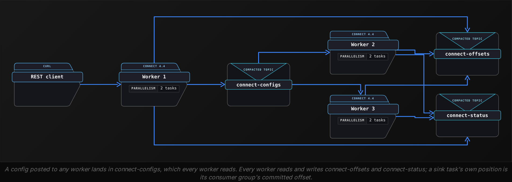

Advanced·[](https://kafka.apache.org/)·20 min · 6 challenges

# Kafka in the Pipeline: Advanced

At Uber, a completed trip becomes a record on a topic, and several readers consume it: one consumer writes the fare into a ledger database, another lands trips as hourly files, and a stream processor keeps each driver's running earnings. If the ledger consumer crashes mid-batch and replays a few hundred trips, whether each rider sees 1 charge or 2 comes down to how that write was designed.


<br>

---

## Exactly-Once into a Database

[Exactly-once support](https://kafka.apache.org/44/kafka-connect/user-guide/#exactly-once-support)[isolation.level](https://kafka.apache.org/44/configuration/consumer-configs/#consumerconfigs_isolation.level)

Every hop between a topic and a database delivers at least once. The producer retries a send, the consumer re-reads after a rebalance, a sink connector restarts from its last committed offset. Idempotent producers and transactions remove duplicates inside Kafka, but the write into a relational table happens outside any Kafka transaction, and the database applies whatever the consumer sends it, as many times as it is sent. Exactly-once into a database means designing the write so that a second delivery changes nothing.


<br>

### Where the duplicate comes from

A consumer polls a batch, writes each row to the table, then commits its offset. If it crashes after the write and before the commit, the group coordinator still holds the previous offset, and the replacement consumer starts from there and writes the same rows again. In the animation below, consumer `c1` reads 6 order records into a table, crashes right after a write and before the commit that would have followed it, and comes back 1.5 seconds later. Switch between the variants to see what the table holds after the replay with a plain insert and with an upsert keyed on the order id.

**insert sink**



**upsert sink**




<br>

### Make the write idempotent

A plain insert adds a row for every delivery, so the replayed orders appear twice and a count of rows overstates sales. An upsert keyed on the primary key writes the same values over the same row, so the second delivery leaves the table exactly as the first left it. The record key the producer chose becomes the table's primary key. That is why a change-event topic keyed on the source row's id lands cleanly: each delivery of a change for row 42 updates row 42, and a tombstone for row 42 deletes it. A sink connector for a relational database exposes the same behaviour as an upsert insert mode with the primary key taken from the record key, and a hand-written consumer does it like this.

```sql
batch = consumer.poll(timeout_ms=500)
for tp, records in batch.items():
    for record in records:
        if record.value is None:
            db.delete('orders', order_id=record.key)
        else:
            db.upsert('orders', key='order_id', row=record.value)
consumer.commit()
```


<br>

### Store the offset beside the row

An upsert makes the row idempotent, but the offset commit still lives in Kafka, so a crash between the database commit and the offset commit replays the batch. For a table that must also record exactly how far it has read, move the offset into the database. Add a table `kafka_offsets` (columns `topic`, `partition`, `last_offset`) and update it in the same database transaction as the rows, so either both land or neither does. On start the consumer ignores the group's committed offset. It reads `kafka_offsets` and seeks each assigned partition to `last_offset + 1`. The database becomes the only source of truth for position, and Kafka's own offset commit can be turned off with `enable.auto.commit=false` and no explicit commit call.

```sql
def on_assign(consumer, partitions):
    for tp in partitions:
        row = db.one('kafka_offsets', topic=tp.topic, partition=tp.partition)
        tp.offset = row['last_offset'] + 1 if row else OFFSET_BEGINNING
    consumer.assign(partitions)

while True:
    for tp, records in consumer.poll(timeout_ms=500).items():
        with db.transaction():
            for record in records:
                if record.value is None:
                    db.delete('orders', order_id=record.key)
                else:
                    db.upsert('orders', key='order_id', row=record.value)
            db.upsert('kafka_offsets', key=('topic', 'partition'),
                      row={'topic': tp.topic, 'partition': tp.partition,
                           'last_offset': records[-1].offset})
```

| Moment | orders rows | kafka_offsets.last_offset | Next read starts at |
| --- | --- | --- | --- |
| Batch of offsets 0 to 2 committed | o-0, o-1, o-2 | 2 | 3 |
| Batch 3 to 5 written, crash before DB commit | o-0, o-1, o-2 | 2 | 3 |
| Batch 3 to 5 committed | o-0 to o-5 | 5 | 6 |


<br>

### Effects that cannot be replayed

Some writes carry their history. `UPDATE balances SET total = total + 40` applied twice adds 80. A counter, an append to an audit table, or an email send has no key to collide on. The fix is to give it one: write the record's id into a `processed_events` table with a unique constraint, in the same transaction as the increment, and let the second delivery fail that constraint and roll the whole transaction back. Where the effect leaves your system, such as a payment call to another service, pass the record key as that service's idempotency token so it deduplicates on its side. Every replay-safe design reduces to the same move: find or invent the key that lets the second write collide with the first.

| ✓ Replay changes nothing | ✗ Replay changes the result |
| --- | --- |
| • Upsert keyed on the record key<br><br>• Delete on a tombstone for that key<br><br>• Offset stored in the same transaction as the rows<br><br>• Processed-event id under a unique constraint | • Plain insert without a unique key<br><br>• Increment: total = total + amount<br><br>• Append to an audit log<br><br>• Email or payment call without an idempotency token |

> A crash at each step of the offset-in-database loop
>
> - After poll, before any write: the table is unchanged, the replay writes the batch once.
> - After the row upsert, before the database commit: the transaction rolls back, the replay writes the batch once.
> - After the database commit: rows and last_offset are both in, the replay starts at the next offset.
> - A consumer with Kafka-side commits has 1 extra gap: after the database commit and before the offset commit, where the upsert absorbs the replay.

> **TIP**
>
> Pick the record key before anything else. A topic keyed on the row id gives the database an upsert key, keeps every change to one row in one partition and in order, and gives a sink connector its primary key without a transform.


<br>

---

## Exactly-Once into Files

[Sink connectors](https://kafka.apache.org/44/kafka-connect/user-guide/#sink-connectors)[Message Delivery Semantics](https://kafka.apache.org/44/design/design/#message-delivery-semantics)

A file sink buffers the records it reads from a partition and writes them as a file in an object store or a filesystem. Replay is its normal recovery path: after a crash the sink rewinds to the last committed offset and writes again. Whether the second run produces the same files as the first depends on 3 choices: what names the file, what closes the file, and what folder the record lands in. Each choice is deterministic when it depends only on the records, and nondeterministic when it depends on the clock of the worker that happened to be running.


<br>

### The name carries the start offset

The object-store sink builds each file name from the topic and partition, then appends the offset of the first record in it, such as `orders+3+0000012000.avro`. It commits the consumer offset only after the file is fully uploaded. After a crash it resumes from that committed offset, buffers the same records, and produces a file with the same name and the same content, which overwrites the earlier upload with identical bytes. A reader listing the folder sees each file once. A partially written file from the crashed run never gets a committed offset, so the next run's upload replaces it, and a file that was never uploaded leaves nothing behind at all.

| Run | Offsets buffered | File written | Offset committed |
| --- | --- | --- | --- |
| 1 | 12000 to 12099 | orders+3+0000012000.avro | 12100 |
| 1 | 12100 to 12199 | orders+3+0000012100.avro | 12200 |
| 1 | 12200 to 12299 | orders+3+0000012200.avro uploaded, crash | none |
| 2 | 12200 to 12299 | orders+3+0000012200.avro overwritten, identical | 12300 |
| 2 | 12300 to 12399 | orders+3+0000012300.avro | 12400 |


<br>

### Close the file on a count or on record time

`flush.size=100` closes a file after 100 records. The 100th record is the same record on every replay, so the file boundaries are stable. `rotate.interval.ms=600000` also closes a file once 10 minutes of record time have passed since the file's first record, which is deterministic as long as the timestamp extractor reads the records rather than the worker clock. `rotate.schedule.interval.ms` closes files on the worker's wall clock: a replay that runs faster or starts at a different minute cuts the files in different places, and a file from run 1 may have no counterpart in run 2, leaving both in the folder. Set it only when a file must appear at a fixed time regardless of traffic, and accept that replays then produce different files.

```sql
flush.size=100
rotate.interval.ms=600000
timestamp.extractor=Record
partition.duration.ms=3600000
path.format='year'=YYYY/'month'=MM/'day'=dd/'hour'=HH
timezone=UTC
locale=en-US
```


<br>

### Put the record in the folder its timestamp names

A time-based partitioner builds the folder path from a timestamp. `timestamp.extractor=Record` takes the record's own timestamp, so a record stamped 09:58 lands in `hour=09` on every run. `timestamp.extractor=Wallclock` takes the time the sink processed it, so the same record lands in `hour=09` on the first run and in `hour=14` on a replay that afternoon, and the morning copy stays where it was. `RecordField` reads a named field inside the value, which is the right choice when the event time lives in the payload and the record timestamp is only the producer's send time. With a record-based extractor the folder becomes a function of the data, as the file name and boundary already are, and the whole output can be regenerated from the topic.

| Setting | Depends on | Same on replay |
| --- | --- | --- |
| File name | topic, partition, first offset | yes |
| flush.size | record count | yes |
| rotate.interval.ms with Record extractor | record timestamps | yes |
| rotate.schedule.interval.ms | worker clock | no |
| timestamp.extractor=Record or RecordField | the record | yes |
| timestamp.extractor=Wallclock | worker clock | no |


<br>

### Late records land in a folder that looks finished

A record stamped 09:58 that reaches the sink at 10:20 goes into `hour=09`, in a new file named by its offset. A job that read `hour=09` at 10:05 missed it, and a query at 10:25 includes it. The timing belongs to the data, and the same late file appears on every replay. A reader that needs a stable view of an hour waits until the sink's committed offset has passed a watermark, or it reads folders a few hours behind the present and tolerates a late file arriving. Deleting a half-written file by hand gains nothing, because the next run overwrites it with the same name.

| ✓ Do | ✗ Don't |
| --- | --- |
| • Name files by the first offset in each topic partition<br><br>• Close files by record count or by record time<br><br>• Extract the folder time from the record or a field in it<br><br>• Commit the offset only after the upload completes | • Rotate on the worker's wall clock when replays must match<br><br>• Partition folders by processing time<br><br>• Commit offsets before the file is durable<br><br>• Expect 2 sinks with different flush.size to produce the same files |

> **TIP**
>
> To test determinism, reset the sink's consumer group to an offset 2 hours back and run it. A correct configuration leaves the folder listing unchanged except for files that were still being written.


<br>

---

## State Stores and Changelogs

[Local State Stores](https://kafka.apache.org/44/streams/architecture/#local-state-stores)[Fault Tolerance](https://kafka.apache.org/44/streams/architecture/#fault-tolerance)

A stream processor that counts orders per customer, joins clicks to impressions, or flags 3 failed logins in a minute needs memory of what it has seen. Kafka Streams, the processing library that ships with Kafka 4.4, keeps that memory in a state store: an embedded key-value store on the local disk of the instance running the task. Local disk is fast and it dies with the machine. What makes the state durable is a changelog topic: every write to the store is also produced to a compacted topic, and a replacement instance rebuilds the store by reading that topic from the beginning.


<br>

### One store, one changelog partition

Streams splits an application into tasks, 1 per input partition. Task 3 processes partition 3 of `orders` and owns partition 3 of the store. Its changelog topic, named `<application.id>-<store-name>-changelog`, has the same partition count as the input, and task 3 writes only to changelog partition 3. The topic is created with `cleanup.policy=compact`, so after compaction it holds the latest value per key, which is exactly the content of the store. A store holding 2 million customer counts has a changelog of about 2 million records after compaction, however many orders produced them.

Store on local disk, task 3

| customer | count |
| --- | --- |
| c-7 | 3 |
| c-9 | 2 |
| c-12 | 1 |

Changelog partition 3 before compaction

| offset | key | value |
| --- | --- | --- |
| 0 | c-7 | 1 |
| 1 | c-9 | 1 |
| 2 | c-7 | 2 |
| 3 | c-12 | 1 |
| 4 | c-9 | 2 |
| 5 | c-7 | 3 |

*Compaction keeps offsets 3 to 5. Replaying those 3 records into an empty store produces the left table.*


<br>

### Restoring after a crash

When the instance running task 3 dies, a rebalance hands task 3 to another instance. It has no local copy of the store, so it creates an empty one and consumes changelog partition 3 from offset 0 to the end, applying each record as a put and each tombstone as a delete. Only then does it start processing new input. Restore time is the compacted changelog size divided by read throughput, and during it that partition's output stalls. Each instance also keeps a `.checkpoint` file beside the store recording the changelog offset it has applied, so an instance restarted on the same disk resumes from that offset instead of from 0.

| Store | Compacted changelog | Restore at 100MB/s |
| --- | --- | --- |
| 2M counts, 60 bytes each | 120MB | about 1 second |
| Session state, 40M keys | 4GB | about 40 seconds |
| Join buffer, 1 day of impressions | 40GB | about 7 minutes |


<br>

### Standby replicas cut the gap

`num.standby.replicas=1` tells Streams to keep a second, passive copy of each store on another instance. The standby consumes the changelog continuously and keeps its store close to the head. When the active task dies, the assignor moves it to the instance holding the standby, which restores only the records between its checkpoint and the end of the changelog, usually a few hundred. The 7-minute join restore becomes a few seconds. The price is 1 more copy of every store on disk and 1 more reader on every changelog partition.

```sql
application.id=order-counts
num.standby.replicas=1
processing.guarantee=exactly_once_v2
state.dir=/var/lib/kafka-streams
```


<br>

### Exactly once across store, output and offset

For each record a task writes to the changelog and the output topic, and it also commits its input offset. With `processing.guarantee=exactly_once_v2`, Streams wraps all 3 in one producer transaction per task, committed every `commit.interval.ms`, which defaults to 100ms under this guarantee. A crash mid-transaction aborts all of it, offset commit included, and the restarted task re-reads the input from the last committed offset. Readers of the output and the restoring task read the changelog with `isolation.level=read_committed`, so an aborted changelog write is never applied, and the rebuilt store matches exactly what was committed. The local store may hold the uncommitted put, which is why Streams wipes a store and restores from the changelog after an unclean shutdown under this guarantee.

> Why the changelog is compacted and the input is not
>
> - The input topic is history: every order, kept for its retention period.
> - The changelog is state: only the latest value per key matters.
> - Compaction bounds restore time by the number of keys, not the number of events.
> - A tombstone in the changelog deletes the key from the store on restore.

> **TIP**
>
> Windowed stores expire old windows, and their changelogs use `cleanup.policy=compact,delete` with a retention of the store's retention (window size plus grace) plus 1 extra day by default, set by `windowstore.changelog.additional.retention.ms`. A restore replays closed windows only within that span, never the topic's whole history.


<br>

---

## Distributed Connect Workers

[Running Kafka Connect](https://kafka.apache.org/44/kafka-connect/user-guide/#running-kafka-connect)[group.id](https://kafka.apache.org/44/configuration/kafka-connect-configs/#connectconfigs_group.id)

Connect in distributed mode is a set of worker processes, each a JVM running the Connect framework, that share a `group.id`. A worker holds no connector state on its own disk. A connector's configuration, each source task's position and each task's status live in 3 topics on the Kafka cluster, so any worker can pick up any task. You talk to the cluster through the REST interface of any worker on port 8083: a POST of a connector config to `/connectors` is written to the config topic, and every worker learns of it from there, including the one that will run it.

```sql
group.id=connect-cluster
config.storage.topic=connect-configs
offset.storage.topic=connect-offsets
status.storage.topic=connect-status
offset.storage.partitions=25
config.storage.replication.factor=3
key.converter=org.apache.kafka.connect.json.JsonConverter
value.converter=org.apache.kafka.connect.json.JsonConverter
connect.protocol=sessioned
scheduled.rebalance.max.delay.ms=300000
```


<br>

### From a connector to its tasks

A connector is a config plus a planner. When the config arrives, the leader of the worker group assigns the connector object to a worker, and that worker calls the connector's `taskConfigs(maxTasks)` method, which splits the work: a database source divides 12 tables over `tasks.max=4` as 3 tables each, a storage sink divides the topic's partitions over its tasks. The worker writes each task config to the config topic, forwarding the write to the leader when it is not the leader itself. The leader then spreads the tasks across workers as evenly as it can. With 3 workers and a sink of 6 tasks, each worker runs 2 tasks, and 1 of them also runs the connector object, which watches for config and partition changes and replans the tasks when they change.



| Worker | Runs | Tasks of orders-sink |
| --- | --- | --- |
| Worker 1 | connector object, 2 tasks | 0, 1 |
| Worker 2 | 2 tasks | 2, 3 |
| Worker 3 | 2 tasks | 4, 5 |


<br>

### Where a task's position lives

A source task tracks its position in the external system, such as a database transaction log position or a byte offset in a file, and hands it to the framework with each batch of records. The framework writes it to `connect-offsets`, a compacted topic keyed on connector name and source partition, every `offset.flush.interval.ms`, 60 seconds by default. A sink task is a consumer in the group `connect-<connector-name>`, and its position is an ordinary committed offset on the topics it reads. A source task restarted on another worker reads its last flushed position from `connect-offsets`, so it re-reads up to 60 seconds of source changes. Those duplicates reach the topic and then every sink, which is why the upsert design of section 0 belongs under every Connect pipeline.


<br>

### When a worker dies

Workers heartbeat to the group coordinator exactly as consumers do. When worker 2 misses `session.timeout.ms`, 10 seconds by default, the leader learns that tasks 2 and 3 are unassigned. Connect's incremental cooperative rebalancing, which the default `sessioned` protocol runs, makes the leader wait before moving them. It starts a timer of `scheduled.rebalance.max.delay.ms`, 5 minutes by default, and if worker 2 rejoins inside it, the tasks return to it and no other worker is disturbed. Once the timer expires, workers 1 and 3 take over the 2 tasks and start them from the positions in `connect-offsets` or the sink group's offsets. During those 5 minutes the data those 2 tasks moved stops moving, and lag on their partitions grows. For a worker killed by a deploy that returns in 30 seconds, the delay avoids 2 full rebalances. For a worker on a dead host it is a 5-minute outage, and teams that restart fast lower it to 30 or 60 seconds.

| Clock | Event | Tasks 2 and 3 |
| --- | --- | --- |
| 0:00 | Worker 2's host loses power | running until the heartbeat gap is noticed |
| 0:10 | Session timeout, rebalance, delay timer starts | UNASSIGNED, lag grows |
| 0:10 to 5:10 | Workers 1 and 3 keep their own tasks | UNASSIGNED |
| 5:10 | Timer expires, leader reassigns | task 2 to worker 1, task 3 to worker 3 |
| 5:15 | Tasks read positions and resume | RUNNING, lag drains |

> Rolling a config change without stopping the others
>
> A PUT to `/connectors/orders-sink/config` writes a new config record. Only that connector's tasks stop and restart with the new config; the other connectors in the cluster keep running. Raising `tasks.max` from 6 to 8 makes the leader plan 8 tasks and hand the 2 new ones to the least loaded workers.

> **TIP**
>
> Check `GET /connectors/orders-sink/status` after any worker event. A task in UNASSIGNED is waiting on the rebalance delay. A task in FAILED carries a stack trace and restarts only when you POST to `/connectors/orders-sink/tasks/<n>/restart`.


<br>

---

## Topic Design for Many Readers

[Efficiency](https://kafka.apache.org/44/design/design/#efficiency)[Client groups](https://kafka.apache.org/44/design/design/#client-groups)

A topic owned by 1 producing team and read by 6 consuming teams is a shared interface, and every choice made on it is paid by all 6. The producer decides the partition count and key once, and every reader lives with them; the same goes for retention, the schema and the topic name. The design question for each setting is which reader it must serve: the fastest, the slowest, the one that replays, or the one that wants current state instead of history.

| Reader of orders.placed | Needs | Dictates |
| --- | --- | --- |
| Fraud scoring | each record within 2 seconds, all of a customer's orders in order | 24 partitions, key = customer_id |
| Warehouse landing | hourly files, replay a bad day | retention of at least 7 days |
| Analytics backfill | replay 90 days once a quarter | 90-day retention with tiered storage |
| Notifications | only gift orders, 5% of records | a derived topic |
| Search index | latest state of each order | a compacted companion topic |


<br>

### Size partitions for the largest group

A group can use at most as many consumers as the topic has partitions. If fraud needs 24 consumers to keep up and the warehouse sink needs 4 tasks, the topic needs 24 partitions, and the sink's 4 tasks each own 6 of them. Adding partitions later remaps keys, which moves a customer's new orders to a different partition than their old ones and breaks any reader that depends on the mapping it has already seen, so pick the count for the largest group you expect over the topic's lifetime, with room to spare. A reader that does not need order per key can use a share group instead, which lets more consumers than partitions pull from the same topic.


<br>

### Retention for the slowest reader, state for the joiners

Retention is set by the reader who replays furthest back. Analytics wanting 90 days of `orders.placed` sets `retention.ms` to 90 days, which at 50MB/s is about 390TB of data and 1.2PB with 3 replicas. Tiered storage moves segments older than `local.retention.ms` to object storage, so the brokers hold only the hot days and the cold 87 are cheap. The search team wants the current state of each order rather than its history, and a 90-day event topic answers that badly: they would replay 90 days to find the latest version of each key. Give them a second topic, `orders.current`, compacted and keyed on `order_id`. The same team produces it, and each order appears there once with its latest state and a tombstone when it is cancelled. The event topic and the state topic are 2 views of the same facts, and the producer owns both.


<br>

### Derive topics for the narrow readers

The notifications team wants only gift orders, 5% of the stream. If they read `orders.placed`, they pull all 50MB/s to discard 95% of it, and so does every other narrow reader. A small stream processor owned by the orders team filters once into `orders.placed.gifts`, and narrow readers consume 2.5MB/s. The arithmetic for the cluster: 6 groups on the full topic cost 300MB/s of broker egress; 3 full readers, the filter itself reading the full 50MB/s, and 3 narrow readers on the derived topic cost about 207.5MB/s, and each further narrow reader adds 2.5MB/s instead of 50. Headers such as `event_type=gift` let a reader route a record without deserializing its value, but the bytes still cross the network, so a header helps a reader skip work and a derived topic helps the cluster skip bytes.

| ✓ One topic per event type | ✗ One topic for all events |
| --- | --- |
| • Readers subscribe to exactly what they need<br><br>• Key and partition count fit the entity<br><br>• Schema changes touch 1 contract<br><br>• Retention tuned per topic | • Every reader pays for every record<br><br>• One key scheme serves every entity badly<br><br>• A schema change in any event type touches every reader<br><br>• Retention set by the most demanding event type for all |


<br>

### Schema and name are the contract

The producing team owns the schema and registers it with forward compatibility, so a reader still on its old schema can read records the producer writes after adding fields. The producer upgrades first, and each reading team upgrades on its own schedule. A reader can tell from a name such as `orders.placed.v1` which domain and event the topic carries, and which contract version it follows. A breaking change ships as `orders.placed.v2` alongside the old topic until the last reader has moved, and the owning team finds who remains by looking for consumer groups that still hold committed offsets on the old topic. Quotas per client id, set with `consumer_byte_rate`, keep 1 team's 90-day backfill from starving fraud's 2-second reads on the same brokers.

- One topic per event type, keyed on the entity id
- Partitions sized for the largest consumer group over the topic's life
- Retention set by the furthest replay, tiered storage for the cold tail
- A compacted companion topic for readers who want current state
- Derived topics for readers who want a slice
- Schema owned by the producer, forward compatible, version in the name


<br>

---

## Putting It All Together

A ride-hailing company's trips topic, keyed on rider id across 48 partitions, is read by a ledger sink into a relational database, an hourly file sink into the lake, a Kafka Streams job keeping driver earnings in a state store, and a fraud scorer. During a datacenter maintenance window, 1 Connect worker and 1 Streams instance go down for 6 minutes.

- The ledger sink's tasks on the dead worker sit UNASSIGNED for 5 minutes, then restart on other workers from committed offsets and re-deliver a few batches, which the upsert on trip id absorbs without a second charge.
- The file sink's moved tasks rewind to their last committed offsets and regenerate files with the same names and contents, so the lake's hour folders list each file once.
- The Streams task for driver earnings moves to the instance holding its standby, restores the last few hundred changelog records, and resumes with totals matching what was committed, because exactly_once_v2 aborted the half-finished transaction.
- The fraud scorer, a plain consumer group on healthy brokers, never notices, which is what sizing partitions for its 48 consumers and quotas on the backfill team bought it.
- The analytics team replays 60 days from tiered storage the next week against the same topic, because the producer set retention for the furthest reader rather than the fastest.


<br>

---

## Key Takeaways

- Delivery to anything outside Kafka is at least once; exactly-once is a property of the write, built from an upsert key or an offset stored in the same transaction.
- A file sink replays deterministically when everything about a file derives from the records, its folder as well as its name and boundary, and none of it from the worker's clock.
- A state store is local disk made durable by a compacted changelog; standby replicas turn a minutes-long restore into seconds.
- Connect workers keep connector state in 3 topics, so any worker can run any task, and a dead worker's tasks wait out the rebalance delay before moving.
- A topic read by many teams is sized for its largest group, retained for its furthest replay, and paired with compacted and derived topics for readers who want state or a slice.

[](https://kafka.apache.org/)

Official Apache Kafka resourcesversion 4.4

"Apache Kafka is an open-source distributed event streaming platform used by thousands of companies for high-performance data pipelines, streaming analytics, data integration, and mission-critical applications." [kafka.apache.org](https://kafka.apache.org/)

[Documentation](https://kafka.apache.org/44/)[Quickstart](https://kafka.apache.org/quickstart/)[Download](https://kafka.apache.org/community/downloads/)[Community](https://kafka.apache.org/community/)

In the documentation

Exactly-Once into a Database
:   [Exactly-once support](https://kafka.apache.org/44/kafka-connect/user-guide/#exactly-once-support)[isolation.level](https://kafka.apache.org/44/configuration/consumer-configs/#consumerconfigs_isolation.level)

Exactly-Once into Files
:   [Sink connectors](https://kafka.apache.org/44/kafka-connect/user-guide/#sink-connectors)[Message Delivery Semantics](https://kafka.apache.org/44/design/design/#message-delivery-semantics)

State Stores and Changelogs
:   [Local State Stores](https://kafka.apache.org/44/streams/architecture/#local-state-stores)[Fault Tolerance](https://kafka.apache.org/44/streams/architecture/#fault-tolerance)

Distributed Connect Workers
:   [Running Kafka Connect](https://kafka.apache.org/44/kafka-connect/user-guide/#running-kafka-connect)[group.id](https://kafka.apache.org/44/configuration/kafka-connect-configs/#connectconfigs_group.id)

Topic Design for Many Readers
:   [Efficiency](https://kafka.apache.org/44/design/design/#efficiency)[Client groups](https://kafka.apache.org/44/design/design/#client-groups)

Further
:   [KIP-618 Exactly-Once Source Connectors](https://cwiki.apache.org/confluence/display/KAFKA/KIP-618%3A+Exactly-Once+Support+for+Source+Connectors)[exactly.once.source.support](https://kafka.apache.org/44/configuration/kafka-connect-configs/#connectconfigs_exactly.once.source.support)[Processing Guarantees](https://kafka.apache.org/44/streams/core-concepts/#processing-guarantees)

Apache Kafka, Kafka, and the Kafka logo are either registered trademarks or trademarks of The Apache Software Foundation in the United States and other countries.
