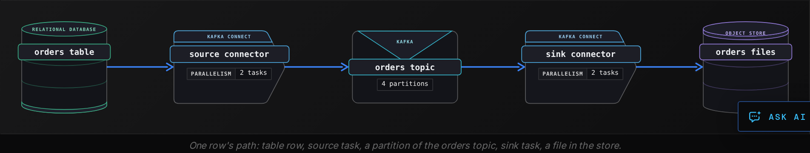
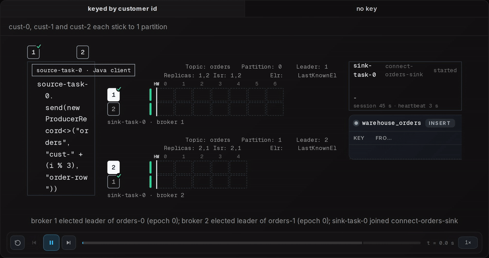
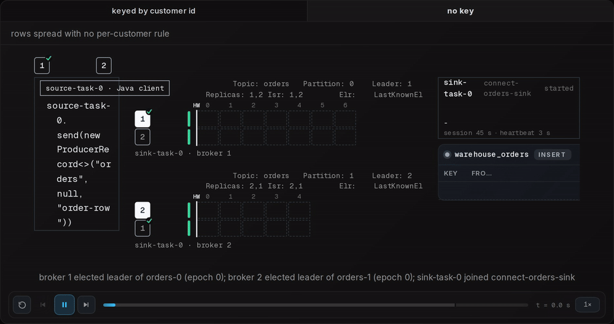
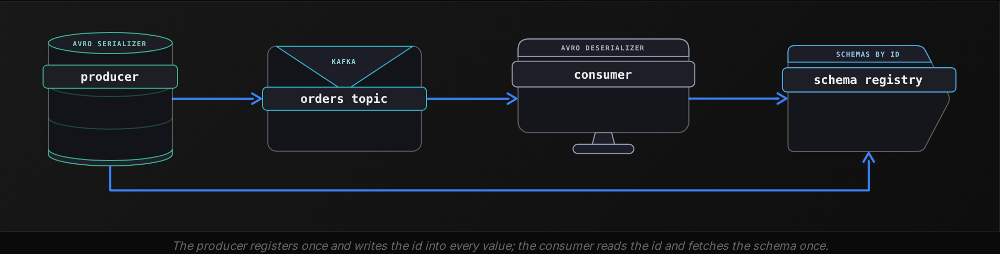
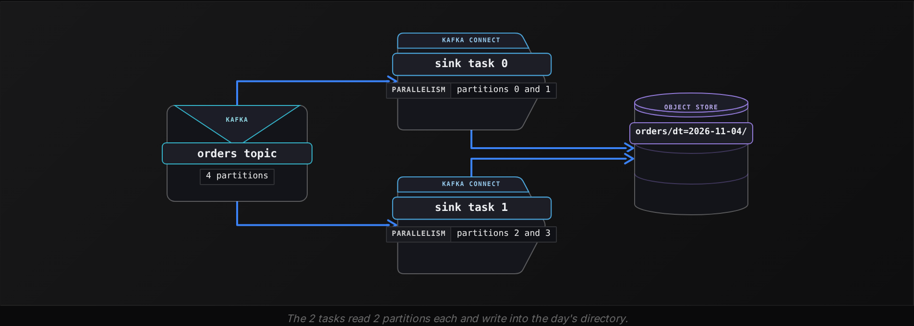
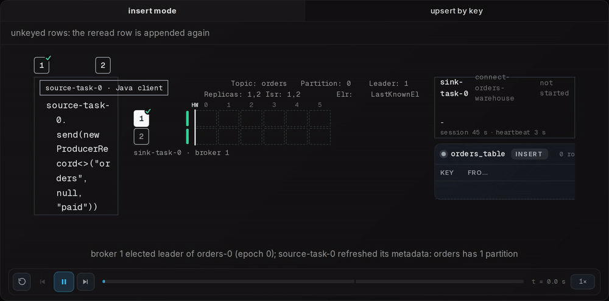
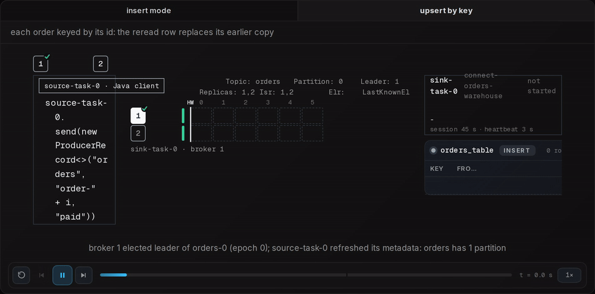

Beginner·[](https://kafka.apache.org/)·20 min · 6 challenges

# Kafka in the Pipeline: Beginner

Black Friday at Shopify. Every checkout becomes a row in an orders database, and the merchant dashboards need those rows in the warehouse within minutes. Nobody on the data team wants to maintain a hand-written copier program per table. One connector pulls each row onto the orders log, another writes the log out to storage, and the only argument left is which file format the dashboards read fastest.


<br>

---

## Connectors Move Data

[Kafka Connect Overview](https://kafka.apache.org/44/kafka-connect/overview/)[Running Kafka Connect](https://kafka.apache.org/44/kafka-connect/user-guide/#running-kafka-connect)

Every record in a topic came from somewhere, and most records are headed somewhere else. The orders rows in a store's relational database need to reach the orders topic, and the orders topic needs to reach the warehouse. You already know how to write both halves by hand: a producer loop that reads the table and calls send, and a consumer loop that polls the topic and writes rows. Kafka Connect, the framework that ships with Kafka 4.4, runs those 2 loops for you from a configuration file, with no program to write.


<br>

### Source connectors and sink connectors

A source connector reads an external system and produces records into a topic. A sink connector consumes a topic and writes its records into an external system. Inside, a source task holds a Kafka producer and a sink task holds a consumer in a consumer group, so partitioning by key and acks behave as you learned them on the producer side, and offsets and lag on the consumer side. The connector owns the loop and the retry logic; you own the configuration.



| Concern | Hand-written client | Connector |
| --- | --- | --- |
| Reading the source | Your query loop and pagination | The source task's loop |
| Choosing a partition | Your key and partitioner | The key the connector sets on each record |
| Remembering progress | A bookmark you store and reload | Source offsets Connect stores per task |
| Committing consumer offsets | Your commit call | Committed by the sink task after it writes |
| Running and restarting | Your deploy and your supervisor | The Connect worker |
| Changing what it does | Edit code, redeploy | Edit a config, restart the connector |

A hand-written source needs its own bookkeeping of where it stopped reading the table. Connect keeps that as source offsets, a per-task record of the last row read, so a restarted task resumes from there rather than reading the table from the start.


<br>

### A worker runs tasks

A Connect worker is the process that runs connectors. Kafka 4.4 starts one with bin/connect-standalone.sh config/connect-standalone.properties config/orders-source.properties: the first file configures the worker, which brokers it talks to and where its plugins live, and every file after it is 1 connector. The worker loads the connector's class from the plugin directory, asks the connector to split its work into tasks, and runs each task on a thread of its own. The task is the piece that holds the producer or the consumer, so a connector with 4 tasks has 4 producers sending in parallel.


Watch a connector pair built from the pieces you already know. The source task below is a producer sending 6 rows from an orders table, each keyed by its customer id, so cust-0's rows all land on 1 partition. The sink task is a consumer in the group connect-orders-sink that writes each record into a warehouse table and commits after the write. Switch to the no-key variant: nothing ties a customer's rows to 1 partition any more, which matters the day the sink runs 2 tasks and a customer's orders can arrive at 2 different writers.

**keyed by customer id**



**no key**



> **TIP**
>
> A sink connector's consumer group is named `connect-` plus the connector's name unless its config overrides it, so the lag commands you already use show a sink's backlog under that group id.


<br>

### When you still write a client

A connector copies. A source reads rows and sends them on; a sink takes records off a topic and writes them out. Either way, at most light reshaping happens along the way. When the work between source and sink is yours, a fraud check that needs the customer's last 10 orders, a join of orders with inventory, a call to a pricing model, you write a consumer and a producer, because no plugin knows that logic. Most teams end up with connectors at the edges where data enters and leaves Kafka, and hand-written clients in the middle where the business logic lives.

- Source: a relational database's tables, polled by primary key or by a change column
- Source: log files on a host, read line by line
- Source: a message queue being migrated to Kafka
- Sink: an object store, as files per partition
- Sink: a warehouse table, as rows
- Sink: a search index, 1 document per record

> What a connector does not decide for you
>
> - The key each record carries, and so its partition
> - How many tasks run, through tasks.max
> - The format of the bytes, through converters
> - Which topic a source writes to and which topics a sink reads


<br>

---

## A Connector Is a Config

[Configuring Connectors](https://kafka.apache.org/44/kafka-connect/user-guide/#configuring-connectors)[REST API](https://kafka.apache.org/44/kafka-connect/user-guide/#rest-api)

A connector is declared, in a properties file or a JSON body, and the framework turns the declaration into running tasks. The file below defines a source connector using the file connector that ships with Kafka 4.4: it tails a file holding 1 order per line and sends each line to the orders topic. The whole program is 5 keys.

```sql
name=orders-file-source
connector.class=org.apache.kafka.connect.file.FileStreamSourceConnector
tasks.max=1
file=/var/orders/orders.jsonl
topic=orders
```

| Key | Who reads it | What it decides |
| --- | --- | --- |
| name | the worker | the connector's identity, and a sink's default group id connect-<name> |
| connector.class | the worker | which plugin to load from plugin.path |
| tasks.max | the connector | the most tasks it may split its work into |
| topic or topics | the task | where a source sends, or which topics a sink's consumer subscribes to |
| key.converter, value.converter | the task | how keys and values become bytes; inherited from the worker if absent |
| the rest, such as file | the plugin's own code | whatever that connector needs to do its job |


<br>

### The worker's own config

The worker has a file of its own, passed first on the command line. It names the brokers, the default converters every connector inherits, where source offsets are kept, and the directory the plugins load from. The file source sends records with no key, so without a converter for keys the worker would not know how to write the null.

```sql
bootstrap.servers=broker-1:9092,broker-2:9092
key.converter=org.apache.kafka.connect.storage.StringConverter
value.converter=org.apache.kafka.connect.json.JsonConverter
value.converter.schemas.enable=false
offset.storage.file.filename=/var/connect/connect.offsets
plugin.path=/opt/connect-plugins
```

Connect holds every config value as a string, tasks.max=1 included. That is why the REST examples below quote their numbers. offset.storage.file.filename is a standalone worker's bookkeeping for source connectors: the last position each source task read, written to that file so a restart resumes from it.


<br>

### What the framework does with it

From config to running tasks

- **1. Validate** *before the connector starts*\
  The plugin declares its config definition. A missing required key or a value of the wrong type is rejected here, and nothing else happens.
- **2. Instantiate the connector** *load connector.class*\
  The worker loads the class and hands it the config. The connector object holds no producer or consumer; it plans.
- **3. Split into tasks** *up to tasks.max*\
  The worker asks the connector for task configs. The file source always answers with 1, because 1 file has 1 reading position.
- **4. Start each task** *1 thread each*\
  A source task opens a producer; a sink task joins the group connect- plus the connector's name. Each runs its loop on its own thread.
- **5. Track progress** *2 kinds of offset*\
  Source offsets go to the worker's offset file; sink offsets are committed to Kafka as the group's committed offsets.

tasks.max sets a ceiling, and the plugin decides how to split the work under it. A database source reading 4 tables with tasks.max=4 asks for 4 task configs with 1 table in each, so 4 producers send in parallel. Set tasks.max=2 and the same connector packs 2 tables into each task. Set it to 8 and you still get 4, because the connector has only 4 pieces of work to hand out.


<br>

### The same config over HTTP

A running worker listens on port 8083. Posting the config to /connectors creates the connector, and the status call for its name shows the connector and each task with its state and the worker it runs on. A paused connector stops its tasks from polling without removing them, which is how you hold a sink while the warehouse table is being altered.

```sql
{
  "name": "orders-file-source",
  "config": {
    "connector.class": "org.apache.kafka.connect.file.FileStreamSourceConnector",
    "tasks.max": "1",
    "file": "/var/orders/orders.jsonl",
    "topic": "orders"
  }
}
```

```sql
{
  "name": "orders-file-source",
  "connector": {
    "state": "RUNNING",
    "worker_id": "10.0.0.5:8083"
  },
  "tasks": [
    {
      "id": 0,
      "state": "RUNNING",
      "worker_id": "10.0.0.5:8083"
    }
  ],
  "type": "source"
}
```


<br>

### Sinks declare the reverse

```sql
name=orders-file-sink
connector.class=org.apache.kafka.connect.file.FileStreamSinkConnector
tasks.max=1
topics=orders
file=/var/orders/orders-out.txt
```

The sink names topics, plural, because its task subscribes the way a consumer does, and it joins the group connect-orders-file-sink. Raise tasks.max to 2 and the connector asks for 2 tasks that each read 2 of the 4 partitions; for this file sink both would append to the same file, so it stays at 1. Extra sink tasks beyond the partition count get no partition and sit idle. A warehouse sink with 1 table per task is where 2 makes sense.

| ✓ A source config declares | ✗ A sink config declares |
| --- | --- |
| • connector.class of a source plugin<br><br>• topic: the 1 topic it writes<br><br>• tasks.max: how many producers may run<br><br>• where to read: a file, a table, a queue | • connector.class of a sink plugin<br><br>• topics: the topics its group subscribes to<br><br>• tasks.max: how many consumers join the group<br><br>• where to write: a path, a table, an index |

| ✓ Do | ✗ Don't |
| --- | --- |
| • Set converters once in the worker config and override only where a connector differs<br><br>• Set tasks.max to the number of parallel units the source or sink has<br><br>• Check the status call after every change, task by task<br><br>• Keep 1 connector per source table or per destination | • Trust a config until the plugin has validated it<br><br>• Assume tasks.max is the number of tasks you get<br><br>• Point 2 tasks at a destination that cannot take 2 writers<br><br>• Edit a running connector's file and expect the worker to notice |


<br>

---

## Serializers and Formats

[key.converter](https://kafka.apache.org/44/configuration/kafka-connect-configs/#connectconfigs_key.converter)[value.converter](https://kafka.apache.org/44/configuration/kafka-connect-configs/#connectconfigs_value.converter)

A broker stores a record's key and value as bytes and nothing else. An order has 4 fields: its id and customer id, then an amount and a status. Those have to become bytes before send and come back from bytes after poll, and the choice of how is the format. A producer calls that step a serializer, a consumer a deserializer, and Connect a converter, because a connector's tasks hold the record in Connect's own in-memory form and the converter turns that form into bytes and back.

```sql
import json

order = {"order_id": 1001, "customer_id": 77, "amount": 19.99, "status": "paid"}
value_bytes = json.dumps(order, separators=(",", ":")).encode("utf-8")
print(len(value_bytes))
```

That program prints 65, with every field name spelled out inside the value. Avro's binary encoding of the same order, written against a schema that lists the 4 fields in order, is 17 bytes: 2 for the order id, 2 for the customer id, 8 for the double, 5 for the 4-character status. The names live in the schema, which the bytes leave out.


<br>

### Reading 17 bytes

| Field | Value | Encoding | Bytes |
| --- | --- | --- | --- |
| order_id | 1001 | zigzag varint, D2 0F | 2 |
| customer_id | 77 | zigzag varint, 9A 01 | 2 |
| amount | 19.99 | 8-byte little-endian double | 8 |
| status | paid | length 08, then p a i d | 5 |

A reader that has the schema walks those 17 bytes field by field. A reader holding a schema that lists customer_id first reads 1001 as the customer and 77 as the order, and the record decodes to a wrong answer with no error raised. The format moved the cost from bytes on the wire to agreement about the schema, and that agreement is the next section's subject.

| Format | Bytes for the order | Carries field names | Readable by eye |
| --- | --- | --- | --- |
| Plain string, status only | 4 | no | yes |
| JSON | 65 | yes | yes |
| JSON with Connect's schema envelope | 360 | yes, plus types | yes |
| Avro binary | 17 | no, the schema holds them | no |
| Protobuf | 20 | field numbers only | no |


<br>

### What each format costs

Picking a format trades size against CPU time, and both against how easily a person can read the value. Every byte of a value is written to the leader's disk, copied to each follower, and read by every consumer, so a format 4 times larger uses 4 times the disk and network at every step, and 4 times the page cache too. Parsing JSON text is slower than reading fixed binary fields, and both are slower than passing raw bytes through untouched. A JSON value shows in a console consumer; an Avro value shows as 17 bytes that mean nothing without the schema.

- **1.95 GB** — a day of 10M JSON orders, 3 copies
- **510 MB** — the same day in Avro

| ✓ Text formats | ✗ Binary formats |
| --- | --- |
| • JSON, lines of text<br><br>• Field names in every record<br><br>• Any language reads them with no schema<br><br>• Debug with a console consumer<br><br>• Largest on disk and on the wire | • Avro, Protobuf<br><br>• Field names in a schema the reader must hold<br><br>• Reader needs the schema, or an id that finds it<br><br>• Debug through a tool that knows the schema<br><br>• Smallest on disk and on the wire |


<br>

### Converters in Connect

The worker config names key.converter and value.converter, and every connector inherits them unless its own config sets the same keys. Kafka 4.4 ships converters for strings and JSON, plus raw bytes and the primitive number types. Of those, org.apache.kafka.connect.storage.StringConverter and org.apache.kafka.connect.json.JsonConverter are the ones you will meet most, along with org.apache.kafka.connect.converters.ByteArrayConverter. The Avro and Protobuf converters come with a schema registry's client and need the registry's address to work.

```sql
{
  "schema": {
    "type": "struct",
    "fields": [
      {
        "type": "int64",
        "optional": false,
        "field": "order_id"
      },
      {
        "type": "int64",
        "optional": false,
        "field": "customer_id"
      },
      {
        "type": "double",
        "optional": false,
        "field": "amount"
      },
      {
        "type": "string",
        "optional": false,
        "field": "status"
      }
    ],
    "optional": false,
    "name": "order"
  },
  "payload": {
    "order_id": 1001,
    "customer_id": 77,
    "amount": 19.99,
    "status": "paid"
  }
}
```

A sink that needs column types, a warehouse table for instance, can build the table from that envelope, at the price of 360 bytes for a 65-byte order, in every record. With schemas.enable=false the converter writes the payload alone, and the sink must guess the types or be told them.


<br>

### Mixing formats breaks the reader

A converter is per side of the record. A key written by the string converter beside a value written by the Avro converter is a common pairing: the key stays a readable customer id, the value stays small. What fails is a mismatch across time. A producer switched from JSON to Avro at offset 5000 leaves a topic whose consumer must deserialize 2 ways, and a deserializer handed the wrong kind of bytes throws on the first record it meets.

> **TIP**
>
> Before choosing a format, serialize 1 real record each way and count the bytes. The ratio between JSON and Avro depends on how long the field names are compared with the values, so a record of 30 short numbers shrinks far more than a record holding a 2 KB description.

| ✓ Do | ✗ Don't |
| --- | --- |
| • Name the format in the worker config so every connector inherits it<br><br>• Pair a string key with a binary value when people need to read the key<br><br>• Measure a real record's bytes before choosing; sizes differ per schema<br><br>• Keep 1 format per topic for the topic's whole life | • Switch a topic's value format in place; start a new topic instead<br><br>• Turn on the JSON schema envelope without pricing the extra bytes<br><br>• Pass raw bytes to a sink that needs column types<br><br>• Treat a text format as free because people can read it |


<br>

---

## Schemas in a Registry

[Configuring Connectors](https://kafka.apache.org/44/kafka-connect/user-guide/#configuring-connectors)[Record](https://kafka.apache.org/44/implementation/message-format/#record)

The 17 bytes of Avro carry no field names, so whoever reads them must hold the schema the writer used, down to the order of the fields. Copying a schema file into every consumer's repository works until someone adds a field, and then 6 teams hold 2 versions. A schema registry is a service that stores each schema once, gives it a number, and lets a serializer write that number in front of the payload, so a reader fetches the exact schema by number and decodes.

```sql
{
  "type": "record",
  "name": "Order",
  "namespace": "shop.orders",
  "fields": [
    {
      "name": "order_id",
      "type": "long"
    },
    {
      "name": "customer_id",
      "type": "long"
    },
    {
      "name": "amount",
      "type": "double"
    },
    {
      "name": "status",
      "type": "string"
    }
  ]
}
```


<br>

### Register, then write the id

What a registry-aware serializer does

- **1. Register on first use** *1 call per schema*\
  On the first send to orders, the serializer posts this schema to the registry under the subject orders-value.
- **2. Receive an id** *7, for this schema*\
  A schema the registry already holds returns its existing id; a new one gets the next number.
- **3. Write id then payload** *22 bytes*\
  Each value becomes a 1-byte marker, the 4-byte id, then the 17 Avro bytes. The id is cached, so the registry is called once.
- **4. Decode by id** *on the consumer*\
  The deserializer reads the id and fetches schema 7 once. After caching it, the deserializer decodes every later record with that id locally.

| Bytes | Hold |
| --- | --- |
| 0 | the marker, 00 |
| 1 to 4 | the id, 00 00 00 07 |
| 5 to 21 | the 17 Avro bytes of the order |




<br>

### Subjects, versions, ids

A subject is the registry's name for one stream of schemas, and the default naming is the topic name plus -key or -value, so the orders topic's values live under orders-value. Each distinct schema registered under a subject becomes the next version there. Ids are global: the same schema registered under 2 subjects gets 1 id, and version 2 of orders-value gets an id that no other schema shares.

| Subject | Version | Id | What it holds |
| --- | --- | --- | --- |
| orders-value | 1 | 7 | the 4-field Order |
| orders-value | 2 | 9 | Order plus a currency field, default USD |
| orders-key | 1 | 8 | a long, the customer id |
| refunds-value | 1 | 7 | the same 4-field Order, so the same id |

Version 2 arrived when the producer team added a currency field. Records sent before that carry id 7 and records after it carry id 9, in the same topic, and a consumer decodes each by the id it reads, so a topic holds 2 shapes at once and every record still decodes with the schema it was written with. Whether a new version may be registered at all is a rule you set per subject, and the rules come later in the track.


<br>

### How a reader finds the shape

When decoding, a reader looks the schema up by id: the number in the bytes names the schema, and a sink's converter fetches by id too, so the first record with id 9 shows the sink the 5th field. A person writing a consumer looks it up by subject instead: ask the registry for the latest version of orders-value and read its field list. The response holds the schema text, tagged with its subject and version and with its id.

```sql
{
  "subject": "orders-value",
  "version": 2,
  "id": 9,
  "schema": "{\"type\":\"record\",\"name\":\"Order\",\"namespace\":\"shop.orders\",\"fields\":[{\"name\":\"order_id\",\"type\":\"long\"},{\"name\":\"customer_id\",\"type\":\"long\"},{\"name\":\"amount\",\"type\":\"double\"},{\"name\":\"status\",\"type\":\"string\"},{\"name\":\"currency\",\"type\":\"string\",\"default\":\"USD\"}]}"
}
```


<br>

### Keys have subjects too

The key side registers under orders-key when the key uses the Avro serializer, which is why the table above holds a subject for a long customer id. A key sent with the string serializer registers nothing, because a string carries its own shape, and that is the pairing most topics use: a readable string key and a registered binary value.

In Connect, the Avro converter for a sink is 2 lines in the connector's config: value.converter set to the class the converter's plugin documents, and value.converter.schema.registry.url set to the registry's address. The converter reads the id from each value and fetches that schema. With it, the converter builds Connect's in-memory record with typed fields, which is what a warehouse sink needs to make columns.

```sql
value.converter=AVRO_CONVERTER_CLASS
value.converter.schema.registry.url=http://registry:8081
```

| ✓ A shared schema file | ✗ A registry |
| --- | --- |
| • Copied into every reader's code<br><br>• A field added upstream breaks readers silently<br><br>• No record says which version wrote it<br><br>• Bytes stay at 17 | • Stored once, numbered once<br><br>• Every reader fetches the writer's exact version<br><br>• The id in the bytes names the version<br><br>• Bytes grow to 22 |


> **TIP**
>
> The registry sits on the write path only for the first record of each schema. After that the serializer has the id cached and the deserializer has the schema cached, so a registry outage stalls new schemas and newly started clients, and leaves running producers and consumers alone.


<br>

---

## Landing a Topic in Storage

[Sink connectors](https://kafka.apache.org/44/kafka-connect/user-guide/#sink-connectors)[Log Aggregation](https://kafka.apache.org/44/getting-started/uses/#log-aggregation)

A topic is a log on brokers; a lake or a warehouse reads files or tables. Landing is the sink that bridges them, and its unit of work is a file: a run of records from 1 partition, written as a whole, then the offset after its last record committed. The sink task buffers records as it reads a partition. When the buffer reaches a record count or a time limit, the task closes the file and uploads it, and only then commits. A crash before the commit means those records are read again.




<br>

### One partition, one file at a time

| File | Partition | Offsets inside | Records |
| --- | --- | --- | --- |
| orders+0+0000000000.parquet | 0 | 0 to 999 | 1000 |
| orders+0+0000001000.parquet | 0 | 1000 to 1999 | 1000 |
| orders+1+0000000000.parquet | 1 | 0 to 999 | 1000 |
| orders+1+0000001000.parquet | 1 | 1000 to 1611 | 612, closed by time |

The file name holds the first offset inside, after the topic and partition, so a name is a position in the log and 2 tasks can never collide on one. flush.size=1000 closed the first 3 files; the 4th closed because the rotation interval, 10 minutes here, ran out at 612 records. The committed offset for partition 1 after that upload is 1612, the next record to read, and the next file's name will carry that number.

- **576** — files a day, 4 partitions active all day
- **65 KB** — a 1000-record JSON file


<br>

### Sizing the file

flush.size and the rotation interval trade freshness for file count. A flush at 1000 records makes small files and fresh data; a lake query opening thousands of them spends more time listing and opening than reading. A sink that waits for 100,000 records makes files the reader likes and data 100 times staler on a quiet partition, which is why the time rotation exists: a quiet partition still closes its file when the interval ends.


<br>

### Paths by time

Readers ask for a day, so the sink writes each file under a directory named by time: orders/dt=2026-11-04/. The task reads each record's timestamp and routes the record to that day's open file, so a partition has 2 files open across midnight. A query for 1 day then opens that directory alone, and a record that arrives late for yesterday still lands in yesterday's directory.


<br>

### File formats the reader wants

| File format | Carries its schema | Best at |
| --- | --- | --- |
| JSON lines | no | reading by eye, debugging a landing |
| Avro file | yes, in the file header | row-at-a-time reads, replaying back into Kafka |
| Parquet | yes, in the file footer | column scans over many rows, the lake's default |

The topic's format and the file's format are separate choices. A topic of Avro values with ids from the registry lands as Parquet in the lake: the sink's converter decodes each value with its schema, and the file writer lays the typed fields out as columns, so the lake reads amount as a double without parsing text.


<br>

### Tables instead of files

A warehouse sink writes rows into a table rather than files, and the crash question has a sharper answer there. Below, a sink task writes 5 orders, committing after each write, and crashes right after writing in its 3rd iteration, before that commit. On restart it rereads from the committed offset, so the row it had written, and any polled with it, reach the table a second time. In insert mode the table ends with more rows than orders. Switch to upsert, where each order is keyed by its order id, and the second write of each row replaces the first, 5 rows for 5 orders.

**insert mode**



**upsert by key**



> Commit only after the upload finishes
>
> - A file is committed only after its upload finishes; rows reach the table before the offset moves
> - A crash between the write and the commit repeats the records that were written
> - Upsert by key makes the repeat harmless; insert keeps both copies

> **TIP**
>
> Count the files before the reader does. Partitions times rotations per day is the count when every partition has data in every interval; a busy partition adds 1 file per flush.size on top. A landing that creates 50,000 files a day needs a bigger flush or a longer interval before anyone queries it.

| ✓ Do | ✗ Don't |
| --- | --- |
| • Put the start offset in each file name, after the topic and partition<br><br>• Rotate by time as well as count so quiet partitions still flush<br><br>• Route each record by its timestamp into a dated path<br><br>• Upsert by key into a table that may see a record twice | • Flush every 100 records into a lake; readers choke on file counts<br><br>• Commit the offset before the upload finishes<br><br>• Land Avro values as text and lose the types the registry gave you<br><br>• Let 2 tasks write the same file name |


<br>

---

## Putting It All Together

Uber has written publicly about Kafka carrying its event streams into its data lake, where analytics and model training read them. Imagine a topic in a pipeline like that, trip-completed, copied to storage by a hand-written client: on a night that client stalls, the morning's model trains on half a day. The replacement is a sink connector landing Parquet files per partition into dated paths, values decoded by id through a registry, with offsets committed only after each upload.

- The sink connector is a consumer group named connect - plus its name, so the lag dashboard that would catch a stalled client shows the connector's backlog with no new tooling.
- Its config names tasks.max to match the topic's partition count, and the worker starts that many tasks, each a consumer holding a share of the partitions.
- Each value on the topic is Avro, an id plus a few dozen bytes, so the brokers hold a fraction of what JSON would cost across 3 replicas.
- The converter fetches each schema by the id it reads, which is how the sink knows the column types to lay out as Parquet.
- Each file is 1 partition's run of records under the trip's date, committed after upload, so a task crash repeats a file rather than losing one.


<br>

---

## Key Takeaways

- A source connector is a producer loop and a sink connector is a consumer group, each run by a Connect worker from a config instead of a program.
- A connector config names the class and tasks.max, and lists the topics and converters; the plugin splits the work into tasks and the worker runs each on a thread.
- A broker stores bytes, and the format sets each value's size and CPU cost, and whether a person can read it: the JSON order is 65 bytes, the Avro order 17, the Connect envelope 360.
- A registry stores each schema once under a subject, gives it an id, and the id travels in front of every value so a reader fetches the writer's exact schema.
- Landing writes a run of 1 partition's records as a file named by its start offset, then commits; a crash before the commit repeats records, which upsert by key absorbs.

[](https://kafka.apache.org/)

Official Apache Kafka resourcesversion 4.4

"Apache Kafka is an open-source distributed event streaming platform used by thousands of companies for high-performance data pipelines, streaming analytics, data integration, and mission-critical applications." [kafka.apache.org](https://kafka.apache.org/)

[Documentation](https://kafka.apache.org/44/)[Quickstart](https://kafka.apache.org/quickstart/)[Download](https://kafka.apache.org/community/downloads/)[Community](https://kafka.apache.org/community/)

In the documentation

Connectors Move Data
:   [Kafka Connect Overview](https://kafka.apache.org/44/kafka-connect/overview/)[Running Kafka Connect](https://kafka.apache.org/44/kafka-connect/user-guide/#running-kafka-connect)

A Connector Is a Config
:   [Configuring Connectors](https://kafka.apache.org/44/kafka-connect/user-guide/#configuring-connectors)[REST API](https://kafka.apache.org/44/kafka-connect/user-guide/#rest-api)

Serializers and Formats
:   [key.converter](https://kafka.apache.org/44/configuration/kafka-connect-configs/#connectconfigs_key.converter)[value.converter](https://kafka.apache.org/44/configuration/kafka-connect-configs/#connectconfigs_value.converter)

Schemas in a Registry
:   [Configuring Connectors](https://kafka.apache.org/44/kafka-connect/user-guide/#configuring-connectors)[Record](https://kafka.apache.org/44/implementation/message-format/#record)

Landing a Topic in Storage
:   [Sink connectors](https://kafka.apache.org/44/kafka-connect/user-guide/#sink-connectors)[Log Aggregation](https://kafka.apache.org/44/getting-started/uses/#log-aggregation)

Further
:   [Kafka Connect Administration](https://kafka.apache.org/44/kafka-connect/administration/)[Plugin Discovery](https://kafka.apache.org/44/kafka-connect/user-guide/#plugin-discovery)

Apache Kafka, Kafka, and the Kafka logo are either registered trademarks or trademarks of The Apache Software Foundation in the United States and other countries.
