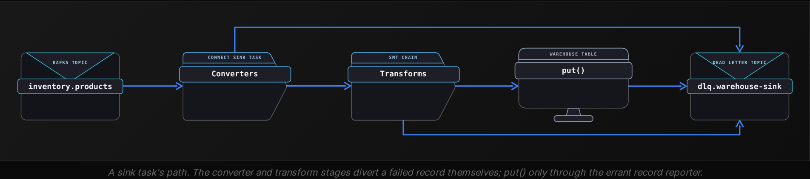

Intermediate·[](https://kafka.apache.org/)·20 min · 6 challenges

# Kafka in the Pipeline: Intermediate

A Shopify merchant cuts a jacket's price from $120 to $96 at 9:00 on Black Friday morning. Before the first shopper checks out, that 1 row update has to be in the storefront search index and the analytics warehouse, and in the ads feed as well. This lesson follows it out of the database log, through a schema check and a connector, into a table you can rebuild.


<br>

---

## Change Events from a Database

[Source connectors](https://kafka.apache.org/44/kafka-connect/user-guide/#source-connectors)[Commit Log](https://kafka.apache.org/44/getting-started/uses/#commit-log)


<br>

### Reading the transaction log

A product catalog table at a retailer takes a few thousand writes a minute, and the warehouse wants every one of them in order, as do the search index and the pricing service. Polling the table on an updated_at column misses a row updated twice between 2 polls and never sees a delete, because a deleted row leaves no timestamp behind to read. A change-capture source connector reads the database's own transaction log, the record every committed write already produces, and turns each row change into 1 Kafka record on a topic named for the table, inventory.products.

> Why the log beats polling
>
> - A delete never shows up in a poll; in the transaction log it is an entry like any other.
> - 2 updates 100 ms apart are 2 log entries; a poll every minute sees 1 row and 1 value.
> - A poll is a query against the production database every interval; the log is read once, off the query path.
> - The log holds the row as it was before the write, so an event can show what changed.

The connector begins with a snapshot: it reads every row the table holds and emits 1 event per row. Then it follows the log from the position the snapshot was taken at, so a write that lands during the snapshot is captured by the log and nothing between the 2 is lost. The log position it has reached goes into Connect's offset storage, the same place any source connector keeps its place, and a restarted task resumes from it. The database never sees a query from the connector after the snapshot; it sees a reader of its log, which is the same work it does to feed a replica.


<br>

### What 1 event says

An event names the row's state before the change, its state after, the kind of change, when it was committed and where in the log it sits. This one is the price cut on product 1042.

```sql
{
  "before": {
    "id": 1042,
    "name": "Trail Jacket",
    "price": 120,
    "stock": 8
  },
  "after": {
    "id": 1042,
    "name": "Trail Jacket",
    "price": 96,
    "stock": 8
  },
  "op": "u",
  "ts_ms": 1762246800412,
  "source": {
    "table": "products",
    "position": "0/1A3F2B8"
  }
}
```

| op | the change | before | after |
| --- | --- | --- | --- |
| c | insert | empty | the new row |
| u | update | the row as it was | the row as it is now |
| d | delete | the row that was removed | empty |
| r | snapshot read | empty | the row as the snapshot found it |

The record's key is the primary key, {"id": 1042} for a JSON key. Keys pick partitions, so every change to row 1042 lands on 1 partition and is read in the order it was committed: price 120, then 96, never the reverse. Send the events with no key and the 2 updates may land on 2 partitions, where 2 sink tasks apply them in whichever order they happen to poll, and the table can finish on the old price with no error anywhere. The animation plays both.


<br>

### A delete comes twice

A delete produces an event with op set to d, the vanished row in before and after empty. The connector then sends a second record with the same key and a null value, a tombstone. The delete event tells the sink which row to remove and what it held. The tombstone is for the topic itself: once compaction runs, it lets the partition drop the key altogether, which the delete event, a record with a full value under that key, cannot do. A sink has to treat a null value as a normal record, since 1 follows every delete.


<br>

### Delivery is at least once

The task writes a batch of events to Kafka, waits for the acknowledgement, and then records the log position it reached. A crash between those 2 steps replays the batch after restart, so the same change can appear twice, with the same key and value at the same log position, and nothing in the topic marks the second copy. The guarantee is at least once, the same one the producer lessons gave you. A sink that applies each event as an upsert on the primary key ends in the same state whether it saw the event once or twice, and section 4 leans on that when it rebuilds a table from the topic.


> **TIP**
>
> A column added to the source table changes the event's schema, and the connector registers the new version before it writes the first event that uses it. Whether the registry accepts that version is section 1.


<br>

---

## Compatibility and Upgrade Order

[value.converter](https://kafka.apache.org/44/configuration/kafka-connect-configs/#connectconfigs_value.converter)


<br>

### A subject, its versions and a mode

The registry files schemas under a subject, inventory.products-value for the values on that topic, as a numbered list of versions. A producer registers its schema once and gets back an id, which it writes in front of every record's bytes; a consumer reads the id back and fetches the schema to decode the rest. The compatibility mode on the subject is a test the registry runs on each new version before it accepts it, against the version before, or, under a transitive mode, against every version the subject has.

| mode | the registry checks that | who upgrades first |
| --- | --- | --- |
| BACKWARD | the new schema can read data written with the previous one | consumers |
| FORWARD | the previous schema can read data written with the new one | producers |
| FULL | both of the above | either side |
| NONE | nothing | nobody, and a reader can break on any record |
| \*_TRANSITIVE | the same test, against every earlier version instead of only the last | as its base mode |


<br>

### Which changes pass

Both tests come down to a reader meeting data it was not written with, under Avro's resolution rules. A field the reader expects must be present in the data or carry a default in the reader's schema; a field the reader does not know is ignored. The catalog team proposed 4 changes to the after record over a quarter, and the 2 modes split them differently.

| change | BACKWARD | FORWARD | why |
| --- | --- | --- | --- |
| add discount_pct, default 0 | accepted | accepted | a new reader fills 0 for old data; an old reader ignores the extra field |
| add supplier_id, no default | rejected | accepted | a new reader finds nothing for it in old data; an old reader ignores it |
| remove stock, which had no default | accepted | rejected | a new reader never asks for it; an old reader expects it and has no default to fill |
| change price from int to long | accepted | rejected | a long reader takes int data; an int reader cannot take long data |

Renaming a column is a removal and an addition in 1 version: BACKWARD needs a default on the added field, FORWARD on the removed one, FULL on both. FULL accepts the first change and nothing else on this list, which is the trade: the mode that frees the upgrade order is the mode that refuses the most changes.


<br>

### Upgrade order follows the mode

BACKWARD guarantees that a reader on the new schema can decode everything already written. It says nothing about a reader on the old schema meeting a new record, and a reader with no default for a field the writer dropped fails on the first such record. So under BACKWARD the consumers go first: every reader learns the new schema, then the producer starts writing it. Under FORWARD the registry has already proven that old readers survive new data, so the producer goes first and each consumer follows when it can. FULL leaves the order free, which is why teams that deploy producers and consumers from different repositories on different days choose it and pay for it in refused changes.

> Why the default is BACKWARD
>
> Replaying a topic from its first offset means a reader on the newest code decoding records written under every schema the subject ever had. BACKWARD_TRANSITIVE is that guarantee exactly, BACKWARD is its single-step version, and a fresh subject gets BACKWARD unless someone sets otherwise.

Records already on the topic keep the schema id they were written with for as long as the topic holds them; the registry never rewrites data. The check at registration is the only thing standing between a new version and a reader that opens a 3-month-old record tomorrow, and a refusal there costs 1 failed task instead of 1 broken consumer per team that reads the topic.


<br>

### A required column arrives

The catalog team adds supplier_id to the products table as NOT NULL with no default. The connector derives a schema with a required field and registers it before writing the first event that carries it. Under BACKWARD the registry refuses: a consumer on the new schema would find no supplier_id in the 40 million events already on the topic. The connector's converter throws and the task fails; the topic has not changed. The fix is a default in the database: the schema the connector derives then carries one and passes under every mode. Setting the subject to FORWARD lets it in too, but protects only old consumers: a consumer on the new schema fails on the first of those 40 million events, so it can read only records written after the change and can never replay from offset 0.

```sql
{
  "compatibility": "FORWARD"
}
```

| ✓ Do | ✗ Don't |
| --- | --- |
| • Give every new field a default, so it passes under every mode<br><br>• Check the subject's mode before a schema change ships, and set it per subject<br><br>• Upgrade in the order the mode dictates: consumers first under BACKWARD<br><br>• Use a transitive mode on any topic you replay from its first offset | • Rename a field in 1 step; remove it, then add the new name with a default<br><br>• Set NONE to push a change through; a reader breaks later, on live data<br><br>• Change a type Avro cannot promote; int to long promotes, string to int fails<br><br>• Assume a rejected schema reached the topic; the task failed before writing |


<br>

---

## Transforms Inside Connect

[Transformations](https://kafka.apache.org/44/kafka-connect/user-guide/#transformations)[Predicates](https://kafka.apache.org/44/kafka-connect/user-guide/#predicates)


<br>

### A chain between connector and converter

A single message transform, an SMT, is a class Connect applies to each record as it passes through a task. On a source task the chain runs after the connector hands over a record and before the converter turns it into bytes; on a sink task it runs after the converter decodes the bytes and before the connector's put. A transform receives 1 record and returns 1 record or null, and a null drops the record at that step. The chain is the list of names in transforms, run in that order, each name carrying its own class and settings.

```sql
transforms=unwrap,mask,route
transforms.unwrap.type=org.apache.kafka.connect.transforms.ExtractField$Value
transforms.unwrap.field=after
transforms.mask.type=org.apache.kafka.connect.transforms.MaskField$Value
transforms.mask.fields=supplier_email
transforms.mask.replacement=hidden
transforms.route.type=org.apache.kafka.connect.transforms.RegexRouter
transforms.route.regex=inventory[.](.*)
transforms.route.replacement=wh_$1
```

The warehouse sink wants the row by itself with the email hidden, under a table name without the schema prefix, and the chain does all 3 on every record. unwrap replaces the value with its after field, so the before image falls away along with the op and the source block. mask overwrites supplier_email with the word hidden. route rewrites the topic name the record carries, and the sink names its table after the topic it sees.

Record in

| field | value |
| --- | --- |
| topic | inventory.products |
| value.op | u |
| value.before.price | 120 |
| value.after.price | 96 |
| value.after.supplier_email | ops@supplier.example |
| value.source.table | products |

Record out

| field | value |
| --- | --- |
| topic | wh_products |
| value.id | 1042 |
| value.price | 96 |
| value.supplier_email | hidden |
| value.stock | 8 |


<br>

### Transforms that ship with Connect

| transform | what it does to a record |
| --- | --- |
| ExtractField | replaces the key or value with 1 of its fields |
| ValueToKey | builds the key from named fields of the value |
| InsertField | adds a field holding the topic, partition, offset, timestamp or a fixed value |
| ReplaceField | renames, keeps or drops named fields |
| MaskField | overwrites named fields with a blank or a replacement |
| Cast | changes a field's type, such as string to int |
| Flatten | turns nested fields into top-level ones joined by a delimiter |
| RegexRouter | rewrites the topic name by a regular expression |
| TimestampRouter | appends the record's timestamp to the topic name, for dated tables |
| HeaderFrom | copies or moves fields into headers |
| Filter | drops the record; meant to run behind a predicate |

Each field transform comes as a $Key form and a $Value form, named for the half of the record it works on. ValueToKey is how a topic produced with no key gains 1 on its way into a sink: it copies named fields of the value into the key, which an upsert sink needs to find its row, and which a compacted topic would have needed from the start.


<br>

### Dropping records with a predicate

Filter drops every record it is given, so it is only useful behind a predicate, which decides which records a transform applies to. Connect ships TopicNameMatches and HasHeaderKey as predicates, along with RecordIsTombstone. A sink that writes files has no row to delete, so the tombstone after every delete from section 0 is a record with nothing in it. This chain removes them:

```sql
transforms=dropnull
transforms.dropnull.type=org.apache.kafka.connect.transforms.Filter
transforms.dropnull.predicate=isnull
predicates=isnull
predicates.isnull.type=org.apache.kafka.connect.transforms.predicates.RecordIsTombstone
```

Any transform can carry a predicate, and negate=true flips it, so the same isnull predicate can restrict unwrap to records that have a value to unwrap, leaving the tombstone intact for a sink that deletes on it.

> Order matters
>
> The chain runs in the order transforms lists it. Put route after unwrap and the sink gets a flat row on the renamed topic; put a TopicNameMatches predicate after route and it tests the new name. A transform that reads a field an earlier transform removed finds nothing, and a transform that finds nothing where it expects a field throws.


<br>

### What stays out of the chain

| ✓ A transform can | ✗ Belongs somewhere else |
| --- | --- |
| • Rename fields, or keep some and drop the rest<br><br>• Pull a nested field up to the top<br><br>• Mask a value or cast its type<br><br>• Change the topic a record goes to<br><br>• Drop tombstones, or records matched by topic or header<br><br>• Copy a field into the key | • Join a record to a row in another table<br><br>• Aggregate or window across records<br><br>• Look a value up in another service<br><br>• Drop a duplicate of an earlier record<br><br>• Split 1 record into several<br><br>• Apply business rules that change weekly |

The reason is shape. A transform holds nothing between records and sees nothing but the record in its hands, so a step that needs another record has nowhere to keep it, whether that is an earlier value or a running count. A lookup against another service puts a network call on the path of every record, ties the task's throughput to that service's latency, and takes the task down with the service. Work that needs state or a second input belongs in a stream processor reading the topic, or in the warehouse after the rows land, where a join is 1 SQL statement that the people who own the data can read and change without redeploying a connector.

> **TIP**
>
> A transform that throws is a transform-stage error, and a transform that returns null is a drop. The first goes where section 3 sends it; the second leaves no trace unless you count records in and records out.


<br>

---

## Connector Errors

[Error Reporting in Connect](https://kafka.apache.org/44/kafka-connect/user-guide/#error-reporting-in-connect)[errors.deadletterqueue.topic.name](https://kafka.apache.org/44/configuration/kafka-connect-configs/#sinkconnectorconfigs_errors.deadletterqueue.topic.name)


<br>

### 3 stages where a record can fail



A sink task reads a batch of records, decodes each one with the key and value converters and the header converter, runs it through the transform chain, and hands the batch to the connector's put. The converter can throw on bytes it cannot parse or a schema id the registry does not know. A transform can throw when it asks for a field the record lacks. The default, errors.tolerance=none, fails the task on the first such exception. Its state goes to FAILED and its consumer leaves the group, so a rebalance hands its partitions to the tasks still running. The first to reach the bad record fails on it too, and the failure walks from task to task: lag climbs, then more tasks go FAILED, under a connector whose status still says RUNNING.

```sql
{
  "name": "warehouse-sink",
  "connector": {
    "state": "RUNNING",
    "worker_id": "10.0.3.7:8083"
  },
  "tasks": [
    {
      "id": 0,
      "state": "RUNNING",
      "worker_id": "10.0.3.7:8083"
    },
    {
      "id": 1,
      "state": "FAILED",
      "worker_id": "10.0.3.8:8083",
      "trace": "org.apache.kafka.connect.errors.DataException: Failed to deserialize data for topic inventory.products: schema id 418 not found"
    }
  ],
  "type": "sink"
}
```

- A task state of FAILED in the status response, with the exception in its trace
- Lag that climbs, followed by more tasks going FAILED one by one
- A gap in the sink table that begins at 1 offset and never closes
- No new log lines from that task after the trace


<br>

### Tolerate, log, divert

```sql
errors.tolerance=all
errors.log.enable=true
errors.log.include.messages=true
errors.deadletterqueue.topic.name=dlq.warehouse-sink
errors.deadletterqueue.topic.replication.factor=3
errors.deadletterqueue.context.headers.enable=true
errors.retry.timeout=300000
errors.retry.delay.max.ms=30000
```

With errors.tolerance=all the task skips a record that fails in either stage and moves to the next. On its own that is a silent drop, so the other settings say what becomes of the record. The log line records the failure and, with include.messages, the record's content, which helps a quick look and is a problem for anything holding personal data. The dead letter topic receives the record itself, with its original key and value, headers included, copied byte for byte, so nothing the converter could not read is lost. The context headers add where it came from and why it failed. The retry settings apply only to exceptions a stage marks as retriable, such as the registry timing out: the task retries for up to 5 minutes, with the delay between attempts growing to 30 seconds, before it counts the record as failed.

| header | holds |
| --- | --- |
| __connect.errors.topic | the topic the record was read from |
| __connect.errors.partition | its partition |
| __connect.errors.offset | its offset there |
| __connect.errors.connector.name | the connector that failed on it |
| __connect.errors.task.id | the task |
| __connect.errors.stage | KEY_CONVERTER, VALUE_CONVERTER, HEADER_CONVERTER or TRANSFORMATION |
| __connect.errors.class.name | the converter or transform class |
| __connect.errors.exception.class.name | the exception |
| __connect.errors.exception.message | its message |
| __connect.errors.exception.stacktrace | the full trace |

The dead letter topic is a normal topic, so a consumer can read it, group records by __connect.errors.stage and __connect.errors.exception.class.name, and find that 37 records failed in the value converter on 1 missing schema id. Once that schema is back, resending them to inventory.products puts each after any later change to its row: every reader, the search index included, gets the old value, and on a compacted topic it becomes the key's latest record, so the next rebuild restores Tuesday's price over Wednesday's. Writing each record straight to the sink avoids that, as long as it lands only where its row holds a lower offset than __connect.errors.offset, which an InsertField step stored there. So does resending only the keys with no later record in that partition.


<br>

### What the dead letter queue does not catch

A source connector has no dead letter topic, because the record that failed was on its way into Kafka and there is no Kafka record to divert; with tolerance at all, a failure in its converter or a transform is logged and the record skipped. An exception inside the connector's put, such as the database rejecting a row, reaches the dead letter topic only if the connector reports that record through Connect's errant record reporter, which follows the same error settings; otherwise a retriable one is retried and anything else fails the task. And all with neither a log nor a dead letter topic drops the record and keeps the task green, which is a pipeline that looks healthy while its table loses rows.

Once the cause is fixed, POST /connectors/warehouse-sink/restart?includeTasks=true&onlyFailed=true restarts the failed tasks and leaves the running ones alone. A restarted task resumes from its group's last committed offset. The batch that failed in a converter or transform never reached put, but batches delivered since that commit are written again, so the sink still has to upsert.

| ✓ Do | ✗ Don't |
| --- | --- |
| • Name a dead letter topic whenever tolerance is all, and give it a reader<br><br>• Turn context headers on, so every diverted record carries its origin<br><br>• Alert on a FAILED task state and on lag that climbs on a subset of partitions<br><br>• Check the sink for a newer value before replaying a diverted record | • Set tolerance to all with no log and no dead letter topic<br><br>• Log record contents on a topic that carries personal data<br><br>• Expect put() failures in the dead letter topic unless the connector reports them<br><br>• Restart a failed task before the schema or transform it tripped on is fixed |


<br>

---

## Rebuilding a Table

[Log Compaction Basics](https://kafka.apache.org/44/design/design/#log-compaction-basics)[Offline Data Load](https://kafka.apache.org/44/design/design/#offline-data-load)


<br>

### The topic holds the table

A change topic keyed by primary key holds, for every row that ever existed, the sequence of its values and, for a deleted row, a tombstone at the end. Apply those records in order into an empty table, each value overwriting the key's row and each tombstone removing it, and the table that results is the source table as it stood at the last offset read. The sink that lands the stream every day is doing exactly that. Rebuilding a table means doing the same thing again from offset 0 into a fresh table, with the source database left alone, and you do it when a migration goes bad or someone drops a column, or when a warehouse loses a day.

#### 5 records, 1 table

| offset | key | value | table after this record |
| --- | --- | --- | --- |
| 0 | c-1 | Ana, gold | c-1 Ana gold |
| 1 | c-2 | Bo, silver | c-1 Ana gold; c-2 Bo silver |
| 2 | c-1 | Ana, platinum | c-1 Ana platinum; c-2 Bo silver |
| 3 | c-3 | Cy, gold | c-1 Ana platinum; c-2 Bo silver; c-3 Cy gold |
| 4 | c-2 | null | c-1 Ana platinum; c-3 Cy gold |

Within a key the order is the partition's order, because every record for c-1 sits on 1 partition. Across keys the order does not matter: c-3's insert could be applied before c-1's upgrade and the table would end the same, which is why a replay can run 1 task per partition in parallel and still finish on the right rows.


<br>

### Start over from offset 0

A new sink connector, which is a new consumer group named connect-<name>, starts at the first offset the topic still holds when its consumer carries auto.offset.reset=earliest. An existing connector has to be stopped with PUT /connectors/warehouse-sink/stop first, so its group has no live members; its offsets are then moved with kafka-consumer-groups.sh --group connect-warehouse-sink --topic crm.customers --reset-offsets --to-earliest --execute before the connector resumes. Either way the target table is emptied first, or the replay merges new rows into old ones and the result proves nothing.

The sink must apply each record as an upsert on the key and must delete the row on a tombstone. An insert-only sink replayed once over a table it already filled holds every row twice, and a sink that skips tombstones keeps rows the source deleted a year ago.


The crash in the animation lands after the sink writes and before the offset commits, the blind spot from the consumer lessons. On restart the task reads the same records again and writes the same rows again. Upsert absorbs that: writing c-1 as Ana gold a second time leaves c-1 as Ana gold. The insert variant shows the alternative, 1 extra row for every record replayed and a table that is wrong without any task having failed.


<br>

### What compaction does to the replay

Once compaction has run over a partition, it keeps only the latest record for each key, and each tombstone stays for its own retention window after that. A replay reads fewer records and ends on the same table, because every record compaction removed is 1 that a later value for the same key would have overwritten anyway. What the rebuilt table lacks is history, which a table never had. On a topic with time retention and no compaction, the records older than the window are gone and the keys in them with them: a replay produces the rows that changed inside the window and nothing else. For that table, a new snapshot by the source connector is the only full rebuild, and it costs the database a full read.


<br>

### A second reader of the same changes

A rebuild does not have to go back into the table it came from. A search index that needs the catalog, a second warehouse in another region or a cache wiped on every deploy each start a group of their own at the first offset and read the same partitions. The source database never sees them, which is the reason to capture changes once: the table's history sits in Kafka, ordered within each key, for every reader that comes later, and adding a reader costs the database nothing.

> Before a replay
>
> - The topic is compacted, or its retention window covers every row you need back
> - The sink upserts on the key and deletes on a tombstone
> - The target table is empty, or a new table takes the replay
> - The connector is stopped before its group's offsets are reset
> - Lag on the group is the progress bar: it starts at the topic's size and ends at 0


<br>

---

## Putting It All Together

An online grocer captures changes from its products and inventory tables into keyed topics that feed the storefront search index, the analytics warehouse and a nightly price-audit file. On a Monday the catalog team adds a required column and the source connector's task fails, and by Friday the warehouse table has to be rebuilt after a bad migration.

- The required column reaches the registry first, and under BACKWARD it is refused, so the source connector's task fails before a single event with the new column reaches the topic.
- The fix is a default on the column: switching the subject to FORWARD would let the version in, but a consumer on the new schema could not decode the earlier events Friday's rebuild replays.
- The search sink's chain unwraps the after image and routes by table name; the audit file's chain drops tombstones with a predicate, since a file has no row to delete.
- A dead letter topic on the warehouse sink catches any record that fails in its converter or a transform and stamps its headers with the offset and stage, so 1 bad record no longer fails task after task.
- Friday's rebuild stops the warehouse connector, resets its group to the earliest offset and replays into an empty table; the upsert sink makes the crash-induced duplicates harmless and the tombstones remove the rows the grocer delisted.


<br>

---

## Key Takeaways

- A change-capture connector reads the database's transaction log and emits 1 keyed event per row change, carrying the before and after images and the op, at least once.
- Keyed by the primary key, every change to a row lands on 1 partition in commit order; a delete is an event followed by a tombstone.
- The registry's mode decides which schema versions pass and therefore who upgrades first: consumers under BACKWARD, producers under FORWARD.
- A transform reshapes 1 record with no state; joins and lookups need another input and aggregation and dedupe need state, so they belong in a stream processor or the warehouse.
- With tolerance set to all, a record that fails in a converter or a transform goes to the dead letter topic with context headers; put() failures go only if the connector reports them, and source errors never do.
- Replaying a compacted change topic from offset 0 into an upsert sink that deletes on tombstones rebuilds the current table, duplicates included.

[](https://kafka.apache.org/)

Official Apache Kafka resourcesversion 4.4

"Apache Kafka is an open-source distributed event streaming platform used by thousands of companies for high-performance data pipelines, streaming analytics, data integration, and mission-critical applications." [kafka.apache.org](https://kafka.apache.org/)

[Documentation](https://kafka.apache.org/44/)[Quickstart](https://kafka.apache.org/quickstart/)[Download](https://kafka.apache.org/community/downloads/)[Community](https://kafka.apache.org/community/)

In the documentation

Change Events from a Database
:   [Source connectors](https://kafka.apache.org/44/kafka-connect/user-guide/#source-connectors)[Commit Log](https://kafka.apache.org/44/getting-started/uses/#commit-log)

Compatibility and Upgrade Order
:   [value.converter](https://kafka.apache.org/44/configuration/kafka-connect-configs/#connectconfigs_value.converter)

Transforms Inside Connect
:   [Transformations](https://kafka.apache.org/44/kafka-connect/user-guide/#transformations)[Predicates](https://kafka.apache.org/44/kafka-connect/user-guide/#predicates)

Connector Errors
:   [Error Reporting in Connect](https://kafka.apache.org/44/kafka-connect/user-guide/#error-reporting-in-connect)[errors.deadletterqueue.topic.name](https://kafka.apache.org/44/configuration/kafka-connect-configs/#sinkconnectorconfigs_errors.deadletterqueue.topic.name)

Rebuilding a Table
:   [Log Compaction Basics](https://kafka.apache.org/44/design/design/#log-compaction-basics)[Offline Data Load](https://kafka.apache.org/44/design/design/#offline-data-load)

Further
:   [KIP-610 Error Reporting in Sink Connectors](https://cwiki.apache.org/confluence/display/KAFKA/KIP-610%3A+Error+Reporting+in+Sink+Connectors)[errors.log.enable](https://kafka.apache.org/44/configuration/kafka-connect-configs/#sinkconnectorconfigs_errors.log.enable)

Apache Kafka, Kafka, and the Kafka logo are either registered trademarks or trademarks of The Apache Software Foundation in the United States and other countries.
