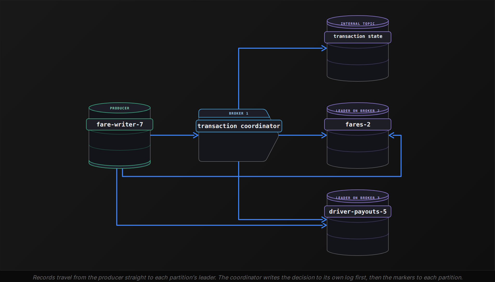
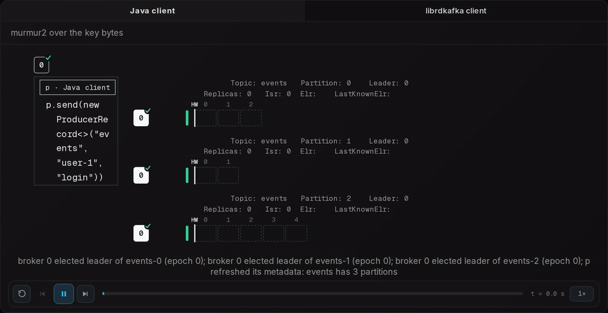
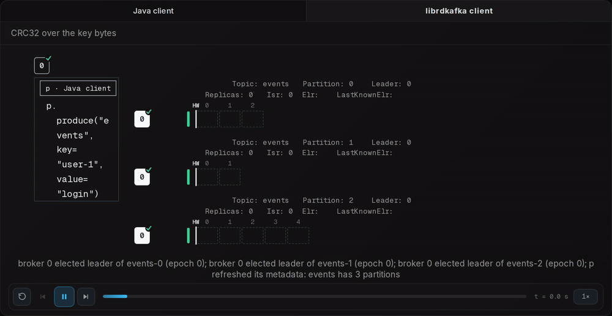
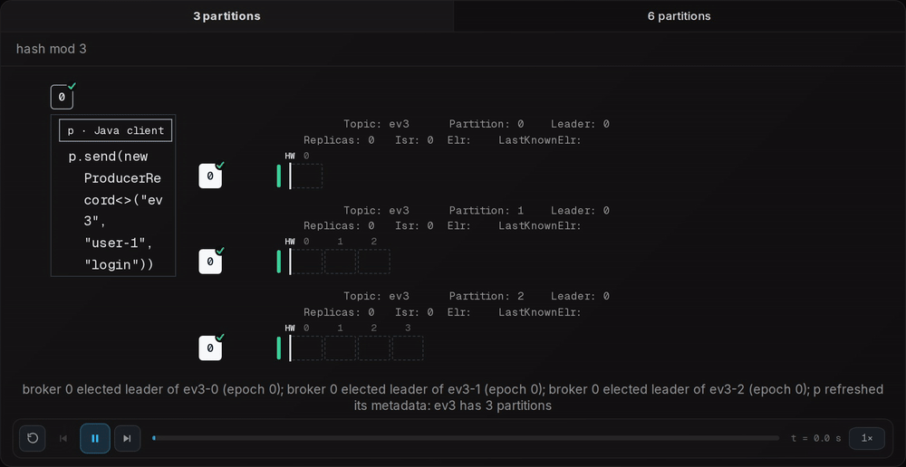
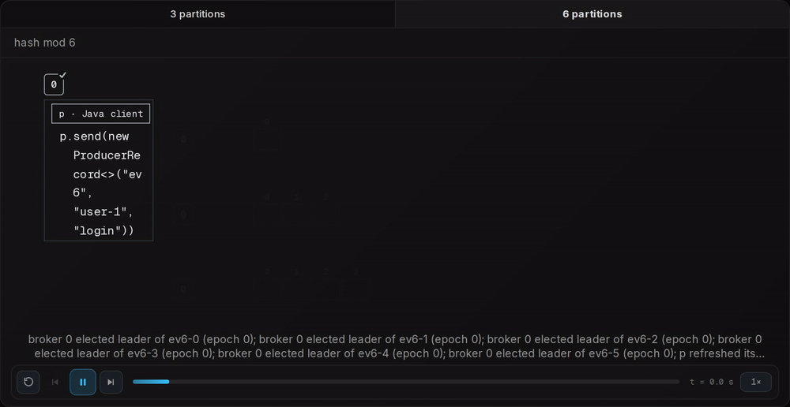

Advanced·[](https://kafka.apache.org/)·20 min · 10 challenges

# Producers: Advanced

It is 2 a.m. on New Year's Day at Uber, and trips are closing as fast as riders step out of cars. A fare service closes each trip with 2 records on 2 topics: the fare charged to the rider and the payout owed to the driver. A producer that dies between those 2 sends charges a rider for a ride no driver is paid for.


<br>

---

## Transactions

[Using Transactions](https://kafka.apache.org/44/design/design/#using-transactions)[transactional.id](https://kafka.apache.org/44/configuration/producer-configs/#producerconfigs_transactional.id)

A trip ends and the fare service sends 2 records: the fare to `fares` and the driver's payout to `driver-payouts`. Those are 2 topics, so 2 partitions with 2 leaders, usually on 2 brokers. An idempotent producer promises that each record lands once in its own partition and nothing more: a crash after the first ack and before the second send leaves a fare with no payout. A transaction ties the 2 sends together. Every record sent between `begin_transaction()` and `commit_transaction()` becomes committed together, or none of them does.

```sql
transactional.id=fare-writer-7
enable.idempotence=true
acks=all
max.in.flight.requests.per.connection=5
transaction.timeout.ms=60000
```

Setting `transactional.id` is the switch. The client refuses to start unless idempotence is on, `acks=all` is set and at most 5 requests are in flight, because a transaction is built on the idempotent producer's id and sequence numbers. The id names a role and stays the same across restarts.

```sql
producer.init_transactions()
producer.begin_transaction()
producer.produce("fares", key="trip-9001", value="fare=18.40")
producer.produce("driver-payouts", key="driver-512", value="payout=14.72")
producer.commit_transaction()
```

`init_transactions()` runs once per producer. It asks any broker where the transaction coordinator for `fare-writer-7` is: the coordinator is the leader of the partition of the internal topic `__transaction_state` that the id hashes to, a normal broker with a normal replicated log. The coordinator assigns producer id 4001 at epoch 0, writes that assignment to its log, and aborts anything an earlier run under the same id left open. `begin_transaction()` sends nothing: it flips local state. The first `produce()` to a partition appends the record there and, on a 4.x cluster, that partition's leader tells the coordinator it now belongs to the open transaction. By the time `commit_transaction()` runs, the coordinator knows the transaction touched `fares-2` and `driver-payouts-5`.




<br>

### Commit is written twice

`commit_transaction()` is a 2-phase write. Phase 1: the coordinator appends a `PrepareCommit` record for producer 4001 to `__transaction_state`, a topic created with a minimum in-sync count of 2, so the decision is on 2 disks before anything else happens, and the producer's call returns at this point. Phase 2: the coordinator sends a COMMIT marker to the leader of every partition in the transaction. Each leader appends the marker as a control record, a record with no key and no value that takes 1 offset of its own. When every marker is acknowledged, the coordinator appends `CompleteCommit` and the transaction is over.

fares-2 after the commit

| offset | record |
| --- | --- |
| 40 | trip-9001, fare=18.40, producer 4001 epoch 0 |
| 41 | COMMIT marker for producer 4001 |

driver-payouts-5 after the commit

| offset | record |
| --- | --- |
| 118 | driver-512, payout=14.72, producer 4001 epoch 0 |
| 119 | COMMIT marker for producer 4001 |

The fare was appended at offset 40 the moment the producer sent it, long before the commit. The marker at 41 is what makes offset 40 committed. The 2 markers land on 2 brokers at 2 different moments, so atomic means that both partitions reach the same outcome, never that they reach it at the same instant. A reader that asks for committed records only holds back at a record until its marker arrives, and skips aborted records for good; how that reader works is a later lesson. A reader with the default setting ignores markers and sees the fare the moment offset 40 exists.


<br>

### Abort leaves the record in the log

`abort_transaction()`, or a crash before commit, ends in an ABORT marker written the same 2-phase way: `PrepareAbort` in the coordinator's log, then a marker in each partition. The fare at offset 40 stays where it is. The log is append-only, so an abort cannot pull a record back; it can only add a marker saying that 40 does not count. Retention deletes the aborted record on the usual schedule, and compaction discards it when the cleaner reaches its segment.

| Producer crashes... | What the coordinator finds | What the logs end up holding |
| --- | --- | --- |
| after `begin_transaction()`, before any send | no partitions registered | nothing: there was nothing to mark |
| after the fare landed at offset 40, before the payout was sent | an open transaction with 1 partition | ABORT marker at 41, written when the next run calls `init_transactions()` or when `transaction.timeout.ms` expires |
| after `commit_transaction()` returned | `PrepareCommit` in `__transaction_state` | COMMIT markers in both partitions, written by the coordinator |
| while the coordinator's own broker dies mid-markers | the new leader of that `__transaction_state` partition reads `PrepareCommit` | the new coordinator finishes writing the COMMIT markers |

> **TIP**
>
> The decision point is the PrepareCommit record. Before it exists, any crash ends in abort. After it exists, any crash ends in commit, even when a different broker has to finish writing the markers.

- **50** — partitions in __transaction_state
- **15 min** — longest timeout a broker allows
- **3** — replicas of the coordinator's log

One transaction can hold any number of records on any number of partitions and topics, at the cost of 1 marker per partition it touched. A transaction per record on a hot topic doubles the writes to that partition; a transaction per batch of 500 records adds 1 marker. `transaction.timeout.ms`, 60 seconds by default, bounds how long a transaction may stay open: the coordinator aborts it on its own once the clock runs out, so a producer that waits on a slow external call mid-transaction finds its commit rejected.


<br>

---

## Fencing Zombie Producers

[Transaction Protocol](https://kafka.apache.org/44/operations/transaction-protocol/#overview)[KIP-890 Transactions Server-Side Defense](https://cwiki.apache.org/confluence/display/KAFKA/KIP-890%3A+Transactions+Server-Side+Defense)

The fare writer runs under an orchestrator that restarts anything that stops answering health checks. Process A owns `transactional.id=fare-writer-7`, holds producer id 4001 at epoch 0, and has a transaction open with the fare for trip-9001 already at offset 40 of `fares-2`. Then A stalls for 40 seconds: a garbage collection pause, or a network link that drops. The orchestrator stops hearing from A and starts process B from the same config. Now 2 processes each believe they are `fare-writer-7`, and A will wake up with sends still queued.

B calls `init_transactions()`. The coordinator looks up `fare-writer-7`, finds producer id 4001 at epoch 0 with a transaction ongoing, bumps the epoch to 1, hands B the pair (4001, 1), and aborts A's open transaction: an ABORT marker goes to every partition A had registered. The coordinator's log now says epoch 1 is current, and each partition leader learns the new epoch from the marker it appended.

| Clock | Who | Does | Result |
| --- | --- | --- | --- |
| 0 s | A | `init_transactions()` | producer id 4001, epoch 0 |
| 1.0 s | A | `produce()` trip-9001 to `fares-2` | offset 40, epoch 0 |
| 1.2 s | A | stalls | nothing leaves A for 40 s |
| 30 s | orchestrator | starts B with the same config | 2 processes claim `fare-writer-7` |
| 31 s | B | `init_transactions()` | epoch 1; ABORT marker at `fares-2` offset 41 |
| 32 s | B | `produce()` trip-9001, `commit_transaction()` | record at 42, COMMIT marker at 43 |
| 41 s | A | wakes, `produce()` trip-9002 to `fares-2` | rejected: epoch 0 is older than 1, `ProducerFencedException` |
| 41 s | A | `commit_transaction()` | same exception; the only call left is `close()` |

Every produce request carries the producer id and the epoch. The leader of `fares-2` already keeps per-producer state for idempotence, the last epoch and sequence number it accepted for 4001, and the marker at offset 41 moved that epoch to 1. A's request at 41 seconds arrives with epoch 0. The leader rejects it as stale, and the client raises `ProducerFencedException`, which is fatal: the producer can no longer retry, open a new transaction or commit. Trip-9002 from A never enters the log, and a reader of committed records sees trip-9001 exactly once, at offset 42, because offset 40 sits under an ABORT marker.

> Fatal means fatal
>
> - A fenced producer cannot be retried, and its open transaction is already aborted on the broker.
> - Building a new producer object with the same id inside the old process fences B right back, and the 2 processes take turns failing.
> - The fix is to let the old process exit; the orchestrator already decided it was dead.


<br>

### The id names a shard of work, not a process

Fencing depends on 1 rule: at any moment, 1 live producer per `transactional.id`. The rule holds only if the id describes something there is 1 of. A service that runs 8 replicas and gives every replica `transactional.id=fare-writer` breaks it: each replica's `init_transactions()` bumps the epoch past the other 7, every replica is fenced on its next send, and the service writes nothing. The scheme that works gives each unit of ownership its own id. With 12 shards of trips, the ids are `fare-writer-0` through `fare-writer-11`, and whichever process owns shard 7 opens its producer with `fare-writer-7`. On a restart the new owner takes the id, the coordinator bumps the epoch, and the old owner, if it is alive anywhere, is fenced on its next request.

| ✓ Stable id per shard | ✗ Fresh id per start |
| --- | --- |
| • fare-writer-7 belongs to shard 7, whoever runs it<br><br>• a restart bumps the epoch and fences the old owner<br><br>• the old owner's open transaction is aborted at once<br><br>• 2 live owners of 1 shard fence each other, which is the alarm you want | • fare-writer-7-a3f9, a random suffix per start, never matches a previous run<br><br>• nothing is ever fenced, so a stalled old process keeps writing<br><br>• the previous run's open transaction waits out transaction.timeout.ms<br><br>• __transaction_state accumulates an entry per start |

An idempotent producer without a `transactional.id` gets none of this. It asks for a producer id with no name attached, receives a fresh one at epoch 0, and the broker deduplicates its retries against that id alone. 2 instances of it write freely into the same partition. Fencing is a property of the transactional id, because the id is the only thing 2 processes can be made to share.


<br>

---

## One Key, Two Partitioners

[partitioner.class](https://kafka.apache.org/44/configuration/producer-configs/#producerconfigs_partitioner.class)[Load balancing](https://kafka.apache.org/44/design/design/#load-balancing)

The rule from the beginner lesson was: a keyed record goes to `hash(key) mod partitions`. That rule does not say which hash. The Java client's built-in partitioner runs murmur2 over the key's serialized bytes, clears the sign bit with `& 0x7fffffff`, and takes the remainder by the partition count. librdkafka, the C library underneath the Python, Go, .NET and Node clients, ships with `partitioner=consistent_random`, which runs CRC32 over the same bytes and takes the remainder. Both functions are deterministic and spread keys evenly, and they are different functions, so a topic written by a Java service and a Python service with the same keys ends up with each key in 2 partitions, 1 per library.

| key | murmur2 (Java) | murmur2 & 0x7fffffff | Java partition of 6 | CRC32 (librdkafka) | librdkafka partition of 6 |
| --- | --- | --- | --- | --- | --- |
| user-1 | -1118138342 | 1029345306 | 0 | 1393466234 | 2 |
| user-2 | -2140329823 | 7153825 | 1 | 3387071788 | 4 |
| user-3 | -1836010240 | 311473408 | 4 | 2378139398 | 2 |
| user-4 | 2131329263 | 2131329263 | 5 | 1693543153 | 1 |
| user-5 | -1119786024 | 1027697624 | 2 | 2367186783 | 3 |
| user-6 | -1264906003 | 882577645 | 1 | 2309225121 | 3 |

Take `user-1`. The Java client computes murmur2 of the 6 bytes of `user-1` and gets -1118138342; clearing the sign bit gives 1029345306, which divides by 6 exactly, so partition 0. librdkafka computes CRC32 of the same 6 bytes and gets 1393466234, remainder 2, so partition 2. The 2 results agree for a key with probability 1 in 6, and none of the 6 keys above agrees. Each library is internally consistent: every `user-1` record from the Java service lands on 0, every one from the Python service on 2, and a reader of partition 0 sees half of `user-1`'s history in order with no sign that the other half exists.

**Java client**



**librdkafka client**



The bytes matter as much as the function. Both libraries hash the serialized key, so 2 producers using the same library still disagree if 1 serializes the user id as the string `42` (2 bytes) and the other as a 4-byte integer. A topic's partitioning contract is 3 things together: the key's bytes, the hash function and the partition count, and any producer that changes 1 of the 3 is writing to a different place.


<br>

### Making them agree

```sql
partitioner = murmur2_random
```

librdkafka's `murmur2_random` reproduces the Java client's function bit for bit, including the sign-bit mask and the random spread for records with no key, so a Python producer with that 1 line puts `user-1` on partition 0 next to the Java service. The reverse is possible too: `partitioner.class` on the Java side accepts a class that computes CRC32, which someone has to write. The decision is per producer, so a mixed fleet needs every producer configured the same way, settled before the first record, because every record already written stays where it landed.

| ✓ Do | ✗ Don't |
| --- | --- |
| • Write the hash and the key serializer into the topic's contract, next to the schema.<br><br>• Set partitioner=murmur2_random on every librdkafka producer of a shared topic.<br><br>• Test a sample of real keys through each client and compare the partition numbers. | • Assume the same key means the same partition across languages.<br><br>• Fix a mismatch by switching 1 service while the other keeps its old history.<br><br>• Hash a key that 1 service serializes as text and another as a number. |

The `_random` suffix names what the partitioner does with a record whose key is null: `consistent_random` and `murmur2_random` pick a random partition for keyless records, while plain `consistent` and `murmur2` hash the empty key and send every keyless record to 1 partition. The Java client sticks keyless records to 1 partition until a batch fills or lingers out, then moves on. None of this touches keyed records, so a mismatch between libraries shows up only where order matters.


<br>

---

## Adding Partitions Remaps Keys

[Modifying topics](https://kafka.apache.org/44/operations/basic-kafka-operations/#modifying-topics)[num.partitions](https://kafka.apache.org/44/configuration/broker-configs/#brokerconfigs_num.partitions)

A topic with 3 partitions is carrying more than it should, so the operator runs 1 command: `kafka-topics.sh --bootstrap-server broker1:9092 --alter --topic events --partitions 6`. The command returns in under a second and nothing moves: the 3 old partitions keep every record they hold, and 3 empty partitions appear. What changes is the arithmetic for every future send. `hash(key) mod 3` becomes `hash(key) mod 6`, and for about half of all keys that is a different number.

| key | murmur2 & 0x7fffffff | mod 3 (before) | mod 6 (after) | moves? |
| --- | --- | --- | --- | --- |
| user-1 | 1029345306 | 0 | 0 | stays |
| user-2 | 7153825 | 1 | 1 | stays |
| user-3 | 311473408 | 1 | 4 | moves |
| user-4 | 2131329263 | 2 | 5 | moves |
| user-5 | 1027697624 | 2 | 2 | stays |
| user-6 | 882577645 | 1 | 1 | stays |

The pattern in the table is exact. A key stays when its hash mod 6 is 0, 1 or 2, because then mod 3 gives the same value, and it moves when the result is 3, 4 or 5. Doubling the count moves half the keys. Growing from 3 to 4 instead moves 3 keys in 4, since mod 3 and mod 4 agree only when the hash mod 12 is 0, 1 or 2. There is no partition count you can grow to that keeps every key in place, and there is no way back: Kafka refuses to reduce a partition count, because records would have to be deleted.

**3 partitions**



**6 partitions**




<br>

### What a moved key looks like

Follow `user-3`. Before the change its 4 records sit on partition 1 at offsets 200 to 230. After the change, its next record lands on partition 4 at offset 0. Every record `user-3` ever had is still in the topic, but its history is now split across 2 partitions, and the per-key order the beginner lesson promised, 1 key on 1 partition read in offset order, holds within each half and not across them. A reader that is behind on partition 1 and current on partition 4 sees the newest record first. A reader that never looks at partition 4 sees nothing new for `user-3` at all.

events-1, where user-3 used to go

| offset | key | value |
| --- | --- | --- |
| 200 | user-3 | login |
| 207 | user-3 | cart add |
| 215 | user-3 | cart add |
| 230 | user-3 | checkout |

events-4, where user-3 goes now

| offset | key | value |
| --- | --- | --- |
| 0 | user-3 | payment ok |
| 1 | user-3 | logout |

Compacted topics make the split permanent. A compacted topic of account balances keeps the latest record per key per partition, because the cleaner works 1 partition at a time and never looks across. After `user-3` moves, partition 1 keeps `balance=120` as its latest and partition 4 keeps `balance=95` as its latest, and both survive every compaction pass forever. A reader rebuilding a table from the topic sees 2 latest values for 1 key and keeps whichever it reads last. The clean path for a compacted topic is a new topic with the new count, refilled from the old one.


<br>

### Producers find out one at a time

A producer learns the partition count from its metadata and refreshes it every `metadata.max.age.ms`, 5 minutes by default, or sooner when a send fails. 2 producers that write the same keys refresh on their own clocks. For up to 5 minutes after the command, producer P1 may send `user-3` to partition 4 while producer P2 still sends it to partition 1, so the split interleaves both ways during the window. A transaction does not protect against this: it makes records commit together on whichever partitions the producers computed.

| Minute after the change | P1 (refreshed at minute 1) | P2 (refreshed at minute 4) |
| --- | --- | --- |
| 0 | `user-3` to partition 1 | `user-3` to partition 1 |
| 1 | `user-3` to partition 4 | `user-3` to partition 1 |
| 3 | `user-3` to partition 4 | `user-3` to partition 1 |
| 4 | `user-3` to partition 4 | `user-3` to partition 4 |

> When growing a live topic is fine
>
> - Keyless topics: no mapping to break, and the new partitions take load within 1 metadata refresh.
> - Keyed topics where order and compaction do not matter, such as independent metrics samples.

> **TIP**
>
> Size a keyed topic's partition count once, for the peak throughput it must carry plus headroom, before any key depends on it. Growing it later costs a reorder for half the keys, and for a compacted topic, a rebuild.


<br>

---

## Full Buffers and Blocking

[buffer.memory](https://kafka.apache.org/44/configuration/producer-configs/#producerconfigs_buffer.memory)[max.block.ms](https://kafka.apache.org/44/configuration/producer-configs/#producerconfigs_max.block.ms)

`send()` returns at once because it never talks to a broker. It hands the record to an in-memory accumulator, sized by `buffer.memory`, 32 MiB by default, and the producer's single I/O thread drains batches from there to the leaders. The application fills, the brokers drain, and when the fill outruns the drain the accumulator grows until it reaches `buffer.memory`. Then `send()` stops returning at once.

| Quantity | Value | Where it comes from |
| --- | --- | --- |
| record size | 1,024 bytes | measured |
| application send rate | 10,000 records/s | the loop calling `send()` |
| cluster drain rate | 6,000 records/s | acks coming back, limited by broker disks and the network |
| net growth | 4,000 records/s | fill minus drain |
| `buffer.memory` | 33,554,432 bytes | 32,768 records of 1,024 bytes |
| time until full | 8.2 s | 32,768 records at 4,000 per second |

The accumulator is full 8 seconds after the loop starts. The next `send()` cannot allocate a batch, so it blocks the calling thread until a batch is acknowledged and its memory comes back. From that point the application runs at 6,000 records a second, because the brokers set the pace. That blocking is the producer's backpressure, and it works as long as the brokers keep draining. The wait has a limit: `max.block.ms`, 60 seconds by default. A `send()` that waits that long throws `TimeoutException`, whose message says it failed to allocate memory within the configured max blocking time, and the record it was handed never entered the buffer.

| Clock | Accumulator | What send() does |
| --- | --- | --- |
| 0 s | empty | returns in microseconds |
| 8.2 s | 32,768 records, full | blocks until a batch frees |
| 8.2 s to 60 s | full, draining at 6,000/s | returns after a short wait each, so the loop runs at the drain rate |
| 60 s, network to every leader cut | full, draining at 0/s | blocks for the whole `max.block.ms` |
| 120 s | full | throws `TimeoutException`; the record is dropped on the application's side |

The buffer is 1 pool shared by every partition. A batch for a partition whose leader is down stays in the accumulator while the producer retries it, up to `delivery.timeout.ms`, 120 seconds by default. With 12 partitions and 1 dead leader, the dead partition's batches stop being freed while the other 11 keep draining, so its share of the pool grows until its batches expire and the memory returns. Whether the pool fills first depends on the rate. With keys evenly spread over the 6,000 records a second the brokers were draining, at 1,024 bytes each, the dead partition's twelfth is 500 records a second. Holding 120 seconds of them would take 60,000 records, about 59 MiB, nearly twice the 32 MiB pool, so the pool fills after about 65 seconds, long before the first batch expires. From then on a `send()` to a healthy partition blocks as well, because memory has no partition, and 1 slow partition has stalled the whole producer.

> 3 places the producer blocks
>
> - No metadata yet for the topic, on the first send or after a leader change: it waits up to `max.block.ms` for the fetch.
> - The accumulator is full: it waits up to `max.block.ms` for a freed batch.
> - `init_transactions()` and `commit_transaction()` wait on the coordinator, bounded by `max.block.ms` too.


<br>

### What to change, and what each change buys

Raising `buffer.memory` is the first instinct and the weakest fix. Doubling it to 64 MiB delays the block from 8.2 seconds to 16.4 seconds, after which the application runs at the drain rate anyway: the buffer sizes a burst, never a rate. Rate fixes live on the drain side: compression shrinks what crosses the wire, a longer `linger.ms` fills larger batches, and more partitions on more brokers add leaders to write in parallel; each raises the 6,000. On the fill side, the application can read the block as a signal: watch the producer's `bufferpool-wait-ratio` metric and slow the loop that calls `send()` when it climbs. A `max.block.ms` of 2,000 turns a silent minute into an exception the application can act on by shedding the record, spilling it locally or pausing its intake.

| ✓ Java client | ✗ librdkafka |
| --- | --- |
| • buffer.memory: 32 MiB of batches, shared across partitions<br><br>• send() blocks when the pool is empty<br><br>• max.block.ms 60 s, then TimeoutException<br><br>• the calling thread pays the wait | • queue.buffering.max.messages 100,000 and queue.buffering.max.kbytes 1,048,576<br><br>• produce() returns RD_KAFKA_RESP_ERR__QUEUE_FULL at once<br><br>• no wait: the application polls, then retries the call<br><br>• the application decides how long to retry |

The 2 libraries hand the same problem to the application in 2 ways. The Java client absorbs it as time: the thread stops. librdkafka returns it as an error: the call fails and the record is still the application's. A working librdkafka loop polls for delivery reports to free queue slots, then calls `produce()` again; a working Java loop catches `TimeoutException` and does the same. Either way the refused record is lost unless the application keeps it, and `delivery.timeout.ms` never starts for it, because that clock begins when a record enters the buffer.

| ✓ Do | ✗ Don't |
| --- | --- |
| • Measure the drain rate before sizing the buffer; the buffer covers bursts above it.<br><br>• Set max.block.ms to what the caller can tolerate, and handle TimeoutException. | • Raise buffer.memory past a few seconds of fill without raising the drain rate.<br><br>• Call send() from a request handler with a 60 s block and no timeout of your own. |


<br>

---

## Putting It All Together

A marketplace's payments team rewrites the service that settles each sale into a ledger topic, keyed by seller id, and a payouts topic, keyed by bank account, after a month in which a replaced pod double-paid 3 sellers and a partition increase left the compacted balances topic with 2 balances for 1 in 2 sellers.

- Each settlement becomes 1 transaction across the 2 topics, so the double payment that came from a crash between 2 sends can no longer happen (section 0).
- The pods take transactional.id=settle-<shard> from the shard they own, so the replaced pod that kept writing for 40 seconds is fenced on its first request after the replacement (section 1).
- The Python reporting producer that also writes the ledger is switched to murmur2_random, so a seller's records from both services share 1 partition (section 2).
- The balances topic is recreated at the final partition count and refilled rather than grown again, because compaction had kept a stale balance on the old partition for every moved key (section 3).
- The settlement loop sets max.block.ms to 5 seconds and slows its intake when bufferpool-wait-ratio rises, so a slow payouts leader shows up as backpressure instead of a 60-second hang in the request path (section 4).


<br>

---

## Key Takeaways

- A transaction makes records on many partitions commit or abort together; the PrepareCommit record in __transaction_state is the decision, and markers in each partition carry it out.
- Aborted records stay in the log under an ABORT marker; an abort can only append, so the marker is what tells readers to skip them.
- A transactional.id names a shard of work; a restart bumps its epoch, and the old producer's next request is fenced for good.
- The Java client hashes keys with murmur2 and librdkafka with CRC32 by default, so the same key lands on 2 partitions unless both are set to murmur2_random.
- Adding partitions moves about half of all keys, splits their history across 2 partitions, and leaves a compacted topic with 2 latest values per moved key.
- A full buffer blocks send() for up to max.block.ms and then throws; the buffer sizes a burst, and only the drain rate fixes a rate.
- A coordinator that dies mid-markers changes no outcome: the new leader of its __transaction_state partition reads PrepareCommit and finishes writing the markers.

[](https://kafka.apache.org/)

Official Apache Kafka resourcesversion 4.4

"Apache Kafka is an open-source distributed event streaming platform used by thousands of companies for high-performance data pipelines, streaming analytics, data integration, and mission-critical applications." [kafka.apache.org](https://kafka.apache.org/)

[Documentation](https://kafka.apache.org/44/)[Quickstart](https://kafka.apache.org/quickstart/)[Download](https://kafka.apache.org/community/downloads/)[Community](https://kafka.apache.org/community/)

In the documentation

Transactions
:   [Using Transactions](https://kafka.apache.org/44/design/design/#using-transactions)[transactional.id](https://kafka.apache.org/44/configuration/producer-configs/#producerconfigs_transactional.id)

Fencing Zombie Producers
:   [Transaction Protocol](https://kafka.apache.org/44/operations/transaction-protocol/#overview)[KIP-890 Transactions Server-Side Defense](https://cwiki.apache.org/confluence/display/KAFKA/KIP-890%3A+Transactions+Server-Side+Defense)

One Key, Two Partitioners
:   [partitioner.class](https://kafka.apache.org/44/configuration/producer-configs/#producerconfigs_partitioner.class)[Load balancing](https://kafka.apache.org/44/design/design/#load-balancing)

Adding Partitions Remaps Keys
:   [Modifying topics](https://kafka.apache.org/44/operations/basic-kafka-operations/#modifying-topics)[num.partitions](https://kafka.apache.org/44/configuration/broker-configs/#brokerconfigs_num.partitions)

Full Buffers and Blocking
:   [buffer.memory](https://kafka.apache.org/44/configuration/producer-configs/#producerconfigs_buffer.memory)[max.block.ms](https://kafka.apache.org/44/configuration/producer-configs/#producerconfigs_max.block.ms)

Further
:   [KIP-98 Exactly Once Delivery](https://cwiki.apache.org/confluence/display/KAFKA/KIP-98+-+Exactly+Once+Delivery+and+Transactional+Messaging)[KIP-794 Uniform Sticky Partitioner](https://cwiki.apache.org/confluence/display/KAFKA/KIP-794%3A+Strictly+Uniform+Sticky+Partitioner)

Apache Kafka, Kafka, and the Kafka logo are either registered trademarks or trademarks of The Apache Software Foundation in the United States and other countries.
