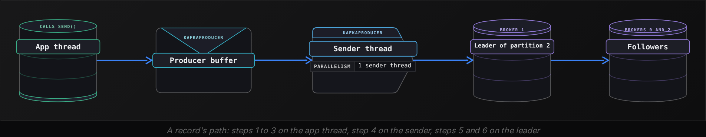
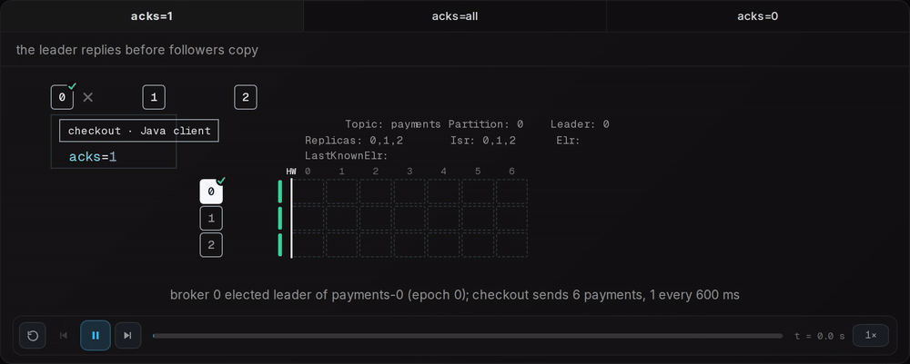
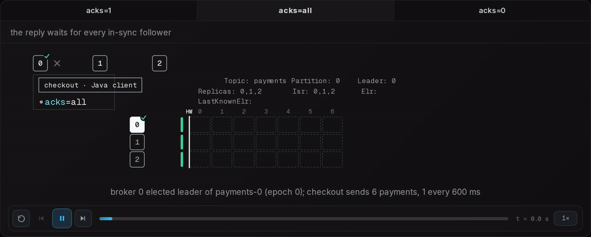
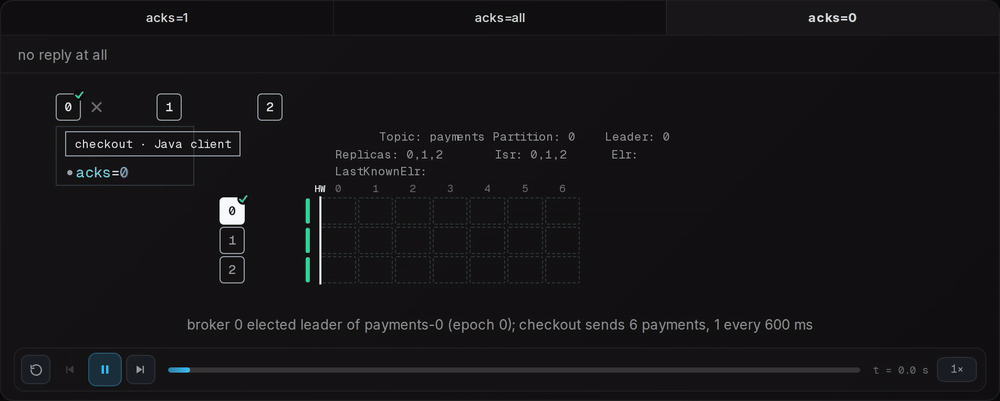
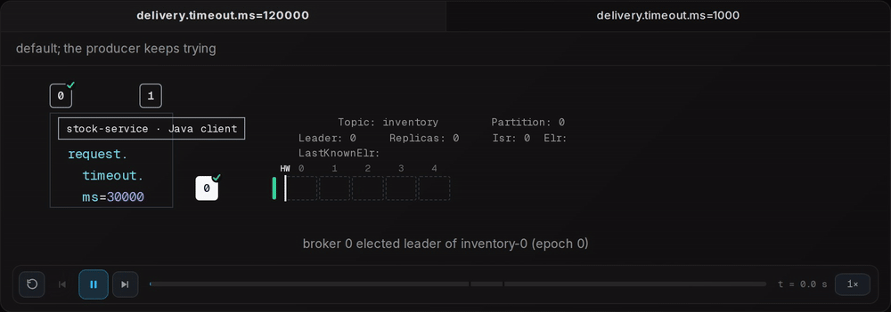
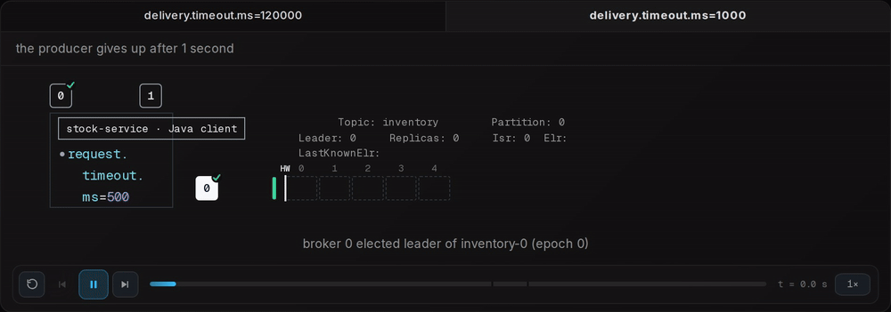

Beginner·[](https://kafka.apache.org/)·20 min · 9 challenges

# Producers: Beginner

An Uber driver's phone reports its position every few seconds, and every report is one send() call into a topic. Some driver is always pulling into SFO's pickup zone while a broker in that cluster is restarting. Whether the ping lands, where it lands, and whether the rider's map jumps backward are all decided by settings in the producer, before any broker sees the record.


<br>

---

## Sending a Record

[The Producer](https://kafka.apache.org/44/design/design/#the-producer)[Asynchronous send](https://kafka.apache.org/44/design/design/#asynchronous-send)


<br>

### The producer lives in your application

A producer is a library object inside your own program, built from a handful of settings and kept open for the life of the process. On startup it connects to one of the brokers listed in `bootstrap.servers`, asks it for metadata, and learns from the reply every partition of every topic it writes to and which broker currently leads each one. From then on it talks to leaders directly: a record bound for partition 2 of `trip-pings` travels to the broker that leads partition 2, with nothing in between. If a leader moves, the next metadata refresh tells the producer where.

```sql
# producer.properties
bootstrap.servers=broker-0:9092,broker-1:9092,broker-2:9092
client.id=driver-app-pings
key.serializer=org.apache.kafka.common.serialization.StringSerializer
value.serializer=org.apache.kafka.common.serialization.StringSerializer
```

Only `bootstrap.servers` and the 2 serializer lines are required. The broker list is a starting point, so any live broker from it is enough to learn the whole cluster. The serializers name how the key and value are turned into bytes, because a broker stores bytes and nothing else; `StringSerializer` writes the UTF-8 bytes of a string, and a later lesson covers the other formats. `client.id` is a label the brokers attach to this producer's requests in their logs and metrics, so a busy producer can be found by name.

The command-line producer shipped with Kafka 4.4 wraps the same library: kafka-console-producer.sh --bootstrap-server broker-0:9092 --topic trip-pings reads a line from the terminal and calls send() for each one, so every step below happens for a line you type.


<br>

### 6 steps between send() and the log

| Step | Where it runs | What is settled there |
| --- | --- | --- |
| 1. Serialize | Producer, on the calling thread | The key and value become byte arrays |
| 2. Pick a partition | Producer, on the calling thread | Which partition of the topic the record will live in |
| 3. Park in the buffer | Producer, on the calling thread | send() returns a future; the record waits in memory |
| 4. Ship to the leader | Producer, sender thread | A produce request carries the record to the partition's leader |
| 5. Append | Leader broker | The record gets the next offset and lands at the end of the log |
| 6. Reply | Leader broker, then sender thread | The future completes, or the callback runs, with the offset |

The first 3 steps run on the thread that called `send()`, and they take microseconds. Nothing has crossed the network when `send()` returns: the record sits in a memory buffer inside the producer, and the call hands back a future that will hold the result. Step 4 belongs to a second thread the producer started on its own, the sender. It drains the buffer, groups the records headed for each partition, and writes one produce request per leader. The leader appends each record at the end of its partition's log, stamps it with the next offset, and the followers copy it as they do any other write. The reply travels back along the same connection, and the sender completes the future for every record the request carried.




<br>

### What the producer gets back

```sql
{
  "topic": "trip-pings",
  "partition": 2,
  "offset": 48213,
  "timestamp": 1762243200517
}
```

The reply is a `RecordMetadata`: the topic, the partition the producer chose, and the offset the leader assigned. The partition was known before the request left, because the producer picked it. The offset was known to nobody until the append, because only the leader knows how long its log is at that moment, and 2 producers writing to the same partition get interleaved offsets in whatever order their requests arrived. Your code reaches the metadata in 1 of 2 ways: call `get()` on the future, which blocks the calling thread until the reply, or pass a callback to `send()`, which the sender thread invokes when the reply comes. The callback form keeps the application thread free to keep sending while earlier records are still in flight.

| Clock | Where | Event |
| --- | --- | --- |
| 0.00 ms | App thread | send() called with key trip-8841 |
| 0.02 ms | App thread | Partition 2 chosen, record parked, future returned |
| 0.90 ms | Sender thread | Produce request to broker 1, leader of partition 2 |
| 1.40 ms | Broker 1 | Record appended at offset 48213 |
| 2.10 ms | Brokers 0 and 2 | Followers fetch the record |
| 2.60 ms | Broker 1 | Reply sent to the producer |
| 3.10 ms | Sender thread | Future completed, callback runs with offset 48213 |

The 3 ms in this timeline is a round trip inside 1 datacenter; across regions the same 7 lines stretch to tens of milliseconds, and almost all of the added time sits between the sender's request and the leader's reply. The leader answers once the record is as safe as the producer asked it to be, and the section after next sets that bar.

> **TIP**
>
> A returned send() means the record sits in the producer's buffer; the network has not seen it yet. Call flush() to wait for everything buffered to be acknowledged, and close() before the process exits. A producer killed mid-run drops whatever the sender had not shipped.

> Who settles what
>
> - Producer: the bytes, the partition, when the request goes out, and whether to try again
> - Leader broker: the offset, the position in the log, and the moment the record is visible
> - Followers: a copy of the record, fetched from the leader after it lands


<br>

---

## Keys Pick Partitions

[Load balancing](https://kafka.apache.org/44/design/design/#load-balancing)[partitioner.class](https://kafka.apache.org/44/configuration/producer-configs/#producerconfigs_partitioner.class)


<br>

### The hash picks the partition

Step 2 of the path, picking the partition, is the producer's call, and the default rule is arithmetic. The producer takes the key's bytes, runs them through a hash function named murmur2, forces the result positive, and takes the remainder when dividing by the topic's partition count. For `trip-pings` with 6 partitions the formula is `hash(key) % 6`, and the answer is a number from 0 to 5. The same bytes always hash to the same number, so a key always lands in the same partition for as long as the topic keeps 6 partitions. The decision runs entirely inside the producer; it could be computed with the cluster unreachable.

| Key | Hash (shortened) | Hash % 6 | Partition |
| --- | --- | --- | --- |
| trip-8841 | 7,342,601 | 5 | 5 |
| trip-8842 | 1,509,223 | 1 | 1 |
| trip-8841 | 7,342,601 | 5 | 5 |
| trip-9007 | 2,211,984 | 0 | 0 |
| trip-8842 | 1,509,223 | 1 | 1 |

*The hash column holds stand-in values to keep the division readable; the real murmur2 result is a 32-bit number, and the remainder step is the same.*

```sql
def partition_for(key_hash, num_partitions):
    return key_hash % num_partitions


hashes = {"trip-8841": 7342601, "trip-8842": 1509223, "trip-9007": 2211984}

for key, h in hashes.items():
    print(key, "->", partition_for(h, 6))
```


<br>

### Sharing a key buys ordering

Every record with key `trip-8841` lands in partition 5, and the leader appends them in the order the producer's requests arrive. A single producer sending ping 1, ping 2 and ping 3 for that trip therefore produces offsets that increase in that order, and anyone reading partition 5 sees the trip's pings in the sequence the phone sent them. That is the whole value of a key: it names a stream whose order matters, and the hash guarantees the stream never splits across partitions. Records with different keys get no ordering guarantee, so a reader of partitions 1 and 5 may see trip 8842's ping before or after trip 8841's.

A key also lets the record be found later. Because trip-8841 can only be in partition 5, a tool looking for that trip's pings reads 1 partition out of 6 and skips the other 5.

> What a key guarantees
>
> - One partition for the key, found by hash(key) % partition count
> - Send order preserved inside that partition for records from 1 producer
> - No ordering between 2 different keys, even from the same producer
> - Exactly 1 partition's capacity for the key's traffic, however much there is


<br>

### Records without a key

A key is optional. When it is null the hash has nothing to work on, and the producer falls back to spreading: it picks a partition, sends a run of keyless records there, then moves to another partition, and over a few thousand records each partition receives roughly the same count. Any 2 keyless records from the same producer can land anywhere, so their relative order is lost the moment they are split, which is acceptable for a record nobody will ever need to line up with another. Metrics samples, log lines and events that are counted rather than sequenced are the usual null-key cases.

| ✓ Keyed record | ✗ Null key |
| --- | --- |
| • Partition fixed by hash(key) % partitions<br><br>• All records of the key stay together, in send order<br><br>• One key can only use 1 partition's capacity<br><br>• Right for events that must line up: a trip, an order, an account | • Partition picked by the producer, changing every so often<br><br>• Records with nothing in common spread evenly<br><br>• Load uses all partitions<br><br>• Right for events counted in bulk: metrics, log lines, clicks |


<br>

### Overriding the default

The hash can be bypassed in 2 ways. A record can carry an explicit partition number, set when the record is built, and the producer honors it without hashing; the key still travels with the record and is stored, but plays no part in routing. Or `partitioner.class` can name your own class, which receives the topic, the key bytes, the value bytes and the live partition count and returns a partition number. Section 4 uses that hook. Either way, the rule that readers rely on still holds: whatever puts a key's records in one partition must keep doing so, or the order you promised downstream breaks.

Given --property parse.key=true --property key.separator=:, the console producer splits each typed line at the first colon, so trip-8841:lat=37.61,lon=-122.38 sends key trip-8841 and lands in partition 5 every time.

> **TIP**
>
> The hash runs over bytes. A key written as the string '8841' and the same key written as a 4-byte integer are different byte arrays, hash to different numbers, and can land in different partitions. Pick 1 key serializer for a topic and keep it.

*Changing the partition count changes the divisor, and a key that lived in partition 5 under 6 partitions may land elsewhere under 8. A later lesson works through that move; for now, the count is part of the contract.*


<br>

---

## When a Send Counts

[acks](https://kafka.apache.org/44/configuration/producer-configs/#producerconfigs_acks)[Message Delivery Semantics](https://kafka.apache.org/44/design/design/#message-delivery-semantics)


<br>

### acks takes 3 values

Step 6 of the path, the reply, happens when the leader decides the record is safe enough, and the producer sets that threshold with 1 setting, `acks`. It takes 3 values. With `acks=0` the producer asks for no reply at all, and treats the send as done the instant the request is written to the socket; the leader may append it, or may never receive it, and the producer will not know. With `acks=1` the leader replies as soon as the record is in its own log, before any follower has fetched it. With `acks=all` the leader waits until every replica currently in the in-sync set has copied the record, then replies. Kafka 4.4 defaults to `acks=all`.

| acks | Reply comes when | Copies when the producer hears back | Leader dies right after the reply |
| --- | --- | --- | --- |
| 0 | Never; the send counts once the bytes leave the producer | 0 or more, unknown | The record may never have existed |
| 1 | The leader has appended the record | 1, the leader's | Lost if no follower fetched it in time |
| all | Every in-sync replica has the record | Every replica in the ISR | Survives: the new leader has it |


<br>

### What the cluster has agreed to

The word `all` means the replicas in the in-sync set at the moment of the write, the set from the replication lesson. A follower that has dropped out of the ISR is skipped: with 3 replicas and 1 of them lagging, `acks=all` returns after the leader and the remaining follower hold the record. The acknowledgement travels with the replication: when the leader replies, the record already sits on every broker that could be elected leader next, so the leader's death a millisecond later changes nothing about that record. With `acks=1` the same death loses the record if the followers had not yet fetched it, and the producer holds an offset for a record that no surviving log contains.

*A later replication lesson adds a floor under how small the in-sync set may shrink before the leader refuses writes; without it, acks=all with an ISR of 1 is the leader alone.*

**acks=1**



**acks=all**



**acks=0**



The animation plays 6 payments through a 3-broker cluster with the followers deliberately slow. Switch between `acks=1` and `acks=all` and watch when each record is marked acknowledged relative to the followers' copies; then strike the leader down after a couple of sends and compare what the surviving brokers hold against what the producer believed was done.


<br>

### The wait each acks level adds

The price of `acks` is time per send. `acks=0` costs 1 one-way trip, and the producer never waits. `acks=1` costs a round trip to the leader, which inside 1 datacenter is typically 1 to 3 ms. `acks=all` adds the followers' fetch on top: the leader cannot answer until each in-sync follower has asked for the record and received it, which adds around 1 more round trip, so a send that took 2 ms at `acks=1` takes 3 to 5 ms at `acks=all`. Because the producer keeps many records in flight at once, the longer wait rarely reduces how many records per second a producer can push; it lengthens how long each individual record waits for its callback.

```sql
# acks=all is the default in Kafka 4.4
acks=all
client.id=checkout-payments
```

The command-line producer takes the same setting on its command line: kafka-console-producer.sh --bootstrap-server broker-0:9092 --topic payments --producer-property acks=1 sends every typed line at the weaker level, which is handy for watching the difference and for nothing else.


<br>

### The same crash under acks=1 and acks=all

| Record | acks=1: acknowledged? | On a follower when the leader died? | acks=all: acknowledged? |
| --- | --- | --- | --- |
| pay-1 | Yes | Yes | Yes |
| pay-2 | Yes | Yes | Yes |
| pay-3 | Yes | Yes | Yes |
| pay-4 | Yes | No | No, still waiting |
| pay-5 | Yes | No | No, still waiting |

Under `acks=1` the producer's callbacks reported 5 landed records, and the new leader's log holds 3; the application has already written done for pay-4 and pay-5 somewhere else. Under `acks=all` the callbacks for pay-4 and pay-5 had not fired, so the producer still holds both records, and once a new leader is elected it sends them there, which section 3 walks through.

> A send counts when
>
> - acks=0: the request left the producer's socket
> - acks=1: the leader appended it and assigned an offset
> - acks=all: the leader and every in-sync follower hold it
> - In every case, the callback or future reflects that moment and nothing later

> **TIP**
>
> Choosing acks=1 for a topic like payments trades a millisecond per send for records that vanish when a leader dies. The default of all is the right starting point; move down only for data you can afford to lose and have measured you need to.


<br>

---

## Send Errors and Retries

[retries](https://kafka.apache.org/44/configuration/producer-configs/#producerconfigs_retries)[delivery.timeout.ms](https://kafka.apache.org/44/configuration/producer-configs/#producerconfigs_delivery.timeout.ms)


<br>

### Failures that pass and failures that don't

A produce request can fail for reasons that will pass and reasons that will not. The leader of partition 2 died and a new one is being elected: wait a moment and the same request to the new leader succeeds. The connection to broker 1 dropped: reconnect and try again. The request got no reply within `request.timeout.ms`: send it again. The producer classifies these as retriable and handles them itself, inside the sender thread, without waking the application. A record larger than the broker accepts, a key that cannot be serialized, a topic name with illegal characters, or a client that lacks permission to write to the topic will fail the same way on the hundredth attempt, so the producer stops at once and hands the error to your code.

| Failure | Retried by the producer? | What the application sees |
| --- | --- | --- |
| Leader of the partition changed (NotLeaderOrFollower) | Yes, after a metadata refresh | Nothing, if a retry succeeds within the delivery timeout |
| Broker unreachable (NetworkException) | Yes, on reconnect | Nothing, same condition |
| No reply within request.timeout.ms (TimeoutException) | Yes | Nothing, same condition |
| Record larger than max.request.size (RecordTooLarge) | No | Callback error on the first attempt |
| Topic the client may not write to (TopicAuthorization) | No | Callback error on the first attempt |
| Serializer threw (SerializationException) | No | send() itself throws, before the buffer |


<br>

### The clock that ends a retry

Retries are bounded by time rather than count. `delivery.timeout.ms` starts when `send()` is called and, when it runs out, the record fails to the application with a `TimeoutException` no matter how many attempts were made; the default gives the producer 2 minutes. Inside that window, `request.timeout.ms` governs 1 attempt: 30 seconds with no reply counts as a failed attempt. Between attempts the producer waits a backoff that starts small and doubles each time up to a ceiling, so a 400 ms leader election costs a few backoffs and metadata refreshes, then 1 retry that lands. The `retries` setting still exists and still caps the count, but its default is so large that in practice the delivery timeout is what ends the wait.

- **2,147,483,647** — default retries
- **100 ms** — first retry backoff
- **1,000 ms** — retry backoff ceiling

```sql
# defaults, written out
delivery.timeout.ms=120000
request.timeout.ms=30000
retry.backoff.ms=100
retry.backoff.max.ms=1000
retries=2147483647
```


<br>

### A leader dies mid-send

| Clock | Event | Producer's view |
| --- | --- | --- |
| 0 ms | Broker 1, leader of partition 2, crashes | Unaware; the request for pay-7 is already on the wire |
| 30 ms | Connection to broker 1 fails | Attempt 1 fails with NetworkException; retriable |
| 130 ms | Backoff ends, metadata requested from broker 0 | Learns partition 2 has no leader yet |
| 330 ms | Backoff ends, metadata requested again | Broker 2 now leads partition 2 |
| 335 ms | Produce request for pay-7 sent to broker 2 | Attempt 2 |
| 338 ms | Broker 2 appends pay-7 at offset 48219 and replies | Future completes; the callback sees success |

The application wrote `send()` once and received 1 callback with an offset, 338 ms later than usual. Had the election outlasted the delivery timeout, that single callback would instead carry a `TimeoutException`, and your code would decide what to do with pay-7. The leader change itself is the replication lesson's story, playing out exactly as described there; the producer's part is to keep the record in its buffer, refresh metadata, and aim the next attempt at whoever leads now.

*A retry can reach a leader that did append the previous attempt before the reply was lost. Kafka 4.4's default producer settings let the broker recognize such a resend and keep 1 copy; the intermediate producer lesson explains how.*

**delivery.timeout.ms=120000**



**delivery.timeout.ms=1000**



The animation sends 8 inventory updates through a partition whose only replica goes down for 1.5 seconds partway through; the single replica keeps anything else from taking over, so the gap stands in for a leader election of that length. Under the default delivery timeout the producer holds the records caught in the gap and lands every one when the broker returns. Switch to a 1 second delivery timeout and the same outage turns those records into errors delivered to the application.

```sql
def on_delivery(metadata, error):
    if error is None:
        print(f"landed in partition {metadata.partition} at offset {metadata.offset}")
    elif error.retriable:
        print(f"gave up after the delivery timeout: {error}")
    else:
        print(f"rejected on the first attempt: {error}")
```

The callback hears every outcome after the record entered the buffer, the same one `get()` on the future returns; a serializer error never reaches it, because `send()` throws it. The first branch carries the metadata from section 0. The second fires for a retriable error that outlasted the delivery timeout: decide whether the record is still worth sending and, if so, call `send()` again. The third fires for an error the producer refused to retry, and resending without changing the record or the configuration fails the same way.

| ✓ Do | ✗ Don't |
| --- | --- |
| • Keep delivery.timeout.ms longer than the longest leader election you expect<br><br>• Log the exception class from the callback, since it tells you which family failed<br><br>• Treat a non-retriable error as a bug in the record or the config | • Set retries=0 to avoid resends; a leader election then fails sends that would have landed<br><br>• Shorten request.timeout.ms below the broker's slowest normal reply<br><br>• Swallow callback errors; a send that fails there is otherwise invisible |


<br>

---

## Hot Keys and Skew

[Load balancing](https://kafka.apache.org/44/design/design/#load-balancing)[KIP-794 Uniform Sticky Partitioner](https://cwiki.apache.org/confluence/display/KAFKA/KIP-794%3A+Strictly+Uniform+Sticky+Partitioner)


<br>

### A hot key puts all its load on 1 partition

A key buys order by pinning its records to 1 partition, and the pin holds no matter how much traffic the key carries. Suppose `trip-pings` were keyed by pickup zone instead of trip, so that every ping from a driver waiting at the airport carries key `zone-SFO`. The airport is where drivers queue, so half of all pings in the city may carry that 1 key, and all of them hash to partition 3. Partition 3's leader appends, replicates and serves half the topic's bytes while the other 5 partitions share the rest; a reader of partition 3 falls behind while readers of the others sit idle. That imbalance is skew, and a key that causes it is a hot key.

| Partition | End offset | Share of records |
| --- | --- | --- |
| 0 | 1,100,000 | 9.3% |
| 1 | 1,000,000 | 8.5% |
| 2 | 1,200,000 | 10.2% |
| 3 | 6,400,000 | 54.2% |
| 4 | 1,100,000 | 9.3% |
| 5 | 1,000,000 | 8.5% |

kafka-get-offsets.sh --bootstrap-server broker-0:9092 --topic trip-pings prints the end offset of every partition, which equals its record count while the log still starts at offset 0: partition 3 above holds 54% of 11.8 million records, and --time earliest shows where each log starts. kafka-log-dirs.sh --describe --bootstrap-server broker-0:9092 --topic-list trip-pings reports the bytes each partition occupies on each broker, which is the number the disks feel.


<br>

### Adding partitions leaves the key hot

The reflex is to give the topic more partitions, and for a hot key it changes nothing: `zone-SFO` hashes to exactly 1 partition out of 12 just as it did out of 6, and that partition still carries half the topic. Partition count sets how many keys can be spread; it sets no limit on how much 1 key can concentrate. The fix has to change what the key names.


<br>

### Split the key along the order you need

Ask what order the readers actually depend on. A rider's map needs 1 driver's pings in sequence; it never needs driver A's ping ordered against driver B's because both sat at the same airport. The unit whose order matters is the driver, so the key should name the driver: `zone-SFO:driver-2201`. Thousands of drivers mean thousands of keys, the hash spreads them over all 6 partitions, and each driver's pings still sit in 1 partition in send order. The order given up, across drivers inside a zone, was never promised to anyone. This is the general rule for a hot key: shrink the key to the finest unit that still needs ordering, and the heat spreads with it.

| Key design | Distinct keys | Partition 3 share | Order kept |
| --- | --- | --- | --- |
| zone-SFO | 6 zones | 54% | All pings in a zone, in sequence |
| zone-SFO:driver-2201 | Thousands of drivers | About 17% | Each driver's pings, in sequence |


<br>

### Keeping a coarse key with a custom partitioner

Sometimes readers key their own state on the original value and cannot take a longer key. Then the spreading moves into the producer's partitioner. A custom `partitioner.class` keeps the record's key as `zone-SFO` but routes it by a finer field taken from the value, say the driver id, hashed into a fixed set of partitions reserved for that zone. Readers still see key `zone-SFO` on every record; each driver still lands in 1 partition; the zone's traffic covers 2 or 3 partitions instead of 1. The partitioner must be deterministic over something stable in the record, because a partitioner that picks at random spreads the load and shreds every driver's order at the same time.

```sql
import zlib

HOT_ZONES = {"zone-SFO": [1, 3, 5]}


def choose_partition(key, driver_id, num_partitions):
    if key in HOT_ZONES:
        spread = HOT_ZONES[key]
        return spread[zlib.crc32(driver_id.encode()) % len(spread)]
    return zlib.crc32(key.encode()) % num_partitions
```

The function keeps the hot zone's drivers on partitions 1, 3 and 5, each driver on 1 of them for good, and sends every other key through an ordinary hash. The real class implements Kafka's `Partitioner` interface and hashes with murmur2 so that cold keys land where the default partitioner would put them; the Python shows the decision, which runs on the app thread at step 2 of the path for every record.


<br>

### Keys that carry no order

If the zone's pings are only counted, the key was never needed: send them with a null key and let the producer spread them. Ordering across the topic is gone, and so is the hot partition.

> 3 ways to cool a key
>
> - Refine the key to the unit whose order matters: zone becomes zone and driver
> - Keep the key and spread it in a custom partitioner over a reserved set of partitions, by a stable field
> - Drop the key when nothing downstream needs sequence; null keys spread on their own

| ✓ Do | ✗ Don't |
| --- | --- |
| • Measure per-partition end offsets before and after a key change<br><br>• Key by the finest unit whose order readers depend on<br><br>• Make any custom partitioner a deterministic function of the record | • Add partitions to cool a hot key; 1 key still maps to 1 partition<br><br>• Route a hot key at random; that spreads load and destroys its order<br><br>• Change a topic's key design without telling every reader of it |


<br>

---

## Putting It All Together

Uber's driver location pipeline during a Friday evening airport surge: thousands of drivers queue at SFO while the broker leading one of the location topic's partitions is restarted for a routine upgrade, and the rider app must keep every driver's dot moving forward on the map.

- Each ping is a send() that returns before the network is touched, so the driver app keeps reporting while the sender thread works through a buffer of pings bound for several leaders.
- Keying pings by driver rather than by zone spreads the airport's surge across every partition while keeping each driver's dots in sequence, which is the only order the map needs.
- With acks=all, the pings acknowledged before the restart already sit on the followers, so the broker going down loses none of them and the new leader continues the partition's log.
- The pings in flight during the leader election fail with NotLeaderOrFollower, back off, pick up the new leader from refreshed metadata and land seconds later, well inside the delivery timeout, so the app's callbacks report offsets rather than errors.
- The per-partition end offsets checked afterwards show the surge's load shared evenly. That confirms the key design, and adding partitions would have changed nothing for a zone key.


<br>

---

## Key Takeaways

- send() returns once the record is serialized, assigned a partition and parked in the producer's buffer; the sender thread ships it to the partition's leader, which assigns the offset.
- The producer picks the partition by hash(key) % partition count, so one key always lands in one partition in send order, and nothing is ordered between keys.
- acks sets when a send counts: 0 for the bytes leaving, 1 for the leader's append, all for every in-sync replica, and only all survives the leader dying right after the reply.
- Retriable failures such as a moved leader or a dropped connection are retried inside the producer until delivery.timeout.ms runs out; record size, authorization and serialization errors reach the application at once.
- A hot key concentrates its traffic on one partition no matter how many partitions exist; the cure is a finer key, a deterministic custom partitioner, or no key when order is not needed.

[](https://kafka.apache.org/)

Official Apache Kafka resourcesversion 4.4

"Apache Kafka is an open-source distributed event streaming platform used by thousands of companies for high-performance data pipelines, streaming analytics, data integration, and mission-critical applications." [kafka.apache.org](https://kafka.apache.org/)

[Documentation](https://kafka.apache.org/44/)[Quickstart](https://kafka.apache.org/quickstart/)[Download](https://kafka.apache.org/community/downloads/)[Community](https://kafka.apache.org/community/)

In the documentation

Sending a Record
:   [The Producer](https://kafka.apache.org/44/design/design/#the-producer)[Asynchronous send](https://kafka.apache.org/44/design/design/#asynchronous-send)

Keys Pick Partitions
:   [Load balancing](https://kafka.apache.org/44/design/design/#load-balancing)[partitioner.class](https://kafka.apache.org/44/configuration/producer-configs/#producerconfigs_partitioner.class)

When a Send Counts
:   [acks](https://kafka.apache.org/44/configuration/producer-configs/#producerconfigs_acks)[Message Delivery Semantics](https://kafka.apache.org/44/design/design/#message-delivery-semantics)

Send Errors and Retries
:   [retries](https://kafka.apache.org/44/configuration/producer-configs/#producerconfigs_retries)[delivery.timeout.ms](https://kafka.apache.org/44/configuration/producer-configs/#producerconfigs_delivery.timeout.ms)

Hot Keys and Skew
:   [Load balancing](https://kafka.apache.org/44/design/design/#load-balancing)[KIP-794 Uniform Sticky Partitioner](https://cwiki.apache.org/confluence/display/KAFKA/KIP-794%3A+Strictly+Uniform+Sticky+Partitioner)

Further
:   [KIP-91 Producer Timeouts](https://cwiki.apache.org/confluence/display/KAFKA/KIP-91+Provide+Intuitive+User+Timeouts+in+The+Producer)[KIP-679 Strongest Delivery Guarantee by Default](https://cwiki.apache.org/confluence/display/KAFKA/KIP-679%3A+Producer+will+enable+the+strongest+delivery+guarantee+by+default)

Apache Kafka, Kafka, and the Kafka logo are either registered trademarks or trademarks of The Apache Software Foundation in the United States and other countries.
