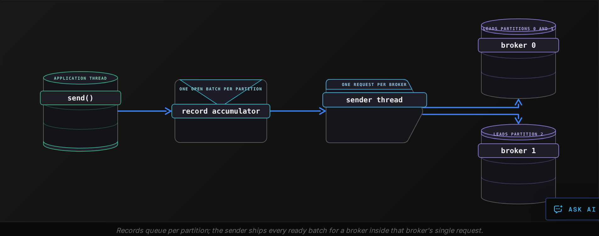
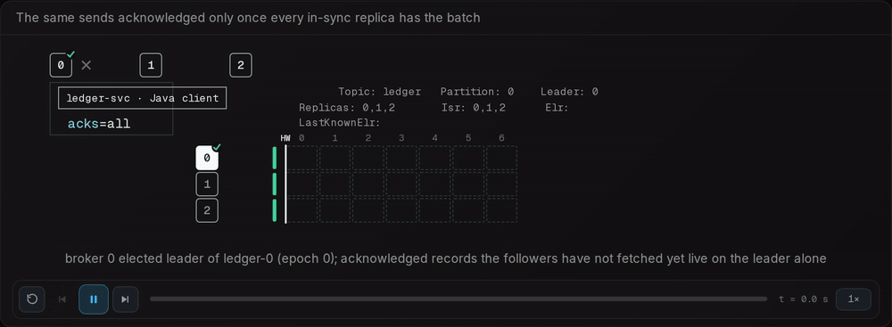

Intermediate·[](https://kafka.apache.org/)·20 min · 9 challenges

# Producers: Intermediate

Midnight at Netflix: a new season drops and devices in every time zone send play events at once, along with pauses and scrubs. One viewer's play event times out waiting on a slow broker. The producer retries, and the viewing-history topic now counts that episode as started twice. Whether that duplicate lands, and whether an acknowledged event can vanish when a broker dies, comes down to producer settings.


<br>

---

## Batching and Linger

[linger.ms](https://kafka.apache.org/44/configuration/producer-configs/#producerconfigs_linger.ms)[batch.size](https://kafka.apache.org/44/configuration/producer-configs/#producerconfigs_batch.size)


<br>

### One request carries many batches

A call to `send()` appends the record to the open batch for its partition in the record accumulator, the producer's buffer. It returns a future before any byte reaches the network. A separate sender thread drains the accumulator: it takes every batch that is ready, groups the batches by the broker that leads their partitions, and sends 1 produce request per broker. A producer writing to 12 partitions led by 3 brokers can ship 12 batches in 3 requests, and the brokers see 3 requests' worth of handling per round instead of 12.




<br>

### Three ways a batch becomes ready

A batch is ready once its bytes reach `batch.size`, which defaults to 16384. It is also ready once `linger.ms` has passed since its first record arrived. There is a third way. When the sender builds a request for a broker, it takes the first batch of every partition that broker leads, even a batch that is neither full nor past its linger. A 3-record batch for partition 3 rides along with a full batch for partition 7 when the same broker leads both, because sending it later would cost a second request. `batch.size` caps 1 batch and a batch never spans 2 partitions, so a partition that receives 1 record a second ships 1-record batches whatever the ceiling says.


<br>

### linger.ms=0 batches under load

`linger.ms=0` tells the sender to ship whatever is ready the moment it looks, which differs from 1 record per request. `max.in.flight.requests.per.connection`, 5 by default, lets the sender keep 5 requests to a broker unanswered; once the 5 slots are full, records pile into the open batch until a response frees a slot. At `linger.ms=0` the batch size is therefore set by how quickly the broker answers. At 1000 records a second to a partition whose broker answers in 10 ms, the 5 slots fill at 500 requests a second, so each request carries about 2 records; a broker that answers in 40 ms allows 125 requests a second and batches of 8. Linger sets a floor under the wait: a batch that would have shipped after 2 ms of accumulation holds on for 20 and ships 10 times larger.

| linger.ms | records per batch | requests a second | longest extra wait |
| --- | --- | --- | --- |
| 0 | 4 | 500 | 10 ms, for a free slot |
| 5 | 10 | 200 | 5 ms |
| 20 | 40 | 50 | 20 ms |
| 100 | 81, capped by batch.size | 25 | 41 ms, the time to fill 16384 bytes |

*The model behind the table: 2000 records a second of 200 bytes each to 1 partition, a broker that answers in 10 ms, and max.in.flight.requests.per.connection at 5.*


The scene holds `max.in.flight.requests.per.connection` at 1, so each batch waits for the answer to the one before it. In it, 8 records arrive 5 ms apart. At `linger.ms=0` the first record leaves alone, the records that land during its round trip leave together behind it, and the run takes more than 1 request. At `linger.ms=40` the first record opens a batch and waits; the other 7 arrive inside the window, and the whole run leaves in 1 request 40 ms after the first record was sent. The first record paid 40 ms for that, the last paid about 5.


<br>

### Who pays the wait, and what it buys

Linger charges each record in a batch a different fee. The first record waits the full `linger.ms`; the last arrives as the batch closes and waits nothing; a record's share of the cost depends on when it showed up. The fee buys fewer requests. A request costs the broker the same work whether it carries 1 record or 400: the broker reads it off the socket and a handler thread appends it. Each batch carries 1 header of 61 bytes on the wire and on disk, shared by every record inside it. A broker handling 50 requests a second of 40 records does a small fraction of the work of one handling 2000 requests of 1 record carrying identical data. More linger keeps helping until batches hit `batch.size` before linger expires; past that point it changes nothing, and the ceiling is the setting to raise.

To predict a change for keyed records, count records per partition per linger window, because the keys split the traffic across partitions before batching sees it. A topic of 60 partitions taking 6000 keyed records a second, spread evenly, gives each partition 100 a second, so a 50 ms linger gathers 5 records a batch, and reaching 100 a batch would need a full second of linger. A topic over-partitioned for its volume ships small batches at any linger, which is one more cost of the partition count you chose. Keyless records behave differently: the default partitioner sends them to 1 partition until about `batch.size` bytes have gone there, then moves on, so their batches fill at the topic's full rate.

> **TIP**
>
> Read the producer metrics `batch-size-avg` and `records-per-request-avg` before changing linger. An average batch already near `batch.size` can't grow from more waiting, and `batch.size` is the setting to raise instead.

| ✓ Do | ✗ Don't |
| --- | --- |
| • Raise linger.ms in steps and watch requests a second fall at each step<br><br>• Size batch.size to what one partition receives inside one linger window<br><br>• Measure delay at the first record of a batch, since it waits longest | • Assume linger.ms=0 means 1 record per request<br><br>• Raise batch.size past what a partition fills before linger expires<br><br>• Add linger to a topic whose partitions each get 1 record a second |


<br>

---

## Compression on the Wire

[compression.type](https://kafka.apache.org/44/configuration/producer-configs/#producerconfigs_compression.type)[End-to-end Batch Compression](https://kafka.apache.org/44/design/design/#end-to-end-batch-compression)


<br>

### The batch is the unit of compression

`compression.type` on the producer takes `none` for no compression, or names one of the codecs `gzip`, `snappy`, `lz4` and `zstd`. The producer compresses records into the batch as it appends them, so the unit of compression is the batch. A codec earns its ratio by finding repeats, and in event data the repeats sit across records rather than inside one: 100 order events share the same field names, the same handful of store ids and the same timestamp prefix. A batch of 100 compresses well. A batch of 1 has nothing to repeat against, and under gzip it comes out larger than it went in, because the codec writes a 10-byte header and an 8-byte trailer of its own around bytes it couldn't shrink.

*The model for the table: each event is 220 bytes, 150 of them structure repeated from one event to the next and 70 that differ. The codec writes the first copy of the structure in full and each later repeat as a 3-byte reference, plus 18 bytes of gzip framing per batch.*

| records in batch | raw bytes | compressed bytes | ratio |
| --- | --- | --- | --- |
| 1 | 220 | 238 | 0.92, larger than raw |
| 10 | 2200 | 895 | 2.5 |
| 100 | 22000 | 7465 | 2.9 |
| 400 | 88000 | 29365 | 3.0 |

Real data beats the model, because the 70 differing bytes repeat partly too: 2 events a second apart share most of their timestamp digits, and a store id that appears in 30 events of 100 is a repeat as well. Measured ratios on event streams run higher than 3 and keep climbing with batch size until the codec's window of memory fills.


<br>

### Where the cost lands

Compression spends CPU on the producer as the batch is built, and the compressed batch is what travels: the produce request is smaller, the leader appends the compressed bytes as they arrived, followers replicate those same bytes, the segment on disk holds them, and a fetch returns them. Each reader of the topic spends CPU to decompress, once per batch per reader. The byte saving therefore multiplies: a batch that shrinks 3 times saves 3 times on the producer's network, 3 times on every replication copy, 3 times on disk for the whole retention window, and 3 times on every consumer fetch. The CPU cost stays with the producer and each reader.

The topic setting `compression.type` defaults to `producer`, which tells the broker to keep whatever codec the producer used. Set it to a named codec instead and the broker decompresses every batch that arrives in a different codec and recompresses it, which moves the CPU cost onto the broker, the one machine in the path that is hardest to scale out. The 1 reason to do it is a fleet of producers you do not control sending uncompressed data to a topic whose disk you pay for.

| codec | ratio on text-like data | speed | level setting, since 3.8 |
| --- | --- | --- | --- |
| gzip | highest of the 4 | slowest to compress | compression.gzip.level, 1 to 9, default 6 |
| snappy | lowest | fast, little CPU | none |
| lz4 | moderate | fastest to decompress | compression.lz4.level, 1 to 17, default 9 |
| zstd | near gzip | between lz4 and gzip | compression.zstd.level, up to 22, default 3 |

```sql
compression.type=zstd
compression.zstd.level=3
linger.ms=20
batch.size=65536
```


<br>

### Why batch size changes the answer

Because the ratio comes from repeats across records, the same codec on the same data gives a different answer at every batch size. The batch size depends on `linger.ms` and `batch.size` as well as on the record rate per partition from the previous section. A producer at `linger.ms=0` shipping 4-record batches may measure gzip at 1.4 times and conclude compression isn't worth the CPU; the same producer at `linger.ms=20` ships 40-record batches and measures 3 times. There's a second coupling. The producer checks `batch.size` against the batch's estimated compressed size, using a ratio it learns from recent batches, so a 16384-byte ceiling with a 3 times ratio holds around 48 KB of raw records. Turning compression on makes batches hold more records, which raises the ratio further. The growth stops when linger expires first or the record rate can't fill the batch.

> Measure 3 numbers together
>
> - `compression-rate-avg` on the producer: compressed bytes over raw bytes, per batch
> - `batch-size-avg`: the compressed bytes per batch that the ratio was measured on
> - Producer-host and reader CPU, measured before and after the change

> **TIP**
>
> Pick the codec on your own payload at the batch size you will run in production, measured by `compression-rate-avg`; a codec test at `linger.ms=0` on 3-record batches tells you around 3-record batches and nothing else.


<br>

---

## Idempotent Producers

[enable.idempotence](https://kafka.apache.org/44/configuration/producer-configs/#producerconfigs_enable.idempotence)[Message Delivery Semantics](https://kafka.apache.org/44/design/design/#message-delivery-semantics)


<br>

### One send, 2 records

A retry is only safe when the first attempt did not land. The case that breaks that assumption is a lost answer. A producer sends a batch with `acks=all`; the leader appends it, then waits for the followers to copy it before answering. One follower is slow, the answer misses `request.timeout.ms`, and the producer, which cannot tell a slow answer from a lost request, sends the batch again. The leader has no memory of the first attempt beyond the bytes in its log, so it appends the batch a second time. The partition now holds the same payment twice, and every reader will see both.


<br>

### A producer id and a sequence number

With `enable.idempotence=true`, the 4.4 default, the producer asks a broker for a producer id on its first send and then stamps every batch with that id and a sequence number. The sequence counts records per partition from 0, so a batch carries its first record's sequence and the leader derives the rest from the record count. The leader keeps, for each producer id on each partition, the sequence ranges of the last 5 batches it appended. A batch whose sequence it already appended is answered with the original offset and appended again never. A batch whose first sequence is higher than the next expected number is rejected with `OutOfOrderSequenceException`, because something before it went missing.

| attempt | batch carries | leader expects | leader does | log after |
| --- | --- | --- | --- | --- |
| 1 | pid 7, seq 0, 3 records | seq 0 | appends at offsets 40 to 42, waits for followers | 40, 41, 42 |
| answer lost |  |  | producer times out, schedules a retry | 40, 41, 42 |
| 2, the retry | pid 7, seq 0, 3 records | seq 3 | finds seq 0 in its window, answers offset 40 | 40, 41, 42 |
| 3, next batch | pid 7, seq 3, 2 records | seq 3 | appends at offsets 43 and 44 | 40 to 44 |


In the scene every attempt reaches the same leader, so the difference lies in what the leader remembers. Without idempotence the leader sees 3 arrivals of the same bytes and appends 3 times; the followers copy all 3 and the partition holds 3 charges of 40.00 for 1 invoice. With idempotence the second and third arrivals carry sequence 0 again, the leader finds sequence 0 already in its window, answers with the offset it wrote the first time, and appends nothing.

Idempotence needs acks=all and a positive retries. It also caps max.in.flight.requests.per.connection at 5, which matches the window the leader keeps. The 4.4 producer applies these for you when the setting is on, and refuses to start with a ConfigException if you set one of them to a conflicting value, such as acks=1.

> What the leader keeps per producer id and partition
>
> - The first sequence and record count of each of the last 5 batches
> - The offset each of those batches landed at, to answer a duplicate with
> - The next sequence it expects, which an arriving batch must not skip past

The window of 5 is also why `max.in.flight.requests.per.connection` is capped at 5 for an idempotent producer. The leader recognises a duplicate only of a batch it still remembers, and with 6 requests in flight the oldest could fall out of the window before its retry arrived, turning a safe retry into a second copy.


<br>

### What the window does not cover

Duplicates idempotence does not stop

- Two calls to send() with the same payload: the producer assigns 2 sequences and the leader appends both.
- A producer process that crashes and restarts: the new process gets a new producer id, so a re-sent record carries a sequence the leader has never seen under that id.
- Two producers sending the same record: each has its own producer id, and the leader deduplicates within 1 id only.

The producer id and sequence travel in the batch header, so they sit in the log on every replica. A follower that becomes leader rebuilds the per-producer state from its own copy of the log, and a retry that arrives at the new leader is deduplicated the same way. The window survives the failure, which matters because a leader change is exactly when retries happen.

> **TIP**
>
> Idempotence costs the leader a small table per producer id and a few bytes per batch header. The 4.4 default turns it on because that cost is near zero and the alternative is a duplicate on every lost answer.


<br>

---

## Ordering Under Retries

[max.in.flight.requests.per.connection](https://kafka.apache.org/44/configuration/producer-configs/#producerconfigs_max.in.flight.requests.per.connection)[retries](https://kafka.apache.org/44/configuration/producer-configs/#producerconfigs_retries)


<br>

### 5 requests in the air

`max.in.flight.requests.per.connection` lets the sender have up to 5 produce requests to 1 broker unanswered at once. Throughput depends on it: 1 in flight means 1 request per round trip, 5 means 5. It also opens a door. Batch A with records 10 to 12 for partition 0 goes out at t=0; batch B with records 13 and 14 for the same partition goes out at t=2 while A is still unanswered. The leader rejects A with `NotEnoughReplicas` because the in-sync set dipped below the minimum for an instant, then the follower rejoins and the leader appends B at t=5. The producer waits out `retry.backoff.ms` and retries A at t=102; the leader appends it at t=105. The partition now reads 13, 14, 10, 11, 12.

| time | producer | leader | log tail |
| --- | --- | --- | --- |
| t=0 | sends A: records 10, 11, 12 |  |  |
| t=2 | sends B: records 13, 14 |  |  |
| t=3 |  | rejects A, NotEnoughReplicas |  |
| t=5 |  | appends B | 13, 14 |
| t=102 | resends A after the backoff |  | 13, 14 |
| t=105 |  | appends A | 13, 14, 10, 11, 12 |

A reader of this partition sees record 13 before record 10. If those are 2 updates to the same account, the older one applies last and wins. Nothing was lost and nothing was duplicated; the log holds every record once, in an order the producer never sent. Order within a partition is the promise Kafka makes, and this scene breaks it from the producer's side.


<br>

### Fix 1: one request at a time

Setting `max.in.flight.requests.per.connection=1` closes the door with no help from the broker: B can't leave until A is answered, so a rejected A is retried before B ever goes. The price is throughput per broker connection, which falls to 1 request per round trip. A producer whose broker answers in 10 ms is capped at 100 requests a second per broker. How many records each of those 100 carries is then up to linger and `batch.size`. Producers that wanted order with retries before idempotence existed ran this way and paid for it.


<br>

### Fix 2: let the leader refuse the overtaker

The idempotent producer keeps order at 5 in flight because the leader checks sequences exactly. Say this producer has already sent 10 records to partition 0, so A's first sequence is 10 and B's is 13, matching the record labels. The leader rejects A as before. When B arrives, the leader is expecting sequence 10. It finds 13 and rejects B with `OutOfOrderSequenceException` instead of appending it. The producer reads that as a signal to retry in sequence order: it re-queues A ahead of B, sends A, waits for A's acknowledgement, then sends B. The log ends with 10 through 14 in order, and at every other moment up to 5 requests stay in flight.

```sql
enable.idempotence=true
acks=all
max.in.flight.requests.per.connection=5
retries=2147483647
delivery.timeout.ms=120000
```


<br>

### How long a retry keeps trying

`delivery.timeout.ms` bounds the retrying, with `retries` left at its default. The 4.4 producer retries until that budget, 120000 ms by default, runs out, measured from the moment `send()` returned, and the budget covers linger, every attempt's `request.timeout.ms` of 30000 and every `retry.backoff.ms` between attempts. A batch still unacknowledged when the budget ends fails with a `TimeoutException` to the application, and the batches behind it in the same partition continue with their sequences adjusted so the gap does not block them.

Order was only ever promised inside 1 partition. Records with different keys that land on different partitions are appended by different leaders with no clock between them, and a reader of partition 2 may see a record sent at t=9 before a reader of partition 0 sees one sent at t=8. The settings in this section keep the sequence a producer sent to 1 partition; a workload that needs 2 records in order puts them under 1 key.

> **TIP**
>
> A producer running `enable.idempotence=false` with more than 1 request in flight has no ordering guarantee under retries. Whenever you turn idempotence off, lower `max.in.flight.requests.per.connection` to 1 in the same change.

| ✓ max.in.flight=1, idempotence off | ✗ Idempotent, max.in.flight=5 |
| --- | --- |
| • 1 request outstanding per broker<br><br>• Order kept by never letting a second request leave<br><br>• Throughput capped at 1 request per round trip<br><br>• No sequence checks on the broker | • Up to 5 requests outstanding per broker<br><br>• Order kept by the leader rejecting a batch whose sequence skips ahead<br><br>• Throughput of up to 5 requests per round trip<br><br>• Needs acks=all and a producer id |


<br>

---

## The Durability Contract

[acks](https://kafka.apache.org/44/configuration/producer-configs/#producerconfigs_acks)[min.insync.replicas](https://kafka.apache.org/44/configuration/topic-configs/#topicconfigs_min.insync.replicas)


<br>

### acks names who must hold the record

`acks` sets how many copies exist when the producer counts a send as done. With `acks=0` the producer counts it done when the bytes leave the socket, so a leader that dies while the request is in the air loses the record and the producer never hears. With `acks=1` the leader answers after appending to its own log, before any follower has fetched the batch; if the leader dies in that gap, the new leader is a follower that never got the record, and the record is gone after the producer was told it was safe. With `acks=all`, the 4.4 default, the leader answers only when every replica in the in-sync set has appended the batch, which is the moment the high watermark passes it.

| acks | leader answers when | lost if | wait per request |
| --- | --- | --- | --- |
| 0 | nothing is awaited | the socket drops or the leader dies with it in flight | none |
| 1 | its own append completes | the leader dies before a follower fetches | 1 round trip |
| all | every in-sync replica has appended | every in-sync replica dies | 1 round trip plus the slowest in-sync follower's fetch |

`acks=0` has a place: a stream of sensor samples where the next reading replaces the last, sent by a producer that must never wait on the cluster. Everywhere a record is a fact rather than a sample, it's the wrong setting.


<br>

### min.insync.replicas puts a floor under all

`acks=all` waits for the in-sync set, and the in-sync set shrinks when followers fall behind. A topic with 3 replicas whose 2 followers both fell out of sync has an in-sync set of 1, and `acks=all` then means the leader alone, the same promise as `acks=1`. `min.insync.replicas` on the topic sets the smallest in-sync set the leader will accept an `acks=all` write with. At 2, a leader whose in-sync set has dropped to itself rejects the batch with `NotEnoughReplicas`. That error is retriable, so the producer retries until a follower catches up or `delivery.timeout.ms` expires. The count includes the leader, so 2 means the leader plus 1 follower.

A sibling error, `NotEnoughReplicasAfterAppend`, arrives when the in-sync set shrank after the leader appended the batch. The record sits in the leader's log unacknowledged, and the retry that follows is exactly the retry the previous sections made safe: the idempotent leader answers it from the window without a second append.

| replicas | min.insync.replicas | acks | replica brokers down before writes stop | can an acked record vanish when 1 broker dies? |
| --- | --- | --- | --- | --- |
| 3 | 1 | 1 | 2 | yes, if the leader dies before a follower fetches |
| 3 | 1 | all | 2 | yes, once the in-sync set has shrunk to the leader |
| 3 | 2 | all | 1 | no |
| 3 | 3 | all | 0 | no, and any single failure stops writes |
| 2 | 2 | all | 0 | no, and any single failure stops writes |

The row to run is 3 replicas, `min.insync.replicas=2`, `acks=all`. Any 1 broker can die and the partition keeps taking writes, because 2 in-sync copies remain; and every acknowledged record sits on at least 2 brokers, so the death of 1 can't remove it. Lose 2 of the 3 and writes stop rather than proceed on a single copy, which is the point: the producer gets an error it can retry instead of an acknowledgement it can't trust.



Set the floor on the topic so each topic states its own contract: bin/kafka-configs.sh --bootstrap-server broker0:9092 --alter --entity-type topics --entity-name payments --add-config min.insync.replicas=2. A topic created without it inherits the broker's min.insync.replicas, which defaults to 1.


<br>

### The contract has 3 parties

The producer's `acks`, the topic's `min.insync.replicas` and the topic's replication factor are 3 settings owned by 3 people, and the promise holds only when all 3 agree. A producer at `acks=all` writing to a topic with `min.insync.replicas=1` has a contract of 1 copy the moment a follower lags. A topic at `min.insync.replicas=2` written by a producer at `acks=1` never consults the floor, because the leader checks the floor only for `acks=all` requests. A topic with 2 replicas and `min.insync.replicas=2` holds the promise but stops writing the moment either broker restarts for an upgrade.

Readers close the loop. A consumer fetches up to the high watermark, and the high watermark advances only when every in-sync replica has the record, so a record acknowledged under `acks=all` with a floor of 2 is readable the instant the producer hears back and sits on 2 brokers when it's read. A record acknowledged under `acks=1` becomes readable only when the followers catch up, and if the leader dies first it never does.

| ✓ Do | ✗ Don't |
| --- | --- |
| • Set acks=all and min.insync.replicas=2 on every topic whose records you cannot replay<br><br>• Keep the replication factor 1 above min.insync.replicas so 1 restart doesn't stop writes<br><br>• Treat NotEnoughReplicas alerts as the floor doing its job, and page on them | • Rely on acks=all alone while min.insync.replicas sits at 1<br><br>• Set min.insync.replicas equal to the replication factor on a topic that must stay writable<br><br>• Read acks=1 throughput figures as the cost of acks=all |


<br>

---

## Putting It All Together

Take the Netflix season launch from the opening and design the producer that carries its play events, keyed by profile. A short linger lets the brokers see a request per few dozen events rather than per event; zstd on those batches keeps replication traffic within the network the cluster has; idempotence means the retry after a slow follower does not count one play twice; 5 requests in flight with the leader enforcing sequence order keeps a pause and the resume after it in the order the viewer pressed them; and acks=all to a topic of 3 replicas at min.insync.replicas=2 means a broker lost during the launch takes no acknowledged event with it.

- The linger that groups play events into batches is also what gives zstd enough repeats to shrink them, so the 2 settings are tuned together.
- The leader deduplicates whole compressed batches, the same units it stores and replicates, so the producer id and sequence ride on the same header that the codec bit lives in.
- The slow follower that delays an acks=all answer is the same follower min.insync.replicas waits for, and the retry it causes is the one idempotence makes safe.
- Order under retries and durability under failure both depend on the leader refusing a write, once for a skipped sequence and once for a shrunken in-sync set.
- Every setting in the lesson trades a few milliseconds of producer latency for something: fewer requests and bytes, or duplicates, reordering and loss ruled out. The contract holds only when the producer's settings match what the topic and cluster are configured for.


<br>

---

## Key Takeaways

- The sender ships 1 request per broker holding every ready batch, and linger.ms sets how long a partial batch waits to grow.
- linger.ms=0 still batches under load, because records accumulate while the 5 in-flight slots to a broker are full.
- Compression works on the batch, so its ratio rises with batch size and its CPU cost lands on the producer and on each reader.
- An idempotent producer stamps each batch with a producer id and sequence, and the leader answers a repeated sequence without appending it.
- With 5 requests in flight a retried batch can land behind the batch sent after it; idempotence keeps order by rejecting the overtaker, max.in.flight=1 keeps it by never sending one.
- An acknowledged record survives 1 broker failure when acks=all meets a min.insync.replicas of at least 2; 3 replicas at min.insync.replicas=2 also keeps taking writes through that failure.

[](https://kafka.apache.org/)

Official Apache Kafka resourcesversion 4.4

"Apache Kafka is an open-source distributed event streaming platform used by thousands of companies for high-performance data pipelines, streaming analytics, data integration, and mission-critical applications." [kafka.apache.org](https://kafka.apache.org/)

[Documentation](https://kafka.apache.org/44/)[Quickstart](https://kafka.apache.org/quickstart/)[Download](https://kafka.apache.org/community/downloads/)[Community](https://kafka.apache.org/community/)

In the documentation

Batching and Linger
:   [linger.ms](https://kafka.apache.org/44/configuration/producer-configs/#producerconfigs_linger.ms)[batch.size](https://kafka.apache.org/44/configuration/producer-configs/#producerconfigs_batch.size)

Compression on the Wire
:   [compression.type](https://kafka.apache.org/44/configuration/producer-configs/#producerconfigs_compression.type)[End-to-end Batch Compression](https://kafka.apache.org/44/design/design/#end-to-end-batch-compression)

Idempotent Producers
:   [enable.idempotence](https://kafka.apache.org/44/configuration/producer-configs/#producerconfigs_enable.idempotence)[Message Delivery Semantics](https://kafka.apache.org/44/design/design/#message-delivery-semantics)

Ordering Under Retries
:   [max.in.flight.requests.per.connection](https://kafka.apache.org/44/configuration/producer-configs/#producerconfigs_max.in.flight.requests.per.connection)[retries](https://kafka.apache.org/44/configuration/producer-configs/#producerconfigs_retries)

The Durability Contract
:   [acks](https://kafka.apache.org/44/configuration/producer-configs/#producerconfigs_acks)[min.insync.replicas](https://kafka.apache.org/44/configuration/topic-configs/#topicconfigs_min.insync.replicas)

Further
:   [KIP-679 Strongest Delivery Guarantee by Default](https://cwiki.apache.org/confluence/display/KAFKA/KIP-679%3A+Producer+will+enable+the+strongest+delivery+guarantee+by+default)[KIP-98 Exactly Once Delivery](https://cwiki.apache.org/confluence/display/KAFKA/KIP-98+-+Exactly+Once+Delivery+and+Transactional+Messaging)

Apache Kafka, Kafka, and the Kafka logo are either registered trademarks or trademarks of The Apache Software Foundation in the United States and other countries.
