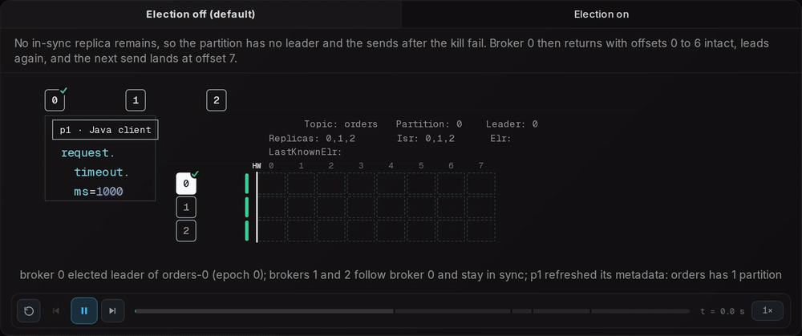
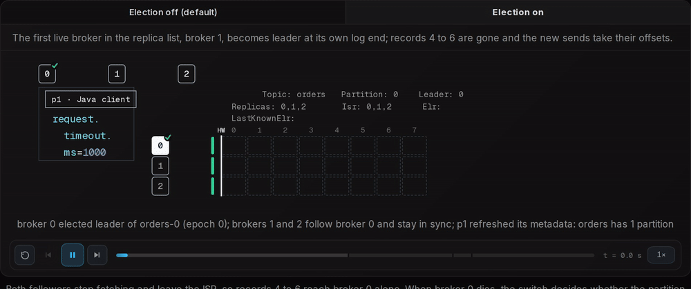
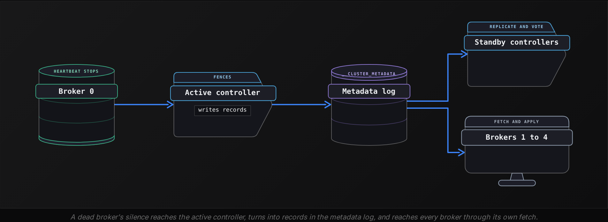

Advanced·[](https://kafka.apache.org/)·20 min · 7 challenges

# Replication: Advanced

It is 3:14 am at LinkedIn, and a rack in one datacenter has lost power. The partition holding members' feed events has no in-sync replica left. The on-call engineer can wait for the rack to come back, or hand leadership to a replica that stopped 40 seconds ago and lose those records. The settings in this lesson decide which she picks, and what the feed shows next.


<br>

---

## Unclean Leader Election

[unclean.leader.election.enable](https://kafka.apache.org/44/configuration/topic-configs/#topicconfigs_unclean.leader.election.enable)[Eligible Leader Replicas](https://kafka.apache.org/44/operations/eligible-leader-replicas/#overview)

A clean election picks the new leader from the in-sync replicas, so the new leader holds every record the old one had committed. That rule has a gap. The ISR can shrink to the leader alone when every follower falls behind, and if that leader then dies, no replica is in sync with it. The controller has 2 options: leave the partition without a leader until the dead broker returns, or make a replica that is missing records the leader. The setting that picks between them is unclean.leader.election.enable.


<br>

### A partition with one replica left in sync

Take partition 3 of orders, replicated on brokers 0, 1 and 2 with broker 0 leading. Both followers sit on a rack whose switch starts dropping packets, their fetches stall, and after replica.lag.time.max.ms the leader removes them from the ISR. Writes keep landing: min.insync.replicas is 1, the ISR is {0}, and the high watermark advances with every record. The log end offsets drift apart.

| Broker | Role | Log end offset | In the ISR |
| --- | --- | --- | --- |
| 0 | leader | 100 | yes |
| 1 | follower | 61 | no |
| 2 | follower | 58 | no |

At offset 100, broker 0 loses power and goes down. Its disk still holds offsets 0 to 99, but no one can read them until the machine boots again. The controller sees a dead leader and an ISR with nobody else in it.


<br>

### Off: wait for the leader

With the setting at its default of false, the controller leaves partition 3 with no leader. Writes to it fail, readers on it get nothing, and the other partitions of orders carry on. When broker 0 comes back with its log intact, it resumes as leader at offset 100, the followers catch up, and every acknowledged record is still there. The price is that this partition stays offline for as long as broker 0 is down.


<br>

### On: promote a stale replica

With the setting at true, the controller makes a replica from outside the ISR the leader. It never sees the replicas' log end offsets, so it does not look for the freshest one. It takes the first live broker in the partition's replica list, here [0, 1, 2], which is broker 1. Broker 1 leads from its own log end, offset 61, and the ISR becomes {1}. Records 61 through 99, all acknowledged, now exist only on broker 0's powered-off disk. Had the list been [0, 2, 1], broker 2 would lead from offset 58 and records 58 to 99 would be lost, 3 more than here, while broker 1 sat holding them. New writes arrive at once and the leader assigns them offsets starting at 61. Offset 80 now names a record written after the failure, and any reader that already consumed the old record 80 holds a value the cluster no longer has.

**Election off (default)**



**Election on**




<br>

### The old leader truncates on return

Broker 0 restarts holding offsets 0 to 99 and finds broker 1 leading with a newer leader epoch. It asks the leader where their logs diverge, learns that the leader's epoch began at offset 61, truncates its own log to offset 61, and fetches the new records from there. The 39 records it had are gone from the cluster for good. A reader whose position sat inside the lost range meets one of 2 outcomes, depending on where that position falls against the new leader's log end. A reader at offset 90 while the log ends at 65 asks for an offset that does not exist, gets an offset-out-of-range error, and must restart from the log's start or its end by whatever rule it was configured with. A reader at offset 63 gets no error at all: it reads on, and records 63 to 65 are ones written after the failure, different from the records it would have read there before. Nothing warns a reader that offsets 61 to 99 now hold different records; the only trace is a jump in the leader epoch, which the broker writes to its own log file.

| Moment | Broker 0 log | Broker 1 log | Readable range |
| --- | --- | --- | --- |
| before the crash | 0 to 99 | 0 to 60 | 0 to 99 |
| after the unclean election | offline | 0 to 60 | 0 to 60 |
| after 5 new writes | offline | 0 to 65 | 0 to 65 |
| broker 0 rejoins | 0 to 65, truncated | 0 to 65 | 0 to 65 |

| ✓ Election off (default) | ✗ Election on |
| --- | --- |
| • The partition stays offline until a replica with the full log returns<br><br>• Every acknowledged record survives<br><br>• Writers and readers of that partition wait | • A new leader is chosen within seconds<br><br>• Records only the dead leader held are dropped<br><br>• Offsets past the divergence point are reassigned to new records |


<br>

### Choosing per topic

The setting is a topic config and overrides the broker default. A topic of page-view counts can run with it on, since a gap of 40 records costs a dashboard a blip. A topic of payments runs with it off and accepts the outage. You can also leave it off everywhere and trigger a single unclean election by hand when the wait has gone on too long: kafka-leader-election.sh --bootstrap-server b1:9092 --election-type UNCLEAN --topic orders --partition 3. That choice is yours at the moment, rather than the controller's by rule.

```sql
unclean.leader.election.enable = TRUE
```

> **TIP**
>
> An unclean election can lose records only because the ISR shrank to 1 first. With `min.insync.replicas` at 2, writers using `acks=all` are refused while the ISR is that small, so their at-risk records were never acknowledged. A writer using `acks=1` is acknowledged by the leader alone, so its records can still be acknowledged and then lost.


<br>

---

## KRaft Controllers

[Controllers](https://kafka.apache.org/44/operations/kraft/#controllers)[Process Roles](https://kafka.apache.org/44/operations/kraft/#process-roles)

Every election in the last section was carried out by a controller: the one part of the cluster that holds the list of every partition's replicas, leader and ISR, and that writes down a new leader when a broker dies. In Apache Kafka 4.4 that controller runs as a small quorum of its own, using the Raft protocol, and keeps its metadata in a log that works like any partition you have read so far. The name for this is KRaft.


<br>

### The roles a node can declare

Each node declares process.roles: controller, broker, or broker,controller for both on one process. Controllers form the quorum; brokers hold topic partitions. Running both on 1 process suits a laptop, and a production cluster keeps them on separate machines so that a broker drowning in fetches never delays an election.

```sql
process.roles=controller
node.id=1
listeners=CONTROLLER://ctl-1:9093
controller.listener.names=CONTROLLER
controller.quorum.bootstrap.servers=ctl-1:9093,ctl-2:9093,ctl-3:9093
log.dirs=/var/lib/kafka/metadata
```

A broker's file names the same bootstrap list under process.roles=broker, which is how it finds the quorum. Each node is formatted once with kafka-storage.sh format, which stamps the cluster id into its log directory, and a controller formatted with --initial-controllers joins as a voter from the start.


<br>

### The metadata log

The quorum's state is a topic named __cluster_metadata with 1 partition, held by every controller. One controller is its leader, called the active controller, and the others replicate it as followers, with the same fetch loop a topic partition uses. A record in it counts as committed once a majority of the voters have written it: 2 of 3, or 3 of 5. Each record describes one change: a topic created, a partition's ISR shrinking, a broker registering, a leader changing. Replaying the log from the start rebuilds the whole cluster's metadata, which is what a controller does when it boots, and it snapshots the log periodically so that the replay stays short.

| Record | What it says |
| --- | --- |
| RegisterBrokerRecord | broker 4 at b4:9092, rack us-east-1b, fenced |
| TopicRecord | topic orders, id 7f3e |
| PartitionRecord | orders-3 replicas [0,1,2] isr [0,1,2] leader 0 epoch 12 |
| PartitionChangeRecord | orders-3 isr [0] leader 0 epoch 13 |
| PartitionChangeRecord | orders-3 isr [1] leader 1 epoch 14 |


<br>

### Fencing a dead broker

Each broker sends a heartbeat to the active controller on a fixed interval, and when the controller has heard nothing for longer than the session timeout it fences the broker: it writes a record marking it fenced, then one PartitionChangeRecord per partition that broker led, naming a new leader from each ISR. Those records commit once a majority of controllers hold them. Each broker learns by fetching: it runs a fetch against the metadata log, exactly as a follower fetches a partition, and applies every new record it reads. A broker finds out it has become leader of orders-3 by reading that fact from the log.

- **2 s** — between a broker's heartbeats
- **9 s** — of silence before fencing




<br>

### Watching the quorum

kafka-metadata-quorum.sh --bootstrap-server b1:9092 describe --status prints the active controller and how far each voter has replicated:

| Field | Value |
| --- | --- |
| LeaderId | 2 |
| LeaderEpoch | 31 |
| HighWatermark | 48211 |
| MaxFollowerLag | 0 |
| CurrentVoters | [1, 2, 3] |
| CurrentObservers | [10, 11, 12] |

Brokers appear as observers: they replicate the log without a vote. A standby whose lag climbs is one that would lose records if it won an election, and the Raft rule refuses to elect it, since a candidate wins only with votes from a majority whose logs are no longer than its own. That rule is why the controller never has an unclean election of its own. Losing a minority of controllers costs nothing. Losing a majority stops the cluster from changing metadata until enough return: existing leaders keep serving reads and writes, and every election, topic creation and ISR change waits.

> Growing and shrinking the quorum
>
> - Format the new controller with the cluster id, start it, then run kafka-metadata-quorum.sh add-controller on it to turn it from observer into voter
> - Before running kafka-metadata-quorum.sh remove-controller, check with describe --replication that the voters staying are caught up, and prefer removing one that is not the active controller
> - Add or remove 1 voter at a time so a majority is always well defined
> - Keep an odd count: 4 voters survive the same single loss as 3 and need 3 to agree instead of 2


<br>

---

## Moving Partitions

[Expanding your cluster](https://kafka.apache.org/44/operations/basic-kafka-operations/#expanding-your-cluster)[Automatically migrating data to new machines](https://kafka.apache.org/44/operations/basic-kafka-operations/#automatically-migrating-data-to-new-machines)

Adding broker 4 to a cluster of 3 changes nothing on its own. Every existing partition keeps its replica set, broker 4 holds nothing, and only partitions created after it joined can land there. To spread the load, you move partitions, which means telling the controller a new replica set for each one and letting the new replica copy the whole partition from the leader while the topic keeps serving.


<br>

### The reassignment tool

kafka-reassign-partitions.sh runs in 3 steps. --generate takes a list of topics and a --broker-list and proposes a spread, --execute submits a reassignment file, and --verify reports which partitions have finished and clears the throttles it set. The file names the target replica set per partition:

```sql
{
  "version": 1,
  "partitions": [
    {
      "topic": "orders",
      "partition": 3,
      "replicas": [
        1,
        2,
        4
      ],
      "log_dirs": [
        "any",
        "any",
        "any"
      ]
    },
    {
      "topic": "orders",
      "partition": 7,
      "replicas": [
        2,
        4,
        0
      ],
      "log_dirs": [
        "any",
        "any",
        "any"
      ]
    }
  ]
}
```

The first entry of replicas is the preferred leader, so the file also decides who leads once the move finishes. log_dirs can name a specific disk on the broker instead of any, which is how a partition is moved from a full disk to an empty one on the same machine.


<br>

### The controller's steps during a move

For orders-3, moving from [0, 1, 2] to [1, 2, 4], the controller records broker 4 as an adding replica and broker 0 as a removing replica. The partition's replica set becomes [0, 1, 2, 4] for the duration. Broker 4 opens a fetch against the leader at the leader's log start offset and copies every segment, while the ISR stays {0, 1, 2} and writes are unaffected. When broker 4 is caught up, the leader adds it to the ISR. The controller then drops broker 0 from the replica set and the ISR, moves leadership to broker 1 because broker 0 was leading, and broker 0 deletes its copy. While broker 4 copies and sits outside the ISR, no write waits for it. Once it joins the ISR it counts like any other in-sync replica, and a write that is acknowledged only when every in-sync replica has it waits for broker 4 too.

| Moment | Replicas | ISR | Leader |
| --- | --- | --- | --- |
| before execute | [0, 1, 2] | {0, 1, 2} | 0 |
| copying | [0, 1, 2, 4] | {0, 1, 2} | 0 |
| broker 4 caught up | [0, 1, 2, 4] | {0, 1, 2, 4} | 0 |
| done | [1, 2, 4] | {1, 2, 4} | 1 |


<br>

### The cost of a move

A moving replica reads the whole partition over the network and writes it to a new disk. A 400 GB partition is 400 GB of reads from the leader's disk, 400 GB across the network and 400 GB of writes, on top of the traffic the topic already carries. Unthrottled, that copy competes with the leader's followers and with the writers sending to it. The tool takes --throttle in bytes per second, which sets leader.replication.throttled.rate and follower.replication.throttled.rate on the brokers involved and lists only the moving replicas as throttled on the topic, so in-sync followers are never slowed.

| Partition size | Throttle | Copy time |
| --- | --- | --- |
| 400 GB | 50 MB/s | 2 h 13 min |
| 400 GB | 200 MB/s | 33 min |
| 2 TB | 100 MB/s | 5 h 33 min |

The copy must also outrun the writers. A partition taking in 20 MB/s under a 50 MB/s throttle closes the gap at 30 MB/s, and a throttle below the write rate never finishes. Running --verify after the move clears the throttle settings. Skipping it leaves the throttled-replica lists on the topic and the rate settings on the brokers in place, so replication of those replicas stays capped at the old rate, and any later move that reuses them crawls at that rate too. On a topic with tiered storage, the new replica copies only the local segments and reads the remote ones from the object store when asked, which makes the move as cheap as the local retention.


<br>

### Changing your mind

A move in flight can be stopped with --cancel, which removes the adding replicas and leaves the originals in place; the copied bytes are discarded. Submitting a second file for a partition already moving replaces its target. A move is also how a replication factor is raised, by naming 4 brokers where there were 3, or lowered, by naming 2.

| ✓ Do | ✗ Don't |
| --- | --- |
| • Move a few partitions at a time and watch progress with verify<br><br>• Pick a throttle above the partition's write rate<br><br>• Run verify once every partition reports complete, to clear the throttles<br><br>• Generate a plan first and read it before executing | • Move every partition in one file on a busy cluster<br><br>• Start a move without a throttle on a leader already near its disk limit<br><br>• Forget that the new replica copies every retained byte from the start<br><br>• Assume a new broker fills up on its own |


<br>

---

## Mirroring to Another Cluster

[Geo-Replication Overview](https://kafka.apache.org/44/operations/geo-replication-cross-cluster-data-mirroring/#geo-replication-overview)[What Are Replication Flows](https://kafka.apache.org/44/operations/geo-replication-cross-cluster-data-mirroring/#what-are-replication-flows)

Replication protects a partition against a broker dying. It does nothing when the whole cluster goes: a region's power, a bad configuration push, a disk corruption that every replica copied. For that, a second cluster in another place holds a copy of the topic, written by a mirror. Apache Kafka ships one as MirrorMaker 2, started with connect-mirror-maker.sh and a properties file.


<br>

### A reader on one side, a writer on the other

The mirror is a client of both clusters. It reads records from the source cluster's partitions, as any reader does, and writes each to the target cluster, as any writer does, remembering how far it has read. Because it is an ordinary client, it is asynchronous: a record acknowledged on the source is on the target only after the mirror has fetched and written it, so the target trails by the mirror's lag. It also delivers at least once: if the mirror crashes after writing a record but before saving its position, it writes that record again on restart.

| Setting in mm2.properties | Value | What it does |
| --- | --- | --- |
| clusters | east,west | names the 2 clusters by alias |
| east.bootstrap.servers | east-b1:9092,east-b2:9092 | where the mirror reaches east |
| west.bootstrap.servers | west-b1:9092,west-b2:9092 | where the mirror reaches west |
| east->west.enabled | true | turns on the flow from east to west |
| east->west.topics | orders,payments | the topics that flow copies |
| replication.factor | 3 | replication factor of the topics it creates on west |
| sync.topic.configs.enabled | true | copies topic configs such as retention |
| offset.lag.max | 100 | how many records apart offset syncs are written |
| offset-syncs.topic.location | target | keeps the offset syncs on west |


<br>

### Topic names and offsets on the target

Topic orders on east appears on west as east.orders, with the same partition count and each record in the same partition number it had at the source. The prefix is the source cluster's alias and does 2 jobs: a reader on west can tell local records from mirrored ones, and a mirror running the other way, west to east, skips any topic whose prefix names east, so 2 clusters can mirror each other without a record circling forever. Topic configs such as retention are copied too, so the mirror's log is cleaned by the same rules as the source.

east: orders, partition 3

| offset | key | value |
| --- | --- | --- |
| 1200 | c-41 | order 9001 |
| 1201 | c-17 | order 9002 |
| 1202 | c-41 | order 9003 |
| 1203 | c-08 | order 9004 |

west: east.orders, partition 3

| offset | key | value |
| --- | --- | --- |
| 877 | c-41 | order 9001 |
| 878 | c-17 | order 9002 |
| 879 | c-41 | order 9003 |

The offsets differ. The mirror started copying after the source had deleted its early segments, so the target's first offset was paired with a much later source offset, and that difference at the start explains the 323 gap. Each duplicate the mirror wrote since then narrowed the gap by 1, since a duplicate takes a target offset of its own. Order 9004 is on east and has not reached west yet: that is the mirror's lag, and it is what a failover loses.


<br>

### Failing a reader over

A reader of orders on east keeps its position as a source offset, say 1202. On west that number means nothing, since offset 1202 of east.orders is a different record, if it exists at all. The mirror solves this by writing offset syncs: a record, on a topic of its own named mm2-offset-syncs.west.internal, pairing a source offset with the target offset the same record received, written whenever the pair has moved by offset.lag.max records. That topic lives on the source cluster by default, which is useless when the source is the cluster that died, so a mirror built for failover sets offset-syncs.topic.location=target to keep it on west. To fail over, the reader finds the latest sync whose source offset is at or below its own, and starts from that sync's target offset.

| Sync | Source offset | Target offset |
| --- | --- | --- |
| 1 | 1000 | 677 |
| 2 | 1100 | 777 |
| 3 | 1200 | 877 |

A reader stopped at source offset 1202 takes sync 3 and starts at target offset 877, which is order 9001. It rereads 2 records it had already processed, 9001 and 9002, before reaching new ground at 9003. A reader at 1095 takes sync 1 and rereads 95. The reread is bounded by the sync spacing, and a reader that cannot tolerate duplicates keeps its own record of what it has processed. Then there is 9004: written to east, acknowledged, and absent from west. If east never returns, it is lost. If east returns, it sits in east's log at offset 1203, and nothing moves it to west on its own, since failing back is a second migration in the other direction.

> What a reader changes to fail over
>
> - Its bootstrap servers: west's brokers instead of east's
> - Its topic name: east.orders, keeping the same partition number
> - Its starting offset: translated through the latest offset sync, never copied as is
> - Its tolerance: up to offset.lag.max records arrive a second time
> - Its expectations: records inside the mirror's lag at the moment east died are not there

Mirror lag is the figure to watch. The mirror reports how far behind each partition it is, in records, and at a source taking 10,000 records a second, a lag of 2 seconds is the count of acknowledged records a failover at that moment drops.

- **20,000** — records dropped by that failover


<br>

### Mirroring through an unclean election

The mirror takes the source's offsets at their word, so a source partition that reuses offsets, as an unclean election does, damages the copy in 3 ways. Say the mirror had copied source offsets up to 89 when a stale replica took over leading from offset 61. First, the target keeps the old records 61 to 89: the mirror never deletes what it has written, so west holds records east has lost for good. Second, the mirror's read position now sits among reused offsets, and where it resumes decides what follows: from the divergence point, the new records 61 onward are copied after the old ones and the target holds both versions; from its old position, the new records below 90 never reach the target. Third, the syncs written before the rewind still pair source offsets 61 to 89 with target offsets of the lost records, and syncs written after it pair the same source numbers with new target offsets, so a source position in that range can translate to the wrong target record. Nothing on either cluster flags this, which is a reason to keep unclean election off on any topic mirrored for failover.

*Readers that keep their positions on the cluster itself can have the mirror translate them in bulk; that mechanism belongs to a later lesson on consumer groups.*


<br>

---

## Reading the Nearest Replica

[replica.selector.class](https://kafka.apache.org/44/configuration/broker-configs/#brokerconfigs_replica.selector.class)[client.rack](https://kafka.apache.org/44/configuration/consumer-configs/#consumerconfigs_client.rack)

By default every read of a partition goes to its leader, wherever it sits. With replicas spread across 3 zones, a leader in zone a serves readers in zones b and c across zone boundaries, which cloud providers bill per gigabyte and which adds milliseconds to each fetch. The replicas in b and c hold the same committed records and do nothing with them but wait. Since KIP-392, a reader can fetch from the follower in its own zone instead.


<br>

### Broker and reader settings

The broker needs replica.selector.class set to the rack-aware selector and a broker.rack naming its zone, which rack-aware placement already requires. The reader sets client.rack to the zone it runs in. On the reader's first fetch, the leader answers with no records and a preferred read replica, the follower whose rack matches; the reader sends its next fetches there.

```sql
broker.rack=us-east-1b
replica.selector.class=org.apache.kafka.common.replica.RackAwareReplicaSelector
```

```sql
client.rack = us - east - 1 b
```


<br>

### How far behind a follower reads

A follower serves only up to its own high watermark, and it learns the leader's high watermark one fetch late: the leader advances it when every in-sync replica has fetched a record, and tells the followers in the response to their next fetch. A record committed at the leader at 10:00:00.000 becomes readable from the leader at once and from the follower after the follower's next round trip, which is bounded by replica.fetch.wait.max.ms, 500 ms by default, plus the network.

| Time | Leader HWM | Follower HWM | Reader in zone a | Reader in zone b |
| --- | --- | --- | --- | --- |
| 10:00:00.000 | 500 | 500 | up to 499 | up to 499 |
| 10:00:00.120 record 500 fetched by followers | 500 | 500 | up to 499 | up to 499 |
| 10:00:00.121 leader advances | 501 | 500 | up to 500 | up to 499 |
| 10:00:00.260 follower's next fetch returns | 501 | 501 | up to 500 | up to 500 |

Two readers of the same partition in different zones therefore see each record at different moments, around 140 ms apart in this table and up to half a second in a quiet partition. They never see different records at an offset, and never a record the leader has not committed, because the follower's high watermark never passes the leader's. The order inside the partition is unchanged. What changes is that latest means something different for each reader: the end of the log as the follower knows it.


<br>

### Falling back to the leader

The leader picks the follower only from the ISR, so a reader is never pointed at a replica that fell behind. If the chosen follower then drops out of the ISR or dies, the reader's fetch fails, it goes back to the leader, and the leader names a new preferred replica or serves the reader itself. Every metadata.max.age.ms, 5 minutes by default, the reader asks the leader again, which lets the leader move it after a reassignment puts a replica in its zone. If no replica shares the reader's rack, it reads from the leader as before. Writes are untouched: a follower never accepts a record, so the reader's zone decides where its reads go and nothing about where writes go.

| Setup, 3 zones, 100 MB/s of reads in each | Cross-zone read traffic | Cross-zone replication traffic |
| --- | --- | --- |
| every reader fetches from the leader | 200 MB/s | 2 times the write rate |
| each reader fetches from its zone's replica | 0 MB/s | 2 times the write rate |

> **TIP**
>
> A reader that measures how far it sits behind the log end will look a few records behind while reading from a follower, since the follower's end sits below the leader's. Measure against the replica you read from, or accept a steady offset of a few hundred milliseconds.


<br>

---

## Putting It All Together

Picture Uber's trip events during an evening rush in one region. A rack fails and takes the last in-sync replica of a busy partition with it; the controller quorum, down to 2 of 3 voters, still commits the decision to leave it leaderless because the topic refuses unclean election. Trip readers in the other 2 zones were fetching from local followers, so their last visible offset sits a fetch behind the dead leader's. Meanwhile the mirror in the second region trails by 3 seconds, and the on-call decides whether to fail over the pricing readers to it or wait 4 minutes for the rack.

- The unclean election setting and the quorum's majority rule are the same trade from 2 sides: the partition chooses availability or durability per topic, while the controller always chooses durability and waits for a majority.
- Followers that serve reads and the mirror that copies records both show a reader a committed log slightly behind the leader, by a fetch in one case and by the mirror's lag in the other, and neither ever shows an uncommitted record.
- Failing over to the mirror and moving a partition to a new broker both end with the reader on a different replica of the same data, and both require offsets to be looked up anew rather than assumed.
- After the rack returns, a reassignment onto replacement hardware and a fresh rack-aware placement restore the local follower each zone's readers were fetching from.


<br>

---

## Key Takeaways

- Unclean leader election trades acknowledged records for availability: a stale replica leads, the old leader truncates on return, and offsets past the divergence point name new records.
- The controller is a Raft quorum writing to the __cluster_metadata log; brokers learn every leadership change by fetching that log, and a lost majority freezes metadata changes without stopping existing leaders.
- Moving a partition copies every retained byte to the new replica while the ISR keeps serving; the throttle decides how long it takes, and verify clears the throttle afterwards.
- A mirror is a reader on the source and a writer on the target, so the copy lags, delivers at least once, and lives at different offsets; a failing-over reader translates its position through offset syncs.
- Reading from a follower in your zone removes cross-zone read traffic and shows committed records one fetch later than the leader does, with no change to order or to where writes go.

[](https://kafka.apache.org/)

Official Apache Kafka resourcesversion 4.4

"Apache Kafka is an open-source distributed event streaming platform used by thousands of companies for high-performance data pipelines, streaming analytics, data integration, and mission-critical applications." [kafka.apache.org](https://kafka.apache.org/)

[Documentation](https://kafka.apache.org/44/)[Quickstart](https://kafka.apache.org/quickstart/)[Download](https://kafka.apache.org/community/downloads/)[Community](https://kafka.apache.org/community/)

In the documentation

Unclean Leader Election
:   [unclean.leader.election.enable](https://kafka.apache.org/44/configuration/topic-configs/#topicconfigs_unclean.leader.election.enable)[Eligible Leader Replicas](https://kafka.apache.org/44/operations/eligible-leader-replicas/#overview)

KRaft Controllers
:   [Controllers](https://kafka.apache.org/44/operations/kraft/#controllers)[Process Roles](https://kafka.apache.org/44/operations/kraft/#process-roles)

Moving Partitions
:   [Expanding your cluster](https://kafka.apache.org/44/operations/basic-kafka-operations/#expanding-your-cluster)[Automatically migrating data to new machines](https://kafka.apache.org/44/operations/basic-kafka-operations/#automatically-migrating-data-to-new-machines)

Mirroring to Another Cluster
:   [Geo-Replication Overview](https://kafka.apache.org/44/operations/geo-replication-cross-cluster-data-mirroring/#geo-replication-overview)[What Are Replication Flows](https://kafka.apache.org/44/operations/geo-replication-cross-cluster-data-mirroring/#what-are-replication-flows)

Reading the Nearest Replica
:   [replica.selector.class](https://kafka.apache.org/44/configuration/broker-configs/#brokerconfigs_replica.selector.class)[client.rack](https://kafka.apache.org/44/configuration/consumer-configs/#consumerconfigs_client.rack)

Further
:   [KIP-500 KRaft](https://cwiki.apache.org/confluence/display/KAFKA/KIP-500%3A+Replace+ZooKeeper+with+a+Self-Managed+Metadata+Quorum)[KIP-966 Eligible Leader Replicas](https://cwiki.apache.org/confluence/display/KAFKA/KIP-966%3A+Eligible+Leader+Replicas)[KIP-392 Fetch from the closest replica](https://cwiki.apache.org/confluence/display/KAFKA/KIP-392%3A+Allow+consumers+to+fetch+from+closest+replica)[KIP-382 MirrorMaker 2.0](https://cwiki.apache.org/confluence/display/KAFKA/KIP-382%3A+MirrorMaker+2.0)

Apache Kafka, Kafka, and the Kafka logo are either registered trademarks or trademarks of The Apache Software Foundation in the United States and other countries.
