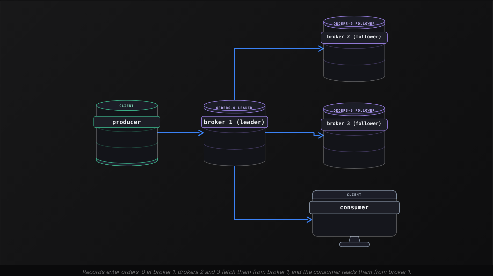
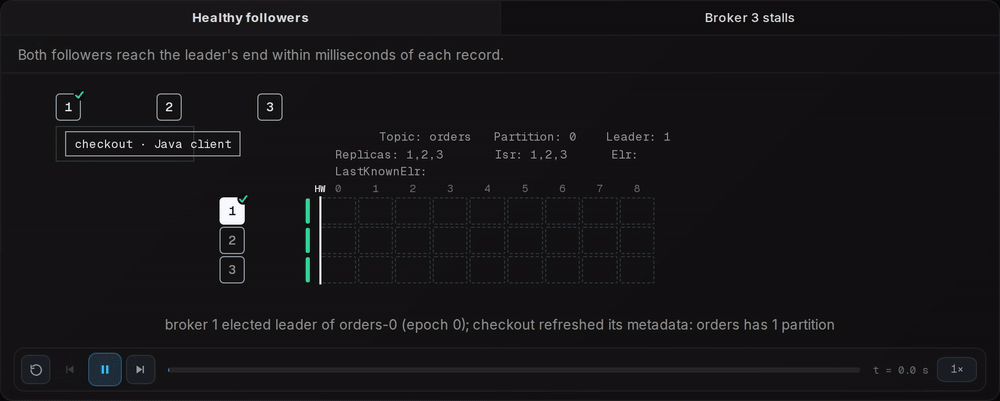
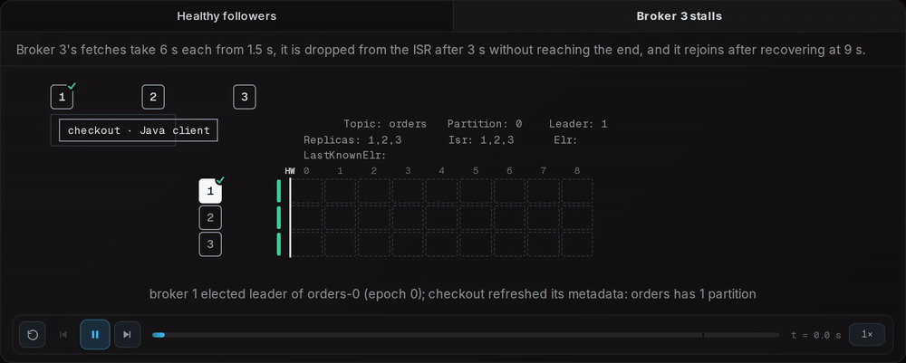
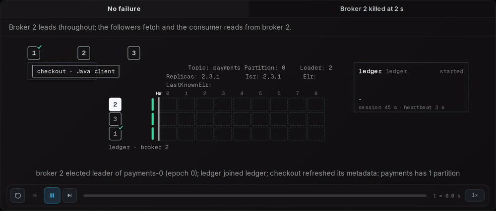
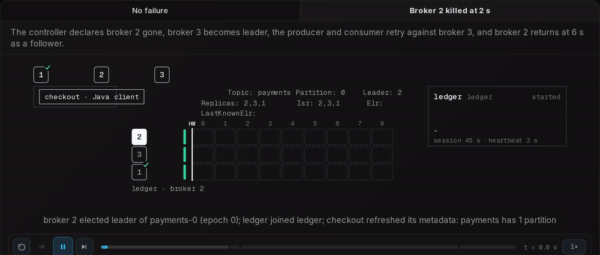

Beginner·[](https://kafka.apache.org/)·20 min · 8 challenges

# Replication: Beginner

LinkedIn built Kafka to carry member activity events such as page views, and has written that its clusters handle more than 7 trillion messages a day. When 1 broker in those clusters loses power mid-afternoon, some partitions lose a copy and carry on, some lose their leader and stall, and whether any page view is lost depends on which surviving copy had kept up.


<br>

---

## Brokers Hold Replicas

[Replication](https://kafka.apache.org/44/design/design/#replication)


<br>

### A partition is a file, and a file sits on a machine

The log lesson left a partition as an ordered list of records, each at an offset, growing at 1 end. That list is stored on disk, and the disk belongs to a broker: 1 Kafka server process on 1 machine, with an integer id such as 1 or 2. A cluster is a set of brokers, usually 3 or more, each with its own disk and its own network link. Every partition of every topic is stored on at least 1 broker, and the question this lesson answers is what happens to the partition when that broker's disk fails on a Tuesday afternoon.

Replication is the answer. Instead of 1 copy of a partition's log, the cluster keeps several, each on a different broker, and each copy is called a replica. A replica holds the same records at the same offsets as every other replica of its partition, so offset 41 of partition 2 names 1 record on every broker that stores a copy. The number of replicas a topic keeps for each of its partitions is its replication factor, chosen when the topic is created.

Creating a topic with 3 partitions and 3 replicas of each: kafka-topics.sh --create --topic orders --partitions 3 --replication-factor 3 --bootstrap-server broker1:9092. The flag counts every copy, including the one producers will write to, so 3 means 3 brokers each store the full log of each partition.

Suppose orders-2 has received 5 records, at offsets 0 through 4. Broker 3's replica has those 5 records at offsets 0 through 4, broker 4's replica has the same 5, and broker 1's replica has the same 5. A consumer that stopped at offset 3 of orders-2 finds the same record at offset 4 whichever copy answers, because offsets belong to the partition and every replica agrees on them. Replication adds copies of the log without adding anything to the log.


<br>

### Where the copies land

The cluster assigns replicas when the topic is created, and no 2 replicas of 1 partition ever share a broker. With 4 brokers and replication factor 3, each partition lands on 3 of the 4: the first replica shifts 1 broker along with each new partition, and the other 2 go to the brokers after it in id order, wrapping from 4 back to 1. Topics with more partitions than brokers go round again, shifting which brokers follow on each pass.

| Partition | Broker 1 | Broker 2 | Broker 3 | Broker 4 |
| --- | --- | --- | --- | --- |
| orders-0 | replica | replica | replica |  |
| orders-1 |  | replica | replica | replica |
| orders-2 | replica |  | replica | replica |
| orders-3 | replica | replica |  | replica |

Read the table by column and the point of the rotation shows: broker 1 stores replicas of 3 partitions, and so does each of the other 3 brokers, so disk use is even. Read it by row and no partition depends on 1 machine. Unplug broker 3 and orders-0 still lives on brokers 1 and 2, orders-1 on brokers 2 and 4, orders-2 on brokers 1 and 4, and orders-3 never touched broker 3 at all. Every record of every partition is still on a disk somewhere in the cluster.

`kafka-topics.sh --describe --topic orders` lists, for each partition, the ids of the brokers holding a replica, in assignment order, under the heading Replicas. That column is the first thing to read when a broker goes down: every partition whose Replicas list names the dead broker has lost 1 copy, and every partition whose list does not is untouched.

> A replica, in 4 lines
>
> - A full copy of 1 partition's log, with the same records at the same offsets as every other copy.
> - Stored on 1 broker, and no 2 replicas of the same partition share a broker.
> - Counted by the replication factor: 3 means 3 brokers each hold the whole log.
> - Kept current by copying from 1 of the others, which the next section shows.

The placement rule sets 2 limits. The replication factor cannot exceed the number of brokers, because the extra copy would have nowhere to go; asking for 4 replicas on a 3-broker cluster fails at creation with InvalidReplicationFactorException and no topic is made. And the factor is per topic, so 1 cluster can keep 3 copies of `orders` and 1 copy of a scratch topic nobody would miss. Not every copy can take writes from producers, or 3 copies would hand out 3 different offsets for the same record; the next section shows what the other copies do instead.


> **TIP**
>
> Count copies by partition, never by topic. A topic with 12 partitions and replication factor 3 is 36 replicas spread across the cluster, and a broker failure removes whichever of the 36 that broker stored.


<br>

---

## Leaders and Followers

[Replicated Logs: Quorums, ISRs, and State Machines](https://kafka.apache.org/44/design/design/#replicated-logs-quorums-isrs-and-state-machines-oh-my)


<br>

### One copy takes the writes

Among a partition's replicas, 1 is the leader and the rest are followers. A producer sends every record for that partition to the leader, and the leader appends it to its log and assigns the offset. Followers write nothing on their own; each asks the leader for the records it does not yet have and appends them to its own log, at the offsets the leader assigned. By default a consumer reads from the leader too, so the leader is the single point of contact for a partition, and the followers are copies kept warm for the day the leader's broker fails.

The reason for exactly 1 writer is the offset. Offsets form a sequence with no gaps, decided once. If broker 1 and broker 2 both accepted records for orders-0, each would hand out offset 17 to a different record, and the 2 logs would disagree about what offset 17 means. A single leader decides the order once, every follower copies that order, and the guarantee from the log lesson holds on every replica: offset 17 of orders-0 is 1 record, everywhere.




<br>

### The fetch loop

A follower copies the way a consumer reads. It sends the leader a fetch request carrying the next offset it needs; the leader replies with the records from that offset to its log's end; the follower appends them and asks again at once. Each broker runs this fetch loop for every partition it follows, so a follower missing 1 record at 9:00:00.000 usually has it by 9:00:00.050.

| Tick | Leader log end | Follower asks from | Leader returns | Follower log end after |
| --- | --- | --- | --- | --- |
| 1 | 5 | offset 3 | offsets 3 and 4 | 5 |
| 2 | 8 | offset 5 | offsets 5, 6 and 7 | 8 |
| 3 | 8 | offset 8 | nothing yet | 8 |
| 4 | 9 | offset 8 | offset 8 | 9 |

Take 1 record through the loop. A producer writes `order-9001` to orders-0 at 10:00:00.000. Broker 1, the leader, appends it at offset 1204. Broker 2's fetch loop asks for offset 1204 a few milliseconds later and gets it; broker 3's loop does the same. By 10:00:00.020 all 3 replicas hold `order-9001` at offset 1204, and the followers are asking for 1205, which does not exist yet, so the leader holds their requests open until a producer sends the next record.


<br>

### Every broker leads something

Leadership is per partition, and the assignment spreads it: the first broker in a partition's Replicas list is its preferred leader, and because the starting broker rotates from one partition to the next, each broker is the preferred leader of its share. On the 4-broker cluster from the last section, broker 1 leads orders-0, broker 2 leads orders-1, broker 3 leads orders-2 and broker 4 leads orders-3. A broker that leads 1 partition and follows 2 others carries producer and consumer traffic for the first and fetch traffic for the others, which keeps writes from piling up on 1 machine.

| Partition | Leader | Replicas | Isr |
| --- | --- | --- | --- |
| orders-0 | 1 | 1,2,3 | 1,2,3 |
| orders-1 | 2 | 2,3,4 | 2,3,4 |
| orders-2 | 3 | 3,4,1 | 3,4,1 |
| orders-3 | 4 | 4,1,2 | 4,1,2 |

This is the per-partition part of what `kafka-topics.sh --describe` prints. The Isr column is the subject of the next section; for now read Leader against Replicas and note that each leader is the first id in its own list. Preferred matters later: when a broker returns from a failure, the cluster moves leadership back to the preferred replica so the spread stays even, and section 4 shows that return.


<br>

### Sending to the wrong broker

A producer that sends a record for orders-0 to broker 2 gets an error, NOT_LEADER_OR_FOLLOWER, and broker 2 stores nothing. The producer then asks the cluster for fresh metadata, learns that broker 1 leads orders-0, and resends there. The same error reaches a consumer that fetches from the wrong broker. Leadership can move because of this: nobody edits a client's config, and the client learns the new leader from the next error. Reading from a follower is possible in 4.4 through a consumer setting that a later lesson covers; the default, and the picture to hold now, is leader for both writes and reads.

| ✓ Leader | ✗ Follower |
| --- | --- |
| • Receives every record a producer sends for the partition<br><br>• Assigns each record its offset<br><br>• Answers fetch requests from followers and from consumers<br><br>• Exactly 1 per partition at any moment | • Fetches from the leader in a loop, like a consumer<br><br>• Appends at the offsets the leader assigned<br><br>• Accepts no writes from producers<br><br>• Ready to become leader, which section 4 shows |

> **TIP**
>
> When a producer or consumer asks any broker where orders-2 lives, the reply names the current leader. Clients cache that answer and refresh it on an error, which is what makes a change of leader survivable without reconfiguring anything.


<br>

---

## In-Sync Replicas

[Replicated Logs: Quorums, ISRs, and State Machines](https://kafka.apache.org/44/design/design/#replicated-logs-quorums-isrs-and-state-machines-oh-my)[replica.lag.time.max.ms](https://kafka.apache.org/44/configuration/broker-configs/#brokerconfigs_replica.lag.time.max.ms)


<br>

### Caught up is measured in seconds

A follower that copies continuously is never more than a few milliseconds behind, but a follower on a sick disk, or behind a saturated network link, can fall far behind, and the cluster needs a crisp rule for which followers still count. The rule defines the in-sync replica set, written ISR. A follower is in the ISR while it has caught up to the leader's end of log at some point in the last `replica.lag.time.max.ms` milliseconds, 30000 by default. The leader of a partition is always in its own ISR.

```sql
# broker setting, default shown
replica.lag.time.max.ms=30000
```

Read the rule carefully, because it is a rule about time. A follower that is 2,000 records behind at this instant is in sync if it reached the leader's end 10 seconds ago, which happens during a burst: the leader took a flood of records, and the follower is fetching through it. A follower that is 1 record behind is out of sync if it has reached the leader's end at no point in the last 30 seconds, which happens when the follower is stuck. The leader keeps a clock for each follower, and when 30 seconds pass without that follower reaching the end, it drops the follower from the ISR.

Kafka once judged lag by a count of records, and dropped that rule years ago: a burst from a producer could push a healthy follower past the count and out of the set through no fault of its own, and a quiet partition could hide a stuck follower that was only 3 records behind. Time catches both cases, because a healthy follower reaches the end many times a second whatever the volume.


<br>

### The ISR lists the safe successors

The ISR answers 1 question: which replicas could take over as leader without losing records? A follower in the ISR has held everything the leader held within the last 30 seconds and is fetching the rest. A follower dropped from the ISR may be missing hours of records. When section 4's broker dies, the cluster picks the new leader from the ISR and only from the ISR, so keeping the set accurate is what makes a failover safe. While a follower is out, the partition still takes writes and the leader still confirms them; the cost is 1 fewer safe candidate, so a second failure in that window hurts more. How many in-sync copies a write must reach before the leader confirms it is a setting the next replication lesson covers.


<br>

### A follower falls behind and comes back

| Time | Leader log end | Broker 3 log end | Broker 3 last reached the end | ISR |
| --- | --- | --- | --- | --- |
| 09:00:00 | 500 | 500 | 09:00:00 | 1,2,3 |
| 09:00:10 | 900 | 620 | 09:00:04 | 1,2,3 |
| 09:00:35 | 1900 | 700 | 09:00:04 | 1,2 |
| 09:01:20 | 3700 | 3700 | 09:01:20 | 1,2,3 |

At 09:00:04 broker 3's disk started stalling. It kept answering, slowly, so at 09:00:10 it was 280 records behind and still in the set, because its last full catch-up was 6 seconds old. At 09:00:34 that catch-up turned 30 seconds old and the leader removed broker 3 from the ISR; writes to the partition continued through brokers 1 and 2. Broker 3's fetch loop kept running without any restart, the disk recovered, and at 09:01:20 it reached offset 3700, the leader's end, so the leader added it back. Shrinking and expanding the ISR is routine and automatic; what an operator watches for is a shrink that does not undo itself.

**Healthy followers**



**Broker 3 stalls**



Running `--describe` at 09:00:35 prints `Isr: 1,2` against `Replicas: 1,2,3`: 1 replica is assigned and not caught up. The lag rule covers a follower that is alive and stuck; a broker that stops altogether leaves every ISR sooner, about 9 seconds after it falls silent, through the session timeout section 4 introduces.

> In or out of the ISR
>
> - In: reached the leader's end within the last replica.lag.time.max.ms, 30 seconds by default.
> - Out: no full catch-up for longer than that on a live broker; a stopped broker leaves when its session expires.
> - Back in: the moment the follower's log reaches the leader's end again.


> **TIP**
>
> An ISR shorter than the Replicas list on many partitions that all share 1 broker id points at that broker, its disk or its link, rather than at the topics.


<br>

---

## Replication Factor

[default.replication.factor](https://kafka.apache.org/44/configuration/broker-configs/#brokerconfigs_default.replication.factor)[Increasing replication factor](https://kafka.apache.org/44/operations/basic-kafka-operations/#increasing-replication-factor)


<br>

### The number of copies is a choice per topic

Replication factor is the count of replicas a topic keeps for each partition, chosen when the topic is created with `--replication-factor`, or taken from the broker's `default.replication.factor` when the flag is left out. A factor of 1 keeps 1 copy, which means the partition has a leader and no followers; the loss of that broker takes the partition offline until the broker returns, with its records gone for good if the disk went with it. `kafka-topics.sh --describe` prints the factor on its first line, before the per-partition rows.


<br>

### Failures each extra copy survives

| Replication factor | Brokers that can be down while the partition still serves | Disk for 100 GB of records |
| --- | --- | --- |
| 1 | 0 | 100 GB |
| 2 | 1 | 200 GB |
| 3 | 2 | 300 GB |
| 4 | 3 | 400 GB |

The middle column is the reason to replicate. With factor 3, a partition keeps serving reads and writes through the loss of any 2 of its 3 brokers, because 1 in-sync copy remains to lead. The jump from 1 to 2 buys the most: it turns a broker failure from an outage into a change of leader. The jump from 2 to 3 buys the ability to take 1 broker down on purpose, for an upgrade or a disk swap, while still holding a spare copy in case a second broker fails during the work.


<br>

### Disk, network and broker time

Each copy costs disk, network and broker time. A topic holding 200 GB of records occupies 600 GB across the cluster at factor 3, because each of 3 brokers writes the full log. Each record a producer sends crosses the wire once to the leader and then once more to every follower, so factor 3 turns 200 GB of produced data into 400 GB of fetch traffic between brokers. And every follower's fetch loop is work on the leader's side too, answering requests for every partition it leads, so a leader of 500 partitions at factor 3 answers 1,000 follower loops.

Latency is the cost people expect. Whether the leader waits for followers to copy a record before confirming it to the producer is a producer setting, taught in the producers lessons, and that setting is where the factor touches write latency: each follower that must copy first adds a round trip inside the cluster before the confirmation leaves. In a healthy cluster that round trip is a millisecond or two; on a cluster with 1 slow follower, it is however slow that follower is, which is 1 more reason the ISR rule from the last section drops a stuck follower rather than waiting on it.

Worked through for 1 topic: 12 partitions that have accumulated 350 GB of records and take in 50 GB a day. At factor 1 that is 350 GB on disk across the cluster; at factor 3, 1,050 GB, spread over 36 replicas, so a 6-broker cluster carries about 175 GB of it per broker. The same topic at factor 3 moves 100 GB a day of follower fetch traffic between brokers, on top of the 50 GB the producers send in.


<br>

### Factor 3 for most production topics

A factor of 3 keeps serving through 1 planned outage plus 1 surprise. During a rolling restart of a 6-broker cluster, 1 broker is always down on purpose; with factor 2, every partition that broker holds is left with a single copy for the duration, and a second broker's disk failing in that window loses records. With factor 3, the same window leaves 2 copies. Going to 4 buys a third simultaneous failure, which is rarely worth 33% more disk and bandwidth, so most production topics stop at 3. A topic whose records could be regenerated from a source system, such as a nightly export, can run at 2 to save disk, and the team owning it should be able to say so out loud.

```sql
# applies to topics created without --replication-factor,
# including topics a client creates by naming one that does not exist
default.replication.factor=3
```

Changing a topic's factor after creation means adding or removing a replica for every partition, which is a partition move: the new broker must copy the full log from the leader before it is a replica worth having, and for the 350 GB topic above that is 350 GB of fetch traffic to add 1 copy. Kafka 4.4 does it through `kafka-reassign-partitions.sh`, and a later lesson covers the tool. The practical point now is that the factor is a creation-time decision that costs a full copy of the data to revise, so it is worth getting right on the day the topic is created.

| ✓ Do | ✗ Don't |
| --- | --- |
| • Set default.replication.factor=3 on every broker so an accidental topic still has copies<br><br>• Choose the factor from how the topic's records would be recovered if lost<br><br>• Keep factor 3 or more for topics whose records exist nowhere else | • Create topics at factor 1 when their records matter<br><br>• Plan to raise the factor later as though it were a flag flip<br><br>• Size disk per topic without multiplying by the factor |

> **TIP**
>
> The factor is a ceiling on copies, and the ISR is the count that is real right now. A factor-3 topic with an ISR of 1 on some partition has exactly 1 copy of that partition's recent records until the followers catch up.


<br>

---

## When a Broker Dies

[Availability and Durability Guarantees](https://kafka.apache.org/44/design/design/#availability-and-durability-guarantees)[Graceful shutdown](https://kafka.apache.org/44/operations/basic-kafka-operations/#graceful-shutdown)


<br>

### Broker 2 and its 3 replicas

Broker 2 on the 4-broker cluster loses power at 14:02:10. It held 3 replicas: the leader of orders-1 and followers of orders-0 and orders-3. The controller, the part of the cluster that tracks which brokers are alive, stops receiving broker 2's heartbeats; after `broker.session.timeout.ms`, 9000 milliseconds by default, it declares broker 2 gone, removes it from the ISR of every partition it held, and for each partition it led picks a new leader from the remaining ISR. Then 2 different things happen, depending on the role broker 2 played in each partition.

For orders-0 and orders-3, where broker 2 was a follower, the ISR shrinks from 3 ids to 2 and nothing else changes: the leaders keep appending, the other follower keeps fetching, and producers and consumers of those partitions see nothing at all. For orders-1, where broker 2 led, every producer and consumer has lost its point of contact, and the partition is without a leader until the controller names one.


<br>

### Picking a new leader

The ISR of orders-1 was brokers 2, 3 and 4 until the crash. The controller removes 2 and chooses the first surviving id in Replicas order, broker 3. It records the change and tells every broker; from that moment broker 3 appends writes for orders-1 and broker 4 fetches from broker 3. Because broker 3 was in sync, it holds the records the dead leader had copied out, and new offsets continue from the end of broker 3's log. A record that broker 2 took in and no follower had fetched yet is the one at risk, and whether the producer was ever told that record was safe depends on the producer setting the producers lessons teach.

| Time | Event | A producer writing to orders-1 sees |
| --- | --- | --- |
| 14:02:10 | broker 2 loses power | its open send gets no reply |
| 14:02:19 | controller declares broker 2 gone, broker 3 leads orders-1 | still waiting on a silent connection |
| 14:02:40 | the producer's request timeout expires | metadata refresh names broker 3 |
| 14:02:40.1 | broker 4 already fetches from broker 3 | the resend succeeds at the next offset |


<br>

### The pause clients see

The pause has 2 parts. The controller needs around 9 seconds, the session timeout, to elect a new leader, and a client uses that leader only after it gives up on broker 2. When the broker process crashes on a running machine, the operating system resets the connection, requests fail at once, and the client retries until the election lands: about 10 seconds with defaults. A machine that loses power sends nothing back, so the client waits out its `request.timeout.ms`, 30000 by default, then refreshes metadata and goes to broker 3: about 30 seconds. Consumers do the same with their fetches, resuming from the offset they had reached.

**No failure**



**Broker 2 killed at 2 s**



A dead leader's partitions each pass to the next in-sync broker in their Replicas list. On the 4-broker layout broker 2 leads only orders-1, so broker 3 inherits it alone. On topics with many more partitions than brokers, each pass of the assignment puts a different broker second, so the leadership of a broker that led 100 partitions, and its producers' retries, splits across the survivors.


<br>

### Broker 2 returns and takes orders-1 back

At 14:40 broker 2 is powered on. Its 3 replicas fetch what they missed, including 38 minutes of orders-1 records from broker 3, and re-enter their ISRs. Broker 2 is still first in the Replicas list of orders-1, and with `auto.leader.rebalance.enable` on by default, the controller checks every 300 seconds for partitions not led by their preferred leader, so leadership moves back to broker 2 within 5 minutes of catching up. Broker 3 is up for that move and answers clients with NOT_LEADER_OR_FOLLOWER at once, so they redirect after 1 metadata refresh.

A second failure before the first is repaired is where factor 3 and the ISR meet. If broker 3 also dies before broker 2 returns, orders-1 has 1 replica left, broker 4, which is in the ISR and becomes leader; the partition keeps serving with no spare. If broker 4 then fails too, no in-sync replica remains and the partition goes offline: sends fail and fetches return nothing until a broker holding a copy comes back. With factor 3 that takes 3 failures of exactly the right brokers before anyone repairs the first, which is what the factor was chosen to make rare.

> A broker failure, by partition role
>
> - Follower lost: the ISR shrinks by 1 and clients notice nothing.
> - Leader lost: after the session timeout a new leader is chosen from the ISR, and clients pause, refresh metadata and retry.
> - Offsets never change, so a consumer resumes from the offset it had reached.
> - Broker back: its replicas fetch to catch up, rejoin the ISR, and preferred leadership returns within the rebalance interval.

> **TIP**
>
> Before taking a second broker down, read the ISR column rather than the Replicas column. A partition whose ISR is already down to 1 id has no spare copy, whatever its factor says, and a restart of that last broker takes it offline.


<br>

---

## Putting It All Together

A Kafka broker at LinkedIn carrying member activity events, such as page views, loses power at 14:02. For the partitions it followed, the ISR shrinks and nobody notices. For the partitions it led, the controller promotes an in-sync follower after the 9-second session timeout, while the producers of page-view events sit on silent connections until their 30-second request timeout expires, then refresh metadata and resend to the new leaders. Consumers resume from the offsets they had reached. Those partitions pause for about 30 seconds and catch up, and 40 minutes later the repaired broker rejoins, fetches what it missed, and takes its preferred partitions back.

- The placement from section 0 decides which partitions lost a copy: those whose Replicas list names the dead broker, and no others.
- The leader rule from section 1 is why only the partitions that broker led saw an interruption, and why the client learned the new leader from an error rather than a config change.
- The ISR from section 2 is what made the promotion safe: the follower chosen had reached the leader's end within the last 30 seconds, so it held the records the old leader had copied out.
- The factor from section 3 is why 2 copies remained during the outage, leaving a spare in case a second disk died before the first was replaced.
- The timeline from section 4 explains the length of the pause: the session timeout for the election, the request timeout for a connection gone silent, then retries landing on the brokers that inherited leadership.


<br>

---

## Key Takeaways

- A replica is a full copy of 1 partition's log on 1 broker, with the same records at the same offsets, and no 2 replicas of a partition share a broker.
- One replica per partition is the leader; producers write to it, followers fetch from it in a loop, and consumers read from it by default.
- A follower is in the ISR while it has reached the leader's end within replica.lag.time.max.ms, 30 seconds by default, and the ISR is the list of replicas safe to promote.
- The replication factor sets how many brokers can be lost while a partition still serves, and each copy costs a full share of disk and a full share of fetch traffic; 3 is the usual choice.
- When a leader's broker dies, the controller waits out the session timeout, promotes an in-sync follower, and clients refresh metadata and retry; offsets never change, and the returning broker catches up and takes its preferred leadership back.

[](https://kafka.apache.org/)

Official Apache Kafka resourcesversion 4.4

"Apache Kafka is an open-source distributed event streaming platform used by thousands of companies for high-performance data pipelines, streaming analytics, data integration, and mission-critical applications." [kafka.apache.org](https://kafka.apache.org/)

[Documentation](https://kafka.apache.org/44/)[Quickstart](https://kafka.apache.org/quickstart/)[Download](https://kafka.apache.org/community/downloads/)[Community](https://kafka.apache.org/community/)

In the documentation

Brokers Hold Replicas
:   [Replication](https://kafka.apache.org/44/design/design/#replication)

Leaders and Followers
:   [Replicated Logs: Quorums, ISRs, and State Machines](https://kafka.apache.org/44/design/design/#replicated-logs-quorums-isrs-and-state-machines-oh-my)

In-Sync Replicas
:   [Replicated Logs: Quorums, ISRs, and State Machines](https://kafka.apache.org/44/design/design/#replicated-logs-quorums-isrs-and-state-machines-oh-my)[replica.lag.time.max.ms](https://kafka.apache.org/44/configuration/broker-configs/#brokerconfigs_replica.lag.time.max.ms)

Replication Factor
:   [default.replication.factor](https://kafka.apache.org/44/configuration/broker-configs/#brokerconfigs_default.replication.factor)[Increasing replication factor](https://kafka.apache.org/44/operations/basic-kafka-operations/#increasing-replication-factor)

When a Broker Dies
:   [Availability and Durability Guarantees](https://kafka.apache.org/44/design/design/#availability-and-durability-guarantees)[Graceful shutdown](https://kafka.apache.org/44/operations/basic-kafka-operations/#graceful-shutdown)

Further
:   [Replica Management](https://kafka.apache.org/44/design/design/#replica-management)

Apache Kafka, Kafka, and the Kafka logo are either registered trademarks or trademarks of The Apache Software Foundation in the United States and other countries.
