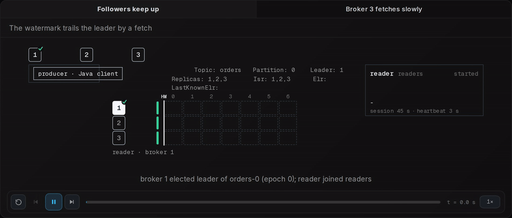
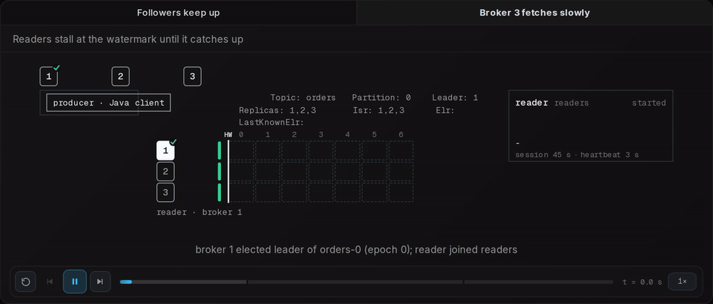
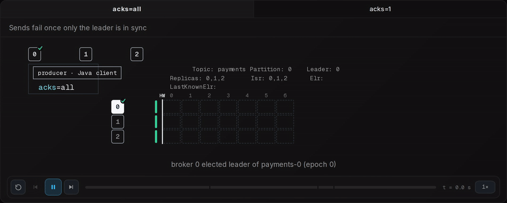
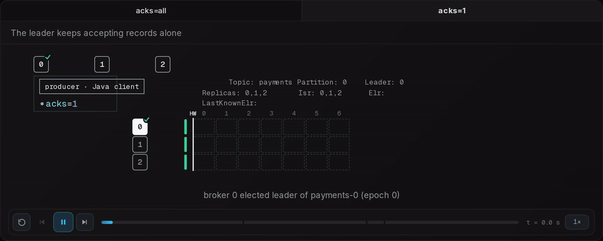
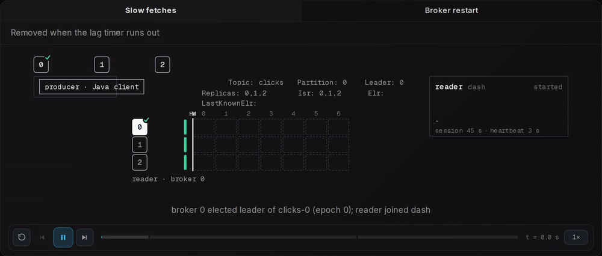
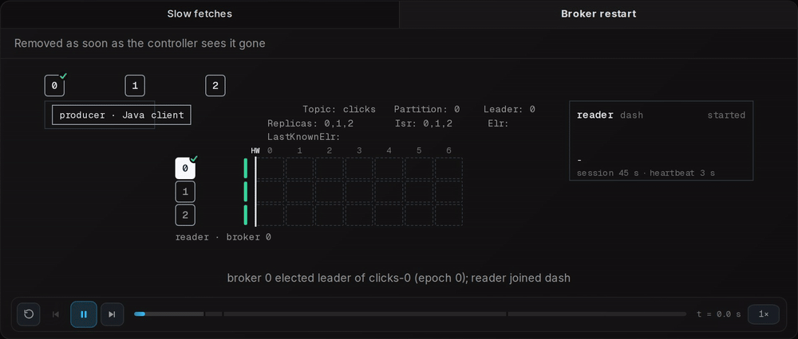
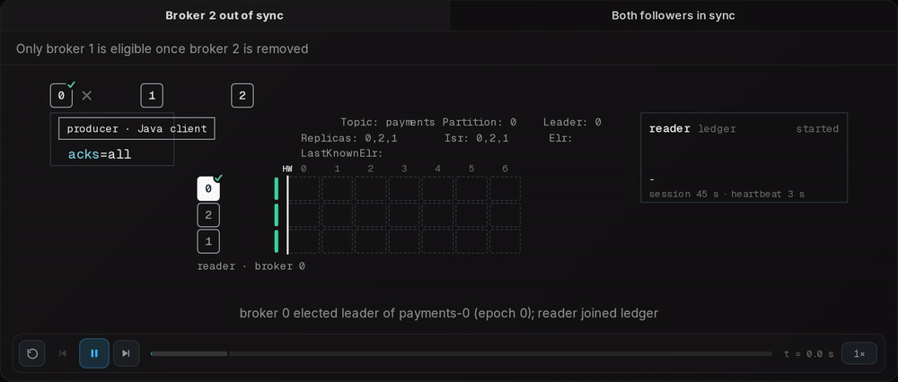
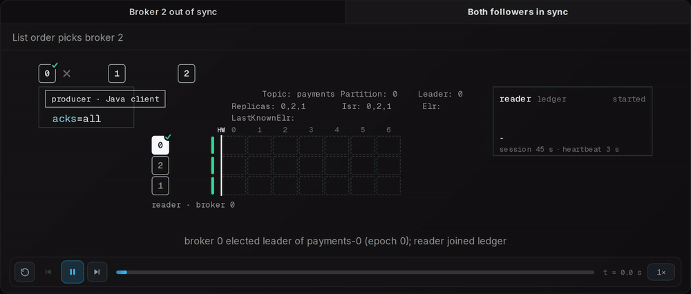
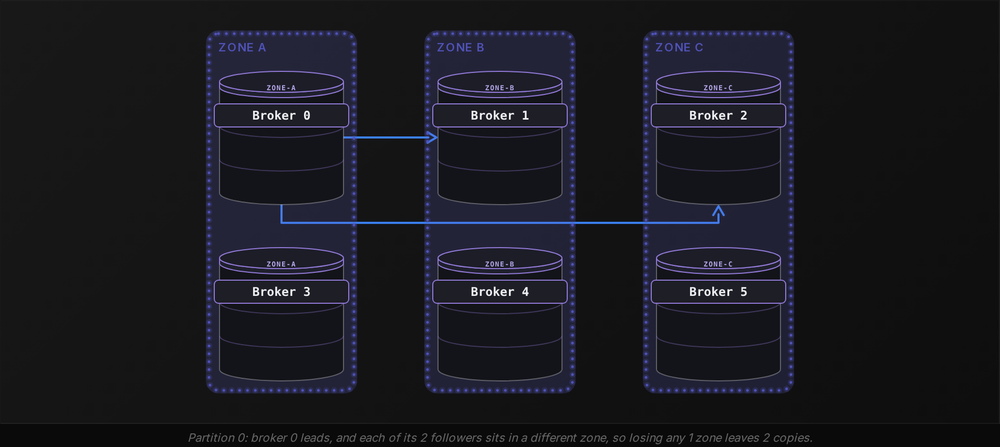

Intermediate·[](https://kafka.apache.org/)·20 min · 7 challenges

# Replication: Intermediate

At Netflix, every play, pause and scrub lands as an event in Kafka clusters spread across 3 availability zones. On a Tuesday evening one zone loses power during the finale of a hit series. Whether millions of viewers keep streaming, and whether the playback events from the last 2 seconds survive, comes down to where each partition's copies sit and how many of them were in sync.


<br>

---

## The High Watermark

[Replicated Logs: Quorums, ISRs, and State Machines](https://kafka.apache.org/44/design/design/#replicated-logs-quorums-isrs-and-state-machines-oh-my)

A producer sends a record to the partition's leader on broker 1. The leader appends it at offset 7 and the record now exists on exactly 1 disk in the cluster. A consumer fetching from offset 7 at that instant gets back an empty response. The leader holds the record back until every in-sync follower has copied it, and the offset that marks how far that copying has reached is the high watermark.


<br>

### Two offsets on every replica

Every replica tracks 2 positions. The **log end offset** is the offset of the next record it will append, so a replica whose last record sits at offset 7 has a log end offset of 8. The **high watermark** is the offset up to which every replica in the in-sync set holds the data. On the leader, the high watermark is the smallest log end offset among the in-sync replicas. A record below the high watermark is committed: it survives the loss of any single in-sync replica, because every one of them has it.

Take a partition with replication factor 3: the leader on broker 1, followers on brokers 2 and 3, all 3 in sync, and 7 records already committed at offsets 0 through 6. Call the follower on broker 2 follower A and the one on broker 3 follower B. The table follows 1 new record from its append to the moment a reader can have it.

| Moment | Leader log end offset | Follower A next fetch | Follower B next fetch | High watermark | A reader can see |
| --- | --- | --- | --- | --- | --- |
| Record 7 appended on the leader | 8 | 7 | 7 | 7 | offsets 0 to 6 |
| A's fetch for offset 7 returns record 7 | 8 | 7 (writing it) | 7 | 7 | offsets 0 to 6 |
| A asks for offset 8, B asks for offset 7 | 8 | 8 | 7 | 7 | offsets 0 to 6 |
| B asks for offset 8 | 8 | 8 | 8 | 8 | offsets 0 to 7 |

The leader learns what a follower holds only from its fetch requests: a follower requesting offset 8 is proving it has written everything through offset 7. So a record needs 2 round trips before a reader can have it: the fetch that carries it to the follower, then the next fetch, whose offset tells the leader it landed. On a healthy partition that takes a few milliseconds. When 1 in-sync follower struggles, the wait stretches to that follower's pace, because the slowest member sets the smallest log end offset.


<br>

### What the reader is allowed to see

A consumer's fetch names an offset, and the leader answers with records from there up to the high watermark and no further, plus the mark itself. A consumer that asks for offset 7 while the mark is still 7 receives 0 records, waits, and asks again. Every fetch response to a follower carries the mark too, and each follower raises its own copy to match, so a follower that takes over as leader already knows which records readers may have.

> Why the leader holds the record back
>
> - Suppose the leader handed out offset 7 the moment it was appended, and its disk died 10 ms later.
> - Neither follower had fetched offset 7 yet, so the new leader's log ends at offset 7 and the record is gone.
> - A reader that already processed record 7 has acted on data the cluster no longer holds, and a reader starting later will never see it.
> - Waiting for the high watermark means every record a reader sees is one every in-sync replica holds, so no leader change can take it back.


<br>

### Reading the mark from the command line

kafka-get-offsets.sh --bootstrap-server broker1:9092 --topic orders prints 1 line per partition in the form orders:0:8, and the number is the high watermark, the first offset no reader has been given. When it stops moving while the producer keeps sending, a follower is holding it, and the next 2 sections show what the leader does about it.

**Followers keep up**



**Broker 3 fetches slowly**



In the slow variant the leader keeps appending while the consumer's position freezes at the watermark. Broker 3 stays in the in-sync set throughout, since its stall is far shorter than 30 seconds, so the mark is pinned to its progress. When broker 3 catches up, the mark jumps and the consumer takes the held records in a burst.

> **TIP**
>
> Consumer lag is measured against the high watermark. A consumer can show 0 lag on a partition whose leader holds records nobody can read yet, because those records sit above the mark waiting on a slow follower.


<br>

---

## Minimum In-Sync Replicas

[min.insync.replicas](https://kafka.apache.org/44/configuration/topic-configs/#topicconfigs_min.insync.replicas)[Availability and Durability Guarantees](https://kafka.apache.org/44/design/design/#availability-and-durability-guarantees)

Replication factor 3 promises 3 copies of every record, but the promise only holds while 3 brokers are up. With `min.insync.replicas` at its default of 1, a partition whose 2 followers have both dropped out of the in-sync set keeps accepting writes with the leader as the only replica, and the leader confirms each record as fully replicated because, among the in-sync replicas, it is. If that broker's disk fails before the followers return, those records are gone. `min.insync.replicas` sets the floor: the number of in-sync replicas a partition must have before it accepts a write that asked for full replication.


<br>

### Which writes it refuses

A producer chooses how much confirmation it wants through its acks setting. With acks=all, the leader confirms a record only after every in-sync replica has it, which in high watermark terms means after the mark has passed the record. That is the write min.insync.replicas guards. When the in-sync set is smaller than the minimum, the leader answers an acks=all send with the error NotEnoughReplicas and appends nothing. A producer sending with acks=1 asked only for the leader's confirmation, and the leader keeps accepting those writes with 1 copy, minimum or not. The setting protects producers that asked for safety and does nothing for ones that did not.

With the eligible leader replicas feature, on by default on clusters newly formatted with a recent 4.x release and switched on by an operator after an upgrade, the rule also reaches the high watermark: while the in-sync set is below the minimum, the leader stops advancing the mark. Records that arrived with `acks=1` during the shortage stay unreadable until enough replicas are back in sync, so no reader acts on a record only 1 disk holds.

The error is retriable: the producer's client resends on its own, so a shortage of a few seconds looks to the application like a slow send. One that outlasts the client's patience surfaces as an exception, which tells the application its data is not being stored to the standard it asked for.


<br>

### Setting it

The setting lives on the topic, with a broker-wide default for topics that do not set their own. The usual pairing is replication factor 3 with a minimum of 2. kafka-configs.sh --bootstrap-server broker1:9092 --alter --entity-type topics --entity-name payments --add-config min.insync.replicas=2 raises it on 1 topic at once. The broker properties below set the floor for every topic without its own value, existing topics included, once each broker restarts with them; default.replication.factor shapes only topics created afterwards.

```sql
# server.properties on every broker
default.replication.factor=3
min.insync.replicas=2
```

| Replication factor | min.insync.replicas | Brokers that can be lost while acks=all writes continue | Copies every confirmed record has |
| --- | --- | --- | --- |
| 3 | 1 | 2 | at least 1 |
| 3 | 2 | 1 | at least 2 |
| 3 | 3 | 0 | 3 |
| 2 | 2 | 0 | 2 |
| 5 | 3 | 2 | at least 3 |


<br>

### The trade behind the number

Raising the minimum trades availability for durability. At replication factor 3 and a minimum of 2, 1 broker can be down and every confirmed record still sits on 2 disks. A minimum of 3 guarantees 3 copies, and the first broker restart stops writes on every partition that broker holds. A minimum above the replication factor can never be met, so the topic refuses every fully replicated write, and the cluster accepts that configuration without complaint.

Refusing a write pushes the problem back to the producer, which retries, buffers, or fails loudly, instead of quietly holding data on 1 disk. For a payments topic the refusal is the right answer: a 30 second pause while a broker comes back costs less than a lost transfer. For a topic of debug metrics sampled every second, a minimum of 1 and the occasional lost record may be the better trade. The number encodes a business decision about which failure you would rather explain.

**acks=all**



**acks=1**



With 1 broker down the in-sync set holds 2 replicas, the minimum, and both variants keep writing. The second kill drops the set to 1. In the `acks=all` variant every send from that point comes back with `NotEnoughReplicas` and the leader's log stops growing; in the `acks=1` variant the log keeps growing on a single disk, which is the situation the setting exists to prevent.

| ✓ Do | ✗ Don't |
| --- | --- |
| • Pair replication factor 3 with min.insync.replicas=2 for most topics<br><br>• Set the broker default so every topic without its own value inherits it<br><br>• Alert on UnderMinIsrPartitionCount, since producers are being refused<br><br>• Raise the minimum to the replication factor only where pausing beats losing a record | • Leave min.insync.replicas at 1 on a topic that cannot lose records<br><br>• Set the minimum above the replication factor<br><br>• Expect it to protect producers that send with acks=1<br><br>• Treat NotEnoughReplicas as a producer bug; it is a broker count |


<br>

---

## Followers That Fall Behind

[replica.lag.time.max.ms](https://kafka.apache.org/44/configuration/broker-configs/#brokerconfigs_replica.lag.time.max.ms)[Replica Management](https://kafka.apache.org/44/design/design/#replica-management)

In sync is a statement about time. A follower is in sync when it has fetched up to the leader's log end offset at least once in the last `replica.lag.time.max.ms` milliseconds, 30,000 by default. The leader records the moment each follower last caught up fully, and a follower whose moment is older than 30 seconds is removed from the in-sync set. The number of records behind does not enter the rule: a follower 5,000 records behind a busy leader that caught up 2 seconds ago is in sync, and a follower 1 record behind that has not reached the end for 31 seconds is out.

Time works where a count would not: a partition taking 10,000 records a second always has a follower hundreds of records behind mid-fetch, so a count threshold would flap on every burst.


<br>

### Timeline of a shrink

| Clock | What happens | In-sync set | High watermark |
| --- | --- | --- | --- |
| 0 s | Broker 3 enters a long garbage collection pause and stops fetching | 1, 2, 3 | stuck at 1,200 |
| 0 to 30 s | Leader appends 3,000 records; broker 2 copies them all; broker 3 copies none | 1, 2, 3 | stuck at 1,200 |
| 30 s | Leader's check finds broker 3 last caught up 30 s ago and removes it | 1, 2 | jumps to 4,200 |
| 30 s | Leader sends the new set to the controller, which records it in the metadata log | 1, 2 | 4,200 |
| 45 s | Broker 3 wakes and resumes fetching from offset 1,200 | 1, 2 | advancing |
| 52 s | Broker 3 reaches the high watermark and is added back | 1, 2, 3 | advancing |

For those 30 seconds every record the leader accepted sat above the high watermark, confirmed to no `acks=all` producer and readable by nobody. Removing the follower unblocks the partition: once the set is brokers 1 and 2, broker 2's log end offset sets the mark, which jumps 3,000 offsets and hands stalled readers a burst. With a minimum of 2, the partition still accepts fully replicated writes, 1 broker away from refusing them.

The leader runs that check every `replica.lag.time.max.ms` divided by 2, so a follower leaves between 30 and 45 seconds after it stalls. The leader proposes the smaller set to the controller and keeps using the old one until the controller has recorded the change, so a slow controller keeps the mark pinned a little longer.


<br>

### What makes a follower slow

- **A disk that cannot keep up** *writes stall*\
  The follower appends slower than the leader, falls behind during bursts and never quite reaches the end.
- **A saturated or partitioned network link** *fetches time out*\
  Cross-zone links are the common case: replication traffic competes with everything else on them.
- **A long garbage collection pause** *the broker freezes*\
  Nothing is fetched for seconds; a pause past 30 s costs the broker its place in every partition it follows.
- **Too many partitions on 1 broker** *fetcher threads overloaded*\
  The follower rotates through thousands of partitions and each one waits its turn.
- **A restart** *the broker is gone, then back*\
  A broker that stops is removed as soon as the controller notices it is gone, then catches up on everything it missed.


<br>

### Coming back

A follower rejoins once the offset it requests reaches the current high watermark, which can be short of the leader's log end. The leader then proposes adding it back, and the set grows when the controller records the change. From then on the mark advances only as fast as that follower copies. A follower that is still unhealthy, catching up in a quiet moment and falling behind on the next burst, flaps in and out, and each time it is in, the mark can wait on it for up to 30 seconds.

kafka-topics.sh --bootstrap-server broker1:9092 --describe --under-replicated-partitions lists every partition whose in-sync set is smaller than its replica list, and prints nothing on a healthy cluster. The broker metric UnderReplicatedPartitions counts the same per broker, and UnderMinIsrPartitionCount counts the partitions below their minimum, which are refusing acks=all writes. A few under-replicated partitions for a minute during a rolling restart is normal; a list that stays put points at a follower that cannot keep up.

**Slow fetches**



**Broker restart**



In both variants the watermark sticks while broker 2 still counts as in sync and jumps when it leaves. A stopped broker loses its place as soon as the controller sees it gone; a slow one keeps it until the lag timer, shortened to 1.5 seconds here, runs out, because until then a slow fetcher looks like a healthy one.

> **TIP**
>
> Lower replica.lag.time.max.ms and followers leave the set sooner, so the watermark unblocks faster but a brief hiccup drops a copy you wanted. Raise it and readers wait longer behind a struggling follower. Thirty seconds is the middle most clusters keep.


<br>

---

## Electing a New Leader

[Unclean leader election](https://kafka.apache.org/44/design/design/#unclean-leader-election-what-if-they-all-die)[Balancing leadership](https://kafka.apache.org/44/operations/basic-kafka-operations/#balancing-leadership)

Broker 1 leads partition 0 of `payments` and stops answering. The active controller, the node that keeps the cluster's metadata, expects a heartbeat from every broker, and once `broker.session.timeout.ms`, 9,000 ms by default, passes with no heartbeat from broker 1, it marks broker 1 fenced, strips it out of every in-sync set, and picks a new leader for each partition broker 1 led. The election itself takes milliseconds and consults no producer or consumer; clients find the new leader when a request to the old one fails and they refresh their metadata.

*A fenced broker leads nothing and holds no place in any in-sync set. A silent broker is fenced after the 9 second heartbeat timeout, well before the 30 second lag rule would have removed it as a slow follower.*


<br>

### The rule

The controller walks the partition's replica list in order and picks the first replica that is both alive and in the in-sync set. The replica list is the one assigned to the partition, which only a reassignment changes, and its first entry is the preferred leader, so when nothing has gone wrong the preferred replica leads. The in-sync requirement is the heart of it: an in-sync replica holds every record below the high watermark, and the high watermark bounds everything any reader has seen, so a leader chosen from the in-sync set can never lose a record a reader already has.

The fields below are the ones `kafka-topics.sh --describe` prints for a partition. Broker 2 wins because it comes before broker 0 in the list and both are in sync.

| Moment | Leader | Replicas | Isr | Elr |
| --- | --- | --- | --- | --- |
| Before | 1 | 1, 2, 0 | 1, 2, 0 |  |
| Broker 1 fenced | 2 | 1, 2, 0 | 2, 0 |  |
| Broker 1 back, catching up | 2 | 1, 2, 0 | 2, 0 |  |
| Broker 1 reaches the mark | 2 | 1, 2, 0 | 2, 0, 1 |  |
| Preferred leader election | 1 | 1, 2, 0 | 2, 0, 1 |  |


<br>

### What happens to the old leader's extra records

Broker 1 may have held records above the high watermark that no follower had fetched: appended, confirmed to an `acks=1` producer, read by nobody. Each election raises the partition's leader epoch, a counter every replica stores alongside its log and every request carries, so when broker 1 returns it is a follower with a stale epoch. It asks the new leader where the new epoch began, truncates its own log back to that offset, which discards the unreplicated records, and fetches forward from there. The `acks=1` producer lost records it was told were stored, which is the risk it accepted, and no reader lost anything, because readers were held at the mark.


<br>

### When nobody in sync is left

The in-sync set can be empty: brokers 2 and 0 die together, or 1 follower was already out of the set when the leader died. On its own, the in-sync rule then leaves the controller no safe candidate. The eligible leader replicas feature, on by default on clusters newly formatted with a recent 4.x release and switched on by an operator after an upgrade, adds a second list, which the describe output prints as `Elr`. A replica joins it when its own exit from the in-sync set takes the set below `min.insync.replicas`. The mark cannot advance while the set is short, so that replica still holds every committed record and the controller may elect it. A replica that has lost its data, such as one restarting onto a fresh disk, is taken off the list.

If the in-sync set and the eligible list are both empty, the partition goes offline: the describe output shows `Leader: none`, every read and write to it fails, and the partition waits for a replica from one of the 2 lists to come back. The controller would rather serve nothing than elect a replica that is missing committed records. An operator can override that and accept the loss; that choice has a lesson of its own.


<br>

### Giving the leader back

Broker 1 rejoins as a follower while broker 2 keeps leading, so after a few restarts leadership piles up on whichever brokers stayed up. With `auto.leader.rebalance.enable` at its default of true, the controller checks every `leader.imbalance.check.interval.seconds`, 300 by default, and moves leadership back to the preferred replica on any broker whose share of non-preferred leaders exceeds 10 percent. `kafka-leader-election.sh --bootstrap-server broker1:9092 --election-type preferred --all-topic-partitions` does the same on demand, which is how an operator restores balance right after a rolling restart instead of waiting 5 minutes.

**Broker 2 out of sync**



**Both followers in sync**



The replica list is 0, 2, 1. With both followers keeping up, broker 2 takes over because it comes first. In the slow variant, strike after the leader has removed broker 2 and the controller skips it for broker 1; strike before the removal and broker 2, still in sync, leads, holding everything readers were given because the mark was pinned to its progress. Broker 0 returns as a follower.


<br>

---

## Replicas Across Racks

[Balancing replicas across racks](https://kafka.apache.org/44/operations/basic-kafka-operations/#balancing-replicas-across-racks)[broker.rack](https://kafka.apache.org/44/configuration/broker-configs/#brokerconfigs_broker.rack)

Six brokers run across 3 availability zones, 2 brokers in each: brokers 0 and 3 in zone A, 1 and 4 in zone B, 2 and 5 in zone C. A topic with 6 partitions and replication factor 3 is created on a cluster that knows nothing about the zones, so the controller spreads replicas across brokers and nothing else. A partition placed on brokers 0, 3 and 1 has 2 of its 3 copies in zone A, and when zone A loses power it keeps 1 in-sync replica, below a minimum of 2, and refuses writes until the zone returns. Nothing was lost, and the partition is still down.


<br>

### Telling the broker where it is

```sql
# server.properties on broker 3, which runs in zone A
node.id=3
broker.rack=zone-a
```

`broker.rack` is a label and nothing more; the broker does not check it against anything. The controller reads it when a topic is created or gains partitions and places each partition's replicas so that they spread across as many distinct racks as the replication factor allows, which with 3 racks and replication factor 3 means 1 replica per rack for every partition. It also rotates which broker holds the first replica, so leadership spreads evenly. The placement happens once, at creation: adding a rack label to a running broker changes nothing about partitions that already exist.

| Partition | Replicas (brokers) | Racks | Leader |
| --- | --- | --- | --- |
| 0 | 0, 1, 2 | A, B, C | 0 |
| 1 | 1, 2, 3 | B, C, A | 1 |
| 2 | 2, 3, 4 | C, A, B | 2 |
| 3 | 3, 4, 5 | A, B, C | 3 |
| 4 | 4, 5, 0 | B, C, A | 4 |
| 5 | 5, 0, 1 | C, A, B | 5 |

Every partition has 1 copy in each zone, and each broker leads exactly 1 partition and follows 2. With `min.insync.replicas` set to 2, the table also tells you what the cluster can survive.




<br>

### Zone B loses power

Brokers 1 and 4 vanish together. The controller fences both, removes them from every in-sync set, and elects new leaders for partitions 1 and 4, which they led, by the rule from the previous section. The next table is the cluster 1 second later.

| Partition | Leader | In-sync set | Fully acknowledged writes with a minimum of 2 |
| --- | --- | --- | --- |
| 0 | 0 | 0, 2 | accepted |
| 1 | 2 | 2, 3 | accepted |
| 2 | 2 | 2, 3 | accepted |
| 3 | 3 | 3, 5 | accepted |
| 4 | 5 | 5, 0 | accepted |
| 5 | 5 | 5, 0 | accepted |

Leadership is now uneven: brokers 2 and 5 lead 2 partitions each while brokers 0 and 3 lead 1, until zone B returns and the preferred leader check moves partitions 1 and 4 back. Without rack labels, a partition on brokers 1, 4 and 2 would now sit at 1 in-sync replica and refuse writes, and nobody would have known it was exposed until the zone went dark.


<br>

### Three numbers that have to agree

Replication factor 3 across 3 racks with a minimum of 2 survives any 1 rack and keeps writing. The same topic on a cluster with only 2 racks puts 2 replicas in one rack for every partition, so losing a rack drops every partition that had 2 copies there to 1 in-sync replica, below the minimum, and roughly half the partitions stop accepting writes even though none lost data. Replication factor 3 across 3 racks with a minimum of 3 keeps 3 copies at all times and stops writing on every partition the moment any rack blinks. Count the racks first, then pick the other 2 numbers.

The price is network. With 1 replica per zone, every record a leader receives crosses 2 zone boundaries to reach its followers, and on a public cloud, traffic between zones is typically billed by the gigabyte while traffic inside a zone usually is not. A topic taking 100 MB per second of writes sends 200 MB per second across zone boundaries for replication alone, before any consumer reads it. That is what surviving a zone loss costs, paid on every byte written.

> What rack awareness does not do
>
> - It places replicas when a topic is created or gains partitions; it does not move existing partitions when a rack label is added later.
> - It balances racks, not disks: 2 brokers in the same rack can hold very different amounts of data.
> - It cannot invent copies: replication factor 2 across 3 racks still leaves every partition 1 rack failure away from a single copy.
> - Reads still go to the leader, so a consumer in zone C reading a partition led from zone A pays cross-zone traffic on every fetch; a later lesson covers reading from the nearest replica.

> **TIP**
>
> After creating a topic, run kafka-topics.sh --describe and check each partition's replica list against your rack map. The controller does the placement, but a topic created with an explicit replica assignment can ignore racks entirely, and the describe output is the only place that shows it.


<br>

---

## Putting It All Together

A ride-hailing platform stores trip state changes, driver locations and fare calculations in topics on a 9 broker cluster spread across 3 cloud zones, 3 brokers per zone, with replication factor 3, rack labels set, and min.insync.replicas at 2 on the trip and fare topics and 1 on driver locations. At the start of the Friday evening rush, one zone loses network connectivity for 4 minutes.

- Because every partition had 1 replica per zone, the outage removed exactly 1 replica from each in-sync set, leaving 2, so the trip and fare topics kept accepting fully acknowledged writes and no partition went below its minimum.
- The controller fenced the 3 unreachable brokers once their 9 second heartbeat timeout ran out, well inside the 30 second lag rule, and for each partition they led it picked the first in-sync replica in the replica list, moving a third of all leadership onto the 6 surviving brokers.
- Readers of the fare topic saw no replay and no gap: everything they had been given was below the high watermark, and the new leaders held it, while a few records the old leaders had appended above the mark were truncated when those brokers returned.
- For those first 9 seconds, before fencing, the high watermark on affected partitions stalled because the unreachable followers were still counted in sync, and consumer lag read 0 while records piled up on the leaders.
- When the zone returned, its brokers rejoined each in-sync set only after reaching the high watermark, and the preferred leader check moved leadership back within 5 minutes, restoring the even spread the rack-aware placement had created.


<br>

---

## Key Takeaways

- A record becomes readable at the high watermark, the smallest log end offset among the in-sync replicas, so a reader never holds a record a leader change could take back.
- min.insync.replicas sets the fewest in-sync copies a fully acknowledged write may land on; below it the leader refuses acks=all sends with NotEnoughReplicas, and with the eligible leader replicas feature it also stops advancing the mark.
- In sync is a time rule: a follower that has not caught up to the leader's end within replica.lag.time.max.ms, 30 seconds by default, leaves the set, and rejoins when it reaches the high watermark.
- A new leader is the first alive in-sync replica in the replica list; with none in sync, a controller running the eligible leader replicas feature tries that list, and with none of those the partition goes offline rather than losing committed records.
- broker.rack lets the controller spread each partition's replicas across racks at creation, so replication factor 3 across 3 racks with a minimum of 2 survives the loss of any 1 rack and keeps writing.
- Replication factor, in-sync minimum and rack count are 1 decision made 3 times, and the describe output is where you verify all 3.

[](https://kafka.apache.org/)

Official Apache Kafka resourcesversion 4.4

"Apache Kafka is an open-source distributed event streaming platform used by thousands of companies for high-performance data pipelines, streaming analytics, data integration, and mission-critical applications." [kafka.apache.org](https://kafka.apache.org/)

[Documentation](https://kafka.apache.org/44/)[Quickstart](https://kafka.apache.org/quickstart/)[Download](https://kafka.apache.org/community/downloads/)[Community](https://kafka.apache.org/community/)

In the documentation

The High Watermark
:   [Replicated Logs: Quorums, ISRs, and State Machines](https://kafka.apache.org/44/design/design/#replicated-logs-quorums-isrs-and-state-machines-oh-my)

Minimum In-Sync Replicas
:   [min.insync.replicas](https://kafka.apache.org/44/configuration/topic-configs/#topicconfigs_min.insync.replicas)[Availability and Durability Guarantees](https://kafka.apache.org/44/design/design/#availability-and-durability-guarantees)

Followers That Fall Behind
:   [replica.lag.time.max.ms](https://kafka.apache.org/44/configuration/broker-configs/#brokerconfigs_replica.lag.time.max.ms)[Replica Management](https://kafka.apache.org/44/design/design/#replica-management)

Electing a New Leader
:   [Unclean leader election](https://kafka.apache.org/44/design/design/#unclean-leader-election-what-if-they-all-die)[Balancing leadership](https://kafka.apache.org/44/operations/basic-kafka-operations/#balancing-leadership)

Replicas Across Racks
:   [Balancing replicas across racks](https://kafka.apache.org/44/operations/basic-kafka-operations/#balancing-replicas-across-racks)[broker.rack](https://kafka.apache.org/44/configuration/broker-configs/#brokerconfigs_broker.rack)

Further
:   [KIP-36 Rack-Aware Replica Assignment](https://cwiki.apache.org/confluence/display/KAFKA/KIP-36+Rack+aware+replica+assignment)[min.insync.replicas](https://kafka.apache.org/44/configuration/broker-configs/#brokerconfigs_min.insync.replicas)

Apache Kafka, Kafka, and the Kafka logo are either registered trademarks or trademarks of The Apache Software Foundation in the United States and other countries.
