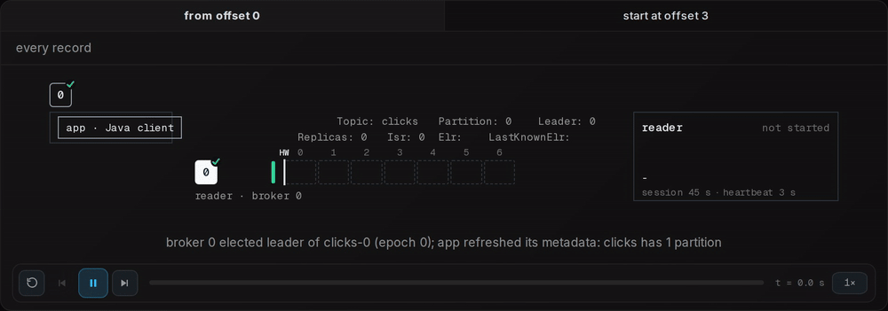
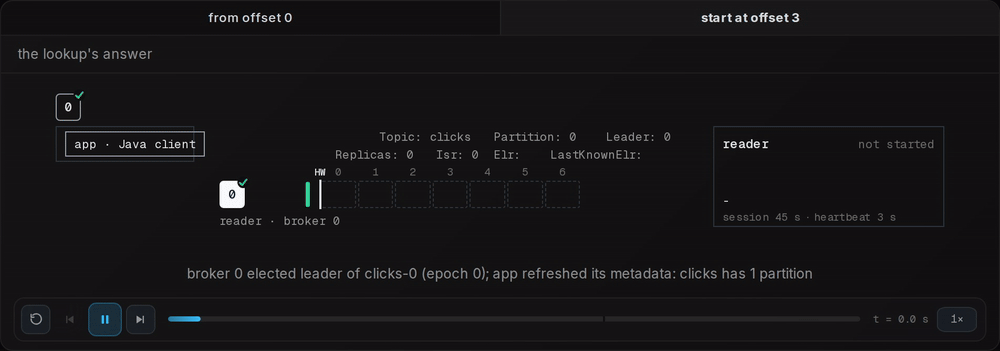
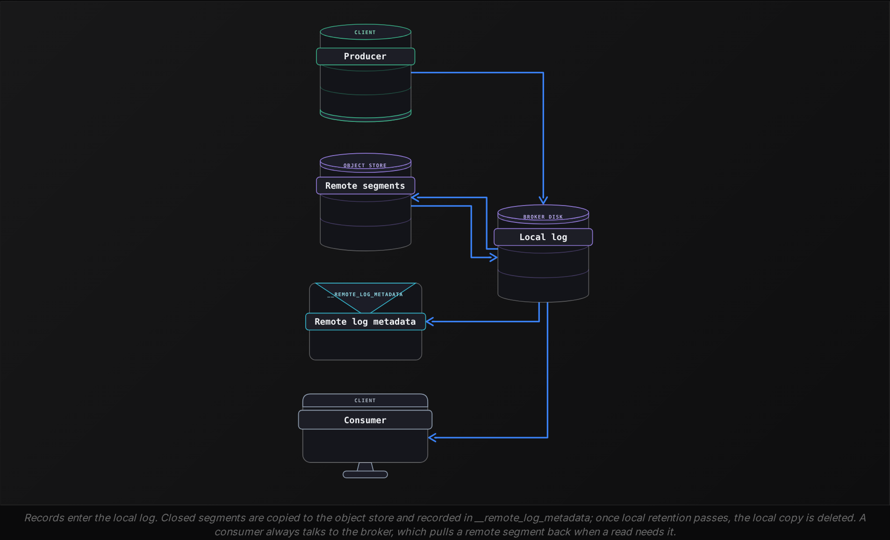

Advanced·[](https://kafka.apache.org/)·20 min · 8 challenges

# The Log: Advanced

At Uber, whose engineers wrote Kafka's tiered storage design, a trip-events topic set to keep 7 days has grown to 40. The disk graph climbs, the retention config is correct, and nothing is deleting. One partition holds 1 record stamped 3 years from now, and retention, segment rolling, lookups by time and the compaction lags all trust it. Tiered segments and oversized records stretch the same log further.


<br>

---

## When Compaction Runs

[Log Compaction Details](https://kafka.apache.org/44/design/design/#log-compaction-details)[min.cleanable.dirty.ratio](https://kafka.apache.org/44/configuration/topic-configs/#topicconfigs_min.cleanable.dirty.ratio)

The intermediate lesson ended with a promise: a compacted topic keeps the latest value for every key. It said nothing about when. Right after a producer writes a new value for key `u42`, the partition holds the old value and the new one, and a reader that starts at offset 0 sees both. Removing the old one is the job of the log cleaner, a pool of threads inside the broker, and it runs on its own schedule under rules you set per topic.


<br>

### Clean, dirty and active

The cleaner sees each partition as 3 regions. The active segment, where new records are appended, is never touched. Everything before it is either clean, meaning the cleaner has already passed over it and it holds at most 1 value per key, or dirty, meaning records have arrived since the last pass. The boundary is 1 offset per partition, saved in a file named `cleaner-offset-checkpoint` in each log directory, so it survives a restart.

| segment file | offsets | region | values per key |
| --- | --- | --- | --- |
| 00000000000000000000.log | 0 to 999 | clean | at most 1 |
| 00000000000000001000.log | 1000 to 1799 | dirty | any number |
| 00000000000000001800.log | 1800 to 2399 | dirty | any number |
| 00000000000000002400.log | 2400 and up | active | any number, never cleaned |


<br>

### The dirty ratio decides whether a pass is worth it

Rewriting segments costs a full read and a full write of their bytes, so the cleaner runs on a partition only once its dirty region has grown enough to pay for that. The measure is the dirty ratio: dirty bytes divided by clean plus dirty bytes, with the active segment left out. Say the clean segment in the table holds 100 MB and the 2 dirty segments hold 60 MB and 40 MB. The ratio is 100 divided by 200, which is 0.5. The topic setting `min.cleanable.dirty.ratio` defaults to 0.5, so this partition qualifies by a hair. When a cleaner thread wakes, it looks across every compacted partition on the broker, takes the eligible one with the highest ratio, cleans it, then looks again; if nothing qualifies it sleeps for `log.cleaner.backoff.ms`, 15 seconds by default.

```sql
def cleanable(clean_bytes, dirty_bytes, min_ratio=0.5):
    total = clean_bytes + dirty_bytes
    if total == 0:
        return False
    return dirty_bytes / total >= min_ratio

print(cleanable(100_000_000, 100_000_000))
print(cleanable(100_000_000, 20_000_000))
```


<br>

### Lag settings bound the timing from both sides

When a pass may happen is bounded by 2 topic settings. `min.compaction.lag.ms`, default 0, keeps records out of the dirty region until their timestamps are that old: a reader that needs every change from the last 10 minutes sets it to 600000 and knows nothing younger is deduplicated. The cleaner stops at the first segment whose largest timestamp is younger than the lag, so 1 record stamped a year ahead stalls its segment and every later one. `max.compaction.lag.ms`, with a default so large it never fires, forces the opposite. Once the oldest dirty record is older than it, the partition becomes eligible whatever its ratio, so a topic that receives a trickle of writes still compacts inside a known window. A partition with a ratio of 0.1 and a 2 day old dirty record is cleaned because of the max lag; a partition with a ratio of 0.9 whose dirty records are all 3 minutes old waits because of the min lag.


<br>

### What one pass does

A pass has 2 phases. First the cleaner reads the dirty region into an offset map that holds, for each key, the highest offset at which that key appears. The map lives in memory sized by `log.cleaner.dedupe.buffer.size`, 128 MB by default; when the dirty region holds more keys than fit, the pass covers only the prefix that fits and the rest waits for the next pass. Second it reads the clean and dirty segments from the start, copies into a new file each record whose offset is the one in the map for its key, and swaps the new file in for the group it replaced. Offsets never change. A reader positioned at offset 1500 resumes at 1500 even if 1500 itself was removed: the fetch returns the first surviving record after it.

*A tombstone survives the pass that first reads it. That pass writes a deletion horizon beside it, and a later pass, once delete.retention.ms has elapsed past that horizon, drops it.*

> Why an old value is still there
>
> - The active segment is never compacted, so the newest duplicates survive until it rolls.
> - A dirty ratio under min.cleanable.dirty.ratio means the cleaner skips the partition.
> - Records younger than min.compaction.lag.ms are not yet dirty.
> - Another partition with a higher ratio goes first, and log.cleaner.threads defaults to 1.

> **TIP**
>
> The broker's `log-cleaner.log` lists each finished pass: the partition, when it ran, and the bytes read and written. It never says why a partition was skipped: work that out from its dirty ratio, lag settings and segment ages.

Try it. The drill below hands you 1 partition and the settings above; strike the records the cleaner has removed by the clock it shows.


<br>

---

## Two Kinds of Timestamp

[message.timestamp.type](https://kafka.apache.org/44/configuration/topic-configs/#topicconfigs_message.timestamp.type)[KIP-32 Record Timestamps](https://cwiki.apache.org/confluence/display/KAFKA/KIP-32+-+Add+timestamps+to+Kafka+message)

Every record carries 1 timestamp: a 64-bit count of milliseconds since the epoch, stored in the record itself on disk. Whose clock it came from is the topic setting `message.timestamp.type`, which has 2 values. `CreateTime`, the default, keeps what the producer sent: the producer's own clock at the moment the record was built, unless the application set an explicit value such as the time a sensor took its reading. `LogAppendTime` discards that and stamps the record with the broker's clock as the record is appended to the log.

| ✓ CreateTime (default) | ✗ LogAppendTime |
| --- | --- |
| • Stamped by the producer, or by the application if it sets one<br><br>• Can go backwards between neighbouring records<br><br>• Preserves when the event happened<br><br>• Trusts every producer's clock | • Stamped by the broker as it writes the record<br><br>• Never decreases within a partition<br><br>• Records when the broker received it, and nothing else<br><br>• Ignores the producer's clock and any value the application set |

```sql
message.timestamp.type = LogAppendTime
```

The choice decides what the number means. Under CreateTime, the timestamp at offset 122 can be earlier than the one at 121, because 2 producers with clocks 4 seconds apart, or 1 producer resending after a network stall, append in an order their clocks did not agree on. Under LogAppendTime the stamps in a partition never decrease, because 1 clock assigns them in append order. The cost is that the moment the event happened is gone unless the application carries it inside the value. LogAppendTime suits topics where only arrival order and arrival time matter, such as feeds from devices whose clocks nobody maintains.


<br>

### The time index

Beside each segment's offset index sits a second file ending in `.timeindex`, a list of (timestamp, offset) pairs. The broker appends an entry about every `index.interval.bytes` of data, 4096 bytes by default, and only if the record's timestamp is larger than every timestamp already in that segment's index. The entries therefore increase even on a CreateTime topic whose records do not.

Records in segment 120

| offset | timestamp |
| --- | --- |
| 120 | 10:00:00 |
| 121 | 10:00:04 |
| 122 | 10:00:02 |
| 123 | 10:00:09 |
| 124 | 10:00:07 |
| 125 | 10:00:15 |

Entries in 00000000000000000120.timeindex

| timestamp | offset |
| --- | --- |
| 10:00:00 | 120 |
| 10:00:09 | 123 |
| 10:00:15 | 125 |


<br>

### Finding an offset by time

A lookup asks for the earliest offset whose record is stamped at or after a time T. The broker first chooses a segment: the earliest one whose largest timestamp is at or after T. Within it, a binary search over the time index finds the entry with the largest timestamp not after T, and the broker scans forward from that entry's offset, reading records, until one is stamped at or after T. Take T = 10:00:05 in the tables. The entry is (10:00:00, 120). The scan reads 120, 121, 122 and 123, and stops at 123 because 10:00:09 is the first stamp at or after 10:00:05. Offset 124, stamped 10:00:07, comes after T in value but sits after 123 in position, so a reader that starts at 123 receives it. That is the guarantee a lookup gives: every record stamped at or after T lies at or after the returned offset, while records stamped before T may still lie after it.

Under LogAppendTime the scan after the binary search is short, because stamps increase with offsets, and the answer is exact to the broker's clock. Under CreateTime the answer is only as good as the producers' clocks: a producer running 10 minutes slow writes records that a lookup for the real time places at the wrong offset, and no index can repair that after the fact.

On the command line, kafka-get-offsets.sh --bootstrap-server broker1:9092 --topic clicks --time 1762250405000 prints that offset for every partition of the topic, and a consumer gets the same answer from its offsetsForTimes call. In place of a time you can pass 3 words: earliest returns the first offset still in the log, latest the offset after the last record, and max-timestamp the offset of the record with the largest timestamp.

The animation sends the same 6 records from offset 0, each tile showing its stamp's seconds, so :09 sits at offset 3. One run starts a reader at offset 0; the other starts it at offset 3, the lookup's answer for 10:00:05. Watch which records each run receives.

**from offset 0**



**start at offset 3**



> Where the timestamp is read again
>
> - Time retention measures a segment's age by its largest timestamp (next section).
> - A segment rolls on segment.ms measured from its first record's timestamp.
> - Readers that window events by time, and tools that replay from a time, read it.

| ✓ Do | ✗ Don't |
| --- | --- |
| • Set the timestamp explicitly when the event time is known, so CreateTime means event time<br><br>• Use LogAppendTime on topics where producer clocks are untrusted<br><br>• Run kafka-get-offsets.sh with --time before replaying from a date | • Assume CreateTime stamps increase along a partition<br><br>• Read a lookup's result as 'only records after T'<br><br>• Change message.timestamp.type on a live topic without telling its readers |


<br>

---

## Timestamps from the Future

[message.timestamp.after.max.ms](https://kafka.apache.org/44/configuration/topic-configs/#topicconfigs_message.timestamp.after.max.ms)[message.timestamp.before.max.ms](https://kafka.apache.org/44/configuration/topic-configs/#topicconfigs_message.timestamp.before.max.ms)

Time retention deletes a closed segment once it is old enough, and the broker decides age with the segment's largest timestamp: a segment is eligible when now minus its largest timestamp exceeds `retention.ms`, checked every `log.retention.check.interval.ms`, 5 minutes by default. Under CreateTime that largest timestamp is whatever the most forward-running producer clock claimed. One record stamped 3 years ahead raises its segment's largest timestamp by 3 years, and the segment stays on disk until the real clock catches up to that stamp plus the retention.

| segment | offsets | largest timestamp | age at 12 Mar 2027 09:00 | deleted with retention.ms = 7 days? |
| --- | --- | --- | --- | --- |
| 0 | 0 to 9999 | 28 Feb 2027 23:58 | 11d 9h | yes |
| 10000 | 10000 to 19999 | 1 Mar 2027 23:59 | 10d 9h | yes |
| 20000 | 20000 to 29999 | 14 Mar 2030 11:20 | 3 years in the future | no, until 21 Mar 2030 |
| 30000 | 30000 to 39999 | 3 Mar 2027 23:57 | 8d 9h | no, stuck behind 20000 |
| 40000 | 40000 and up | 12 Mar 2027 08:59 | active | never while active |

Deletion walks the segments from the front and stops at the first one that is not old enough. Segment 20000 is stamped 3 years in the future, so it is never old enough, and segment 30000 behind it, which on its own is 8 days old and past the 7 day retention, is kept as well. Every segment appended after the future record is kept with it. One record of a few hundred bytes has turned a 7 day topic into one that keeps everything, and the disk fills at the partition's full write rate until somebody notices. Size retention, `retention.bytes`, still applies, because it counts bytes rather than reading stamps.


<br>

### The guard, and when it is loosened

The broker refuses records that claim a time too far from its own clock, and 2 topic settings draw the window: `message.timestamp.after.max.ms`, default 3600000, 1 hour, rejects a record stamped further ahead than that, and `message.timestamp.before.max.ms`, with a default so large it never fires, would reject one stamped further behind. A rejected record fails the write with `InvalidTimestampException`, so the producer sees it and the log stays clean. With the defaults, the worst a future stamp can do is hold a segment 1 hour longer. The damage in the table needs the after window widened, which teams do when applications stamp records with a scheduled time, such as a reminder due next month, and then forget that retention reads the same field. Both settings apply only under CreateTime; LogAppendTime makes the broker's clock the stamp, so there is nothing to check.

```sql
message.timestamp.after.max.ms=3600000
message.timestamp.before.max.ms=9223372036854775807
```


<br>

### Records from the past expire early

The before window defaults to open because replays are routine: a producer re-reads 3 days of events from a file and writes them with their original timestamps. Under CreateTime those stamps stay, and if the topic's retention is 24 hours, every segment the replay fills is already older than the retention the moment it closes. The next retention check, within 5 minutes, deletes it. A reader that is 10 minutes behind the replay finds the offsets it wanted gone and starts again from the earliest offset the log still has. The replay looked like it worked, and the data was in the log for less time than it took to write it. The fixes are to raise `retention.ms` for the replay's duration, or to run the replay into a topic set to LogAppendTime, or to keep the original time inside the value and let the record's stamp be the time of the replay.


<br>

### Rolling and lookup trust the stamp too

The same field feeds 2 more mechanisms. Time-based rolling measures from a segment's first stamp, so a segment that opens with a future-stamped record never rolls on `segment.ms` while new stamps trail it; it rolls on `segment.bytes` or waits. The time index records only stamps larger than any before them in the segment, so after the future record at offset 20000 no entry is added, and a lookup for any time from 2 Mar 2027 to 2030 picks the segment holding 20000, scans to it, and returns 20000. A reader that asks for 'everything since yesterday' is handed more than 10 days of data in place of 1.

LogAppendTime would not repair this: it stamps only later appends, and segment 20000 keeps its 2030 stamp. Set `message.timestamp.after.max.ms` back to 1 hour, then run `kafka-delete-records.sh --bootstrap-server broker1:9092 --offset-json-file delete.json`, the file naming partition 0 at offset 30000. The log's first offset moves to 30000, and the next check deletes segment 20000, whose other records were already past retention, with segment 30000 behind it, so lookups read real stamps again. A compact-only topic refuses the command; there, or where current records share the bad segment, copy the records into a new LogAppendTime topic.

> A timestamp out of line, 4 effects
>
> - Retention: a future stamp blocks deletion of its segment and every segment after it.
> - Retention: a past stamp lets a segment be deleted the moment it closes.
> - Rolling: a future first record delays the time-based roll.
> - Lookup: a future stamp swallows every later time index entry in its segment.

> **TIP**
>
> Alert on the gap between a partition's max-timestamp offset and its latest offset. On a healthy CreateTime topic they are within a few records of each other; a gap of thousands means a stamp is holding the segment.

The drill below gives you a partition with 1 future stamp in it; strike the records retention has deleted at the clock shown.


<br>

---

## Tiered Storage

[Tiered Storage Overview](https://kafka.apache.org/44/operations/tiered-storage/#tiered-storage-overview)[remote.storage.enable](https://kafka.apache.org/44/configuration/topic-configs/#topicconfigs_remote.storage.enable)

A partition that keeps 90 days at 2 TB a day needs 180 TB of broker disk, and broker disk is the costly kind: fast, local and sized for every partition the broker holds. Most of those bytes are read once, by the readers who keep up, and then sit until retention deletes them. Tiered storage moves closed segments off the broker to an object store, a system that holds files cheaply and serves them over the network at some latency, while the topic keeps reading as 1 log. A reader asking for offset 0 still gets offset 0; the broker fetches the segment from the store and hands the records over.




<br>

### A local retention and a total retention

Enabling it adds a second retention to the topic. `retention.ms` and `retention.bytes` keep their meaning: how much the topic holds in total, local and remote together. `local.retention.ms` and `local.retention.bytes` say how much of that stays on the broker's disk; their default, -2, means the same as the total, which is the same as not tiering at all. A topic with `retention.ms` of 90 days and `local.retention.ms` of 1 day holds 1 day of segments on fast disk and all 90 days in the store. Reads inside the last day are served from local files; reads older than that wait for a fetch from the store.

```sql
remote.storage.enable=true
retention.ms=7776000000
local.retention.ms=86400000
```


<br>

### A segment's life

| step | what happens | which copies exist |
| --- | --- | --- |
| 1 | Records append to the active segment | local only |
| 2 | The segment rolls and is now closed | local only |
| 3 | The broker copies the segment, its offset index and its time index to the store, and writes a record to __remote_log_metadata | local and remote |
| 4 | local.retention.ms passes since the segment's largest timestamp | remote only |
| 5 | retention.ms passes | none; the remote copy is deleted |

Step 3 happens shortly after the roll, and it is the step everything waits on. The local copy is deleted at step 4 only if step 3 completed, so a store that is unreachable for an hour means an hour of segments piling up on the broker past `local.retention.ms`, which is the right failure: data is never dropped to meet a local target. The active segment is never copied, whatever its age, because it is still being written. Each remote segment is known to the broker by a record in the internal topic `__remote_log_metadata`, saying which segment lives where and which offsets it covers, so a broker that restarts rebuilds its view of the store from that topic rather than listing the store.


<br>

### Reading from the store

A fetch that asks for an offset older than the local log's first offset becomes a remote read. The broker looks up the segment in its metadata, finds the position inside the segment using the remote copy of the offset index, which it caches locally under `remote.log.index.file.cache.total.size.bytes`, downloads the needed part of the segment, and returns records from it. The first such read on a cold segment takes the store's latency, tens to hundreds of milliseconds, in place of a local disk read; `remote.fetch.max.wait.ms` caps how long the broker waits on the store before answering the fetch with what it has. A lookup by time picks the remote segment by the largest timestamps in `__remote_log_metadata`, then waits on the store for its time index and records. A reader replaying from 60 days ago runs at the store's throughput, and a reader 10 minutes behind never touches it.

> What tiered storage will not do
>
> - Tier a compacted topic: cleanup.policy=compact cannot be combined with remote.storage.enable.
> - Copy the active segment, so local.retention.ms is a floor, not a ceiling, on local data.
> - Replace retention: retention.ms still deletes, now from the store.
> - Make old reads fast: a cold segment costs a round trip to the store.

Turning it off starts with `remote.log.copy.disable=true`, which stops new copies while remote reads keep working, and a topic can stay that way while its remote data is needed. `remote.storage.enable=false` then makes it local, and the broker accepts that only alongside `remote.log.delete.on.disable=true`, which deletes the remote segments, so a reader positioned in one must be moved first.

| ✓ Do | ✗ Don't |
| --- | --- |
| • Size local.retention.ms to cover the readers who replay routinely<br><br>• Monitor local disk against local.retention.ms; a gap means copies are failing<br><br>• Test a 60 day replay once to learn the store's throughput | • Tier a topic whose readers routinely rewind past the local window<br><br>• Treat retention.ms as free once bytes are remote<br><br>• Disable remote.storage.enable while a reader is positioned in a remote segment |


<br>

---

## Large Messages

[max.message.bytes](https://kafka.apache.org/44/configuration/topic-configs/#topicconfigs_max.message.bytes)[message.max.bytes](https://kafka.apache.org/44/configuration/broker-configs/#brokerconfigs_message.max.bytes)

Kafka's defaults assume a record under 1 MB. A bigger one is rejected by 2 limits, the producer's and the broker's or topic's, while 2 consumer limits only size fetches. They measure the record as serialized: key, value and headers together, plus the few dozen bytes of batch framing the broker wraps around it. A 3 MB image or a 2 MB JSON document with a base64 blob inside trips the first of them before leaving the producer, and raising that one only moves the failure to the next.

| setting | where | default | what it checks |
| --- | --- | --- | --- |
| max.request.size | producer | 1048576 (1 MiB) | the serialized size of a record, before it is sent |
| message.max.bytes | broker | 1048588 | the largest batch the broker accepts for any topic without its own limit |
| max.message.bytes | topic | 1048588 | the same check for 1 topic, overriding the broker's value |
| max.partition.fetch.bytes | consumer | 1048576 | how much a fetch asks for per partition; a bigger first batch is still returned |
| fetch.max.bytes | consumer | 52428800 (50 MiB) | how much a fetch asks for in total; a bigger first batch is still returned |


<br>

### Where a 3 MB record dies

Follow a 3 MB record. The producer serializes it, compares 3145728 bytes with `max.request.size`, and raises `RecordTooLargeException` without sending anything. Raise `max.request.size` to 4 MiB and the producer sends it; the broker compares the batch with the topic's `max.message.bytes` if one is set, else its own `message.max.bytes`, and answers with the error `MESSAGE_TOO_LARGE`, which the producer surfaces as the same exception. Set `max.message.bytes=4194304` on the topic as well and the record lands in the log. The consumer then needs nowhere near 3 MB of configuration to read it: since a fetch always returns at least the first batch of the first partition that has data, however large, the record arrives in a fetch of its own. What the consumer does need is memory for it, and a handler written for a payload 30 times its usual size.

The ceiling behind all of these is the broker's socket.request.max.bytes, 104857600, 100 MiB, the largest request of any kind it reads from a connection. A record that needs the limits raised toward that is a sign the record is the wrong unit, which is what the 2 patterns below are for.


<br>

### Pattern 1: the claim check

Store the payload somewhere built for payloads and send a record that points to it. The producer writes the 3 MB image to an object store under a key it chooses, then sends a small record carrying that key, the size, a checksum and the content type. The consumer reads the record, fetches the image by the key, verifies the checksum, and processes it. The log holds 300 bytes per event, every limit stays at its default, and readers that only need the metadata never download the image at all.

```sql
{
  "event_id": "img-7f3a",
  "store_key": "uploads/2027/03/12/7f3a.jpg",
  "bytes": 3145728,
  "sha256": "9b1c...e4",
  "content_type": "image/jpeg"
}
```

The pattern's cost is 2 lifetimes to keep in step. The record expires under `retention.ms`; the object expires under whatever rule the store applies. If the object is deleted first, a reader replaying the topic finds a pointer to nothing, so the store's retention must be at least the topic's, and a reader must treat a missing object as a case to handle rather than a crash.


<br>

### Pattern 2: chunking

When the payload must travel through the log, split it. The producer cuts the 3 MB into 4 chunks of under 1 MiB, sends each as its own record with the same key, so all 4 land in 1 partition in order, and puts a chunk id, an index and a total in the record's headers. The consumer collects chunks by id until the count matches the total, reassembles, and processes. Readers of the topic must all know the convention, and a reader that starts between chunk 2 and chunk 3 of a payload sees an incomplete set and must drop it.

```sql
def chunk_records(payload: bytes, key: str, chunk_id: str, size: int = 900_000):
    total = (len(payload) + size - 1) // size
    for index in range(total):
        headers = [
            ("chunk-id", chunk_id.encode()),
            ("chunk-index", str(index).encode()),
            ("chunk-total", str(total).encode()),
        ]
        yield key, payload[index * size:(index + 1) * size], headers
```

| ✓ Claim check | ✗ Chunking |
| --- | --- |
| • Log stays small; limits stay default<br><br>• Needs a second system and its retention<br><br>• Readers choose whether to fetch the bytes<br><br>• Payload can be any size | • Everything travels through the log<br><br>• Needs a convention every reader follows<br><br>• Readers must buffer and reassemble<br><br>• Payload bounded by retention and partition throughput |

> What a big record costs even when it fits
>
> - The broker's page cache holds fewer records, so readers that are behind fall to disk sooner.
> - A fetch that would have carried 1000 small records carries 1 large one, so throughput in records drops.
> - Retention by bytes expires more history for the same number of events.

| ✓ Do | ✗ Don't |
| --- | --- |
| • Raise max.message.bytes on the 1 topic that needs it rather than message.max.bytes on the broker<br><br>• Carry a checksum with any claim check or chunk set<br><br>• Keep the store's retention at least as long as the topic's | • Raise only the producer limit and expect the write to succeed<br><br>• Chunk across keys; chunks of 1 payload must share a partition<br><br>• Let a reader crash on a missing object or an incomplete chunk set |


<br>

---

## Putting It All Together

Uber's trip-receipt topic keeps a year for audit, tiered after 3 days, with readers that window receipts by event time. A quarter-end backfill of 2 million historical receipts, each a few megabytes with an embedded PDF, must land without expiring early, without holding retention open, and without tripping a size limit anywhere on the path.

- The PDF goes to the object store with a claim check in the record, so the backfill never meets max.request.size or max.message.bytes.
- The historical receipts keep their event time inside the value, and the topic runs LogAppendTime, so the stamp is the backfill's time and retention neither deletes them early nor stalls on a stray future stamp.
- Each backfill segment is copied to the store shortly after it rolls, and its local copy is deleted once the 3 days of local.retention.ms pass; the audit reader fetching it next year pays the store's latency, served through the same broker as 1 log.
- A reader that restarts from the moment the backfill began uses a lookup by time, which the broker's stamps make exact.
- The partition that holds per-trip latest state is compacted on its own topic, where the dirty ratio and the lags decide when the superseded receipts leave.


<br>

---

## Key Takeaways

- The cleaner skips a partition until its dirty ratio, min lag and max lag say otherwise, and it never touches the active segment.
- CreateTime is the producer's clock and can run backwards; LogAppendTime is the broker's and cannot.
- A lookup by time returns the earliest offset stamped at or after T; records stamped before T can still follow it.
- Retention deletes from the front and stops at the first segment not old enough, so 1 future stamp keeps every segment after it.
- Tiered storage copies closed segments to a store, deletes local copies after local.retention.ms, and reads old offsets back through the broker.
- Limits at the producer, broker, topic and consumer size a record; the claim check and chunking keep records under them.

[](https://kafka.apache.org/)

Official Apache Kafka resourcesversion 4.4

"Apache Kafka is an open-source distributed event streaming platform used by thousands of companies for high-performance data pipelines, streaming analytics, data integration, and mission-critical applications." [kafka.apache.org](https://kafka.apache.org/)

[Documentation](https://kafka.apache.org/44/)[Quickstart](https://kafka.apache.org/quickstart/)[Download](https://kafka.apache.org/community/downloads/)[Community](https://kafka.apache.org/community/)

In the documentation

When Compaction Runs
:   [Log Compaction Details](https://kafka.apache.org/44/design/design/#log-compaction-details)[min.cleanable.dirty.ratio](https://kafka.apache.org/44/configuration/topic-configs/#topicconfigs_min.cleanable.dirty.ratio)

Two Kinds of Timestamp
:   [message.timestamp.type](https://kafka.apache.org/44/configuration/topic-configs/#topicconfigs_message.timestamp.type)[KIP-32 Record Timestamps](https://cwiki.apache.org/confluence/display/KAFKA/KIP-32+-+Add+timestamps+to+Kafka+message)

Timestamps from the Future
:   [message.timestamp.after.max.ms](https://kafka.apache.org/44/configuration/topic-configs/#topicconfigs_message.timestamp.after.max.ms)[message.timestamp.before.max.ms](https://kafka.apache.org/44/configuration/topic-configs/#topicconfigs_message.timestamp.before.max.ms)

Tiered Storage
:   [Tiered Storage Overview](https://kafka.apache.org/44/operations/tiered-storage/#tiered-storage-overview)[remote.storage.enable](https://kafka.apache.org/44/configuration/topic-configs/#topicconfigs_remote.storage.enable)

Large Messages
:   [max.message.bytes](https://kafka.apache.org/44/configuration/topic-configs/#topicconfigs_max.message.bytes)[message.max.bytes](https://kafka.apache.org/44/configuration/broker-configs/#brokerconfigs_message.max.bytes)

Further
:   [KIP-405 Tiered Storage](https://cwiki.apache.org/confluence/display/KAFKA/KIP-405%3A+Kafka+Tiered+Storage)[max.compaction.lag.ms](https://kafka.apache.org/44/configuration/topic-configs/#topicconfigs_max.compaction.lag.ms)[Configuring The Log Cleaner](https://kafka.apache.org/44/design/design/#configuring-the-log-cleaner)

Apache Kafka, Kafka, and the Kafka logo are either registered trademarks or trademarks of The Apache Software Foundation in the United States and other countries.
