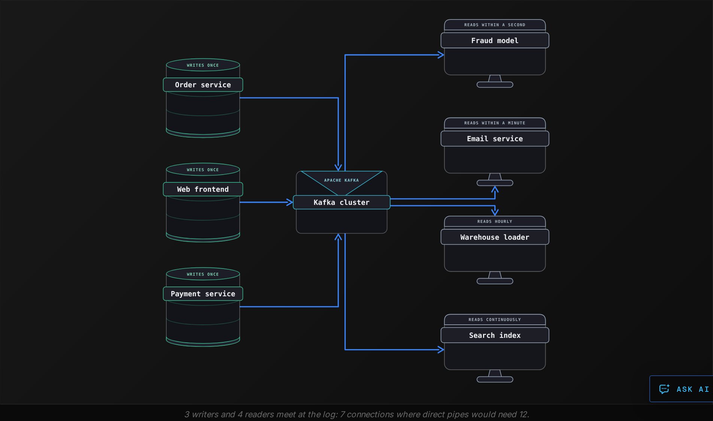
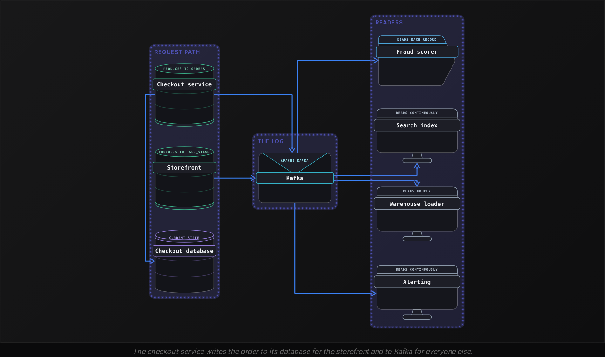

Beginner·[](https://kafka.apache.org/)·20 min · 6 challenges

# The Log: Beginner

Every page view at LinkedIn is activity data, and so is every search. Monitoring dashboards and the search team tuning relevance both want each event, and so do the overnight jobs that load the data warehouse. Building a separate pipe from every source to every reader stopped scaling, so LinkedIn built Kafka: one log each event is written to once, which every system reads at its own pace.


<br>

---

## What Kafka Is For

[Main Concepts and Terminology](https://kafka.apache.org/44/getting-started/introduction/#main-concepts-and-terminology)[Persistence](https://kafka.apache.org/44/design/design/#persistence)


<br>

### A fan-out problem

A company's data starts as events: a customer places an order, a page loads, a payment clears, a sensor reports a temperature. Each event is produced by one system and wanted by several. A sale the order service records is wanted by 4 other systems: the warehouse that packs it, the email service that confirms it, the fraud model that scores it, and the analytics tables that count it each night.

Connecting each system that produces events to each system that wants them works for 2 systems and fails at 10. Every pair needs its own pipe, its own format, its own retry logic and its own on-call owner. 5 producing systems and 6 wanting systems make 30 pipes. Adding a 7th reader means asking 5 teams to build a pipe to it, and when the fraud model goes down for an hour, the order service either holds its events for it or drops them.




<br>

### One log in the middle

Kafka puts a log between them. A log is a file that grows only at its end: a new record is written after the last one, and nothing already written is changed. The order service appends each order to the log once. The fraud model reads the log from wherever it left off, and so do the email service and the analytics job. The order service never learns how many readers exist, and a reader that was down for an hour reads the hour it missed when it comes back.

The name comes from the logs software has always kept: a database's write-ahead log, a web server's access log. Each is a file written in time order where every line is one thing that happened. Kafka takes that file, spreads it over a cluster of servers, and gives every system in the company a way to append to it and a way to read it.

Kafka's names for the roles: a **producer** appends records, a **consumer** reads them, and a **broker** is a server that stores the log on its disk. Brokers together form a **cluster**. A named log is a **topic**, such as orders or page_views, and a company runs hundreds of them.


<br>

### What kind of system that makes it

Kafka is a storage system first. A record a producer sends is written to disk on a broker and kept there whether or not anyone has read it. The default retention is 7 days, and a topic can set its own. That property is what the fan-out problem needed: because the record is stored, a reader doesn't have to be running at the moment the writer writes. Writing and reading are decoupled in time.

| ✓ A database table | ✗ A Kafka topic |
| --- | --- |
| • Holds the current state of each row<br><br>• An update overwrites the old value in place<br><br>• Answers a question about now: what is order 1042's status?<br><br>• Each reader runs a query, a fresh question each time | • Holds every event in the order it happened<br><br>• A new event is appended and nothing is overwritten<br><br>• Answers a question about history: what happened to order 1042, step by step?<br><br>• Each reader walks forward through the records from a position it chooses |

Each row of the comparison follows from the append-only rule. Because nothing is overwritten, the log is a history, and because the history is kept, any reader can walk it. A fraud model that shipped a bug on Tuesday can be pointed back to Monday's records and run again, and the order service does nothing to help.

> What Kafka is, in 3 claims
>
> - A durable store: records are written to disk and kept for days even if nobody reads them.
> - An ordered store: records stay in the order they were appended within one partition, which is a slice of a topic covered 2 sections from here.
> - A shared store: any number of readers read the same records, each at its own pace, and none of them changes the log.

The rest of the lesson takes these 3 claims in turn. The next section places the store among a company's other systems, the 2 after that open it up to see how it's ordered and what each record holds, and the last one returns to the shared store and what reading it does, and does not, do to the records.


> **TIP**
>
> When a colleague describes Kafka as a message queue, check the one behavior that separates the 2: a queue removes a message when a worker takes it, and Kafka keeps the record in place for every other reader and for the same reader tomorrow.


<br>

---

## Where Kafka Fits

[Main Concepts and Terminology](https://kafka.apache.org/44/getting-started/introduction/#main-concepts-and-terminology)[Adding and removing topics](https://kafka.apache.org/44/operations/basic-kafka-operations/#adding-and-removing-topics)


<br>

### The path an order takes

Trace one order at an online store. A customer pays, and the checkout service writes the order to its own database, which keeps the current state the storefront needs: the order exists, it is paid, it hasn't shipped. In the same request the checkout service produces a record to the orders topic. From that moment the order is in 2 places, and the 2 places serve different readers. The database serves the storefront's next page load. The topic serves everyone else.



Kafka sits between the systems that record what is happening and the systems that act on it or analyze it. On the left are services that answer user requests in milliseconds, so they write the event and move on. On the right are systems with their own clocks: a fraud scorer that wants each order within a second, a search index that updates within a minute, a warehouse load that runs every hour, and a report that runs once a night. The log lets each side keep its own clock.


<br>

### What the writing side relies on

- A fast write: the broker takes the record, acknowledges it, and the checkout service returns to the customer
- A single destination: one topic to write to, however many systems read it
- Durability: once acknowledged, the record is on a broker's disk and stays for days
- No knowledge of readers: adding or removing a reader changes nothing in the checkout service

The fraud team changes what the scorer consumes by changing the scorer. It reads orders, and nothing in checkout moves. When the scorer is replaced next year by a different system, the replacement reads orders too, from whatever position its team chooses, and the checkout service isn't told.


<br>

### What the reading side relies on

- Order: records within a partition arrive in the order they were appended
- Its own position: each reader decides where it starts and keeps its own place
- Independence: a slow or crashed reader costs the other readers nothing
- Replay: a reader can go back over records it already read

The warehouse loader that runs hourly reads an hour of records in one pass. The alerting system reads every record as it arrives, so it sits at the end of the log and waits for the next one. Both read the same topic and the same records, and the loader's 59 minutes of absence cost the alerting system nothing. A third team can start a reader tomorrow without a meeting with either of them. How each reader keeps its place is the subject of this lesson's last section.

Some systems stand on both sides. The fraud scorer reads orders and produces to a fraud_scores topic that the alerting system and the warehouse loader read in turn. A stream of events is often several topics long, each one a producer's output and a consumer's input, and the cluster holds all of them.

*A producer or consumer is given the addresses of a few brokers and learns the rest of the cluster from them, so it names a topic and never needs to know which broker holds it.*


<br>

### Where the data goes next

Kafka keeps days of recent history and serves it to readers in order. A question such as how many orders region West placed last quarter belongs to the warehouse, which a reader fills from the topic and keeps for years. The storefront's question, whether this order has shipped, belongs to the database the checkout service already writes. Kafka is the hand-off between the 2: everything that happens passes through it, and each system on the right takes what it needs and stores it in the shape it needs.

| System | What it holds | Who asks it |
| --- | --- | --- |
| Checkout database | The current state of each order | The storefront, on every page load |
| orders topic | Every order event, in order, for 7 days | Fraud scorer, search index, loaders, alerting |
| Data warehouse | Every order ever, as tables | Analysts and the nightly report |

*Nothing in this section ran a query against Kafka. Readers walk the log forward; questions about totals and joins are asked of the systems the readers fill.*


<br>

---

## The Partitioned Log

[Consumer Position](https://kafka.apache.org/44/design/design/#consumer-position)[Reads](https://kafka.apache.org/44/implementation/log/#reads)


<br>

### A topic is several logs

A topic is split into partitions, and each partition is its own log: an ordered sequence of records that grows at its end. The orders topic created with 3 partitions is 3 such sequences, numbered 0 through 2. When a producer sends a record, the broker appends it to the end of exactly one partition, and that is where the record lives from then on. Which partition is decided by the record's key, which the next section covers; this section is about what happens once it lands.

| Partition | Offset 0 | Offset 1 | Offset 2 | Offset 3 |
| --- | --- | --- | --- | --- |
| 0 | cart-7: placed | cart-7: paid | cart-2: placed |  |
| 1 | cart-4: placed | cart-4: paid | cart-4: shipped | cart-9: placed |
| 2 | cart-1: placed |  |  |  |

Each row reads left to right in time. Partition 1 holds 4 records and partition 2 holds 1, which is normal: partitions fill at different rates depending on what is sent to each. The columns line up on the page and nowhere else. Offset 2 of partition 0 and offset 2 of partition 1 were written at unrelated moments, and nothing in Kafka says which came first.


<br>

### Grows at the end, and only there

A partition accepts one kind of write: an append. The broker takes the record, writes it after the last record on disk, and hands back the position it got. Records are never inserted in the middle or edited after the write. They do not move, and reading one does not remove it. This is a rule about the storage, and it's what makes the rest cheap.

> What append-only makes cheap
>
> - Writes: the broker writes to the end of a file in sequence, the fastest pattern a disk has.
> - Reads: a reader asks for records from a position onward and receives one contiguous run of bytes.
> - Many readers: 10 readers of the same partition read the same bytes, which the operating system keeps in memory after the first read.
> - Bookkeeping: the broker keeps no per-record state about who has read what, because reading changes nothing.

Set that against the work a database does for one update: find the row through an index, lock it, write the new value, update every index that points at it. An append skips all of it. That's why a broker's write speed is bounded by how fast its disk writes in sequence, and why a single broker handles hundreds of thousands of small records a second on ordinary disks.


<br>

### An offset is a record's address

The position the broker hands back is the offset: a whole number, 0 for the first record ever written to the partition, and each record after it gets the next number. Offsets are assigned at append and never reused, so every record in a partition has a number no other record in that partition has or will have. Put the topic and partition together with the offset and you have a record's address, which names the same record to every broker and to every producer or consumer that uses it.

orders partition 1 offset 2 is cart-4: shipped for a reader on the fraud team and for a reader on the warehouse team. Both can say they have read through offset 2 of partition 1 and mean the same thing, and a reader that stops there tonight and asks for offset 3 tomorrow receives cart-9: placed, the record that followed.

Offsets are also how a reader keeps its place. A reader does not read a topic as a whole; it reads each partition from an offset, and after each record it has handled, its position in that partition is the offset of the next one. That position belongs to the reader, and reading never changes the log. A reader may ask the broker to store the number for it, which a later lesson covers, and the records stay as they were either way. 2 readers of the same partition hold 2 different numbers.


<br>

### Order holds inside a partition

Within one partition, a record at a lower offset was appended before a record at a higher offset, and a reader receives them in that order. Across partitions there is no such promise: partition 0 offset 3 may have been written before or after partition 2 offset 0. A topic's order is the order of each of its partitions, 3 orders for 3 partitions. When the whole story of one cart has to be read in sequence, every record of that cart must land in the same partition, and the record's key is what arranges that.

> **TIP**
>
> When reasoning about a topic, draw it as separate tapes, one per partition, each numbered from 0 at its left end. Every claim about order lives on one tape. A claim that needs 2 tapes is a claim Kafka does not make.


<br>

---

## What a Record Carries

[Record](https://kafka.apache.org/44/implementation/message-format/#record)[Record Header](https://kafka.apache.org/44/implementation/message-format/#record-header)


<br>

### 4 parts the producer sets, 2 the broker adds

A record is more than its payload. The producer fills in a key and a value, plus a timestamp and a list of headers, and the broker adds the partition the record landed in and the offset it got. The table lays out all 6, and the rest of the section walks through why each one is there.

| Part | Set by | Holds | There for |
| --- | --- | --- | --- |
| Key | Producer | Bytes, or empty | Picking the partition, so records about one thing stay together and in order |
| Value | Producer | Bytes | The event itself |
| Timestamp | Producer, by default | Milliseconds since 1970 | When it happened, and finding records by time |
| Headers | Producer | Pairs of a name and bytes | Facts about the record that are not the event |
| Partition | Broker | A number | Where the record landed |
| Offset | Broker | A number | The record's position in that partition |

Here is the record from the last section, offset 2 of partition 1, written out as a reader would print it. The key and value are bytes on the wire; the printout shows them decoded as text so they can be read.

```sql
{
  "topic": "orders",
  "partition": 1,
  "offset": 2,
  "timestamp": 1762516800000,
  "key": "cart-4",
  "headers": {
    "source": "checkout-service",
    "trace_id": "5f3a9c",
    "content_type": "application/json"
  },
  "value": {
    "cart_id": "cart-4",
    "status": "shipped",
    "carrier": "ground",
    "amount_cents": 4599
  }
}
```


<br>

### The key

The key is bytes the producer chooses, most often a string naming the thing the event is about: a cart id, a customer id, a device id. The producer client hashes the key to pick a partition before the record leaves it. Every record with key cart-4 hashes to the same number, so every record about cart 4 lands in partition 1, one after another. That is how the order of a partition becomes the order of a cart: placed, then paid, then shipped, received in that sequence by anyone reading partition 1.

A record can be sent with no key. The producer then spreads records across partitions for balance, and 2 records about the same cart may land in different partitions with no order between them. A key is the producer saying which records belong together, and the cost of leaving it empty is paid by every reader that needs them in sequence.


<br>

### The value

The value is the event, as bytes. Kafka never parses the bytes it stores and returns, so the producer and its readers have to agree on what they mean. They could be text or a JSON document, a number or an image. The orders producer sends a JSON object holding a cart id and a status, along with the carrier and the amount. A reader expecting that shape gets it; a reader expecting a different shape gets bytes it cannot use, and the broker raises no error, because the broker never looked. The agreement is between the teams, and a later lesson covers the tooling that writes it down.


<br>

### The timestamp

Each record carries a timestamp in milliseconds since 1 January 1970. The one in the printout, 1762516800000, is noon UTC on 7 November 2025. By default the producer stamps the record when it creates it, so the timestamp says when the event happened as the producer saw it. A reader can hand the broker a time and ask for the first offset at or after it, and start reading there. The offset says where a record sits in its partition; the timestamp says when it was made. 2 records can share a timestamp and never an offset.


<br>

### Headers

Headers are a list of name-value pairs carried alongside the value. Each name is a string and each header value is bytes. They hold facts about the record that aren't the event: which service produced it, the trace id that links it to a request, the format of the value, a version of the agreed shape. A reader that filters by those facts reads the headers and leaves the value unparsed, and a tool in the middle can add a header without understanding the payload. The same name may appear more than once in the list.

> Address and content
>
> - The address comes from 2 sides: the producer names the topic and its key picks the partition, then the broker assigns the offset.
> - The content is what the producer sets, the key and value along with the timestamp and headers, and the broker stores it as bytes it doesn't parse.
> - The broker reads a key only on one kind of topic a later lesson covers; on the topics here it stores the key untouched.
> - A reader receives the 3 parts of the address with the 4 of content and can quote the address back to anyone to name the record.

| ✓ Do | ✗ Don't |
| --- | --- |
| • Key each record by the thing whose order matters: one cart, one customer, one device<br><br>• Put the event itself in the value and keep transport facts out of it<br><br>• Keep headers small: a source name, a trace id, a content type | • Key by a field that changes during the story, such as order status<br><br>• Bury routing facts inside the value, where a filter must parse it to find them<br><br>• Send one form of key from one service and another form from a second for the same entity |

> **TIP**
>
> A record with an empty key is still a full record. Readers see null for the key but get the value and headers exactly as sent. The only thing lost is the promise that related records share a partition.


<br>

---

## Reading Does Not Delete

[Deletes](https://kafka.apache.org/44/implementation/log/#deletes)[The Consumer](https://kafka.apache.org/44/design/design/#the-consumer)


<br>

### A read is a copy, and the log is the original

A reader asks a broker for records from an offset, the broker sends it a copy of the bytes, and the log is as it was. Reading changes nothing on the broker: the record is at the same offset, with the same bytes, for the next reader and for the same reader an hour later. The broker removes records on its own schedule, by age, 7 days by default on a new topic, and whether a record has been read 0 times or 50 times plays no part in that decision.

| ✓ A queue | ✗ A Kafka partition |
| --- | --- |
| • A worker takes a message and the message is gone<br><br>• Each message has one reader<br><br>• A second system needs a second copy of the message<br><br>• Re-reading means the producer sends it again | • A reader copies a record and the record stays at its offset<br><br>• Each record has as many readers as show up<br><br>• A second system reads the same record at the same offset<br><br>• Re-reading means the reader moves its position back |


<br>

### Each reader keeps its own position

A position belongs to the reader, and moving it changes nothing in the log. A fraud scorer on the payments topic remembers it is at offset 4 of partition 0. A warehouse loader on the same partition remembers it is at offset 2, because it ran at 09:00 and read offsets 0 and 1. A new audit reader started this morning begins at 0, so the one log now has 3 positions on it, one per reader.

| Clock | Log, partition 0 | Scorer position | Loader position | Audit position |
| --- | --- | --- | --- | --- |
| 09:00 | offsets 0 to 3 | 4 | 2 | not started |
| 09:30 | offsets 0 to 6 | 7 | 2 | not started |
| 10:00 | offsets 0 to 6 | 7 | 7 | 0 |
| 10:05 | offsets 0 to 8 | 9 | 7 | 9 |

Position means the next offset the reader will ask for. At 09:00 the scorer has handled offsets 0 to 3 and will ask for 4. At 10:00 the loader wakes for its hourly run, reads offsets 2 to 6 in one request and moves to 7, records the scorer finished half an hour earlier. The audit reader starts at 0 and by 10:05 has read all 9 records, 7 of which were on disk before it existed. The log column only grows, and the 3 position columns move at 3 different rates.


<br>

### Starting positions

A reader that has no position yet chooses one. It can start at the oldest record the partition still holds, which is how the audit reader read history it was never running for. It can start at the end, receiving only records appended after it arrived, which is what an alerting system wants. Or it can name an offset, or hand the broker a time and start at the first record from that moment on. The choice is the reader's, and no other reader is consulted or affected.


<br>

### What many readers buy you

- A system added today reads the history it missed: it starts at the oldest record still kept and catches up
- A bug in a reader is fixed by re-reading: set its position back to Monday and run again
- Readers at different speeds share one producer: milliseconds for the scorer, an hour at a time for the loader
- A reader that crashes resumes from its own position and misses nothing the log still holds

Each of these solves the fan-out problem from the first section. The producer wrote once. The scorer took what it needed on its own schedule, as did the loader and the audit reader, and none of them could damage the others, because none of them could change the log.

The one limit is the age at which the broker deletes records. A reader that falls 8 days behind on a topic kept for 7 days has lost its oldest day, and that loss has nothing to do with what any other reader did. The rule that reading does not delete describes readers only; the broker still deletes records once they pass the retention age.

> **TIP**
>
> The broker setting behind the 7 days is log.retention.hours, whose default is 168. A topic can override it, and a later lesson covers how. For now, the figure to remember is that a reader has a week to catch up by default.


<br>

---

## Putting It All Together

A concert ticketing site opens sales for a stadium show at 10:00. 40,000 fans hit the checkout in 3 minutes, and every reservation, payment and release must reach the seat map, the fraud checker, the email service and the finance warehouse, while the checkout service itself has to answer each fan in under a second.

- The checkout service writes each seat event once to a tickets topic and returns to the fan; it never waits for the seat map or the warehouse, which is the decoupling in time from the first 2 sections.
- Each event is keyed by seat id, so the records for seat K-14 land in one partition in the order they happened, reserve before pay and pay before release, and the seat map applies them in the sequence the fan produced them.
- The fraud checker reads each record within milliseconds and the finance warehouse loads an hour at a time; both read the same offsets of the same partitions and neither slows the other.
- When the email service is found to have skipped 2 minutes of records, its team sets its position back to 10:04 by timestamp and re-reads, and the checkout service and every other reader notice nothing.
- A week later the records are deleted by age, having been read by 4 systems and changed by none of them.


<br>

---

## Key Takeaways

- Kafka replaces every pair of pipes between systems with one log that producers append to once and any number of consumers read.
- A record is written to a broker's disk and kept for days whether it has been read. Writers and readers can therefore run on different clocks.
- A topic is several partitions, each an append-only sequence, and order is promised within one partition and nowhere across them.
- A record's address is its topic and partition plus the offset the broker assigns, and it means the same record to every reader.
- A producer sets the key and value along with a timestamp and headers. The key picks the partition, so related records stay together and in order.
- Reading copies a record and leaves it in place, so each reader keeps its own position and the broker deletes only by age.

[](https://kafka.apache.org/)

Official Apache Kafka resourcesversion 4.4

"Apache Kafka is an open-source distributed event streaming platform used by thousands of companies for high-performance data pipelines, streaming analytics, data integration, and mission-critical applications." [kafka.apache.org](https://kafka.apache.org/)

[Documentation](https://kafka.apache.org/44/)[Quickstart](https://kafka.apache.org/quickstart/)[Download](https://kafka.apache.org/community/downloads/)[Community](https://kafka.apache.org/community/)

In the documentation

An Append-Only Log
:   [Main Concepts and Terminology](https://kafka.apache.org/44/getting-started/introduction/#main-concepts-and-terminology)[Persistence](https://kafka.apache.org/44/design/design/#persistence)

Topics and Partitions
:   [Main Concepts and Terminology](https://kafka.apache.org/44/getting-started/introduction/#main-concepts-and-terminology)[Adding and removing topics](https://kafka.apache.org/44/operations/basic-kafka-operations/#adding-and-removing-topics)

Offsets Mark a Position
:   [Consumer Position](https://kafka.apache.org/44/design/design/#consumer-position)[Reads](https://kafka.apache.org/44/implementation/log/#reads)

What a Record Carries
:   [Record](https://kafka.apache.org/44/implementation/message-format/#record)[Record Header](https://kafka.apache.org/44/implementation/message-format/#record-header)

Reading Does Not Delete
:   [Deletes](https://kafka.apache.org/44/implementation/log/#deletes)[The Consumer](https://kafka.apache.org/44/design/design/#the-consumer)

Further
:   [Commit Log](https://kafka.apache.org/44/getting-started/uses/#commit-log)[What is event streaming?](https://kafka.apache.org/44/getting-started/introduction/#what-is-event-streaming)

Apache Kafka, Kafka, and the Kafka logo are either registered trademarks or trademarks of The Apache Software Foundation in the United States and other countries.
