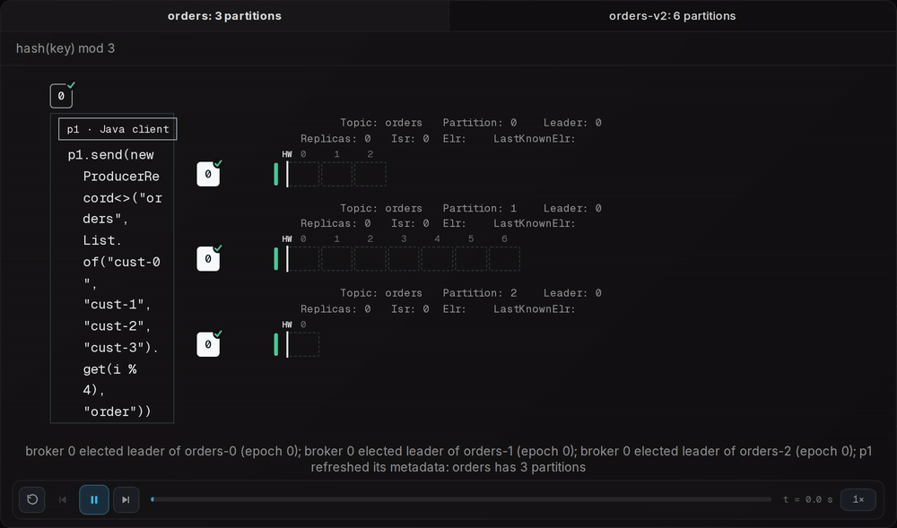
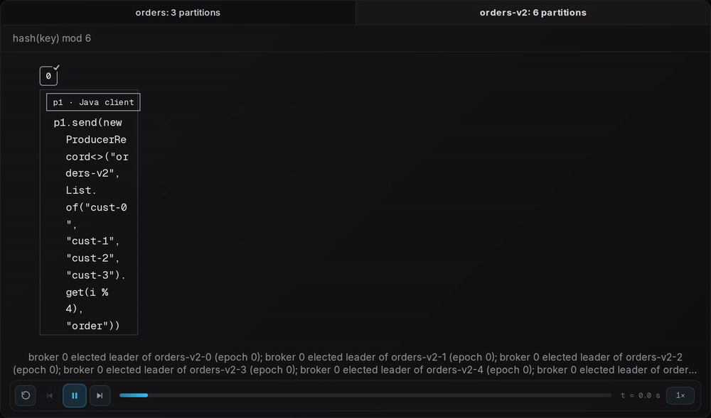

Intermediate·[](https://kafka.apache.org/)·20 min · 9 challenges

# The Log: Intermediate

At LinkedIn, where Kafka was written, a topic takes every edit a member makes to their profile, and a new search index needs each member's current headline and nothing older. A second topic takes page views and must hold 7 days, then let them go. Both are directories of segment files, and what those files keep, drop and split decides whether either job works.


<br>

---

## Segments on Disk

[Writes](https://kafka.apache.org/44/implementation/log/#writes)[segment.bytes](https://kafka.apache.org/44/configuration/topic-configs/#topicconfigs_segment.bytes)

The beginner lesson drew a partition as one tape of records numbered from 0. On the broker, the server that stores the partition, that tape is a directory. A topic `orders` with 3 partitions puts 3 directories under the broker's `log.dirs` path, named `orders-0`, `orders-1` and `orders-2`. Inside each directory the records sit in segments, and a segment is a small group of files named by the offset of the first record it holds. The listing below is `orders-0` after 2.4 million records of about 1 KiB each.


<br>

### What orders-0 holds on disk

| file | what is inside |
| --- | --- |
| 00000000000000000000.log | records 0 to 999,999, about 1 GiB |
| 00000000000000000000.index | offset to byte position, sparse |
| 00000000000000000000.timeindex | timestamp to offset, sparse |
| 00000000000001000000.log | records 1,000,000 to 1,999,999 |
| 00000000000001000000.index | its offset index |
| 00000000000001000000.timeindex | its time index |
| 00000000000002000000.log | records 2,000,000 onward, still growing |
| 00000000000002000000.index | its offset index |
| 00000000000002000000.timeindex | its time index |

Each `.log` name is the base offset of its segment, padded with zeros so the names sort as text in offset order. That number lets the broker pick the right file for any offset without opening one: to serve a read at 1,500,000 it takes the largest base offset at or below the target, which is 1000000, and goes to that segment. Offsets 0 to 999,999 live in the first file, and a reader positioned at 1,500,000 never touches it.


<br>

### Finding one offset inside a 1 GiB file

The second file, `.index`, maps offsets to byte positions inside the `.log`, and it is sparse: the broker adds an entry after every few kilobytes of appended data, not after every record. A lookup for 1,500,000 binary searches the index for the nearest entry at or below the target, seeks to that byte position in the `.log`, and scans forward a few kilobytes until it reaches the record. The `.timeindex` maps a timestamp to the offset of the first record at or after it, so a reader that asks for records since 09:00 is answered with an offset and then served through the `.index` like any other read. Neither index is the data: if one is missing or damaged the broker rebuilds it from the `.log` when it starts.

- **20** — digits in a segment file name
- **4,096 bytes** — between offset index entries
- **10 MiB** — default cap on an index file


<br>

### The active segment

Only the newest segment is written, and it is called the active segment. Every append goes to the end of its `.log`, and its 2 index files grow with it. When the active segment reaches `segment.bytes`, 1 GiB by default, or has been open for `segment.ms`, 7 days by default, the broker rolls: it closes the 3 files and opens a new segment whose base offset is the next offset to be written. A closed segment is never written again. Nothing is appended to it, and no record inside it is changed in place; the only things that ever happen to it are deletion as a whole and, on a compacted topic, being rewritten into a new file.

```sql
segment.bytes=1073741824
segment.ms=604800000
```


<br>

### Segment size sets how much a partition can delete at once

Because a closed segment is a sealed unit, the segment is the smallest amount of data a partition can give back. A partition with 1 GiB segments cannot drop 10 MiB of old records; it drops 1 GiB or nothing. How big a segment gets before it rolls depends on traffic, because the 2 settings race and whichever is reached first wins.

| bytes written per day to the partition | what rolls the segment | segment size at roll |
| --- | --- | --- |
| 50 GiB | segment.bytes, about 50 times a day | 1 GiB |
| 1 GiB | segment.bytes, about once a day | 1 GiB |
| 2 MiB | segment.ms, once a week | 14 MiB |

A busy partition fills segments by size, so its files are uniform and each holds a narrow window of time. A quiet partition holds a whole week in one file, and that file is the unit it can expire. The next section's timing arithmetic depends on knowing which row of this table a topic sits in.

> Reading a partition's directory
>
> - The number of .log files is the number of segments, and the one with the largest base offset is the active segment.
> - A .log name is the first offset it holds; the next .log name is 1 past the last offset it holds.
> - A closed .log far smaller than segment.bytes was rolled by segment.ms, which tells you the partition was quiet.
> - The .log alone is the data; the .index and .timeindex can be rebuilt from it.

> **TIP**
>
> `kafka-dump-log.sh --files /var/lib/kafka/orders-0/00000000000001000000.log --print-data-log` prints every record of that segment with its offset, size and timestamp, read straight from the file. Point it at a closed segment when you want to see a partition exactly as the broker keeps it.


<br>

---

## Retention by Time and Size

[retention.ms](https://kafka.apache.org/44/configuration/topic-configs/#topicconfigs_retention.ms)[retention.bytes](https://kafka.apache.org/44/configuration/topic-configs/#topicconfigs_retention.bytes)

Retention is the broker deleting old segments on a schedule, and 2 topic settings drive it. `retention.ms` is how long a record may stay, 7 days by default. `retention.bytes` caps the bytes a partition may hold, and its default of -1 means no cap. Both are enforced per partition, not per topic: a topic with 12 partitions and `retention.bytes` of 1 GiB holds about 12 GiB, plus up to 1 segment per partition on top, as the size rule below shows. Reading plays no part at all. A record fetched 1,000 times and a record never fetched expire at the same moment.

*A topic-level retention.ms overrides the broker-wide log.retention.ms and log.retention.hours, so set it on the topic, where the number sits next to the data it governs.*


<br>

### The time rule reads one timestamp per segment

Every `log.retention.check.interval.ms`, 5 minutes by default, a background thread visits each partition and walks its segments from oldest to newest. For each one it takes the largest timestamp the broker recorded among the records inside. If the clock minus that timestamp is more than `retention.ms`, the segment is deleted whole. The walk stops at the first segment young enough to keep, since later segments hold later records. If the walk reaches the active segment and it is past the window too, the broker rolls a fresh empty segment first and then deletes the old one, so a partition always keeps at least 1 segment and an empty one is never deleted.

| segment | oldest record | newest record | age of newest at Thu 09:10 | result with retention.ms = 3 days |
| --- | --- | --- | --- | --- |
| 00000000000000000000 | Fri 14:00 | Mon 08:00 | 3 days and 1 hour | deleted |
| 00000000000000420000 | Mon 08:01 | Wed 10:00 | 23 hours | kept, with its Monday records |
| 00000000000000910000 (active) | Wed 10:01 | growing | inside the window | kept |

The second segment keeps its records from Monday 08:01, which are past the window, because the rule reads only the newest timestamp in each segment and judges the whole segment by it. Those records leave on Saturday 10:00, or at the first check after it, when the segment's newest record turns 3 days old. The time rule alone never removes a record before `retention.ms`, and it rarely removes one at `retention.ms`. When `retention.bytes` is also set, the size rule can take a segment sooner, whatever its age.


<br>

### Four reasons the window is never exact

Where the gap between retention.ms and the real departure comes from

- **The segment rule** *whole files go, or stay*\
  A record leaves when the newest record in its segment is old enough. In a 1 GiB segment that can be hours or days after the record's own timestamp passed the window.
- **The check interval** *5 minutes by default*\
  A segment that becomes old enough at 09:01 waits for the check at 09:05, and longer if the interval has been raised on the broker.
- **The record's timestamp** *the record's own clock*\
  Age is measured from the timestamp the record carries, so the window is counted from the record's stamp rather than from the moment the broker wrote it.
- **The delete delay** *file.delete.delay.ms*\
  A deleted segment is first renamed with a .deleted suffix and its files are unlinked after file.delete.delay.ms, 1 minute by default, so the disk space comes back a minute after the check.


<br>

### The size rule is a ceiling that overshoots

`retention.bytes` is checked against the partition's total bytes, active segment included. A partition that has written less than the cap keeps everything. Once it passes the cap, the thread removes the oldest segment only while the partition would still hold at least `retention.bytes` after the removal, so deletion stops at the last point at or above the cap and the partition can sit up to 1 segment over it. With a 2 GiB cap and 1 GiB segments, a partition holding 3 closed segments and 512 MiB in the active one has 3.5 GiB. Removing the oldest leaves 2.5 GiB, still over the cap, so it goes. Removing the next would leave 1.5 GiB, under the cap, so it stays. The partition settles at 2.5 GiB and will not shrink further until more is written.

When both settings are on, a segment goes as soon as either rule says so. Neither limit is exact: the time rule removes a segment only after its newest record is older than `retention.ms`, and the size rule holds a partition at no more than `retention.bytes` plus 1 segment.

```sql
retention.ms=259200000
retention.bytes=2147483648
segment.bytes=268435456
```

A reader whose position sits inside a deleted segment cannot resume there: the records it was about to fetch are gone, and the earliest offset the partition can serve has moved up to the base offset of the oldest surviving segment. Lowering `retention.ms` on a live topic takes effect at the next check, so look at where the slowest reader stands before changing it.

| ✓ Do | ✗ Don't |
| --- | --- |
| • Size retention.bytes per partition and multiply by the partition count for the topic.<br><br>• Give short-retention topics smaller segments so expiry tracks the window.<br><br>• Leave headroom in retention.ms for the longest outage a reader may have. | • Expect disk to come back at the moment retention.ms passes.<br><br>• Count on reading to free space; only the clock and the byte cap do.<br><br>• Lower retention.ms on a live topic without checking the slowest reader. |


<br>

---

## Compacted Topics

[Log Compaction](https://kafka.apache.org/44/design/design/#log-compaction)[cleanup.policy](https://kafka.apache.org/44/configuration/topic-configs/#topicconfigs_cleanup.policy)

Some topics carry state rather than events. A topic of customer addresses keys each record by customer id and carries the current address as the value. The 5th address `c-7` sent makes the earlier 4 worthless, but the delete policy would also drop the 5th once it turned 7 days old, and a reader building a table of addresses would then find `c-7` missing. `cleanup.policy=compact` changes what a partition keeps: for each key, the record with the highest offset is never removed, and older records with the same key may be. A reader starting at offset 0 receives every key's latest value, however old it is, and the partition's size tracks the number of distinct keys rather than the number of writes.


<br>

### One partition, before and after a cleaning pass

Before

| offset | key | value |
| --- | --- | --- |
| 0 | c-7 | Oslo |
| 1 | c-2 | Lima |
| 2 | c-7 | Bergen |
| 3 | c-9 | Quito |
| 4 | c-2 | Cusco |
| 5 | c-7 | Tromso |
| 6 | c-4 | Pune |
| 7 | c-9 | Loja |

After

| offset | key | value |
| --- | --- | --- |
| 4 | c-2 | Cusco |
| 5 | c-7 | Tromso |
| 6 | c-4 | Pune |
| 7 | c-9 | Loja |

The pass left 4 records, 1 per key, and each kept the offset it was written at. Offsets 0 to 3 no longer exist, and a reader that asks for offset 1 is handed the record at 4, the next offset the partition has. The survivors stay in their original order, so `c-2` at 4 still comes before `c-7` at 5. Compaction never creates or moves a record; it only leaves some out when it rewrites a segment.


<br>

### Where the cleaning stops

The work is done by the log cleaner, a background thread on the broker, and it rewrites closed segments only: it reads a closed segment, copies the records that are the latest for their key into a new segment file, and swaps the new file in for the old. The active segment is never cleaned, and a closed segment waits its turn, so at any moment a partition is a cleaned part at the front and an uncleaned tail at the back where a key can appear several times. A later lesson covers how the cleaner decides which segments to visit and when. Whatever that schedule is, the tail is always there, so a reader must expect repeated keys and keep the last value it sees for each.

| part of the partition | segments | what a key looks like there |
| --- | --- | --- |
| cleaned head | closed segments the cleaner has rewritten | at most 1 record per key |
| uncleaned tail | closed segments not yet visited, plus the active segment | every write, repeats and all |

After a pass, a segment that held 1 GiB of writes for 10,000 keys may hold 10 MiB, so the cleaner also merges small cleaned segments into one file to keep the directory from filling with tiny segments. A compacted partition's disk use therefore settles at roughly the size of 1 value per key, plus whatever the tail holds at the time.

*Cleaning is per partition, so the promise of 1 latest record per key holds only when every record for a key lands in the same partition, which the key itself arranges and the last section returns to.*


<br>

### What a compacted topic demands

> Rules the broker enforces on a compacted topic
>
> - Every record must carry a key. The broker rejects a keyless record with an invalid record error.
> - Per key, the record at the highest offset is kept. Only older records for that key can go.
> - Offsets are stable. Gaps appear where records were removed, and a reader skips over them.
> - The order of surviving records is the order they were written.
> - The tail is uncleaned, so one key can appear many times to a reader.

The policy is set per topic, at creation with kafka-topics.sh --create --bootstrap-server localhost:9092 --topic customer-addresses --partitions 6 --config cleanup.policy=compact or later with kafka-configs.sh. A topic may carry both policies, cleanup.policy=compact,delete: the cleaner keeps the latest value per key, and the retention thread still removes segments whose newest record is older than retention.ms, so a key that stops being written vanishes after the window.

| ✓ cleanup.policy=delete | ✗ cleanup.policy=compact |
| --- | --- |
| • Every record is an event and every one matters<br><br>• Size is bounded by time or by bytes<br><br>• A reader starting at 0 sees the last window<br><br>• Keys are optional | • Each record is the state of one key<br><br>• Size is bounded by the number of keys<br><br>• A reader starting at 0 sees every key's latest value<br><br>• Keys are required |

The reader-side rule that falls out of all this is short: apply records in offset order and let the later record for a key overwrite the earlier one. A reader written that way is correct against the cleaned head, the uncleaned tail, and a partition the cleaner has never visited, because in every case the record with the highest offset for a key is the one that wins.


<br>

---

## Tombstones and Deletes

[Log Compaction Basics](https://kafka.apache.org/44/design/design/#log-compaction-basics)[delete.retention.ms](https://kafka.apache.org/44/configuration/topic-configs/#topicconfigs_delete.retention.ms)

Compaction keeps the latest record for every key forever, so a customer who closes their account still has a current address in the topic a year later. There is no command that removes a key from a partition. The producer removes it by writing one more record: the same key with a null value, called a tombstone. To the cleaner the tombstone is the key's latest record, so the older values for that key are dropped on the next pass. To a reader it is an instruction: delete this key from whatever you are building.

```sql
producer.send("customer-addresses", key=b"c-7", value=None)
producer.flush()
```

The broker stores a tombstone like any other record. It has an offset, a timestamp and a key, and it sits in the active segment until that segment rolls. A reader fetching it receives a record whose value is null, which differs from a record whose value is an empty byte array; only the null form is a tombstone to the cleaner, and an empty value is kept as the key's latest value like any other.


<br>

### Why the tombstone must linger

Suppose the cleaner removed the tombstone in the same pass that removed the old values. A reader that was halfway through the partition, or offline for the night, would reach the end and never learn that `c-7` was deleted; its table would carry a stale address with nothing left in the topic to correct it. So the tombstone is kept after the values are gone, for `delete.retention.ms`, 24 hours by default, measured from the moment the cleaner first processed the segment that holds it. A later pass after that time removes it. A reader that reads through within the window sees the tombstone and deletes the key. A reader that arrives after it sees no record for `c-7` at all, and that is also correct: the key is absent.

| moment | what happens to c-7 | what a reader starting at 0 ends with for c-7 |
| --- | --- | --- |
| Mon 10:00 | tombstone written at offset 812, in the active segment | Oslo at 0, Bergen at 2, Tromso at 5, then the tombstone: no c-7 |
| Tue 02:00 | the segment holding 812 rolls and closes | no c-7 |
| Tue 03:00 | the cleaner rewrites that segment: offsets 0, 2 and 5 are dropped, 812 is kept and stamped with Tue 03:00 | only the tombstone: no c-7 |
| Wed 03:05 | a pass finds 812 older than delete.retention.ms and drops it | nothing for c-7: no c-7 |

Each row ends in the same state for a reader that starts from offset 0, which is the point of the design. The window matters for a reader that already holds `c-7` from an earlier read and comes back later: if it returns before Wednesday 03:05 it sees the tombstone and deletes the key; if it returns after, nothing in the topic mentions `c-7`, and the stale row survives in its table.


<br>

### What a reader does with each record

| record | reader's action on its table |
| --- | --- |
| key with a value | insert the key, or overwrite the value it already holds |
| key with a null value | delete the key |
| a key seen twice in the tail | apply both in offset order; the later one is the state |

A reader that skips null values, which some deserializers tempt it to do by failing on an empty payload, keeps every deleted key. Processing in offset order makes the rest work without special cases: in the Monday row above the tombstone sits in the active segment behind 3 live values the cleaner has not touched, and a reader applying each record in turn still finishes with `c-7` removed.

> **TIP**
>
> Set delete.retention.ms longer than the longest time a reader of the topic can be away, with margin. The cost is that a deleted key's tombstone occupies the partition for that long, so on a topic that deletes millions of keys a day the window is also a disk budget.


<br>

### What a tombstone does not do

> Limits of a tombstone
>
> - On a topic with the delete policy, a null value means nothing to the broker; the record stays until retention removes its segment.
> - A tombstone removes nothing by itself. The older values go when the cleaner next rewrites their segments.
> - A tombstone does not reset a key. Writing c-7 again later appends a new record at a new offset, and the key is back.
> - A tombstone in a different partition from the key's values removes nothing, because cleaning is per partition.


<br>

---

## Choosing a Partition Count

[num.partitions](https://kafka.apache.org/44/configuration/broker-configs/#brokerconfigs_num.partitions)[Modifying topics](https://kafka.apache.org/44/operations/basic-kafka-operations/#modifying-topics)

The partition count is set when a topic is created, and it decides order, parallel reading, placement and cleanup. Records are ordered within one partition and not across them. A partition is read in order by 1 reader at a time, so 8 partitions let 8 readers work at once while a 9th waits idle. Each partition is a directory on 1 broker, so the count decides how a topic's bytes and writes spread across the cluster. Expiry and compaction both work partition by partition too.

#### Spreading across brokers

A 6-partition topic on a 3-broker cluster puts 2 directories on each broker, so its disk and its writes split 3 ways. A 2-partition topic on the same cluster leaves 1 broker holding none of it. The count therefore also caps how many brokers a topic can use, which matters most for the hot topic whose disk and network a single broker could not carry.


<br>

### A key's partition depends on the count

A record with a key goes to the partition at `hash(key) mod partition count`, and the Java client computes that hash with murmur2. With 3 partitions, `cust-7` maps to the same partition every time, which is what lets a compacted partition hold the key's latest value and lets a reader see the key's records in order. Change the count to 4 and `hash mod 4` sends `cust-7` somewhere else. The animation sends the same 8 records, 4 keys, to 2 topics side by side: `orders` with 3 partitions and `orders-v2` with 4, or with 6 at the switch.

**orders: 3 partitions**



**orders-v2: 6 partitions**



Follow 1 key across the 2 topics. In `orders` its 2 records land together, and in `orders-v2` they land together again, though some keys sit on a different partition number than they do in `orders`. Either way a key's records stay together; only the directory that holds them changes. If `orders` were a topic's past and `orders-v2` its future at a higher count, a key that moved would be split across 2 directories.


<br>

### Adding partitions moves nothing

`kafka-topics.sh --alter --bootstrap-server localhost:9092 --topic orders --partitions 4` creates 1 new empty directory on a broker and tells producers that there are now 4 targets. No existing record moves, because the segments are closed files and compaction and retention are the only things that rewrite them. A key's history now lives in 2 places: its past in the partition it used to hash to, its future in the partition it hashes to now. For that key, 2 things break. Its order across the change is gone, since a reader working 2 partitions can be anywhere in one when it reads the other. And on a compacted topic, the old partition keeps the key's old value forever; a tombstone sent later goes to the new partition and removes nothing in the old one, so a reader rebuilding a table from offset 0 can finish with the stale value, depending on which partition it reads last.

The count can only go up. There is no command to merge partitions, because the records in the removed partitions would need new offsets, and offsets are fixed at write time. A topic that needs fewer partitions, or a compacted topic that needs more, is a new topic: create it with the right count, copy the records across, move the readers, then drop the old one.


<br>

### Picking the number

Start from throughput. Measure what 1 reader can process per second and what 1 partition can take, then divide the target rate by the smaller of the 2: 30 MB/s of writes with readers that handle 4 MB/s each needs 8 partitions to keep up, and 12 leaves room for growth without a change later. Then weigh what each partition costs. Every one is a directory with its own segments and 3 files per segment, so open files, index memory and the retention thread's work all scale with the count times the segments per partition. A topic of 1,000 partitions, each holding a week of 1 GiB segments rolled once a day, keeps about 7,000 segments and over 21,000 files on the cluster.

| topic | what drives the count | a count that fits |
| --- | --- | --- |
| 30 MB/s of order events, readers at 4 MB/s | reader parallelism, with headroom | 12 |
| an audit trail that must read in 1 global order | order | 1, and the throughput of 1 partition |
| a compacted table of 2 million keys | spreading keys across brokers, fixed for the topic's life | chosen once, with growth built in |

- **1** — default num.partitions
- **50** — partitions in __consumer_offsets

| ✓ Do | ✗ Don't |
| --- | --- |
| • Measure one partition's throughput and divide the target by it.<br><br>• Create with room to grow; 12 partitions on a small topic cost little.<br><br>• Treat a compacted topic's count as fixed; grow it with a new topic. | • Add partitions to a topic whose readers depend on per-key order.<br><br>• Create 1,000 partitions to be safe; each is a directory of files on a broker.<br><br>• Plan on shrinking a topic; the count only goes up. |


<br>

---

## Putting It All Together

LinkedIn's profile-edit topic and its page-view topic run on the same cluster. The profile topic is compacted and keyed by member id, so the search index rebuilds every member's current headline from offset 0, and a tombstone follows an account closure so that an index rebuilt 3 weeks later shows no trace of it. The page-view topic keeps 7 days with 256 MiB segments, which its traffic fills every few hours, so disk returns within hours of the window. Both counts were chosen at creation, because the profile topic's keys can never be rehashed without stranding old headlines in old partitions.

- The segment is the unit for everything after it: retention drops it whole, the cleaner rewrites it whole, and the active one is written and never cleaned.
- Retention's timing comes from segment size and the check interval, so the busy page-view topic's smaller segments bring departure close to 7 days.
- Compaction gives the search index a full current state from offset 0, and the tombstone's delete.retention.ms is what lets a reader that missed the deletion still see it.
- Compaction and tombstones work per partition, which is why the profile topic's partition count is fixed by the keys and cannot be raised in place.


<br>

---

## Key Takeaways

- A partition is a directory of segments; each segment is a .log with 2 sparse indexes, named by its first offset, and only the active one is written.
- Retention deletes segments whole, judged by the newest timestamp in each, on a 5-minute check, so the time rule never removes a record before retention.ms and usually removes it later.
- retention.bytes is a soft ceiling per partition: once it is passed, the partition keeps at least that much and at most 1 segment more.
- A compacted topic keeps the highest-offset record for each key, with stable offsets and gaps, and its uncleaned tail can show a key more than once.
- A tombstone is a key with a null value; it removes the key's older values on the next cleaning and stays for delete.retention.ms so a late reader still sees the delete.
- Partition count fixes which partition a key hashes to; adding partitions moves nothing and splits a key's history, and the count never goes down.

[](https://kafka.apache.org/)

Official Apache Kafka resourcesversion 4.4

"Apache Kafka is an open-source distributed event streaming platform used by thousands of companies for high-performance data pipelines, streaming analytics, data integration, and mission-critical applications." [kafka.apache.org](https://kafka.apache.org/)

[Documentation](https://kafka.apache.org/44/)[Quickstart](https://kafka.apache.org/quickstart/)[Download](https://kafka.apache.org/community/downloads/)[Community](https://kafka.apache.org/community/)

In the documentation

Segments on Disk
:   [Writes](https://kafka.apache.org/44/implementation/log/#writes)[segment.bytes](https://kafka.apache.org/44/configuration/topic-configs/#topicconfigs_segment.bytes)

Retention by Time and Size
:   [retention.ms](https://kafka.apache.org/44/configuration/topic-configs/#topicconfigs_retention.ms)[retention.bytes](https://kafka.apache.org/44/configuration/topic-configs/#topicconfigs_retention.bytes)

Compacted Topics
:   [Log Compaction](https://kafka.apache.org/44/design/design/#log-compaction)[cleanup.policy](https://kafka.apache.org/44/configuration/topic-configs/#topicconfigs_cleanup.policy)

Tombstones and Deletes
:   [Log Compaction Basics](https://kafka.apache.org/44/design/design/#log-compaction-basics)[delete.retention.ms](https://kafka.apache.org/44/configuration/topic-configs/#topicconfigs_delete.retention.ms)

Choosing a Partition Count
:   [num.partitions](https://kafka.apache.org/44/configuration/broker-configs/#brokerconfigs_num.partitions)[Modifying topics](https://kafka.apache.org/44/operations/basic-kafka-operations/#modifying-topics)

Further
:   [Constant Time Suffices](https://kafka.apache.org/44/design/design/#constant-time-suffices)[segment.ms](https://kafka.apache.org/44/configuration/topic-configs/#topicconfigs_segment.ms)

Apache Kafka, Kafka, and the Kafka logo are either registered trademarks or trademarks of The Apache Software Foundation in the United States and other countries.
